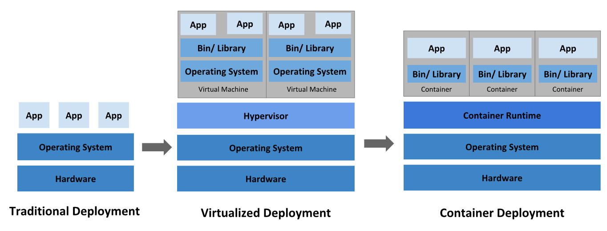
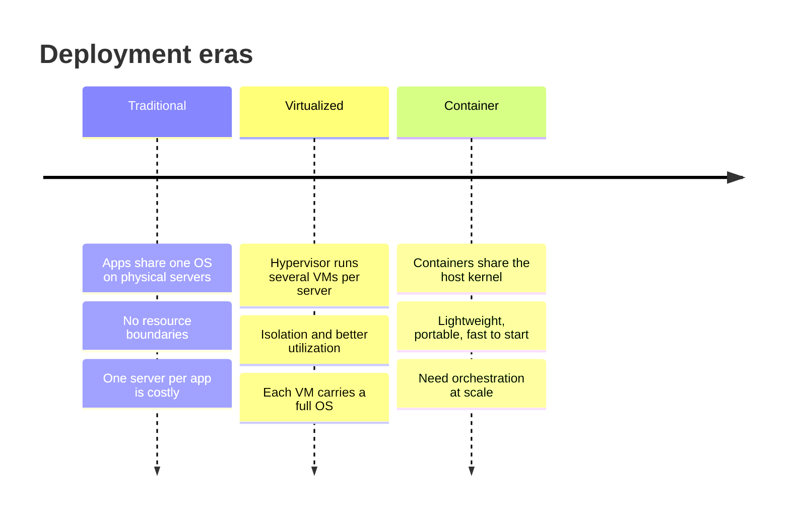
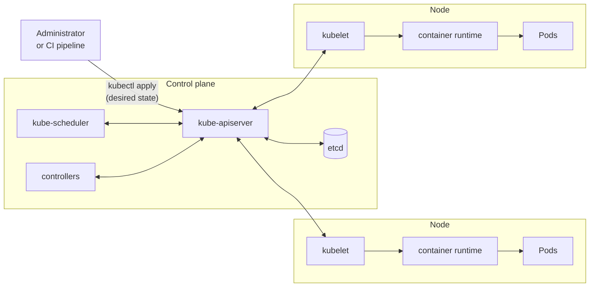
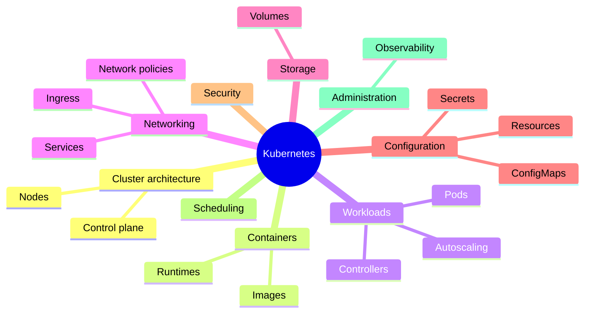

# What is Kubernetes

## Summary

Kubernetes is a portable, extensible, open source platform for running containerized workloads and services on a group of machines called a *cluster*. You describe the state you want (which containers, how many copies, how they are reached) through a declarative API, and a set of independent control loops keeps moving the cluster towards that state. Kubernetes handles placement, restarts, scaling, rollouts, service discovery and storage attachment, but deliberately leaves building code, choosing middleware and picking logging or monitoring tools to you.

## Prerequisites

- Basic Linux and networking knowledge (processes, ports, IP addresses, DNS).
- What a container is: see [Container fundamentals](../containers/container-fundamentals.md).

## Core concepts

### Definition

Kubernetes (often written *K8s*, eight letters between "K" and "s") is a container orchestration platform: it automates the deployment, scaling and management of containerized applications across many hosts. It has a large and fast growing ecosystem, and Kubernetes services, support and tools are offered by many vendors (see [Ecosystem](../ecosystem/README.md)).

Two properties distinguish it from simpler tools:

- **Declarative configuration.** You submit objects that describe a *desired state*. You do not submit a sequence of commands.
- **Automation through control loops.** Instead of a central orchestrator executing a workflow ("first do A, then B"), Kubernetes runs many independent *controllers*. Each one watches part of the cluster state and acts to close the gap between the desired and the actual state. The system therefore does not need a predefined orchestration sequence, which makes it easier to use and more resilient: if a step fails, the next iteration of the loop simply tries again.

### What Kubernetes is not

Kubernetes is often compared to a Platform as a Service (PaaS). It differs from a conventional PaaS because it operates at the container level rather than the hardware level. It offers features common to PaaS offerings (deployment, scaling, load balancing) and lets you plug in logging, monitoring and alerting solutions, but these are optional and pluggable. It is not monolithic: it provides the building blocks for developer platforms and preserves user choice. Concretely, Kubernetes:

- Supports a wide variety of workloads: stateless, stateful and data processing. If an application can run in a container, it should run on Kubernetes.
- Does not deploy source code and does not build applications. CI/CD workflows are left to the organization's preferences (see [CI/CD integration](../application-delivery/ci-cd-integration.md)).
- Does not provide application level services such as middleware, databases, caches or storage systems as built-in services. Such components can run on Kubernetes or be reached from it.
- Does not dictate logging, monitoring or alerting solutions. It provides integrations and mechanisms to collect and export metrics (see [Observability](../cluster-administration/observability/observability.md)).
- Provides a declarative API without imposing a configuration language. Manifests can be YAML, JSON, or generated by tools such as Helm, Kustomize or code.
- Does not provide a system for machine configuration, maintenance or self-healing of the hosts themselves. Operating system provisioning is outside its scope.
- Eliminates the need for orchestration in the narrow sense of "a defined workflow". Independent, composable control processes continuously drive the current state towards the desired state.

### From physical servers to containers

The following figure shows the three eras of application deployment that explain why Kubernetes exists. Look at what is shared in each column: the hardware, the operating system, or only the kernel.





**Traditional deployment era.** Applications ran directly on physical servers. There was no way to define resource boundaries, so one application could take most of the resources and starve the others. Running each application on its own server solved this, but servers were underused and expensive to maintain.

**Virtualized deployment era.** Virtualization lets one physical server run several virtual machines (VMs) on its CPU. VMs isolate applications from each other, which improves security (one application cannot freely read another's data) and resource utilization. Hardware becomes a cluster of disposable VMs, which simplifies adding and updating applications and reduces hardware costs. Each VM, however, runs a full operating system on top of virtualized hardware.

**Container deployment era.** Containers are similar to VMs but have relaxed isolation properties: they share the operating system kernel of the host. They are therefore lighter, start in seconds, and are portable across clouds and OS distributions because they are decoupled from the underlying infrastructure. Containers became popular because they provide:

- **Agile application creation and deployment.** Building a container image is easier and faster than building a VM image.
- **Continuous development, integration and deployment.** Images can be built and deployed reliably and often, with quick rollbacks, because images are immutable.
- **Separation of concerns between Dev and Ops.** Application images are built at build or release time, not at deployment time, which decouples applications from infrastructure.
- **Observability.** Not only OS level information and metrics, but also application health and other signals are surfaced.
- **Environmental consistency** across development, testing and production: the image runs the same on a laptop as in the cloud.
- **Cloud and OS distribution portability.** Images run on Ubuntu, RHEL, Flatcar (formerly CoreOS), on premises, on major public clouds and elsewhere.
- **Application-centric management.** The level of abstraction rises from running an OS on virtual hardware to running an application on an OS using logical resources.
- **Loosely coupled, distributed, elastic microservices.** Applications are split into smaller, independent pieces that are deployed and managed dynamically, not a monolithic stack on one large single-purpose machine.
- **Resource isolation**, which gives predictable application performance.
- **Resource utilization**: high efficiency and density.

Containers solve packaging. They do not solve running hundreds of them across dozens of machines, restarting them, connecting them and updating them without downtime. That is the job of a container orchestrator (see [Container orchestration](../containers/container-orchestration.md)).

### What Kubernetes provides

| Capability | What it means in practice | Home note |
| --- | --- | --- |
| Service discovery and load balancing | Containers are exposed by a DNS name or their own IP address. When traffic is high, Kubernetes distributes it across replicas so that the deployment stays stable. | [Services](../services-and-networking/services.md) |
| Storage orchestration | A storage system of your choice (local storage, public cloud providers and more) is mounted automatically. | [Volumes](../storage/volumes.md) |
| Automated rollouts and rollbacks | You describe the desired state of the deployed containers and Kubernetes changes the actual state at a controlled rate, for example by creating new containers, removing old ones and moving their resources to the new ones. | [Deployments](../workloads/workload-management/deployments.md) |
| Automatic bin packing | You give Kubernetes a cluster of nodes and tell it how much CPU and memory each container needs. It fits containers onto nodes to use resources well. | [kube-scheduler](../scheduling-preemption-and-eviction/kube-scheduler.md) |
| Self-healing | Failed containers are restarted, containers are replaced, containers that fail a user-defined health check are killed, and Pods are not advertised to clients until they are ready. | [Pod lifecycle](../workloads/pods/pod-lifecycle.md), [Probes](../workloads/pods/probes.md) |
| Secret and configuration management | Passwords, OAuth tokens and SSH keys are stored and updated without rebuilding images and without exposing secrets in the stack configuration. | [Secrets](../configuration/secrets.md), [ConfigMaps](../configuration/configmaps.md) |
| Batch execution | Batch and CI workloads run to completion, and failed containers are replaced if desired. | [Jobs](../workloads/workload-management/jobs.md) |
| Horizontal scaling | Applications are scaled with a command, a UI, or automatically based on CPU usage or other metrics. | [Horizontal Pod Autoscaler](../workloads/autoscaling/horizontal-pod-autoscaler.md) |
| IPv4/IPv6 dual-stack | Pods and Services get IPv4 and IPv6 addresses. | [IP address ranges and dual-stack](../services-and-networking/ip-address-ranges-and-dual-stack.md) |
| Designed for extensibility | Features are added to a cluster without changing upstream source code. | [Extending Kubernetes](../extending-kubernetes/extending-kubernetes-overview.md) |

### Kubernetes and Docker

"Kubernetes versus Docker" is a common but misleading comparison, because the two work at different levels. A container runtime runs containers on one host. Kubernetes decides *where* and *how many* containers run across many hosts and keeps them running.

The division of work on a node is:

1. When a Pod is scheduled to a node, the node's agent, the *kubelet*, asks the container runtime to pull the images and start the containers.
2. The runtime pulls, starts and stops the containers on that node.
3. The kubelet monitors the containers and reports their status to the control plane.

With Kubernetes, this automation replaces administrators who would otherwise start and manage containers by hand on each node.

**Common misconception.** Docker is often described as "the container runtime managed by Kubernetes". That was true when the kubelet talked to Docker Engine through a built-in adapter called *dockershim*. Dockershim was deprecated in v1.20 and removed in v1.24. Today the kubelet talks to any runtime that implements the Container Runtime Interface (CRI), usually containerd or CRI-O. Docker Engine can still be used through the external adapter `cri-dockerd`. Images built with Docker remain fully usable, because they follow the OCI image format. See [Docker](../containers/container-technologies/docker.md) and [Node components](../cluster-architecture/node-components.md).

### A Kubernetes cluster

A working Kubernetes deployment is called a *cluster*: a group of hosts that run containers. It has two parts: the *control plane* and the compute machines, called *nodes*.


- **Nodes.** Each node is its own Linux (or Windows) environment, either a physical or a virtual machine. Each node runs Pods, and Pods are made of containers.
- **Control plane.** It maintains the desired state of the cluster, such as which applications run and which images they use. It takes instructions from an administrator or a DevOps team (through the API) and relays them to the nodes.
- **Compute machines** actually run the applications and workloads.

The handoff from the control plane to the nodes works with many services that automatically decide which node is best suited for a task: the scheduler allocates resources and assigns Pods to a node to fulfill the requested work. *Services* decouple work definitions from Pods and automatically route requests to the right Pod, no matter where it moves in the cluster or whether it has been replaced.

The **desired state** of a cluster defines which applications or other workloads should run, which images they use, which resources they get and other configuration details. It is stored as API objects in etcd. The detailed architecture is in [Cluster architecture overview](../cluster-architecture/cluster-architecture-overview.md).



The diagram shows the key rule of the architecture: every component talks to the API server, and only the API server talks to etcd.

### Key concepts and terminology

The concept areas of Kubernetes map directly to the areas of this knowledge base:

- **Cluster architecture**: the architectural concepts behind Kubernetes. See [Cluster architecture](../cluster-architecture/README.md).
- **Containers**: the technology for packaging an application with its runtime dependencies. See [Containers](../containers/README.md).
- **Workloads**: Pods, the smallest deployable compute object in Kubernetes, and the higher level abstractions that run them. See [Workloads](../workloads/README.md).
- **Services, load balancing and networking**: the concepts and resources behind networking in Kubernetes. See [Services and networking](../services-and-networking/README.md).
- **Storage**: ways to provide both long term and temporary storage to Pods. See [Storage](../storage/README.md).
- **Configuration**: the resources Kubernetes provides for configuring Pods. See [Configuration](../configuration/README.md).
- **Cluster administration**: lower level details relevant to creating or administering a cluster. See [Cluster administration](../cluster-administration/README.md).



## Worked example

The smallest end to end demonstration of the declarative model and self-healing. Untested in this repository; written for kind v0.30 or any cluster with Kubernetes v1.30 or later.

```yaml
# hello.yaml: desired state = three replicas of a web server, reachable by one name
apiVersion: apps/v1
kind: Deployment
metadata:
  name: hello
spec:
  replicas: 3
  selector:
    matchLabels:
      app: hello
  template:
    metadata:
      labels:
        app: hello
    spec:
      containers:
        - name: web
          image: nginx:1.27
          ports:
            - containerPort: 80
---
apiVersion: v1
kind: Service
metadata:
  name: hello
spec:
  selector:
    app: hello
  ports:
    - port: 80
      targetPort: 80
```

```bash
kubectl apply -f hello.yaml
kubectl get pods -l app=hello            # three Pods, spread over the nodes
kubectl delete pod -l app=hello --wait=false
kubectl get pods -l app=hello            # new Pods with new names appear immediately
```

Expected behavior: after the delete, the ReplicaSet controller sees zero of three replicas and creates three new Pods. Nobody wrote a "restart" workflow; the controller only compared desired and actual state. The Service name `hello` keeps working because it selects Pods by label, not by name or IP.

## Trade offs and when to use it

- **Benefits.** One API for very different workloads; portability across clouds and on premises; self-healing; declarative rollouts; a large ecosystem.
- **Costs.** Significant operational and conceptual complexity: networking, storage, security and upgrades all need expertise. A cluster has a fixed overhead (control plane, add-ons, monitoring) that does not pay off for one small application.
- **When not to use it.** A single service with modest traffic is often better served by a PaaS or serverless container platform. Simple multi-container setups on one host may only need Docker Compose. See [Alternative orchestrators](../ecosystem/alternative-orchestrators.md) and [Managed Kubernetes services](../ecosystem/platforms/managed-kubernetes-services.md) for the spectrum of options.

## Common mistakes

- **Treating Kubernetes as a PaaS.** It does not build code, provide databases or choose a logging stack. Plan those explicitly.
- **Thinking imperatively.** Running `kubectl run` and `kubectl scale` by hand creates drift. Keep the desired state in version controlled manifests (see [GitOps](../application-delivery/gitops.md)).
- **Believing Kubernetes "needs Docker".** Nodes run containerd or CRI-O; Docker is only one way to build images.
- **Assuming self-healing covers nodes.** Kubernetes replaces Pods, not broken machines. Node repair is the job of the infrastructure or of node autoscaling tools.

## Practice

1. What is the difference between orchestration in the sense of "a defined workflow" and the way Kubernetes reaches the desired state?
2. Name three things Kubernetes intentionally does not provide.
3. Why did the move from VMs to containers increase the need for an orchestrator?
4. A colleague says "we must keep Docker on our nodes because Kubernetes uses it". What do you answer?
5. Which component is the only one that talks to etcd?

Answers: 1. Kubernetes runs independent control loops that keep comparing desired and actual state, instead of executing a fixed sequence of steps. 2. Source code builds, middleware and databases as built-in services, a mandatory logging or monitoring stack (also: machine configuration). 3. Containers are small and numerous; placing, restarting, connecting and updating many of them by hand does not scale. 4. Since v1.24 the kubelet uses CRI runtimes such as containerd or CRI-O; Docker Engine is only possible through cri-dockerd and is not required. 5. kube-apiserver.

## Further reading

- [Overview](https://kubernetes.io/docs/concepts/overview/), Kubernetes documentation. The official definition, the deployment eras and "what Kubernetes is not".
- [Kubernetes Components](https://kubernetes.io/docs/concepts/overview/components/), Kubernetes documentation. The components of a cluster.
- [Don't Panic: Kubernetes and Docker](https://kubernetes.io/blog/2020/12/02/dont-panic-kubernetes-and-docker/), Kubernetes blog, 2020. Why dockershim was deprecated and what it means for images.
- [Borg, Omega, and Kubernetes](https://queue.acm.org/detail.cfm?id=2898444), Burns, Grant, Oppenheimer, Brewer, Wilkes, ACM Queue, 2016. The history and design lessons behind Kubernetes.
- [What is Kubernetes?](https://www.redhat.com/en/topics/containers/what-is-kubernetes), Red Hat. Source of the cluster figure.
