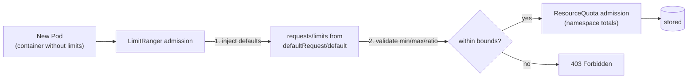
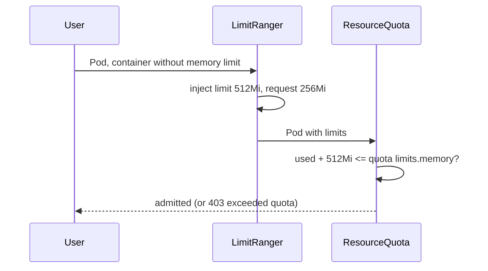

# Limit ranges

## Summary

A LimitRange is a namespaced policy that constrains and defaults resource allocations for Pods, containers and PersistentVolumeClaims. It can set default requests and limits for containers that do not declare them, and minimum, maximum and limit-to-request ratio bounds that the admission controller enforces when objects are created. It works together with ResourceQuota, which caps the totals of a namespace: a memory quota requires every Pod to declare memory limits, and a LimitRange default makes that requirement painless. A LimitRange does not check that its defaults are consistent with values a user sets, which can produce unschedulable Pods.

## Prerequisites

- [Resource management for Pods and containers](../configuration/resource-management-for-pods-and-containers.md).

## Core concepts

### Namespace requests and limits

A cluster can be divided into namespaces. Once a namespace has a default memory limit, and you then try to create a Pod with a container that does not specify its own memory limit, the control plane assigns the default memory limit to that container.

### What a LimitRange is

A **LimitRange** is a policy to constrain resource allocations (such as memory and CPU) for Pods, containers and PersistentVolumeClaims within a namespace. It makes sure that all users and Pods follow the resource usage limits set by administrators. A LimitRange can:

- enforce minimum and maximum compute resource usage per Pod or container,
- enforce minimum and maximum storage requests per PersistentVolumeClaim,
- enforce a ratio between request and limit for a resource,
- set default requests and limits for compute resources and inject them into containers at admission.

It is applied by the `LimitRanger` admission controller when objects are created or updated; existing Pods are not changed.



### Example

Imagine you run a cluster and want every container to have at least 256 MiB of memory and no more than 2 GiB, and every Pod to use at most 4 GiB for all containers combined. A LimitRange for that:

```yaml
apiVersion: v1
kind: LimitRange
metadata:
  name: my-limits
spec:
  limits:
    - default:
        memory: 512Mi
      defaultRequest:
        memory: 256Mi
      max:
        memory: 2Gi
      type: Container
    - max:
        memory: 4Gi
      type: Pod
```

Here containers without values get a 256Mi request and a 512Mi limit, no container may have a limit above 2Gi, and the sum over a Pod may not exceed 4Gi. (To enforce "at least 256 MiB" strictly, add `min: {memory: 256Mi}` to the container entry.)

**Consistency is not checked.** A LimitRange does **not** check the consistency of the default values it applies. A default *limit* set by the LimitRange may be lower than the *request* a client specifies for a container. In that case the final Pod has request greater than limit and is rejected (or, in older behaviors, cannot be scheduled). For example, with the defaults above, a container that sets only `requests.memory: 700Mi` gets the default limit 512Mi, which is invalid.

### Default memory limits and requests with a quota

If the namespace has a memory [resource quota](README.md), it helps to have a default memory limit. Three of the restrictions that a memory ResourceQuota imposes on a namespace:

- For every Pod that runs in the namespace, the Pod and each of its containers must have a memory limit. (If you specify a memory limit for every container in a Pod, Kubernetes can infer the Pod level limit by adding up the container limits.)
- Memory limits apply a resource reservation on the node where the Pod is scheduled. The total memory reserved for all Pods in the namespace must not exceed a specified limit.
- The total amount of memory actually used by all Pods in the namespace must also not exceed a specified limit.

When you add a LimitRange: if any Pod in that namespace includes a container that does not specify its own memory limit, the control plane applies the default memory limit to that container, and the Pod can be allowed to run in a namespace that is restricted by a memory ResourceQuota.



## Worked example

Default and bound memory in a namespace with a quota (untested here; Kubernetes v1.30 or later):

```bash
kubectl create namespace limits-demo
kubectl apply -n limits-demo -f my-limits.yaml
kubectl create quota mem -n limits-demo --hard=limits.memory=2Gi,requests.memory=1Gi
kubectl run a -n limits-demo --image=nginx:1.27
kubectl get pod a -n limits-demo -o jsonpath='{.spec.containers[0].resources}{"\n"}'
# {"limits":{"memory":"512Mi"},"requests":{"memory":"256Mi"}}
kubectl run big -n limits-demo --image=nginx:1.27 --overrides='{"spec":{"containers":[{"name":"big","image":"nginx:1.27","resources":{"limits":{"memory":"3Gi"}}}]}}'
# Error: maximum memory usage per Container is 2Gi, but limit is 3Gi
kubectl run bad -n limits-demo --image=nginx:1.27 --overrides='{"spec":{"containers":[{"name":"bad","image":"nginx:1.27","resources":{"requests":{"memory":"700Mi"}}}]}}'
# rejected: request 700Mi is greater than the injected default limit 512Mi
kubectl describe quota mem -n limits-demo
```

## Trade offs and when to use it

- **Benefits.** Every Pod gets sane requests (better scheduling, QoS) without every team remembering to set them; quotas become usable.
- **Costs.** Hidden defaults surprise users; inconsistent defaults reject valid looking Pods.
- **Alternatives.** Policy engines (Kyverno, Gatekeeper) can require explicit values instead of injecting them.

## Common mistakes

- **Default limit lower than typical requests.**
- **Expecting a LimitRange to change running Pods.** It acts only at admission.
- **Memory quota without a default limit**, which rejects every Pod that does not set limits.
- **Several LimitRanges in one namespace**, whose interaction is not deterministic for defaults.

## Practice

1. What does a LimitRange do for a container that declares no memory limit?
2. Why can a Pod be rejected even though the user only set a request?
3. What three restrictions does a memory ResourceQuota impose?

Answers: 1. It injects the `default` limit (and `defaultRequest`) at admission. 2. The injected default limit can be lower than the user's request; LimitRange does not check consistency. 3. Every Pod and container must have a memory limit; total reserved memory must stay below the quota; total used memory must stay below the quota.

## Further reading

- [Limit Ranges](https://kubernetes.io/docs/concepts/policy/limit-range/), Kubernetes documentation.
- [Configure Default Memory Requests and Limits for a Namespace](https://kubernetes.io/docs/tasks/administer-cluster/manage-resources/memory-default-namespace/), Kubernetes documentation.
- [Resource Quotas](https://kubernetes.io/docs/concepts/policy/resource-quotas/), Kubernetes documentation.
