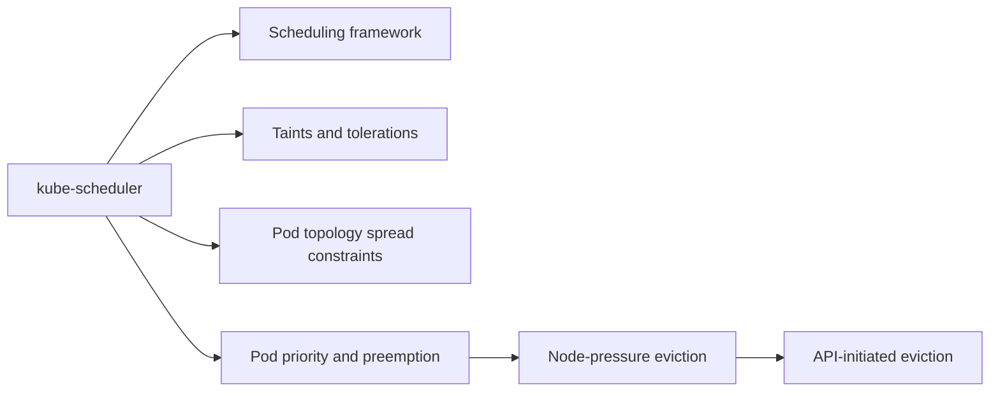

# Scheduling, preemption and eviction

How Pods are assigned to nodes, how the scheduler can be extended and steered, how higher priority Pods displace lower priority ones, and how Pods are removed when a node runs short of resources or is drained. Corresponds to the "Scheduling, Preemption and Eviction" chapter of the Kubernetes documentation Concepts.

## Map of the area

Read kube-scheduler first. The steering mechanisms (taints, topology spread) and the framework can be read in any order. Priority and preemption lead to the two kinds of eviction.

## Notes in reading order

1. [kube-scheduler](kube-scheduler.md): filtering and scoring, binding, scheduling profiles.
2. [Scheduling framework](scheduling-framework.md): scheduling and binding cycles, every extension point.
3. [Taints and tolerations](taints-and-tolerations.md): effects, matching rules, use cases, taint based evictions, taints by condition.
4. [Pod topology spread constraints](pod-topology-spread-constraints.md): fields, node labels, conventions, cluster defaults, comparison with affinity, limitations.
5. [Pod priority and preemption](pod-priority-and-preemption.md): PriorityClass, non-preempting classes, preemption mechanics, interaction with QoS.
6. [Node-pressure eviction](node-pressure-eviction.md): eviction signals and thresholds, node conditions, Pod selection, OOM behavior.
7. [API-initiated eviction](api-initiated-eviction.md): the Eviction API, responses, deletion sequence.

## Planned topics

- Assigning Pods to nodes (nodeSelector, node affinity, inter-Pod affinity, nodeName)
- Running multiple schedulers
- Pod overhead
- Pod scheduling readiness (scheduling gates)
- Gang scheduling and PodGroup scheduling
- Scheduler performance tuning
- Resource bin packing
- Workload-aware preemption and topology-aware workload scheduling
- Node declared features
