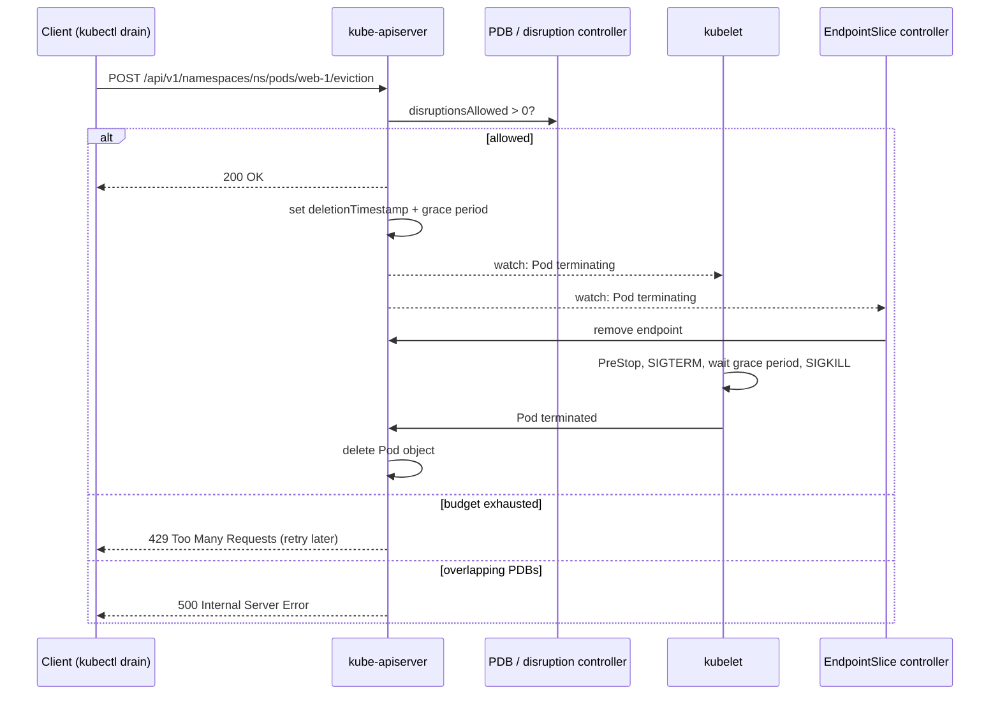

# API-initiated eviction

## Summary

API-initiated eviction is a request to the Eviction API (a POST to a Pod's `eviction` subresource) to gracefully terminate a Pod. It is a policy-controlled delete: the API server checks the PodDisruptionBudgets that select the Pod and answers `200 OK` (the Pod is deleted with its normal grace period), `429 Too Many Requests` (the budget does not allow it now) or `500 Internal Server Error` (misconfiguration, such as overlapping PDBs). `kubectl drain`, the cluster autoscaler and the VPA updater all use it, which is why PDBs protect applications during maintenance.

## Prerequisites

- [Disruptions](../workloads/pods/disruptions.md#pod-disruption-budgets).
- [Node-pressure eviction](node-pressure-eviction.md#eviction-in-general), for the difference between eviction mechanisms.

## Core concepts

### Definition

API-initiated eviction is the process by which you use the Eviction API to create an `Eviction` object that triggers graceful Pod termination.

You can request eviction by calling the Eviction API directly, or programmatically with a client of the API server, such as the `kubectl drain` command. This creates an `Eviction` object, which causes the API server to terminate the Pod.

API-initiated evictions respect your configured `PodDisruptionBudgets` and `terminationGracePeriodSeconds`.

Using the API to create an Eviction object for a Pod is like performing a policy-controlled `DELETE` operation on the Pod.

### How it works

When you request an eviction through the API, the API server performs admission checks and responds in one of the following ways:

- **`200 OK`**: the eviction is allowed, the `Eviction` subresource is created, and the Pod is deleted, similar to sending a `DELETE` request to the Pod URL.
- **`429 Too Many Requests`**: the eviction is not currently allowed because of the configured PodDisruptionBudget. You may be able to retry later. You might also see this response because of API rate limiting.
- **`500 Internal Server Error`**: the eviction is not allowed because there is a misconfiguration, for example several PodDisruptionBudgets reference the same Pod.

If the Pod you want to evict is not part of a workload that has a PodDisruptionBudget, the API server always returns `200 OK` and allows the eviction.

If the API server allows the eviction, the Pod is deleted as follows:

1. The `Pod` resource in the API server is updated with a deletion timestamp, after which the API server considers the `Pod` resource to be terminated. The `Pod` resource is also marked with the configured grace period.
2. The kubelet on the node where the Pod runs notices that the `Pod` resource is marked for termination and starts to gracefully shut down the local Pod.
3. While the kubelet is shutting the Pod down, the control plane removes the Pod from Endpoint and EndpointSlice objects. As a result, controllers no longer consider the Pod a valid object.
4. After the grace period for the Pod expires, the kubelet forcefully terminates the local Pod.
5. The kubelet tells the API server to remove the `Pod` resource.
6. The API server deletes the `Pod` resource.



### Troubleshooting stuck evictions

In some cases, applications enter a broken state where the Eviction API only returns 429 or 500 responses until you intervene, for example when a ReplicaSet creates Pods that never become ready, so the PDB never allows a disruption. Options: abort or pause the automated operation, fix the application, or (for PDB-protected Pods that are not healthy anyway) set `unhealthyPodEvictionPolicy: AlwaysAllow` on the PDB. As a last resort, delete the Pod directly, which bypasses the budget.

## Worked example

Calling the Eviction API directly (untested here; Kubernetes v1.30 or later; the Pod `web-1` is protected by a PDB with no disruptions left):

```bash
kubectl proxy --port=8080 &
cat > eviction.json <<'EOF'
{
  "apiVersion": "policy/v1",
  "kind": "Eviction",
  "metadata": { "name": "web-1", "namespace": "default" }
}
EOF
curl -s -o /dev/null -w '%{http_code}\n' -X POST -H 'Content-Type: application/json' \
  --data @eviction.json localhost:8080/api/v1/namespaces/default/pods/web-1/eviction
# 429 while the PDB has no disruptions allowed; 201 or 200 once it does
kubectl get pdb
```

`kubectl drain` does the same in a loop for every Pod on the node, retrying 429 responses every 5 seconds.

## Trade offs and when to use it

- **Eviction versus delete.** Eviction respects PDBs and is right for automation; delete is immediate and right only when you have decided that availability does not matter for that Pod.
- **Strict PDBs** make maintenance safe but can block it indefinitely; pair them with timeouts and alerts in automation.

## Common mistakes

- **Scripts that delete Pods** during node maintenance instead of evicting them.
- **Overlapping PDBs**, which turn every eviction into a 500 error.
- **Retrying 429s forever** without noticing that the application is unhealthy.

## Practice

1. What are the three possible responses of the Eviction API and what do they mean?
2. When does the API server always return 200 for an eviction?
3. In which step is the Pod removed from Service endpoints?

Answers: 1. 200 allowed and Pod deleted; 429 not allowed now by a PDB (or rate limiting); 500 misconfiguration such as overlapping PDBs. 2. When no PDB selects the Pod. 3. While the kubelet is shutting the Pod down, after the deletion timestamp is set (step 3).

## Further reading

- [API-initiated Eviction](https://kubernetes.io/docs/concepts/scheduling-eviction/api-eviction/), Kubernetes documentation.
- [Safely Drain a Node](https://kubernetes.io/docs/tasks/administer-cluster/safely-drain-node/), Kubernetes documentation.
- [Specifying a Disruption Budget for your Application](https://kubernetes.io/docs/tasks/run-application/configure-pdb/), Kubernetes documentation.
