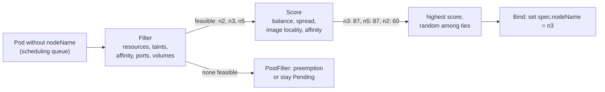

# kube-scheduler

## Summary

Scheduling assigns Pods to nodes. kube-scheduler, the default scheduler, watches for Pods with no node, finds the *feasible* nodes that satisfy the Pod's requirements (filtering), ranks them (scoring) and binds the Pod to the highest scoring node, choosing randomly among ties. If no node is feasible, the Pod stays Pending and preemption may try to make room. Its behavior is configured with scheduling profiles that enable and weight plugins of the scheduling framework; the older scheduling policies (predicates and priorities) were removed in v1.23.

## Prerequisites

- [Control plane](../cluster-architecture/control-plane.md#kube-scheduler).
- [Resource management for Pods and containers](../configuration/resource-management-for-pods-and-containers.md).

## Core concepts

### What scheduling is

Scheduling in Kubernetes is the process of assigning workloads to specific nodes in a cluster. The scheduler decides based on resource availability, node suitability and workload priorities. It balances workloads across the cluster to use resources efficiently and avoid overloading nodes, and it takes into account factors such as location (zones and regions), hardware requirements and application specific needs.

A scheduler watches for newly created Pods that have no node assigned. For every Pod it discovers, the scheduler becomes responsible for finding the best node for that Pod to run on, following the principles below.

### kube-scheduler

kube-scheduler is the default scheduler of Kubernetes and runs as part of the control plane. It is designed so that, if you want and need to, you can write your own scheduling component and use it instead (see [Scheduler extenders](../extending-kubernetes/scheduler-extenders.md)).

kube-scheduler selects an optimal node to run newly created or not yet scheduled Pods. Because containers in Pods, and Pods themselves, can have different requirements, the scheduler filters out any nodes that do not meet a Pod's specific scheduling needs. Alternatively, the API lets you specify a node for a Pod when you create it (`spec.nodeName`), but this is unusual and done only in special cases.

In a cluster, nodes that meet the scheduling requirements of a Pod are called *feasible* nodes. If none of the nodes are suitable, the Pod remains unscheduled until the scheduler is able to place it.

The scheduler finds the feasible nodes for a Pod, runs a set of functions to score them, and picks the node with the highest score. It then notifies the API server of this decision in a process called *binding*.

Factors that are taken into account include individual and collective resource requirements, hardware, software and policy constraints, affinity and anti-affinity specifications, data locality, inter-workload interference, and so on.

### Node selection in two steps

kube-scheduler selects a node for the Pod in a two-step operation:

1. **Filtering**
2. **Scoring**

The *filtering* step finds the set of nodes where it is feasible to schedule the Pod. For example, the `NodeResourcesFit` filter (formerly the `PodFitsResources` predicate) checks whether a candidate node has enough available resources to meet the Pod's specific resource requests. After this step, the node list contains any suitable nodes; often there is more than one. If the list is empty, the Pod is not (yet) schedulable.

In the *scoring* step, the scheduler ranks the remaining nodes to choose the most suitable Pod placement. It assigns a score to each node that survived filtering, based on the active scoring rules.

Finally, kube-scheduler assigns the Pod to the node with the highest ranking. If more than one node has an equal score, kube-scheduler selects one of them at random.



### Configuring the scheduler

There are two ways, historically, to configure the filtering and scoring behavior:

1. **Scheduling Policies** allowed configuring *Predicates* for filtering and *Priorities* for scoring. They were deprecated and removed in v1.23; they appear only in old material.
2. **Scheduling Profiles** let you configure plugins that implement different scheduling stages, including `QueueSort`, `Filter`, `Score`, `Bind`, `Reserve`, `Permit` and others. You can also configure kube-scheduler to run several profiles, each with its own `schedulerName`. See [Scheduling framework](scheduling-framework.md).

For very large clusters, `percentageOfNodesToScore` limits how many feasible nodes are scored, trading placement quality for scheduling throughput.

### What steers the decision

| Mechanism | Effect | Note |
| --- | --- | --- |
| Requests | Filter nodes without enough allocatable resources | [Resource management](../configuration/resource-management-for-pods-and-containers.md) |
| `nodeSelector`, node affinity | Require or prefer nodes with labels | Planned: assigning Pods to nodes |
| Taints and tolerations | Nodes repel Pods without matching tolerations | [Taints and tolerations](taints-and-tolerations.md) |
| Inter-Pod affinity and anti-affinity | Place Pods near or away from other Pods | [Pod topology spread constraints](pod-topology-spread-constraints.md#podaffinity-and-podantiaffinity) |
| Topology spread constraints | Balance Pods across zones or nodes | [Pod topology spread constraints](pod-topology-spread-constraints.md) |
| Priority | Order of scheduling and preemption | [Pod priority and preemption](pod-priority-and-preemption.md) |

## Worked example

Watching filtering at work (untested here; Kubernetes v1.30 or later):

```bash
kubectl run huge --image=nginx:1.27 --overrides='{"spec":{"containers":[{"name":"huge","image":"nginx:1.27","resources":{"requests":{"cpu":"64"}}}]}}'
kubectl get pod huge                                   # Pending
kubectl describe pod huge | sed -n '/Events/,$p'
# Warning  FailedScheduling  default-scheduler  0/3 nodes are available:
#   1 node(s) had untolerated taint {node-role.kubernetes.io/control-plane: },
#   2 Insufficient cpu. preemption: 0/3 nodes are available: ...
```

The event lists, per filter plugin, how many nodes it rejected, which is the fastest way to understand a Pending Pod.

## Trade offs and when to use it

- **Default scheduler with profiles** covers most needs; custom plugins require building your own scheduler binary.
- **Spreading versus bin packing.** The default scoring balances load; `MostAllocated` scoring packs nodes tighter, which helps node autoscalers scale down.
- **Throughput versus quality** on large clusters through `percentageOfNodesToScore`.

## Common mistakes

- **Setting `nodeName` directly**, which bypasses the scheduler (no resource checks, no preemption).
- **Reading "Pending" as a scheduler bug.** The events usually show missing resources, taints or affinity mismatches.
- **Following tutorials that use scheduling Policies** (removed).

## Practice

1. What are the two steps of node selection?
2. What happens if two nodes have the same highest score?
3. What does binding change on the Pod?
4. Why is a Pod with a very large CPU request Pending even if the cluster has many idle nodes?

Answers: 1. Filtering and scoring. 2. One of them is chosen at random. 3. It sets `spec.nodeName`. 4. Filtering compares requests with allocatable capacity per node; no single node has enough.

## Further reading

- [Kubernetes Scheduler](https://kubernetes.io/docs/concepts/scheduling-eviction/kube-scheduler/), Kubernetes documentation.
- [Scheduler Configuration](https://kubernetes.io/docs/reference/scheduling/config/), Kubernetes documentation. Profiles and plugins.
- [Assigning Pods to Nodes](https://kubernetes.io/docs/concepts/scheduling-eviction/assign-pod-node/), Kubernetes documentation.
- [Scheduler Performance Tuning](https://kubernetes.io/docs/concepts/scheduling-eviction/scheduler-perf-tuning/), Kubernetes documentation.
