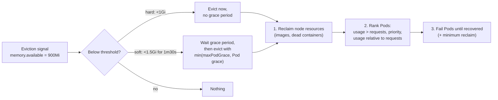
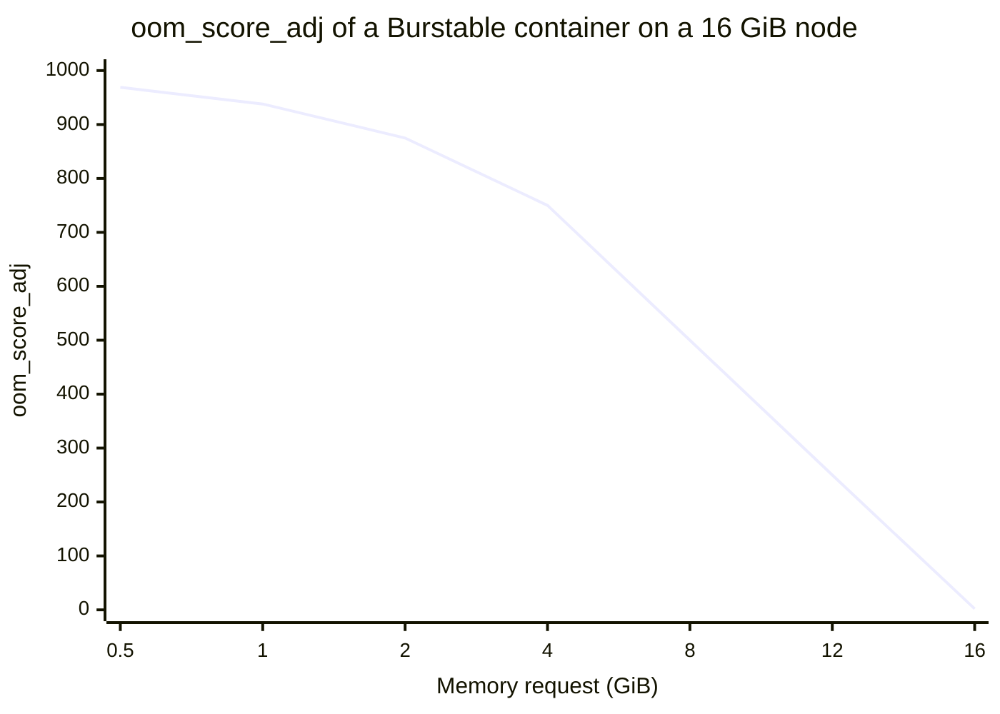

# Node-pressure eviction

## Summary

*Eviction* is the forced termination of Pods to free resources. *Node-pressure eviction* is done by the kubelet: it watches memory, disk space, inodes and process IDs on its node, compares *eviction signals* with configured *thresholds*, first reclaims node level resources (unused images, dead containers), and then fails Pods in a defined order until the resource recovers. Soft thresholds wait for a grace period, hard thresholds act immediately. The kubelet reports pressure as node conditions, which become taints that keep new Pods away. If the kernel runs out of memory before the kubelet acts, the OOM killer chooses a victim using `oom_score_adj` values derived from QoS classes.

## Prerequisites

- [Pod quality of service classes](../workloads/pods/pod-quality-of-service-classes.md).
- [Resource management for Pods and containers](../configuration/resource-management-for-pods-and-containers.md).

## Core concepts

### Eviction in general

In Kubernetes, **eviction** is the process of forcefully terminating one or more Pods on a node to free up resources for other Pods or for the node itself. Evicted Pods may get a graceful termination period to finish their work before they are killed.

There are three distinct mechanisms that remove running Pods, and they are often confused:

| Mechanism | Who acts | Why | Respects PDB? | Home note |
| --- | --- | --- | --- | --- |
| Preemption | kube-scheduler | Make room for a pending higher priority Pod | Best effort | [Pod priority and preemption](pod-priority-and-preemption.md) |
| Node-pressure eviction | kubelet | The node is running out of memory, disk, inodes or PIDs | No | This note |
| API-initiated eviction | Any API client (`kubectl drain`, autoscaler) | Voluntary maintenance | Yes | [API-initiated eviction](api-initiated-eviction.md) |

**Common misconception.** Eviction is sometimes defined as "typically initiated by the scheduler when it cannot find a node for a pending Pod and determines that removing lower priority Pods will create the necessary resources". That describes *preemption*. Eviction in the narrow sense is done by the kubelet (node pressure) or through the Eviction API.

### Node-pressure eviction

Node-pressure eviction is the process by which the kubelet proactively terminates Pods to reclaim resources on nodes.

The kubelet monitors resources such as memory, disk space and file system inodes on the node. When one or more of these resources reach specific consumption levels, the kubelet can proactively fail one or more Pods on the node to reclaim resources and prevent starvation.

During a node-pressure eviction, the kubelet sets the phase of the selected Pods to `Failed` and terminates the Pods. Node-pressure eviction is not the same as API-initiated eviction: the kubelet does not respect your configured PodDisruptionBudget or the Pod's `terminationGracePeriodSeconds` (for hard thresholds).

### Self-healing behavior

The kubelet attempts to [reclaim node-level resources](https://kubernetes.io/docs/concepts/scheduling-eviction/node-pressure-eviction/#reclaim-node-resources) before it terminates end-user Pods. For example, it removes unused container images when disk resources are starved.

If the Pods are managed by a [workload](../workloads/workloads-overview.md) object (such as a [StatefulSet](../workloads/workload-management/statefulsets.md) or [Deployment](../workloads/workload-management/deployments.md)) that replaces failed Pods, the control plane (`kube-controller-manager`) creates new Pods in place of the evicted ones. Static Pods are restarted by the kubelet itself.

### Eviction signals, thresholds and monitoring intervals

The kubelet uses several parameters to make eviction decisions:

- eviction signals,
- eviction thresholds,
- monitoring intervals.

**Eviction signals** are the current state of a particular resource at a specific point in time. The kubelet compares signals with eviction thresholds, which are the minimum amount of the resource that should be available on the node.

| Eviction signal | Definition |
| --- | --- |
| `memory.available` | `memory.available` := `node.status.capacity[memory]` - `node.stats.memory.workingSet` |
| `nodefs.available` | `nodefs.available` := `node.stats.fs.available` |
| `nodefs.inodesFree` | `nodefs.inodesFree` := `node.stats.fs.inodesFree` |
| `imagefs.available` | `imagefs.available` := `node.stats.runtime.imagefs.available` |
| `imagefs.inodesFree` | `imagefs.inodesFree` := `node.stats.runtime.imagefs.inodesFree` |
| `pid.available` | `pid.available` := `node.stats.rlimit.maxpid` - `node.stats.rlimit.curproc` |

The kubelet recognizes two specific file system identifiers:

1. **`nodefs`**: the node's main file system, used for local disk volumes, `emptyDir` volumes not backed by memory, log storage and more. For example, `nodefs` contains `/var/lib/kubelet/`.
2. **`imagefs`**: an optional file system that container runtimes use to store container images and container writable layers. (Newer releases also distinguish a separate `containerfs` for writable layers.)

Note that `memory.available` is based on the working set, which includes active page cache; it is not the same as `free -m`.

**Eviction thresholds.** You can specify custom eviction thresholds for the kubelet. Thresholds have the form `[eviction-signal][operator][quantity]`, where:

- `eviction-signal` is the signal to use,
- `operator` is the relational operator, such as `<` (less than),
- `quantity` is the threshold amount, such as `1Gi`. It must match the quantity representation used by Kubernetes. You can use literal values or percentages (`%`).

For example, if a node has 10 GiB of total memory and you want eviction when available memory falls below 1 GiB, define the threshold as either `memory.available<10%` or `memory.available<1Gi` (not both).

**Soft eviction thresholds** pair a threshold with an administrator-specified grace period. The kubelet does not evict Pods until the grace period is exceeded. The kubelet returns an error on startup if there is no grace period for a soft threshold. You can specify both a soft threshold grace period (`eviction-soft-grace-period`) and a maximum allowed Pod termination grace period (`eviction-max-pod-grace-period`) for the kubelet to use during evictions. If you set a maximum allowed grace period and the soft threshold is met, the kubelet uses the lesser of the two grace periods. If you do not specify a maximum allowed grace period, the kubelet kills evicted Pods immediately without graceful termination.

**Hard eviction thresholds** have no grace period. When a hard threshold is met, the kubelet kills Pods immediately without graceful termination to reclaim the starved resource. Configure them with the `eviction-hard` flag, for example `memory.available<1Gi`. The kubelet has the following default hard thresholds:

- `memory.available<100Mi` (Linux nodes; `<500Mi` on Windows)
- `nodefs.available<10%`
- `imagefs.available<15%`
- `nodefs.inodesFree<5%` (Linux nodes)
- `imagefs.inodesFree<5%` (Linux nodes)

**Eviction monitoring interval.** The kubelet evaluates eviction thresholds based on its configured `housekeeping-interval`, which defaults to `10s`.



### Node conditions

The kubelet reports [node conditions](https://kubernetes.io/docs/concepts/architecture/nodes/#condition) to reflect that the node is under pressure because a hard or soft eviction threshold is met, independent of configured grace periods. The kubelet maps eviction signals to node conditions as follows:

| Node condition | Eviction signal | Description |
| --- | --- | --- |
| `MemoryPressure` | `memory.available` | Available memory on the node has satisfied an eviction threshold. |
| `DiskPressure` | `nodefs.available`, `nodefs.inodesFree`, `imagefs.available` or `imagefs.inodesFree` | Available disk space and inodes on either the node's root file system or image file system have satisfied an eviction threshold. |
| `PIDPressure` | `pid.available` | Available process identifiers on the (Linux) node have fallen below an eviction threshold. |

The control plane turns these conditions into `NoSchedule` taints, so no new Pods are scheduled to the node (see [Taints and tolerations](taints-and-tolerations.md#taint-nodes-by-condition)). The kubelet updates the node conditions based on `--node-status-update-frequency`, which defaults to `10s`.

**Node condition oscillation.** In some cases, nodes oscillate above and below soft eviction thresholds without holding them for the defined grace periods. This makes the reported node condition switch between `true` and `false`, which leads to bad eviction decisions. To prevent oscillation, use the `eviction-pressure-transition-period` flag, which controls how long the kubelet must wait before transitioning a node condition to a different state. The default is `5m`.

**Minimum eviction reclaim.** In some cases, Pod eviction reclaims only a small amount of the starved resource. This can lead the kubelet to hit the configured thresholds repeatedly and trigger multiple evictions. Use the `--eviction-minimum-reclaim` flag or a [kubelet config file](https://kubernetes.io/docs/tasks/administer-cluster/kubelet-config-file/) to configure a minimum reclaim amount for each resource. When the kubelet notices that a resource is starved, it continues to reclaim it until it has reclaimed the quantity you specify (threshold plus minimum reclaim).

### Pod selection

If the kubelet's attempts to reclaim node-level resources do not bring the eviction signal below the threshold, it begins to evict end-user Pods, ranked by:

1. whether the Pod's usage of the starved resource exceeds requests,
2. [Pod priority](pod-priority-and-preemption.md),
3. the Pod's usage of the starved resource relative to its requests.

As a result, `BestEffort` and `Burstable` Pods using more than their requests are evicted first, ordered by priority and then by how much they exceed their requests. `Guaranteed` Pods and `Burstable` Pods within their requests are evicted last, only when system daemons need more resources than reserved.

### Node out of memory behavior

If the node experiences an *out of memory* (OOM) event before the kubelet can reclaim memory, the node depends on the [oom_killer](https://lwn.net/Articles/391222/) to respond. The kubelet sets an `oom_score_adj` value for each container based on the QoS of the Pod:

| Quality of service | `oom_score_adj` |
| --- | --- |
| `Guaranteed` | -997 |
| `BestEffort` | 1000 |
| `Burstable` | min(max(2, 1000 - (1000 × memoryRequestBytes) / machineMemoryCapacityBytes), 999) |

(Node critical Pods with priority `system-node-critical` get -997 regardless of QoS.)

If the kubelet cannot reclaim memory before a node experiences OOM, the `oom_killer` calculates an `oom_score` based on the percentage of memory the process uses on the node, and adds the `oom_score_adj` to get an effective `oom_score` for each container. It then kills the container with the highest score. This means that containers in low QoS Pods that consume a large amount of memory relative to their scheduling requests are killed first.

Unlike Pod eviction, if a container is OOM killed, the kubelet can restart it based on its `restartPolicy`.

**Example of the Burstable formula.** On a node with 16 GiB of memory, a container that requests 4 GiB gets `1000 - 1000 × 4/16 = 750`; one that requests 512 MiB gets `1000 - 1000 × 0.5/16 = 969`.



## Worked example

Kubelet eviction settings for a node with 16 GiB of memory (untested here; KubeletConfiguration `kubelet.config.k8s.io/v1beta1`):

```yaml
apiVersion: kubelet.config.k8s.io/v1beta1
kind: KubeletConfiguration
evictionHard:
  memory.available: "500Mi"
  nodefs.available: "10%"
  imagefs.available: "15%"
  nodefs.inodesFree: "5%"
evictionSoft:
  memory.available: "1Gi"
evictionSoftGracePeriod:
  memory.available: "1m30s"
evictionMaxPodGracePeriod: 60
evictionPressureTransitionPeriod: "5m"
evictionMinimumReclaim:
  memory.available: "500Mi"
systemReserved: { memory: "1Gi" }
kubeReserved: { memory: "1Gi" }
```

```bash
kubectl describe node <node> | grep -E 'MemoryPressure|DiskPressure|PIDPressure'
kubectl get events -A --field-selector reason=Evicted
kubectl get pods -A --field-selector status.phase=Failed -o wide | grep Evicted
```

With this configuration, available memory below 1 GiB for 90 seconds triggers soft eviction with at most 60 seconds of grace; below 500 MiB triggers immediate hard eviction; and each eviction round continues until 1 GiB (500Mi + 500Mi) is available.

## Trade offs and when to use it

- **Higher thresholds** protect the node and system daemons but waste memory; lower thresholds risk kernel OOM kills, which are less orderly.
- **Soft thresholds** give Pods time to shut down cleanly; hard thresholds protect the node.
- **Reserved resources** (`systemReserved`, `kubeReserved`) keep the kubelet and runtime alive under pressure.

## Common mistakes

- **No requests on Pods**, making them the first eviction candidates.
- **Confusing preemption with eviction** in incident analysis.
- **Ignoring disk pressure from logs and `emptyDir`.**
- **Soft threshold without grace period**: the kubelet does not start.

## Practice

1. Which component performs node-pressure eviction, and does it respect PDBs?
2. A node has 10 GiB of memory; express an eviction at 1 GiB available in two ways.
3. Which node condition does `imagefs.inodesFree` map to?
4. Why might the kernel OOM killer act before the kubelet evicts?
5. Compute the `oom_score_adj` of a Burstable container requesting 2 GiB on an 8 GiB node.

Answers: 1. The kubelet; no. 2. `memory.available<1Gi` or `memory.available<10%`. 3. `DiskPressure`. 4. The kubelet checks every housekeeping interval (10 s), while memory can be exhausted faster. 5. `1000 - 1000 × 2/8 = 750`.

## Further reading

- [Node-pressure Eviction](https://kubernetes.io/docs/concepts/scheduling-eviction/node-pressure-eviction/), Kubernetes documentation.
- [Reserve Compute Resources for System Daemons](https://kubernetes.io/docs/tasks/administer-cluster/reserve-compute-resources/), Kubernetes documentation.
- [Taming the OOM killer](https://lwn.net/Articles/391222/), LWN.net, 2010.
