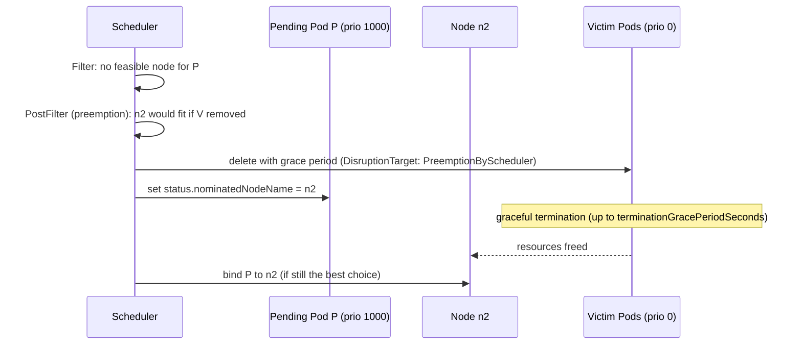

# Pod priority and preemption

## Summary

Pods can have a *priority*, an integer taken from a PriorityClass. The scheduler orders pending Pods by priority, and if a high-priority Pod cannot be placed, *preemption* evicts lower-priority Pods from a node to make room, nominating that node for the waiting Pod. Preemption respects PodDisruptionBudgets only on a best effort basis, honors graceful termination (which delays the preemptor), and does not consider QoS classes. A non-preempting PriorityClass (`preemptionPolicy: Never`) lets a Pod jump the queue without evicting anyone. The kubelet also uses priority when it evicts Pods under node pressure.

## Prerequisites

- [kube-scheduler](kube-scheduler.md).
- [Pod quality of service classes](../workloads/pods/pod-quality-of-service-classes.md).

## Core concepts

### Definition

Pods can have *priority*. Priority indicates the importance of a Pod relative to other Pods. If a Pod cannot be scheduled, the scheduler tries to preempt (evict) lower priority Pods to make scheduling of the pending Pod possible.

### How to use priority and preemption

1. Add one or more PriorityClasses.
2. Create Pods with `priorityClassName` set to one of the added PriorityClasses. Normally you do not create Pods directly; you add `priorityClassName` to the Pod template of a workload resource such as a Deployment.

### PriorityClass

A PriorityClass is a non-namespaced object that maps a priority class name to an integer priority value. Higher values mean higher priority. The name must be a valid DNS subdomain and must not start with `system-` (reserved). The value can be any 32-bit integer from -2147483648 to 1000000000 inclusive; larger numbers are reserved for built-in classes that represent critical system Pods (`system-cluster-critical` 2000000000 and `system-node-critical` 2000001000).

Two optional fields:

- **`globalDefault`**: the value of this PriorityClass is used for Pods without a `priorityClassName`. Only one PriorityClass with `globalDefault: true` can exist. If there is none, the priority of Pods without a class is zero.
- **`description`**: an arbitrary string that tells users when to use the class.

**Notes about Pod priority and existing clusters:**

- If you upgrade an existing cluster without this feature, the priority of your existing Pods is effectively zero.
- Adding a PriorityClass with `globalDefault: true` does not change the priorities of existing Pods. Its value is used only for Pods created after it is added.
- If you delete a PriorityClass, existing Pods that use its name remain unchanged, but you cannot create more Pods that use that name.

### Non-preempting PriorityClass

Pods with `preemptionPolicy: Never` are placed in the scheduling queue ahead of lower priority Pods, but they cannot preempt other Pods. A non-preempting Pod waiting to be scheduled stays in the queue until sufficient resources are free and it can be scheduled. Non-preempting Pods, like other Pods, are subject to scheduler backoff: if the scheduler tries and fails to schedule them, they are retried less frequently, which can let other, lower priority Pods be scheduled before them.

Non-preempting Pods may still be preempted by other, higher priority Pods.

`preemptionPolicy` defaults to `PreemptLowerPriority`, which lets Pods of that class preempt lower priority Pods. If it is `Never`, Pods of that class are non-preempting.

An example use case is data science workloads. A user may submit a job that they want prioritized above other workloads, but they do not want to discard existing work by preempting running Pods. The high priority job with `preemptionPolicy: Never` is scheduled ahead of other queued Pods as soon as cluster resources naturally become free.

### Pod priority

After you have one or more PriorityClasses, you can create Pods that name one of them in their spec. The Priority admission controller uses the `priorityClassName` field and populates the integer value of the priority (`spec.priority`). If the priority class is not found, the Pod is rejected.

When Pod priority is enabled, the scheduler orders pending Pods by priority, and a pending Pod is placed ahead of other pending Pods with lower priority in the scheduling queue. As a result, a higher priority Pod may be scheduled sooner than lower priority Pods if its scheduling requirements are met. If such a Pod cannot be scheduled, the scheduler continues and tries to schedule other, lower priority Pods.

### Preemption

**Trigger.** When Pods are created, they go to a queue and wait to be scheduled. The scheduler picks a Pod from the queue and tries to schedule it on a node. If no node satisfies all the requirements of the Pod (P), the preemption logic is triggered for the pending Pod. Preemption tries to find a node where removing one or more Pods with lower priority than P would make P schedulable. If such a node is found, one or more lower priority Pods are evicted from it. After the victims are gone, P can be scheduled on the node.



**Key mechanisms:**

1. **Nominated node.**
   - `nominatedNodeName`: when P preempts Pods on node N, the `nominatedNodeName` field of P's status is set to N. It helps the scheduler track resources reserved for P and tells users about preemptions in the cluster.
   - Scheduling: the scheduler first tries the nominated node in the next cycle. P is not guaranteed to land there: if another node becomes available first, or a higher priority Pod arrives, P may be scheduled elsewhere, and the nominated node may be cleared.
2. **Graceful termination.**
   - Evicted (preempted) Pods get their termination grace period before they are killed forcefully.
   - Time gap: this creates a delay between the preemption and the time P can be scheduled on the node.
   - Minimization: setting a short (or zero) grace period for lower priority Pods reduces this delay.
3. **PodDisruptionBudget (PDB).**
   - Function: limits the number of Pods of an application that can be down at once from voluntary disruptions.
   - Best effort: the scheduler tries to find victims whose PDBs are not violated by preemption. If no such victims exist, preemption still happens and Pods covered by PDBs are removed, even if this violates the budget.
4. **Inter-Pod affinity.**
   - Condition for preemption: a node is considered for preemption only if removing *all* lower priority Pods from it would make P schedulable.
   - Affinity rule: if P has inter-Pod affinity to one or more lower priority Pods on the node, the affinity rule cannot be satisfied after removing them, so the scheduler does not preempt on that node. Give affinity only towards Pods of equal or higher priority.
5. **Cross-node preemption.**
   - Limitation: preemption does not remove Pods from a different node to satisfy anti-affinity or topology rules of P (for example when a Pod in another node of the same zone blocks P through anti-affinity). Only Pods on the candidate node are considered.
   - Future: this may be added if feasible and demanded.

**Limitations and recommendations:**

| Area | Limitation | Recommendation |
| --- | --- | --- |
| Graceful termination | Creates a scheduling delay | Use shorter grace periods for lower priority Pods |
| PodDisruptionBudget | Supported but not guaranteed during preemption | Do not rely on PDBs to protect against preemption; use priorities |
| Inter-Pod affinity | Affinity to lower priority Pods prevents preemption on that node | Target Pods of higher or equal priority |
| Cross-node preemption | Not supported | Design anti-affinity with this in mind |

### Pod priority and quality of service

Pod priority and QoS class are two orthogonal features with few interactions and no default restrictions on setting the priority of a Pod based on its QoS class. The scheduler's preemption logic does not consider QoS when choosing preemption targets. Preemption considers Pod priority and tries to choose a set of targets with the lowest priority. Higher priority Pods are considered for preemption only if removing the lowest priority Pods is not sufficient to schedule the preemptor, or if the lowest priority Pods are protected by a `PodDisruptionBudget`.

The kubelet uses priority to determine the order of Pods for [node-pressure eviction](node-pressure-eviction.md). You can use the QoS class to estimate the order in which Pods are most likely to be evicted. The kubelet ranks Pods for eviction by:

1. whether the starved resource usage exceeds requests,
2. Pod priority,
3. the amount of resource usage relative to requests.

## Worked example

A high priority class for production and a non-preempting class for experiments (untested here; Kubernetes v1.30 or later):

```yaml
apiVersion: scheduling.k8s.io/v1
kind: PriorityClass
metadata: { name: production-high }
value: 100000
globalDefault: false
description: "Customer facing services; may preempt batch work."
---
apiVersion: scheduling.k8s.io/v1
kind: PriorityClass
metadata: { name: batch-low }
value: -10
globalDefault: true
description: "Default for everything else."
---
apiVersion: scheduling.k8s.io/v1
kind: PriorityClass
metadata: { name: research-no-preempt }
value: 50000
preemptionPolicy: Never
description: "Jumps the queue but never evicts running work."
```

```bash
kubectl apply -f priorityclasses.yaml
# fill the cluster with low priority Pods, then create a production Pod that does not fit
kubectl create deployment filler --image=nginx:1.27 --replicas=50
kubectl set resources deployment filler --requests=cpu=500m
kubectl run checkout --image=nginx:1.27 --overrides='{"spec":{"priorityClassName":"production-high","containers":[{"name":"c","image":"nginx:1.27","resources":{"requests":{"cpu":"2"}}}]}}'
kubectl get pod checkout -o jsonpath='{.status.nominatedNodeName}{"\n"}'
kubectl get events --field-selector reason=Preempted
```

## Trade offs and when to use it

- **Benefits.** Critical workloads get capacity in a full cluster without over-provisioning everywhere.
- **Costs and risks.** A misconfigured high priority (or a `globalDefault` that is too high) can evict important workloads; users who can choose any PriorityClass can preempt others, so limit classes per namespace with ResourceQuota scopes.
- **Overprovisioning pattern.** Low priority "placeholder" Pods reserve headroom that real Pods preempt immediately, while the node autoscaler adds capacity in the background.

## Common mistakes

- **Expecting PDBs to block preemption.**
- **Long grace periods on low priority Pods**, which delay critical Pods.
- **Affinity from high priority Pods to low priority Pods.**
- **Using `system-node-critical` for ordinary applications.**

## Practice

1. What is the difference between `preemptionPolicy: Never` and a low priority?
2. Why might a preemptor not land on its nominated node?
3. Does the scheduler prefer to preempt BestEffort Pods?
4. What happens to existing Pods when a PriorityClass is deleted?

Answers: 1. `Never` keeps a high queue position but never evicts others; a low priority puts the Pod late in the queue and makes it a preemption victim. 2. Another node may become available first, or a higher priority Pod may take the freed resources. 3. No; preemption considers priority, not QoS. 4. They keep their priority; new Pods can no longer use the class name.

## Further reading

- [Pod Priority and Preemption](https://kubernetes.io/docs/concepts/scheduling-eviction/pod-priority-preemption/), Kubernetes documentation.
- [Guaranteed Scheduling For Critical Add-On Pods](https://kubernetes.io/docs/tasks/administer-cluster/guaranteed-scheduling-critical-addon-pods/), Kubernetes documentation.
- [Limit Priority Class consumption by default](https://kubernetes.io/docs/concepts/policy/resource-quotas/#limit-priority-class-consumption-by-default), Kubernetes documentation.
