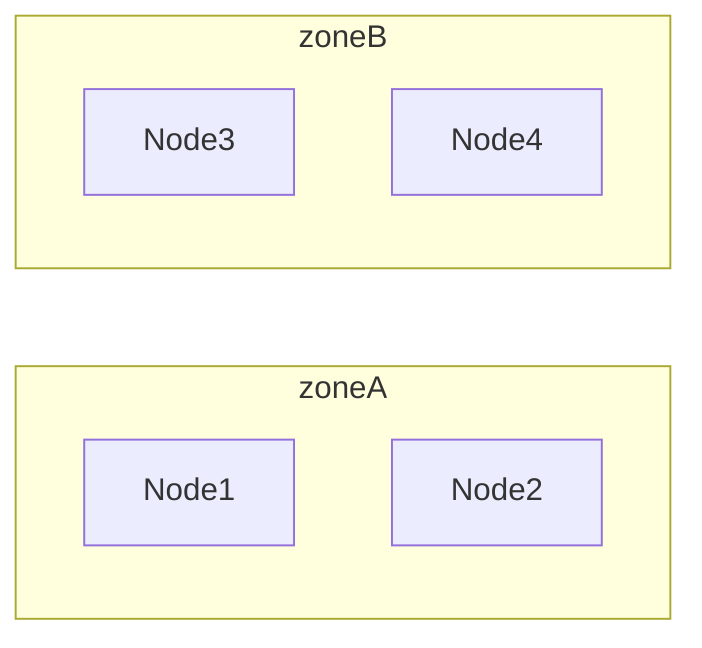
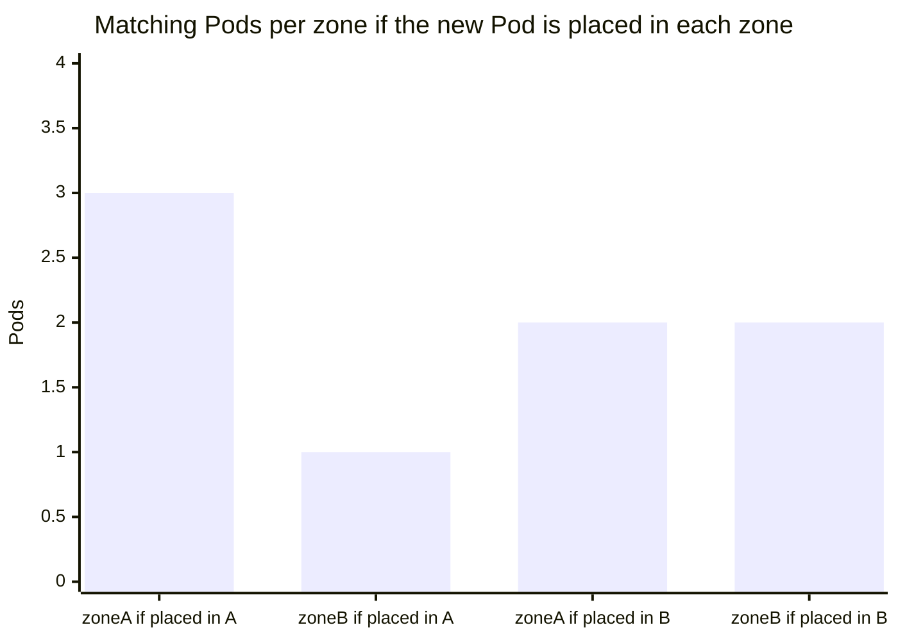

# Pod topology spread constraints

## Summary

Topology spread constraints control how Pods are spread across failure domains such as regions, zones and nodes. Each constraint names a node label (`topologyKey`) that defines the domains, a label selector that defines which Pods are counted, and a `maxSkew`: the maximum allowed difference in matching Pods between any two eligible domains. `whenUnsatisfiable` decides whether a violating placement is refused (`DoNotSchedule`) or only discouraged (`ScheduleAnyway`). Spread constraints give finer control than Pod anti-affinity, which can only allow one Pod per domain or nothing enforceable at all. They are evaluated only at scheduling time and know only domains that currently have nodes.

## Prerequisites

- [kube-scheduler](kube-scheduler.md).
- [Disruptions](../workloads/pods/disruptions.md#dealing-with-disruptions), for the high availability motivation.

## Core concepts

### Definition

You can use *topology spread constraints* to control how Pods are spread across the cluster among failure domains such as regions, zones, nodes and other user-defined topology domains. This helps achieve high availability as well as efficient resource utilization.

### Motivation

Imagine a cluster of up to twenty nodes and a workload that automatically scales between 2 and 15 replicas. With only two Pods, you would prefer them not to run on the same node: a single node failure would take the workload offline.

In addition to this basic usage, there are advanced examples that let workloads benefit from high availability and good cluster utilization. As you scale up and run more Pods, a different concern becomes important. Imagine three nodes running five Pods each. The nodes have enough capacity, but the clients of this workload are split across three different data centers (or infrastructure zones). Now you are less concerned about a single node failure, but you notice that latency is higher than you want, and you pay network costs for traffic between zones. You decide that, under normal operation, you want a similar number of replicas scheduled into each zone, and you want the cluster to self-heal if there is a problem.

Pod topology spread constraints give you a declarative way to configure that.

### The topologySpreadConstraints field

The Pod API has a `spec.topologySpreadConstraints` field:

```yaml
---
apiVersion: v1
kind: Pod
metadata:
  name: example-pod
spec:
  # Configure a topology spread constraint
  topologySpreadConstraints:
    - maxSkew: <integer>
      minDomains: <integer>                 # optional
      topologyKey: <string>
      whenUnsatisfiable: <string>
      labelSelector: <object>
      matchLabelKeys: <list>                # optional; beta since v1.27
      nodeAffinityPolicy: [Honor|Ignore]    # optional; beta since v1.26
      nodeTaintsPolicy: [Honor|Ignore]      # optional; beta since v1.26
  ### other Pod fields go here
```

You can define one or several `topologySpreadConstraints` entries to tell kube-scheduler how to place each incoming Pod relative to the existing Pods across the cluster. The fields are:

- **`maxSkew`** describes the degree to which Pods may be unevenly distributed. You must specify it, and it must be greater than zero. Its semantics differ by `whenUnsatisfiable`:
  - with `DoNotSchedule`, `maxSkew` is the maximum permitted difference between the number of matching Pods in the target topology and the *global minimum* (the minimum number of matching Pods in an eligible domain, or zero if the number of eligible domains is less than `minDomains`);
  - with `ScheduleAnyway`, the scheduler gives higher precedence to topologies that would help reduce the skew.
- **`minDomains`** indicates a minimum number of eligible domains. This field is optional. A domain is a particular instance of a topology. An eligible domain is a domain whose nodes match the node selector. When the number of eligible domains is lower than `minDomains`, the global minimum is treated as 0, which forces new Pods into empty domains (useful with node autoscaling). It can be used only with `DoNotSchedule`.
- **`topologyKey`** is the key of [node labels](#node-labels). Nodes that have a label with this key and identical values are considered to be in the same topology. Each instance of a topology (a `<key, value>` pair) is a domain. The scheduler tries to put a balanced number of Pods into each domain. An eligible domain is a domain whose nodes meet the requirements of `nodeAffinityPolicy` and `nodeTaintsPolicy`.
- **`whenUnsatisfiable`** says how to deal with a Pod if it does not satisfy the spread constraint:
  - `DoNotSchedule` (default) tells the scheduler not to schedule it.
  - `ScheduleAnyway` tells the scheduler to still schedule it while prioritizing nodes that minimize the skew.
- **`labelSelector`** is used to find matching Pods. Pods that match this selector are counted to determine the number of Pods in their topology domain. See [Label Selectors](https://kubernetes.io/docs/concepts/overview/working-with-objects/labels/#label-selectors).
- **`matchLabelKeys`** is a list of Pod label keys to select the Pods over which spreading is calculated. The keys are used to look up values from the incoming Pod's labels, and those key-value labels are ANDed with `labelSelector`. The same key may not appear in both. `matchLabelKeys` cannot be set when `labelSelector` is unset. Keys that do not exist in the Pod's labels are ignored. A null or empty list means only `labelSelector` is used. The typical use is `pod-template-hash`, so that each Deployment revision is spread on its own during a rollout.
- **`nodeAffinityPolicy`** says how the Pod's `nodeAffinity` and `nodeSelector` are treated when calculating the skew:
  - `Honor` (default): only nodes matching nodeAffinity and nodeSelector are included in the calculations.
  - `Ignore`: nodeAffinity and nodeSelector are ignored; all nodes are included.
- **`nodeTaintsPolicy`** says how node taints are treated when calculating the skew:
  - `Honor`: nodes without taints, together with tainted nodes for which the incoming Pod has a toleration, are included.
  - `Ignore` (default): node taints are ignored; all nodes are included.

When a Pod defines more than one constraint, they are combined with AND: the scheduler looks for a node that satisfies all of them.

TODO: Verify the current maturity of `matchLabelKeys`, `nodeAffinityPolicy` and `nodeTaintsPolicy` (beta in the versions above, possibly stable by v1.37).

### Node labels

Topology spread constraints rely on node labels to identify the topology domain or domains each [node](https://kubernetes.io/docs/concepts/architecture/nodes/) is in. For example, a node might have the labels:

```yaml
region: us-east-1
zone: us-east-1a
```

Suppose you have a 4-node cluster with the following labels:

```text
NAME    STATUS   ROLES    AGE     VERSION   LABELS
node1   Ready    <none>   4m26s   v1.16.0   node=node1,zone=zoneA
node2   Ready    <none>   3m58s   v1.16.0   node=node2,zone=zoneA
node3   Ready    <none>   3m17s   v1.16.0   node=node3,zone=zoneB
node4   Ready    <none>   2m43s   v1.16.0   node=node4,zone=zoneB
```

The cluster is then logically viewed as two zones with two nodes each:



**Example of skew.** Three Pods labeled `app=foo` already run: two in zoneA (node1, node2) and one in zoneB (node3). A constraint `maxSkew: 1, topologyKey: zone, whenUnsatisfiable: DoNotSchedule` for a new `app=foo` Pod computes: placing it in zoneA gives 3 vs 1, skew 2 (violates); placing it in zoneB gives 2 vs 2, skew 0. The Pod must go to zoneB (node3 or node4).



### Consistency

Set the same topology spread constraints on all Pods in a group. Usually, with a workload controller such as a Deployment, the Pod template takes care of this. If you mix different spread constraints, Kubernetes follows the API definition of the field; however, the behavior is more likely to become confusing and troubleshooting is less straightforward.

You need a mechanism to make sure that all nodes in a topology domain (such as a cloud provider region) are labeled consistently. To avoid labeling nodes by hand, most clusters automatically populate well-known labels such as `kubernetes.io/hostname`, `topology.kubernetes.io/zone` and `topology.kubernetes.io/region`. Check whether your cluster supports this.

### Implicit conventions

- Only Pods in the same namespace as the incoming Pod can be matching candidates.
- The scheduler bypasses any nodes that do not have any `topologySpreadConstraints[*].topologyKey` present. This implies that:
  1. any Pods on those bypassed nodes do not affect the `maxSkew` calculation;
  2. the incoming Pod has no chance to be scheduled onto such nodes.
- Be aware of what happens if the incoming Pod's `topologySpreadConstraints[*].labelSelector` does not match its own labels: the Pod is placed but not counted, so the spread of the group is not what you expect.

### Cluster-level default constraints

You can set default topology spread constraints for a cluster. They are applied to a Pod if, and only if:

- it does not define any constraints in its `.spec.topologySpreadConstraints`, and
- it belongs to a Service, ReplicaSet, StatefulSet or ReplicationController.

Default constraints are set as part of the `PodTopologySpread` plugin arguments in a scheduling profile. Without explicit configuration, the scheduler uses built-in defaults that softly spread Pods across nodes (`kubernetes.io/hostname`, maxSkew 3) and zones (`topology.kubernetes.io/zone`, maxSkew 5) with `ScheduleAnyway`.

### podAffinity and podAntiAffinity

In Kubernetes, inter-Pod affinity and anti-affinity control how Pods are scheduled in relation to one another: either more packed or more scattered.

- **`podAffinity`** attracts Pods; you can try to pack any number of Pods into qualifying topology domains.
- **`podAntiAffinity`** repels Pods. If you set it to `requiredDuringSchedulingIgnoredDuringExecution` mode, only a single Pod can be scheduled into a single topology domain; if you choose `preferredDuringSchedulingIgnoredDuringExecution`, you lose the ability to enforce the constraint.

For finer control, use topology spread constraints to distribute Pods across topology domains, to achieve either high availability or cost savings. This can also help with rolling updates and scaling out replicas smoothly.

| Requirement | Tool |
| --- | --- |
| Co-locate with another app (cache next to its user) | `podAffinity` |
| At most one replica per node or zone | `podAntiAffinity` required |
| Even spread with a tolerance, many replicas per domain allowed | Topology spread constraints |

### Known limitations

- There is no guarantee that the constraints remain satisfied when Pods are removed. For example, scaling down a Deployment may result in an imbalanced distribution. A tool such as the Descheduler can rebalance the Pods.
- Pods matched on tainted nodes are respected (counted), even though the incoming Pod might not tolerate those nodes.
- The scheduler does not have prior knowledge of all the zones or other topology domains a cluster has. They are determined from the existing nodes. This can be a problem in autoscaled clusters when a node pool (or node group) is scaled to zero nodes and you expect the cluster to scale up, because those topology domains are not considered until there is at least one node in them. `minDomains` mitigates this.

## Worked example

Spread a Deployment evenly over zones and softly over nodes (untested here; Kubernetes v1.30 or later; nodes labeled with `topology.kubernetes.io/zone`):

```yaml
apiVersion: apps/v1
kind: Deployment
metadata:
  name: web
spec:
  replicas: 6
  selector:
    matchLabels: { app: web }
  template:
    metadata:
      labels: { app: web }
    spec:
      topologySpreadConstraints:
        - maxSkew: 1
          minDomains: 3
          topologyKey: topology.kubernetes.io/zone
          whenUnsatisfiable: DoNotSchedule
          labelSelector:
            matchLabels: { app: web }
          matchLabelKeys: ["pod-template-hash"]
        - maxSkew: 1
          topologyKey: kubernetes.io/hostname
          whenUnsatisfiable: ScheduleAnyway
          labelSelector:
            matchLabels: { app: web }
      containers:
        - name: web
          image: nginx:1.27
```

```bash
kubectl apply -f web-spread.yaml
kubectl get pods -l app=web -o custom-columns=POD:.metadata.name,NODE:.spec.nodeName
kubectl get nodes -L topology.kubernetes.io/zone
# expected: 2 Pods per zone across 3 zones; within a zone, preferably on different nodes
```

## Trade offs and when to use it

- **`DoNotSchedule`** guarantees the spread but can leave Pods Pending when a zone is full or down; **`ScheduleAnyway`** keeps capacity at the cost of imbalance.
- **Zone spread** improves availability but can raise cross-zone traffic costs; combine with topology aware routing.
- **Anti-affinity** is simpler for "one per node" rules but scales poorly (it is expensive to compute in large clusters).

## Common mistakes

- **`labelSelector` that does not match the Pod's own labels.**
- **Nodes without the topology label**, which are silently excluded.
- **Expecting rebalancing after scale-down.**
- **Not using `matchLabelKeys: [pod-template-hash]`**, so old and new ReplicaSet Pods are counted together during rollouts and the new revision can end up unevenly spread.

## Practice

1. Zones A, B, C have 3, 2, 2 matching Pods. With `maxSkew: 1, DoNotSchedule`, where may the next Pod go?
2. Why can a node pool scaled to zero break a zone spread constraint, and what helps?
3. When do cluster-level default constraints apply to a Pod?
4. Which tool would you use for "exactly one replica per node"?

Answers: 1. B or C (placing it in A would give skew 2). 2. The scheduler only knows domains with nodes; `minDomains` treats the global minimum as zero until enough domains exist. 3. When the Pod defines no constraints and belongs to a Service, ReplicaSet, StatefulSet or ReplicationController. 4. Required `podAntiAffinity` on `kubernetes.io/hostname` (or a DaemonSet if it should run on every node).

## Further reading

- [Pod Topology Spread Constraints](https://kubernetes.io/docs/concepts/scheduling-eviction/topology-spread-constraints/), Kubernetes documentation.
- [Assigning Pods to Nodes: inter-pod affinity and anti-affinity](https://kubernetes.io/docs/concepts/scheduling-eviction/assign-pod-node/), Kubernetes documentation.
- [Well-Known Labels, Annotations and Taints](https://kubernetes.io/docs/reference/labels-annotations-taints/), Kubernetes documentation.
- [Descheduler](https://github.com/kubernetes-sigs/descheduler), Kubernetes SIGs.
