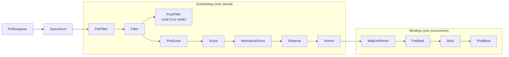

# Scheduling framework

## Summary

The scheduling framework is the pluggable architecture of kube-scheduler. Each attempt to schedule a Pod runs through a *scheduling cycle* (serial: choose a node) and a *binding cycle* (possibly concurrent: apply the choice). Plugins register at extension points along the way: PreEnqueue, QueueSort, PreFilter, Filter, PostFilter (preemption), PreScore, Score, NormalizeScore, Reserve, Permit, PreBind, Bind and PostBind, plus EnqueueExtension and QueueingHint for efficient requeueing. Almost every scheduling feature, from resource fit to topology spread, is a plugin, which keeps the core small and lets you build custom schedulers on the same code.

## Prerequisites

- [kube-scheduler](kube-scheduler.md).
- Basic Go and Kubernetes controller concepts, for writing plugins.

## Core concepts

### Definition

The *scheduling framework* is a pluggable architecture for the Kubernetes scheduler. It consists of a set of "plugin" APIs that are compiled directly into the scheduler. These APIs allow most scheduling features to be implemented as plugins, while keeping the scheduling "core" lightweight and maintainable. The design proposal (KEP-624) gives the technical details.

### Framework workflow

The framework defines a few extension points. Scheduler plugins register to be invoked at one or more of them. Some plugins can change scheduling decisions; some are informational only.

Each attempt to schedule one Pod is split into two phases, the **scheduling cycle** and the **binding cycle**.

**Scheduling cycle and binding cycle.** The scheduling cycle selects a node for the Pod, and the binding cycle applies that decision to the cluster. Together they are called a *scheduling context*. Scheduling cycles run serially, while binding cycles may run concurrently. A scheduling or binding cycle can be aborted if the Pod is found to be unschedulable or if there is an internal error. The Pod is then returned to the queue and retried.

### Extension points

The figure shows the extension points of a Pod scheduling context: PreEnqueue gates Pods before the queue, Sort orders the queue, the green points form the scheduling cycle and the yellow points the binding cycle.




### Interfaces

One plugin may implement several interfaces to do more complex or stateful tasks. Some interfaces match the scheduler extension points that can be configured in the scheduler configuration.

**PreEnqueue.** Called before Pods are added to the internal active queue, where Pods are marked as ready for scheduling. Only when all PreEnqueue plugins return `Success` may the Pod enter the active queue. Otherwise, it is placed in the internal list of unschedulable Pods and does not get an `Unschedulable` condition. (Pod scheduling gates, `spec.schedulingGates`, are implemented this way.)

**EnqueueExtension.** The interface through which a plugin controls whether to retry scheduling of Pods it rejected, based on changes in the cluster. Plugins that implement PreEnqueue, PreFilter, Filter, Reserve or Permit should implement it.

**QueueingHint.** A callback function that decides whether a Pod can be requeued to the active queue or the backoff queue. It runs when a certain kind of event or change happens in the cluster. If the event might make the Pod schedulable, the Pod is put into the active or backoff queue for a retry.

**QueueSort.** Sorts the Pods in the scheduling queue. A queue sort plugin essentially provides a `Less(Pod1, Pod2)` function. Only one queue sort plugin may be enabled at a time. (The default sorts by priority, then by timestamp.)

**PreFilter.** Pre-processes information about the Pod, or checks conditions that the cluster or the Pod must meet. If a PreFilter plugin returns an error, the scheduling cycle is aborted.

**Filter.** Filters out nodes that cannot run the Pod. For each node, the scheduler calls the filter plugins in their configured order. If any filter plugin marks the node as infeasible, the remaining plugins are not called for that node. Nodes may be evaluated concurrently.

**PostFilter.** Called after the Filter phase, but only when no feasible nodes were found for the Pod. Plugins are called in their configured order. If any PostFilter plugin marks the node as `Schedulable`, the remaining plugins are not called. A typical PostFilter implementation is preemption, which tries to make the Pod schedulable by preempting other Pods.

**PreScore.** Performs "pre-scoring" work, which generates a sharable state for Score plugins. If a PreScore plugin returns an error, the scheduling cycle is aborted.

**Score.** Ranks the nodes that passed filtering. The scheduler calls each scoring plugin for each node. There is a well-defined range of integers representing the minimum and maximum scores. After NormalizeScore, the scheduler combines the node scores from all plugins according to the configured plugin weights.

**NormalizeScore.** Modifies scores before the scheduler computes the final ranking of nodes. A plugin that registers for this extension point is called with the Score results of the same plugin, once per plugin per scheduling cycle.

**Reserve.** A plugin that implements Reserve has two methods, `Reserve` and `Unreserve`, which back two informational scheduling phases called Reserve and Unreserve. Plugins that maintain runtime state ("stateful plugins") use these phases to be notified by the scheduler when resources on a node are reserved and unreserved for a given Pod.

The Reserve phase happens before the scheduler actually binds a Pod to its designated node. It exists to prevent race conditions while the scheduler waits for the bind to succeed. The `Reserve` method of each plugin may succeed or fail; if one fails, subsequent plugins are not executed and the Reserve phase is considered failed. If all succeed, the Reserve phase is successful and the rest of the scheduling cycle and the binding cycle run. The Unreserve phase is triggered if the Reserve phase or a later phase fails. Then the `Unreserve` method of **all** Reserve plugins is called in the reverse order of `Reserve` calls, to clean up the state associated with the reserved Pod.

**Caution.** The implementation of the `Unreserve` method in Reserve plugins must be idempotent and may not fail.

**Permit.** Invoked at the end of the scheduling cycle for each Pod, to prevent or delay the binding to the candidate node. A permit plugin can do one of three things:

1. **Approve.** Once all Permit plugins approve a Pod, it is sent for binding.
2. **Deny.** If any Permit plugin denies a Pod, it is returned to the scheduling queue. This triggers the Unreserve phase in Reserve plugins.
3. **Wait** (with a timeout). If a Permit plugin returns "wait", the Pod is kept in an internal list of waiting Pods, and the binding cycle of this Pod starts but blocks until it is approved. If a timeout occurs, wait becomes deny, and the Pod is returned to the scheduling queue, triggering the Unreserve phase in Reserve plugins. (Gang scheduling plugins use "wait" to hold Pods until the whole group can be placed.)

**PreBind.** Performs any work required before a Pod is bound. For example, a pre-bind plugin may provision a network volume and mount it on the target node before allowing the Pod to run there. If any PreBind plugin returns an error, the Pod is rejected and returned to the scheduling queue.

**Bind.** Binds a Pod to a node. Bind plugins are not called until all PreBind plugins have completed. Each bind plugin is called in the configured order. A bind plugin may choose whether to handle the given Pod. If a bind plugin chooses to handle a Pod, **the remaining bind plugins are skipped**.

**PostBind.** An informational interface. PostBind plugins are called after a Pod is successfully bound. This is the end of a binding cycle and can be used to clean up associated resources.

| Extension point | Cycle | Can reject the Pod or node? | Example built-in plugin |
| --- | --- | --- | --- |
| PreEnqueue | Before queue | Holds the Pod back | SchedulingGates |
| QueueSort | Queue | No (orders) | PrioritySort |
| PreFilter, Filter | Scheduling | Yes | NodeResourcesFit, TaintToleration, NodeAffinity |
| PostFilter | Scheduling | Makes room | DefaultPreemption |
| PreScore, Score, NormalizeScore | Scheduling | No (ranks) | NodeResourcesBalancedAllocation, ImageLocality, PodTopologySpread |
| Reserve, Permit | Scheduling | Yes (deny, wait) | VolumeBinding (Reserve) |
| PreBind, Bind, PostBind | Binding | PreBind can fail | VolumeBinding (PreBind), DefaultBinder |

## Worked example

A second scheduler profile that packs nodes tightly, selected per Pod (untested here; Kubernetes v1.30 or later; the configuration is passed to kube-scheduler with `--config`):

```yaml
apiVersion: kubescheduler.config.k8s.io/v1
kind: KubeSchedulerConfiguration
profiles:
  - schedulerName: default-scheduler
  - schedulerName: bin-packing-scheduler
    pluginConfig:
      - name: NodeResourcesFit
        args:
          scoringStrategy:
            type: MostAllocated
            resources:
              - { name: cpu, weight: 1 }
              - { name: memory, weight: 1 }
    plugins:
      score:
        disabled:
          - name: NodeResourcesBalancedAllocation
```

```yaml
# a Pod that uses the second profile
spec:
  schedulerName: bin-packing-scheduler
```

Batch Pods using `bin-packing-scheduler` fill nodes before new ones are used, which helps the node autoscaler remove empty nodes; web Pods keep the default spreading.

## Trade offs and when to use it

- **Profiles and plugin arguments** need no code and are the first choice.
- **Out-of-tree plugins** (for example from `kubernetes-sigs/scheduler-plugins`: coscheduling, capacity scheduling) require building and running your own scheduler binary, but have full access to the scheduler cache.
- **Scheduler extenders** (webhooks) are easier to write but slower and limited to a few points; see [Scheduler extenders](../extending-kubernetes/scheduler-extenders.md).

## Common mistakes

- **Expensive work in Filter**, which runs for every node of every Pod.
- **Non-idempotent `Unreserve`.**
- **Two schedulers acting on the same Pods** without distinct `schedulerName` values.

## Practice

1. Which cycle runs serially, and which may run concurrently?
2. When is PostFilter called?
3. What happens when a Permit plugin's wait times out?
4. Why do Reserve plugins exist?

Answers: 1. The scheduling cycle is serial; binding cycles may be concurrent. 2. Only when no feasible node was found. 3. The Pod is denied, returned to the queue, and Unreserve runs. 4. To update plugin state before binding completes, preventing races while the bind is in progress.

## Further reading

- [Scheduling Framework](https://kubernetes.io/docs/concepts/scheduling-eviction/scheduling-framework/), Kubernetes documentation.
- [Scheduler Configuration](https://kubernetes.io/docs/reference/scheduling/config/), Kubernetes documentation.
- [KEP-624: Scheduling Framework](https://github.com/kubernetes/enhancements/tree/master/keps/sig-scheduling/624-scheduling-framework), Kubernetes enhancements.
- [scheduler-plugins](https://github.com/kubernetes-sigs/scheduler-plugins), Kubernetes SIGs. Out-of-tree plugins.
