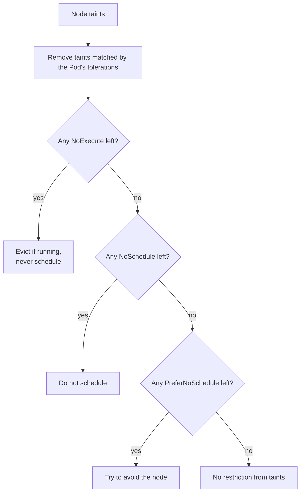
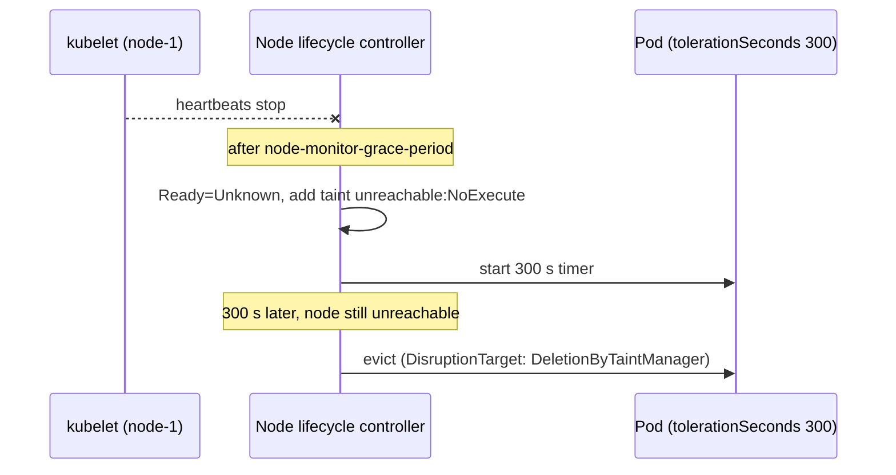

# Taints and tolerations

## Summary

A *taint* on a node repels Pods; a *toleration* on a Pod lets it ignore a matching taint. Each taint has a key, an optional value and an effect: `NoSchedule` (no new Pods without a toleration), `PreferNoSchedule` (avoid if possible) or `NoExecute` (also evict running Pods, optionally after `tolerationSeconds`). Tolerations allow scheduling but never force it, so dedicating nodes needs taints plus node affinity. The control plane taints nodes automatically for conditions such as not-ready, unreachable or memory pressure, which drives taint-based eviction of Pods from failed nodes.

## Prerequisites

- [kube-scheduler](kube-scheduler.md).

## Core concepts

### Definition

Taints and tolerations restrict or allow the scheduling of Pods on certain nodes.

- A **taint** is a property applied to a node that marks a limitation or requirement. (It looks like a label, `key=value:effect`, but is a separate field, `spec.taints`.)
- A **toleration** is applied to a Pod to show that it can tolerate certain taints. When a node has a taint, only Pods with a corresponding toleration can be scheduled onto it.

This is useful to separate critical from non-critical workloads, to reserve nodes for certain tasks, and to protect nodes from being overloaded.

*Node affinity* is a property of Pods that *attracts* them to a set of nodes (either as a preference or a hard requirement). *Taints* are the opposite: they let a node *repel* a set of Pods.

Tolerations are applied to Pods. They allow the scheduler to schedule Pods with matching taints. Tolerations allow scheduling but do not guarantee it: the scheduler also evaluates other parameters as part of its function.

Taints and tolerations work together to make sure Pods are not scheduled onto inappropriate nodes. One or more taints are applied to a node; this marks that the node should not accept any Pods that do not tolerate the taints.

*Analogy.* A taint is a "staff only" sign on a door, and a toleration is a staff badge. The badge lets you walk through, but it does not make you go through that door; for that you need directions (node affinity). The analogy breaks for `NoExecute`: a new sign can also throw out people already inside.

### Concept

You add a taint to a node with `kubectl taint`. For example:

```bash
kubectl taint nodes node1 key1=value1:NoSchedule
```

places a taint on node `node1`. The taint has key `key1`, value `value1` and effect `NoSchedule`. No Pod can be scheduled onto `node1` unless it has a matching toleration. To remove the taint added by the command above:

```bash
kubectl taint nodes node1 key1=value1:NoSchedule-
```

You specify a toleration in the PodSpec. Both of the following tolerations "match" the taint created above, so a Pod with either toleration could be scheduled onto `node1`:

```yaml
tolerations:
  - key: "key1"
    operator: "Equal"
    value: "value1"
    effect: "NoSchedule"
```

```yaml
tolerations:
  - key: "key1"
    operator: "Exists"
    effect: "NoSchedule"
```

The default value of `operator` is `Equal`. A toleration "matches" a taint if the keys are the same and the effects are the same, and:

- the `operator` is `Exists` (in which case no `value` should be specified), or
- the `operator` is `Equal` and the values are equal.

There are two special cases:

- An empty `key` with operator `Exists` matches all keys, values and effects, which means it tolerates everything.
- An empty `effect` matches all effects with key `key1`.

The allowed values of the `effect` field:

| Effect | Effect on new Pods | Effect on running Pods |
| --- | --- | --- |
| `NoExecute` | Not scheduled without a toleration | Pods that do not tolerate the taint are evicted immediately. Pods that tolerate it without `tolerationSeconds` stay bound forever. Pods that tolerate it with `tolerationSeconds` stay for that time, then the node lifecycle controller evicts them. |
| `NoSchedule` | Not scheduled without a matching toleration | Not evicted. |
| `PreferNoSchedule` | A "soft" version of `NoSchedule`: the control plane *tries* to avoid placing a non-tolerating Pod on the node, but it is not guaranteed. | Not evicted. |

### Multiple taints and tolerations

You can put several taints on the same node and several tolerations on the same Pod. Kubernetes processes them like a filter: start with all of a node's taints, then ignore the ones for which the Pod has a matching toleration; the remaining un-ignored taints have their effects on the Pod. In particular:

- If there is at least one un-ignored taint with effect `NoSchedule`, Kubernetes does not schedule the Pod onto that node.
- If there is no un-ignored taint with effect `NoSchedule` but at least one with `PreferNoSchedule`, Kubernetes *tries* not to schedule the Pod onto the node.
- If there is at least one un-ignored taint with effect `NoExecute`, the Pod is evicted from the node (if it is already running there) and is not scheduled onto it (if it is not yet running there).



### Use cases

Taints and tolerations are a flexible way to steer Pods *away* from nodes or to evict Pods that should not be running. Some use cases:

- **Dedicated nodes.** To dedicate a set of nodes to a particular group of users, taint them (`kubectl taint nodes nodename dedicated=groupName:NoSchedule`) and add a matching toleration to their Pods. The tolerating Pods can then use the dedicated nodes as well as any other nodes in the cluster. To make them use *only* the dedicated nodes, also label the nodes (`dedicated=groupName`) and give the Pods node affinity to that label (for example enforced by an admission controller).
- **Nodes with special hardware.** In a cluster where a small subset of nodes has specialized hardware (for example GPUs), keep Pods that do not need it off those nodes, to leave room for later Pods that do. Taint the GPU nodes (`nvidia.com/gpu=present:NoSchedule`); Pods requesting the extended resource get the toleration (the `ExtendedResourceToleration` admission controller can add it automatically).
- **Taint-based evictions.** A per-Pod configurable eviction behavior when there are node problems, described next.

### Taint based evictions

The node controller automatically taints a node when certain conditions are true. The built-in taints are:

| Taint | Meaning |
| --- | --- |
| `node.kubernetes.io/not-ready` | The node is not ready. Corresponds to the NodeCondition `Ready` being `False`. |
| `node.kubernetes.io/unreachable` | The node is unreachable from the node controller. Corresponds to the NodeCondition `Ready` being `Unknown`. |
| `node.kubernetes.io/memory-pressure` | The node has memory pressure. |
| `node.kubernetes.io/disk-pressure` | The node has disk pressure. |
| `node.kubernetes.io/pid-pressure` | The node has PID pressure. |
| `node.kubernetes.io/network-unavailable` | The node's network is unavailable. |
| `node.kubernetes.io/unschedulable` | The node is unschedulable (cordoned). |
| `node.cloudprovider.kubernetes.io/uninitialized` | When the kubelet is started with an "external" cloud provider, this taint marks the node as unusable. After a controller of the cloud-controller-manager initializes the node, the kubelet removes it. |

When a node is to be drained, the node controller or the kubelet adds the relevant taints with the `NoExecute` effect. This effect is added by default for the `not-ready` and `unreachable` taints. When the fault condition returns to normal, the kubelet or node controller removes the relevant taints.

Kubernetes automatically adds tolerations for `not-ready` and `unreachable` with `tolerationSeconds: 300` to Pods that do not set them (DefaultTolerationSeconds admission). So by default, Pods stay bound to a failed node for 5 minutes before eviction. Setting a shorter `tolerationSeconds` makes failover faster; a stateful Pod with local state may want a longer one. DaemonSet Pods tolerate these taints without a time limit (see [DaemonSet](../workloads/workload-management/daemonset.md#taints-and-tolerations)).



### Taint nodes by condition

The control plane, using the node controller, automatically creates taints with a `NoSchedule` effect for node conditions.

The scheduler checks taints, not node conditions, when it makes scheduling decisions. This ensures that node conditions do not directly affect scheduling. For example, if the `DiskPressure` node condition is active, the control plane adds the `node.kubernetes.io/disk-pressure` taint and does not schedule new Pods onto the affected node. If the `MemoryPressure` condition is active, the control plane adds the `node.kubernetes.io/memory-pressure` taint.

You can ignore node conditions for newly created Pods by adding the corresponding tolerations. The DaemonSet controller does this automatically.

## Worked example

Dedicated GPU nodes (untested here; Kubernetes v1.30 or later):

```bash
kubectl taint nodes gpu-node-1 dedicated=gpu:NoSchedule
kubectl label nodes gpu-node-1 dedicated=gpu
```

```yaml
apiVersion: v1
kind: Pod
metadata:
  name: trainer
spec:
  tolerations:
    - { key: dedicated, operator: Equal, value: gpu, effect: NoSchedule }
    - { key: node.kubernetes.io/unreachable, operator: Exists, effect: NoExecute, tolerationSeconds: 60 }
  affinity:
    nodeAffinity:
      requiredDuringSchedulingIgnoredDuringExecution:
        nodeSelectorTerms:
          - matchExpressions:
              - { key: dedicated, operator: In, values: ["gpu"] }
  containers:
    - name: train
      image: busybox:1.36
      command: ["sleep", "3600"]
```

```bash
kubectl apply -f trainer.yaml
kubectl get pod trainer -o wide            # on gpu-node-1
kubectl run web --image=nginx:1.27
kubectl get pod web -o wide                # never on gpu-node-1 (no toleration)
```

The toleration lets the trainer onto the GPU node, the affinity keeps it off other nodes, and it is evicted after 60 seconds (instead of 300) if the node becomes unreachable.

## Trade offs and when to use it

- **Taints alone** keep others out but let tolerating Pods go anywhere; **affinity alone** pulls Pods in but lets others in too. Dedication needs both.
- **`NoExecute`** is powerful and disruptive: adding it to a node evicts every non-tolerating Pod at once.
- **Short `tolerationSeconds`** gives fast failover but risks evicting Pods during short network blips.

## Common mistakes

- **Expecting a toleration to pin a Pod to a node.**
- **Wildcard tolerations** (`operator: Exists` without key) in normal workloads, which let them onto control plane and special nodes.
- **Removing a taint with the wrong suffix** (the trailing `-` must follow the effect).
- **Forgetting that `NoExecute` evicts running Pods.**

## Practice

1. A node has taints `a=1:NoSchedule` and `b=2:PreferNoSchedule`. A Pod tolerates `a`. Where can it go?
2. What is the difference between `NoSchedule` and `NoExecute` for Pods already running?
3. How long does a Pod stay on an unreachable node by default, and why?
4. How do you dedicate nodes exclusively to a team?

Answers: 1. It can be scheduled on the node, but the scheduler tries to avoid it because of the remaining `PreferNoSchedule` taint. 2. `NoSchedule` leaves them; `NoExecute` evicts those without a toleration (or after `tolerationSeconds`). 3. 300 seconds, from the default tolerations added by the DefaultTolerationSeconds admission controller. 4. Taint the nodes, give the team's Pods a toleration, and label the nodes plus require node affinity in the team's Pods.

## Further reading

- [Taints and Tolerations](https://kubernetes.io/docs/concepts/scheduling-eviction/taint-and-toleration/), Kubernetes documentation.
- [Assigning Pods to Nodes](https://kubernetes.io/docs/concepts/scheduling-eviction/assign-pod-node/), Kubernetes documentation.
- [Nodes: node conditions and heartbeats](https://kubernetes.io/docs/concepts/architecture/nodes/), Kubernetes documentation.
