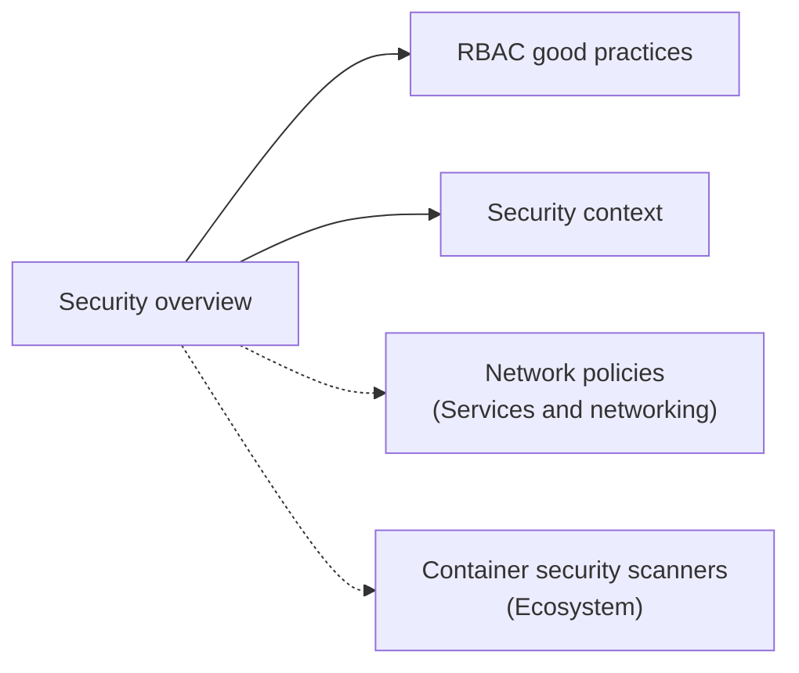

# Security

How Kubernetes protects the control plane, workloads and data: the layers of security controls, RBAC good practices and privilege escalation paths, and per-Pod security settings. Corresponds to the "Security" chapter of the Kubernetes documentation Concepts. Network policies live in [Services and networking](../services-and-networking/network-policies.md), and image scanners in [Ecosystem](../ecosystem/security-tools/container-security-scanners.md).

## Map of the area

## Notes in reading order

1. [Security overview](security-overview.md): control plane protection, Secrets, workload protection, network security, auditing.
2. [RBAC good practices](rbac-good-practices.md): least privilege, token distribution, hardening, review, privilege escalation and denial of service risks.
3. [Security context](security-context.md): Pod and container settings, volume ownership, capabilities, seccomp, SELinux, `/proc` masking.

## Planned topics

- Cloud native security (the 4C model in depth)
- Pod Security Standards
- Pod Security admission
- Service accounts
- Pod Security Policies (removed in v1.25; history and migration)
- Security for Linux nodes and for Windows nodes
- Controlling access to the Kubernetes API (authentication, authorization, admission)
- Good practices for Kubernetes Secrets
- Multi-tenancy
- Hardening guides: authentication mechanisms, dynamic resource allocation, scheduler configuration
- Kubernetes API server bypass risks
- Linux kernel security constraints for Pods and containers
- Security checklist and application security checklist
