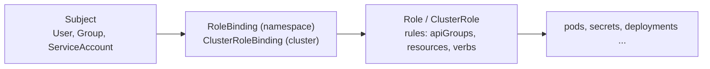
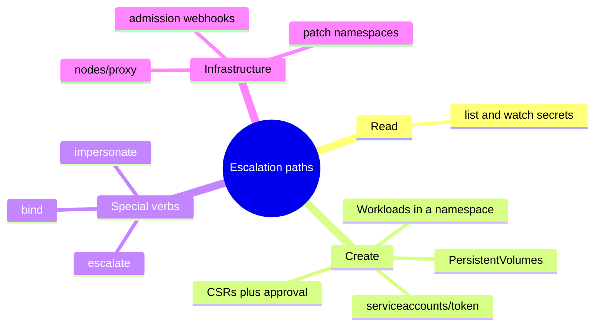

# RBAC good practices

## Summary

Role-based access control (RBAC) grants users and service accounts only the API access they need. Good practice is least privilege (namespaced RoleBindings, no wildcards, no routine `cluster-admin`, nobody in `system:masters`), keeping powerful service account tokens away from untrusted workloads, hardening defaults and reviewing bindings regularly. Several permissions are effectively privilege escalation paths, even though they look harmless: `list` and `watch` on Secrets, creating workloads, creating PersistentVolumes, the node `proxy` subresource, the `escalate`, `bind` and `impersonate` verbs, CSR approval, token requests, control of admission webhooks and patching namespaces. Object creation rights can also be used for denial of service.

This note is for defensive use: it helps administrators find and remove dangerous permissions. Test escalation paths only in your own lab or in an authorized assessment.

## Prerequisites

- [Security overview](security-overview.md).
- RBAC basics: Role, ClusterRole, RoleBinding, ClusterRoleBinding (see [Using RBAC Authorization](https://kubernetes.io/docs/reference/access-authn-authz/rbac/)).

## Core concepts

### Purpose

Kubernetes RBAC is a key security control to make sure that cluster users and workloads have only the access to resources required to execute their roles. When designing permissions for cluster users, the cluster administrator must understand where privilege escalation could occur, to reduce the risk of excessive access leading to security incidents.



### Least privilege

Ideally, minimal RBAC rights are assigned to users and service accounts: only permissions explicitly required for their operation. General rules:

- **Assign permissions at the namespace level where possible.** Use RoleBindings rather than ClusterRoleBindings to give users rights only within a specific namespace.
- **Avoid wildcard permissions**, especially to all resources. Because Kubernetes is extensible, wildcard access gives rights not only to all object types that exist in the cluster today, but also to all object types created in the future.
- **Do not use `cluster-admin` accounts** except where specifically needed. A low-privileged account with impersonation rights can avoid accidental modification of cluster resources.
- **Avoid adding users to the `system:masters` group.** Any member of this group bypasses all RBAC checks and always has unrestricted superuser access, which cannot be revoked by removing RoleBindings or ClusterRoleBindings. If the cluster uses an authorization webhook, membership in this group also bypasses that webhook (requests from its members are never sent to the webhook).

### Minimize distribution of privileged tokens

Ideally, Pods are not assigned service accounts that have powerful permissions (for example any of the rights listed under [privilege escalation risks](#privilege-escalation-risks)). Where a workload needs powerful permissions:

- **Limit the number of nodes running powerful Pods.** Make sure any DaemonSets you run are necessary and run with least privilege, to limit the blast radius of container escapes.
- **Avoid running powerful Pods alongside untrusted or publicly exposed ones.** Use taints and tolerations, node affinity or Pod anti-affinity to make sure such Pods do not share nodes with untrusted or less trusted Pods. Pay special attention where less trustworthy Pods do not meet the **Restricted** Pod Security Standard.

### Hardening

Kubernetes defaults provide access that may not be needed in every cluster. Reviewing the RBAC rights provided by default gives opportunities for hardening. In general, do not change rights given to `system:` accounts, but some options exist:

- Review bindings for the `system:unauthenticated` group and remove them where possible, because this gives access to anyone who can reach the API server on the network.
- Avoid the default automatic mounting of service account tokens by setting `automountServiceAccountToken: false` (on the ServiceAccount or the Pod). Pods that need the API can opt back in.

### Periodic review

Review the Kubernetes RBAC settings regularly for redundant entries and possible privilege escalations. If an attacker can create a user account with the same name as a deleted user, they automatically inherit all rights of the deleted user, in particular the rights bound to that user name. Remove bindings when users leave.

### Privilege escalation risks

Within RBAC, several privileges can allow a user or service account to escalate their privileges in the cluster or affect systems outside it. Cluster operators must take care not to grant more access than intended.



#### Listing secrets

Allowing `get` on Secrets clearly lets a user read their contents. `list` and `watch` also effectively reveal the contents. For example, a List response (such as `kubectl get secrets -A -o yaml`) includes the contents of all Secrets.

#### Workload creation

Permission to create workloads (Pods, or workload resources that manage Pods) in a namespace implicitly grants access to many other resources in that namespace, such as Secrets, ConfigMaps and PersistentVolumes that can be mounted in Pods. It also gives the API access level of any service account in that namespace, because a Pod can run as any of them. Users who can run privileged Pods can potentially escalate to the node.

To mitigate the risk for less trusted users, enforce the Baseline or Restricted Pod Security Standard with Pod Security admission or third party tools. Namespaces separate trust levels, but use least privilege inside them too, because the boundaries within a namespace are weak.

#### Persistent volume creation

Only trusted cluster operators and the control plane components that need it should be allowed to create PersistentVolumes, because a PV (for example `hostPath`) can give unrestricted access to the host file system. Trusted administrators create PersistentVolumes; other users use PersistentVolumeClaims.

#### Access to the proxy subresource of Nodes

Users with access to the `proxy` subresource of Node objects have rights to the kubelet API, which allows command execution in every Pod on the nodes they have rights to. This access bypasses audit logging and admission control, so take care before granting it.

#### Escalate verb

The RBAC system normally prevents users from creating ClusterRoles or Roles with more rights than they hold. The `escalate` verb is the exception: it lets a user create or update roles with rights they do not have.

#### Bind verb

Like `escalate`, `bind` bypasses the built-in protections against privilege escalation: it lets users create bindings to roles with rights they do not already have.

#### Impersonate verb

`impersonate` lets users impersonate and gain the rights of other users (or groups and service accounts) in the cluster. Make sure that no excessive permissions can be gained through one of the impersonated accounts.

#### CSRs and certificate issuing

The CertificateSigningRequest API lets users with `create` on CSRs and `update` on `certificatesigningrequests/approval`, where the signer is `kubernetes.io/kube-apiserver-client`, create new client certificates that authenticate to the cluster. Those certificates can have arbitrary names, including names of Kubernetes system components. This is effectively privilege escalation.

#### Token request

Users with `create` on `serviceaccounts/token` can create TokenRequests to issue tokens for existing service accounts, and thus act as those service accounts.

#### Control admission webhooks

Users who control `validatingwebhookconfigurations` or `mutatingwebhookconfigurations` can control webhooks that can read any object admitted to the cluster, and, for mutating webhooks, also mutate admitted objects (for example inject a privileged container).

#### Namespace modification

Users who can **patch** Namespace objects (through a RoleBinding to a role with that permission) can change namespace labels. In clusters with Pod Security admission, this can allow a more permissive policy than administrators intended. For clusters with NetworkPolicy, users may set labels that indirectly allow access to services the administrator did not intend to expose.

### Denial of service risks

**Object creation denial of service.** Users who can create objects may be able to create objects large enough, or numerous enough, to cause a denial of service condition, as discussed in the issue "etcd used by Kubernetes is vulnerable to OOM attack". This is especially relevant in multi-tenant clusters where semi-trusted or untrusted users get limited access. One mitigation is to use [resource quotas](../policies/README.md) to limit the number of objects that can be created (object count quotas), together with API Priority and Fairness.

## Worked example

Auditing a service account for risky permissions (untested here; Kubernetes v1.30 or later):

```bash
SA=system:serviceaccount:ci:deployer
for check in "get secrets" "list secrets" "create pods" "create serviceaccounts/token" \
             "escalate roles" "bind clusterroles" "impersonate users" "get nodes/proxy" \
             "patch namespaces" "create persistentvolumes"; do
  set -- $check
  printf '%-36s %s\n' "$check" "$(kubectl auth can-i $1 $2 --as=$SA -A)"
done
kubectl get clusterrolebindings -o json | \
  jq -r '.items[] | select(.roleRef.name=="cluster-admin") | .metadata.name + ": " + ([.subjects[]?.name] | join(","))'
```

A least-privilege role for that deployer, limited to one namespace and without Secret reads:

```yaml
apiVersion: rbac.authorization.k8s.io/v1
kind: Role
metadata: { name: deployer, namespace: shop }
rules:
  - apiGroups: ["apps"]
    resources: ["deployments"]
    verbs: ["get", "list", "watch", "patch", "update"]
---
apiVersion: rbac.authorization.k8s.io/v1
kind: RoleBinding
metadata: { name: deployer, namespace: shop }
subjects:
  - kind: ServiceAccount
    name: deployer
    namespace: ci
roleRef:
  kind: Role
  name: deployer
  apiGroup: rbac.authorization.k8s.io
```

Note that even `patch` on Deployments lets the deployer run arbitrary Pods (and so mount Secrets) in `shop`; pair it with Pod Security admission.

## Trade offs and when to use it

- **Granular roles** reduce risk but are harder to maintain; aggregated ClusterRoles and generated roles help.
- **Namespace per team** with RoleBindings is the common multi-tenancy baseline; stronger isolation needs separate clusters or virtual clusters.

## Common mistakes

- **Binding `cluster-admin` to CI service accounts.**
- **Granting `list secrets` for "read-only" dashboards.**
- **Wildcard rules** (`resources: ["*"]`) in custom ClusterRoles.
- **Forgetting that workload creation implies Secret access.**
- **Client certificates for humans**, which cannot be revoked; prefer OIDC.

## Practice

1. Why is `list` on Secrets as dangerous as `get`?
2. Which group bypasses RBAC entirely, and why can its membership not be revoked by deleting bindings?
3. A user can create Deployments but not read Secrets. Can they read Secrets? How?
4. Which two verbs bypass RBAC's escalation prevention?
5. How do you limit object-count denial of service?

Answers: 1. List responses contain the full contents of every Secret. 2. `system:masters`; membership comes from the credential (for example the certificate's organization), and the group is hard-wired to bypass authorization. 3. Yes, by creating a Pod that mounts the Secret or prints it. 4. `escalate` and `bind`. 5. ResourceQuota object counts (and API Priority and Fairness).

## Further reading

- [Role Based Access Control Good Practices](https://kubernetes.io/docs/concepts/security/rbac-good-practices/), Kubernetes documentation.
- [Using RBAC Authorization](https://kubernetes.io/docs/reference/access-authn-authz/rbac/), Kubernetes documentation.
- [Controlling Access to the Kubernetes API](https://kubernetes.io/docs/concepts/security/controlling-access/), Kubernetes documentation.
- [etcd used by Kubernetes is vulnerable to OOM attack (issue 107325)](https://github.com/kubernetes/kubernetes/issues/107325), Kubernetes issue tracker.
