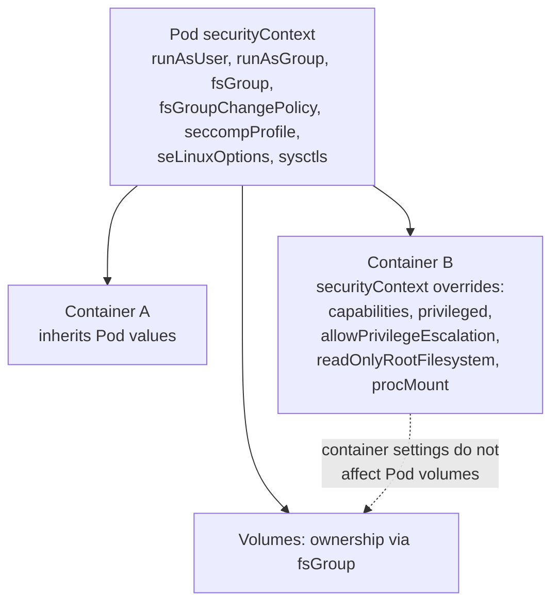

# Security context

## Summary

A security context defines privilege and access control settings for a Pod or a container: the user and group IDs a process runs as, whether it may run privileged or gain more privileges, which Linux capabilities it has, its seccomp, AppArmor and SELinux profiles, whether the root file system is read-only, and how volume ownership is set. Pod level settings apply to all containers; container level settings override them. The `/proc` masking that OCI runtimes apply by default can be relaxed with `procMount`, which is needed only for nested containers. Secure defaults (non-root, no privilege escalation, all capabilities dropped, `RuntimeDefault` seccomp) are what the Restricted Pod Security Standard requires.

This note is defensive; the settings it describes reduce what an attacker can do after compromising a container.

## Prerequisites

- [Security overview](security-overview.md).
- [Container fundamentals](../containers/container-fundamentals.md).

## Core concepts

### Container and Pod security in general

Kubernetes secures containers and Pods through several measures: trusted container images, limited container privileges, Pod level security policies (Pod Security Standards), network security, access control with RBAC, and handling sensitive information with Secrets and ConfigMaps. Together these practices reduce the risk of security incidents in a cluster. The security context is the per-Pod and per-container part of this.

### What a security context controls

A security context defines privilege and access control settings for a Pod or container. Settings include, but are not limited to:

- **Discretionary access control**: permission to access an object, like a file, is based on user ID (UID) and group ID (GID) (`runAsUser`, `runAsGroup`, `fsGroup`, `supplementalGroups`, `runAsNonRoot`).
- **Security Enhanced Linux (SELinux)**: objects are assigned security labels.
- **Running as privileged or unprivileged** (`privileged`).
- **Linux capabilities**: give a process some privileges, but not all the privileges of the root user.
- **AppArmor**: use program profiles to restrict the capabilities of individual programs.
- **Seccomp**: filter a process's system calls.
- **`allowPrivilegeEscalation`**: controls whether a process can gain more privileges than its parent. This boolean directly controls whether the [`no_new_privs`](https://www.kernel.org/doc/Documentation/prctl/no_new_privs.txt) flag is set on the container process. `allowPrivilegeEscalation` is always true when the container:
  - is run as privileged, or
  - has `CAP_SYS_ADMIN`.
- **`readOnlyRootFilesystem`**: mounts the container's root file system as read-only.



### Pod level security context

To specify security settings for a Pod, include the `securityContext` field in the Pod specification. It is a PodSecurityContext object. The settings apply to all containers in the Pod (and to volumes where relevant).

**Volume permissions and ownership.** By default, Kubernetes recursively changes the ownership and permissions of the contents of each volume to match the `fsGroup` in the Pod's `securityContext` when the volume is mounted. For large volumes, checking and changing ownership and permissions can take a long time and slow down Pod startup. The `fsGroupChangePolicy` field controls this behavior. It applies only to volume types that support `fsGroup` controlled ownership and permissions. It has two values:

- **`OnRootMismatch`**: change permissions and ownership only if the permission and ownership of the volume's root directory do not match the expected permissions. This can shorten the time it takes to change ownership and permissions of a volume.
- **`Always`**: always change permission and ownership of the volume when it is mounted.

**Delegating volume permission and ownership change to the CSI driver.** If you deploy a CSI driver that supports the `VOLUME_MOUNT_GROUP` `NodeServiceCapability`, the process of setting file ownership and permissions based on the `fsGroup` in the `securityContext` is performed by the CSI driver instead of Kubernetes. In that case `fsGroupChangePolicy` has no effect: the driver is expected to mount the volume with the given `fsGroup`, which results in a volume readable and writable by that group.

### Container level security context

To specify security settings for a container, include the `securityContext` field in the container manifest. It is a SecurityContext object. Settings for a container apply only to that container, and they override Pod level settings when there is overlap. Container settings do not affect the Pod's volumes.

**Set capabilities.** With Linux capabilities, you can grant certain privileges to a process without granting all the privileges of the root user. To add or remove capabilities for a container, include the `capabilities` field in its `securityContext` (`add` and `drop`; best practice is `drop: ["ALL"]` and add back only what is needed, such as `NET_BIND_SERVICE`).

**Set the seccomp profile.** To set the seccomp profile, include the `seccompProfile` field in the `securityContext` of the Pod or container. It is a SeccompProfile object with `type` and `localhostProfile`. Valid values for `type` are `RuntimeDefault`, `Unconfined` and `Localhost`. `localhostProfile` must be set only if `type: Localhost`; it is the path of a preconfigured profile on the node, relative to the kubelet's configured seccomp profile location (configured with the `--root-dir` flag, under `<root-dir>/seccomp`).

**Assign SELinux labels.** To assign SELinux labels to a container, include the `seLinuxOptions` field in the `securityContext` of the Pod or container. It is an SELinuxOptions object (`user`, `role`, `type`, `level`).

**AppArmor.** Set `appArmorProfile` (type `RuntimeDefault`, `Localhost` or `Unconfined`) in the Pod or container `securityContext` (field based configuration replaced the older annotations).

### Managing access to the /proc file system

For runtimes that follow the OCI runtime specification, containers run by default in a mode where several paths are both masked and read-only. The container has these paths in its mount namespace, and they can work similarly to an isolated host, but the container process cannot write to them. The masked and read-only paths are:

| Masked paths | Read-only paths |
| --- | --- |
| `/proc/asound` | `/proc/bus` |
| `/proc/acpi` | `/proc/fs` |
| `/proc/kcore` | `/proc/irq` |
| `/proc/keys` | `/proc/sys` |
| `/proc/latency_stats` | `/proc/sysrq-trigger` |
| `/proc/timer_list` | |
| `/proc/timer_stats` | |
| `/proc/sched_debug` | |
| `/proc/scsi` | |
| `/sys/firmware` | |
| `/sys/devices/virtual/powercap` | |

For some Pods, you might want to bypass this default masking. The most common case is running containers inside a Kubernetes container (within a Pod), for example nested container builds. The `securityContext` field `procMount` lets a user request that a container's `/proc` be `Unmasked`, or be mounted read-write by the container process. This also applies to `/sys/firmware`, which is not in `/proc`. Unmasked `procMount` requires user namespaces (`hostUsers: false`) and is allowed only by the Baseline (not Restricted) policy when combined with them.

## Worked example

A hardened Pod that meets the Restricted Pod Security Standard (untested here; Kubernetes v1.30 or later):

```yaml
apiVersion: v1
kind: Pod
metadata:
  name: hardened
spec:
  securityContext:
    runAsNonRoot: true
    runAsUser: 10001
    runAsGroup: 10001
    fsGroup: 10001
    fsGroupChangePolicy: OnRootMismatch
    seccompProfile: { type: RuntimeDefault }
  volumes:
    - name: tmp
      emptyDir: {}
  containers:
    - name: app
      image: nginxinc/nginx-unprivileged:1.27
      securityContext:
        allowPrivilegeEscalation: false
        readOnlyRootFilesystem: true
        capabilities: { drop: ["ALL"] }
      volumeMounts:
        - { name: tmp, mountPath: /tmp }      # writable scratch space despite read-only root
```

```bash
kubectl apply -f hardened.yaml
kubectl exec hardened -- id                         # uid=10001 gid=10001 groups=10001
kubectl exec hardened -- touch /etc/x               # Read-only file system
kubectl exec hardened -- grep -E 'NoNewPrivs|Seccomp:' /proc/1/status   # NoNewPrivs: 1, Seccomp: 2
kubectl label ns default pod-security.kubernetes.io/warn=restricted     # no warning for this Pod
```

## Trade offs and when to use it

- **Restricted settings** break images that expect root or write to their file system; use unprivileged images and `emptyDir` mounts for writable paths.
- **`fsGroup`** is convenient but can slow startup on large volumes; use `OnRootMismatch` or CSI delegation.
- **Custom seccomp or SELinux profiles** give stronger confinement but need per-node distribution and maintenance.

## Common mistakes

- **`runAsNonRoot: true` with an image whose user is root** and no `runAsUser`: the container fails to start (`CreateContainerConfigError`).
- **Adding capabilities without dropping `ALL`.**
- **Assuming container `securityContext` changes volume ownership.** Only Pod level `fsGroup` does.
- **`privileged: true` "just to make it work"**, which disables almost every other protection.

## Practice

1. When is `allowPrivilegeEscalation` always true?
2. What is the difference between `fsGroupChangePolicy: OnRootMismatch` and `Always`?
3. Which `seccompProfile.type` requires `localhostProfile`, and where is the file?
4. Which setting unmasks `/proc`, and for which use case?

Answers: 1. When the container is privileged or has `CAP_SYS_ADMIN`. 2. `OnRootMismatch` changes ownership only if the volume root does not match; `Always` changes it on every mount. 3. `Localhost`; a path relative to the kubelet seccomp directory under its root dir. 4. `procMount: Unmasked`, typically for nested containers.

## Further reading

- [Configure a Security Context for a Pod or Container](https://kubernetes.io/docs/tasks/configure-pod-container/security-context/), Kubernetes documentation.
- [Pod Security Standards](https://kubernetes.io/docs/concepts/security/pod-security-standards/), Kubernetes documentation.
- [Linux kernel security constraints for Pods and containers](https://kubernetes.io/docs/concepts/security/linux-kernel-security-constraints/), Kubernetes documentation.
- [Restrict a Container's Syscalls with seccomp](https://kubernetes.io/docs/tutorials/security/seccomp/), Kubernetes documentation.
