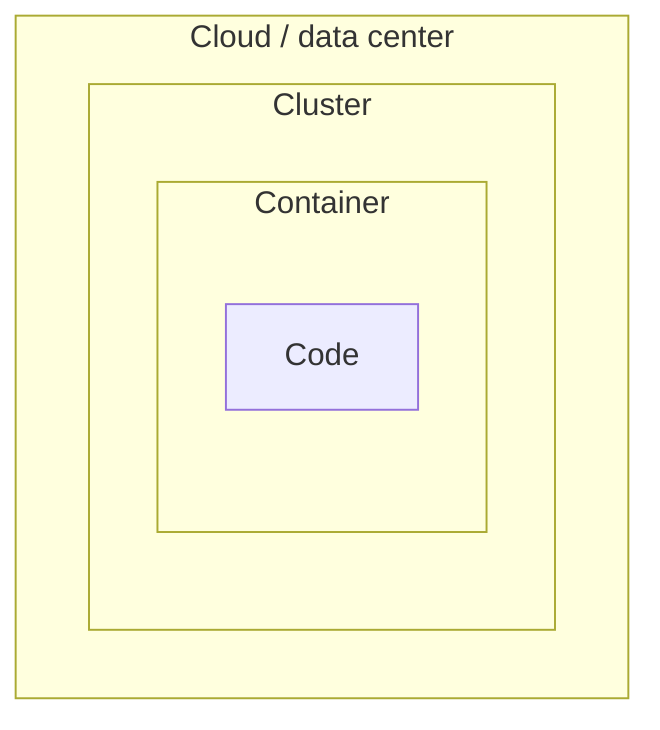
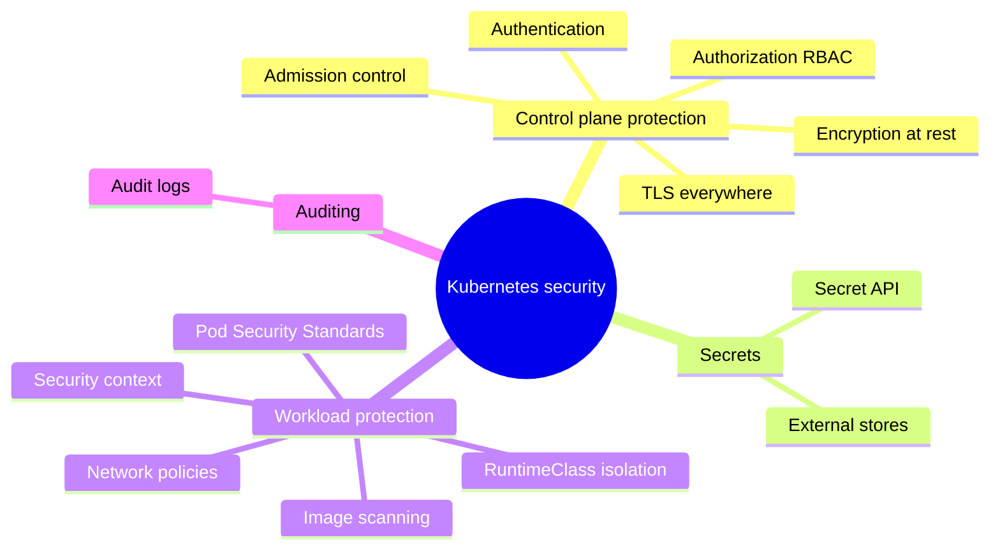
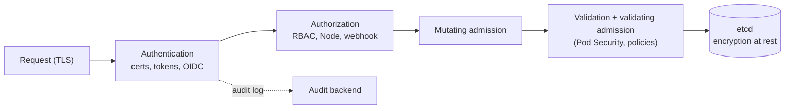

# Security overview

## Summary

Kubernetes security is layered. The control plane is protected by controlling access to the API (TLS, authentication, authorization, admission) and by encrypting data in transit and at rest. Secrets give basic protection to confidential configuration. Workloads are protected by Pod Security Standards, security contexts, RuntimeClasses, network policies and tools from the wider ecosystem. Network security combines network policies, encryption, authentication and authorization, and firewalls. Audit logging records who did what. No single control is sufficient; the layers are meant to be combined.

## Prerequisites

- [Cluster architecture overview](../cluster-architecture/cluster-architecture-overview.md).
- [Secrets](../configuration/secrets.md).

## Core concepts

### The layers

Kubernetes includes several APIs and security controls, as well as ways to define policies that can form part of how you manage information security. A useful model is the "4C" layering of cloud native security: Cloud, Cluster, Container, Code. Each layer relies on the one outside it.





### Control plane protection

A key security mechanism for any cluster is to [control access to the Kubernetes API](https://kubernetes.io/docs/concepts/security/controlling-access/).

Kubernetes expects you to configure and use TLS to provide data encryption in transit within the control plane, and between the control plane and its clients. You can also enable encryption at rest for the data stored by the control plane (etcd); this is separate from using encryption at rest for your workloads' own data, which might also be a good idea.

Every API request passes the same chain: authentication, authorization, admission. Its extension points are described in [Extending Kubernetes](../extending-kubernetes/extending-kubernetes-overview.md#api-access-extensions).



### Secrets

The [Secret](../configuration/secrets.md) API provides basic protection for configuration values that require confidentiality. It must be combined with encryption at rest and least-privilege RBAC to be meaningful.

### Workload protection

- Enforce [Pod Security Standards](https://kubernetes.io/docs/concepts/security/pod-security-standards/) (Privileged, Baseline, Restricted) with the built-in Pod Security admission controller, so that Pods and their containers are isolated appropriately.
- Configure each Pod and container with a [security context](security-context.md): non-root users, dropped capabilities, seccomp, read-only root file system.
- Use [RuntimeClasses](../containers/runtime-class.md) to define custom isolation (for example sandboxed runtimes) when you need it.
- [Network policies](../services-and-networking/network-policies.md) control network traffic between Pods, and between Pods and the network outside the cluster.
- Deploy security controls from the wider ecosystem to implement preventive or detective controls around Pods, their containers and the images that run in them: image scanners (see [Container security scanners](../ecosystem/security-tools/container-security-scanners.md)), policy engines (Kyverno, OPA Gatekeeper) and runtime detection (Falco).

### Network security

Network security in Kubernetes means securing communication between components within the cluster and with external networks. It is achieved with several mechanisms:

| Mechanism | What it gives |
| --- | --- |
| Network policies | Fine-grained control over traffic between Pods and to external endpoints. |
| Encryption | Secure communication between Pods, nodes and external systems: TLS for the API and Ingress, mutual TLS through a service mesh, encrypted CNI dataplanes (WireGuard, IPsec). |
| Authentication and authorization | Prevent unauthorized access and make communication between components trustworthy (client certificates, service account tokens, RBAC). |
| Firewall rules | Protect the cluster against external attacks by limiting access to specific ports and protocols (cloud security groups, node firewalls). |

Network security is critical to the confidentiality, integrity and availability of the cluster.

### Auditing

Kubernetes [audit logging](https://kubernetes.io/docs/tasks/debug/debug-cluster/audit/) provides a security-relevant, chronological set of records documenting the sequence of actions in a cluster. The cluster audits the activities generated by users, by applications that use the Kubernetes API, and by the control plane itself. An audit policy decides which events are recorded and at which level (`None`, `Metadata`, `Request`, `RequestResponse`).

## Worked example

A quick security posture check of a namespace (untested here; Kubernetes v1.30 or later):

```bash
kubectl label namespace shop pod-security.kubernetes.io/enforce=restricted --dry-run=server
# Warning: existing pods in namespace "shop" violate the new PodSecurity enforce level "restricted:latest"
kubectl auth can-i --list --as=system:serviceaccount:shop:default -n shop   # what the default SA can do
kubectl get networkpolicy -n shop                                           # empty means no isolation
kubectl get pods -n shop -o jsonpath='{range .items[*]}{.metadata.name}{" runAsNonRoot="}{.spec.securityContext.runAsNonRoot}{"\n"}{end}'
```

The server-side dry run shows which Pods would violate the Restricted standard before you enforce it.

## Trade offs and when to use it

- **Built-in controls first.** RBAC, Pod Security admission, network policies, encryption at rest and audit logging cover most needs without extra components.
- **Policy engines** add custom rules (allowed registries, required labels) at the cost of another admission dependency.
- **Stricter isolation** (sandboxed runtimes, dedicated nodes, separate clusters) costs efficiency; reserve it for untrusted or highly sensitive workloads.

## Common mistakes

- **Relying on namespaces as a security boundary** without RBAC, Pod Security and network policies.
- **Leaving etcd unencrypted** and reachable.
- **No audit policy**, so incidents cannot be reconstructed.
- **Treating image scanning as runtime protection.** It finds known vulnerabilities before deployment, nothing more.

## Practice

1. Name the three stages every API request passes after TLS.
2. Which built-in mechanism enforces Pod Security Standards?
3. List four mechanisms of network security in Kubernetes.

Answers: 1. Authentication, authorization, admission. 2. The Pod Security admission controller, configured by namespace labels. 3. Network policies, encryption, authentication and authorization, firewall rules.

## Further reading

- [Security](https://kubernetes.io/docs/concepts/security/), Kubernetes documentation.
- [Cloud Native Security and Kubernetes](https://kubernetes.io/docs/concepts/security/cloud-native-security/), Kubernetes documentation.
- [Security Checklist](https://kubernetes.io/docs/concepts/security/security-checklist/), Kubernetes documentation.
- [Auditing](https://kubernetes.io/docs/tasks/debug/debug-cluster/audit/), Kubernetes documentation.
- [CIS Kubernetes Benchmark](https://www.cisecurity.org/benchmark/kubernetes), Center for Internet Security.
