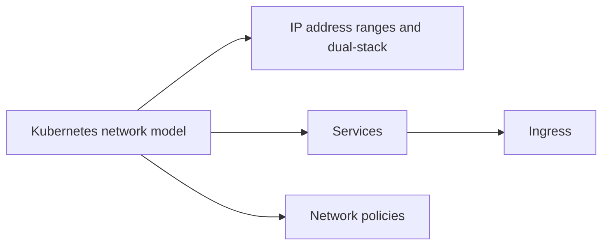

# Services and networking

The concepts and resources behind networking in Kubernetes: the network model and its address ranges, Services and how clients find them, Ingress for HTTP traffic from outside, and network policies that restrict traffic between Pods. Corresponds to the "Services, Load Balancing, and Networking" chapter of the Kubernetes documentation Concepts (with the IP address ranges from "Cluster Networking").

## Map of the area

Read the network model first. Services come next because Ingress routes to them. Network policies can be read any time after the model.

## Notes in reading order

1. [Kubernetes network model](kubernetes-network-model.md): the four networking problems, IP-per-Pod, flat network, CNI plugins, DNS and load balancing.
2. [IP address ranges and dual-stack](ip-address-ranges-and-dual-stack.md): Pod, Service and node ranges, IPv4, IPv6 and dual-stack clusters.
3. [Services](services.md): selectors, Service types, headless Services, discovery by DNS and environment variables, traffic policies.
4. [Ingress](ingress.md): rules, path types, host wildcards, IngressClass, fanout, virtual hosting, TLS, comparison with the Gateway API.
5. [Network policies](network-policies.md): isolation, default policies, selector semantics, lifecycle, limitations.

## Planned topics

- Ingress controllers
- Gateway API
- EndpointSlices
- DNS for Services and Pods
- Topology aware routing
- Service ClusterIP allocation
- Service internal traffic policy
- Networking on Windows
- Service mesh (data plane and control plane; see also Ecosystem)
