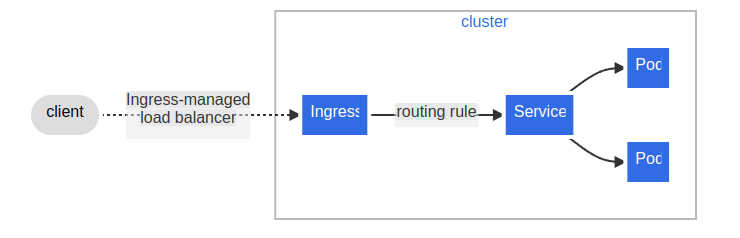
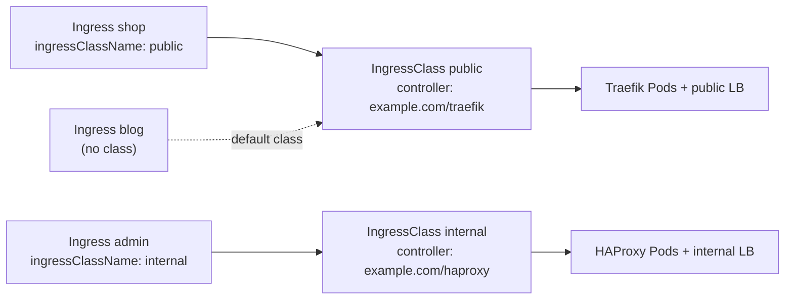
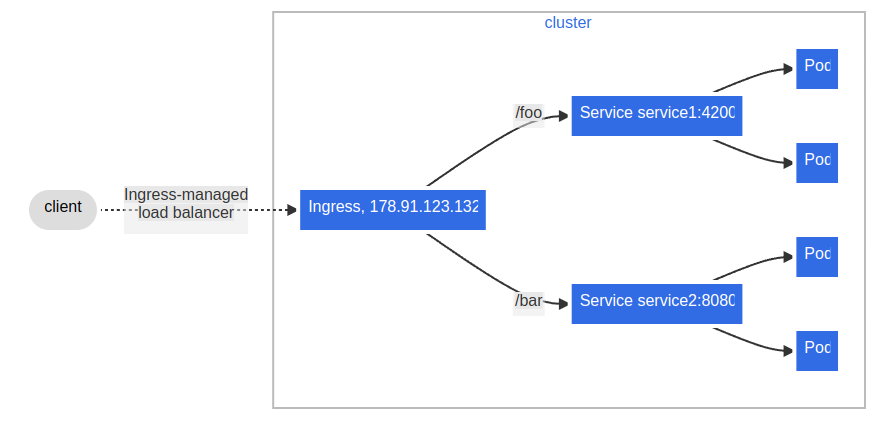
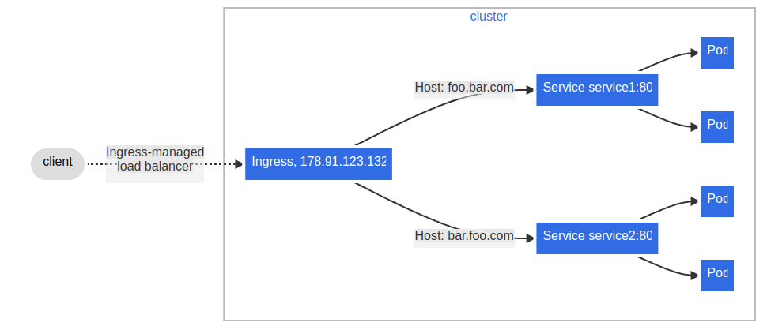

# Ingress

## Summary

An Ingress exposes HTTP and HTTPS routes from outside the cluster to Services inside it, according to rules on host names and URL paths. The Ingress object only describes routing; an *Ingress controller* (for example Traefik, HAProxy, Contour or a cloud load balancer controller) reads it and configures a load balancer or reverse proxy. *IngressClass* selects which controller handles an Ingress. Ingress supports a default backend, path types (`Exact`, `Prefix`, `ImplementationSpecific`), host wildcards, TLS termination and fanout to many Services through one entry point. The Ingress API is frozen; new features go into the Gateway API.

## Prerequisites

- [Services](services.md).

## Core concepts

### Terminology

- **Node**: a worker machine in Kubernetes, part of a cluster.
- **Cluster**: a set of nodes that run containerized applications managed by Kubernetes. In this note, and in most common deployments, nodes are not on the public internet.
- **Edge router**: a router that enforces the firewall policy for the cluster. It could be a gateway managed by a cloud provider or a physical piece of hardware.
- **Cluster network**: a set of links, logical or physical, that enable communication within a cluster according to the Kubernetes [network model](kubernetes-network-model.md).
- **Service**: a Kubernetes Service that identifies a set of Pods with label selectors. Unless mentioned otherwise, Services are assumed to have virtual IPs that are only routable within the cluster network.

### What an Ingress is

Ingress exposes HTTP and HTTPS routes from outside the cluster to Services within the cluster. Traffic routing is controlled by rules defined on the Ingress resource. In the simplest case, an Ingress sends all its traffic to one Service:



An Ingress may be configured to give Services externally reachable URLs, load balance traffic, terminate SSL/TLS, and offer name based virtual hosting. An Ingress controller is responsible for fulfilling the Ingress, usually with a load balancer, though it may also configure your edge router or additional front ends to help handle the traffic.

An Ingress does not expose arbitrary ports or protocols. Exposing services other than HTTP and HTTPS to the internet typically uses a Service of type `NodePort` or `LoadBalancer`.

*Analogy.* An Ingress is the reception desk of an office building with one street entrance: the receptionist reads the visitor's request (host and path) and sends them to the right department (Service). The building's rule book (the Ingress resource) is useless without a receptionist (the controller).

### Prerequisites for using Ingress

You must have an Ingress controller to satisfy an Ingress. Creating an Ingress resource alone has no effect. You may need to deploy one; there are many Ingress controllers to choose from. Ideally, all Ingress controllers fit the reference specification. In reality, the various controllers behave slightly differently (annotations, regex support, default timeouts).

**Status of ingress-nginx.** For years the community `ingress-nginx` controller was the default choice in tutorials. Kubernetes SIG Network announced its retirement, with best effort maintenance ending in March 2026. Plan migrations to another Ingress controller or to a Gateway API implementation. TODO: Verify the ingress-nginx retirement dates against the Kubernetes blog announcement.

### Ingress rules

Each HTTP rule contains:

- **An optional host.** If no host is specified, the rule applies to all inbound HTTP traffic through the IP address specified. If a host is provided (for example `foo.bar.com`), the rule applies to that host.
- **A list of paths** (for example `/testpath`), each with an associated backend defined by `service.name` and `service.port.name` or `service.port.number`. Both the host and the path must match the content of an incoming request before the load balancer directs traffic to the referenced Service.
- **A backend**: a combination of Service and port names, or a custom resource backend by way of a CRD. HTTP (and HTTPS) requests that match the host and path of the rule are sent to the listed backend.

### Default backend

An Ingress with no rules sends all traffic to a single default backend, and `.spec.defaultBackend` is the backend that handles requests in that case. It also handles requests that match no rule. The `defaultBackend` is conventionally a configuration option of the Ingress controller and is not specified in your Ingress resources. If none of the hosts or paths match and no `.spec.defaultBackend` is set, the behavior is up to the controller (typically HTTP 404).

### Resource backends

A `Resource` backend is an object reference to another Kubernetes resource in the same namespace as the Ingress. `Resource` and `service` are mutually exclusive; validation fails if both are set. A common use of a `Resource` backend is to send traffic to an object storage backend with static assets.

### Path types

Each path in an Ingress must have a path type. Paths without an explicit `pathType` fail validation. There are three supported types:

- **`ImplementationSpecific`**: matching is up to the IngressClass. Implementations can treat it as a separate path type or identically to `Prefix` or `Exact`.
- **`Exact`**: matches the URL path exactly, case sensitive.
- **`Prefix`**: matches based on a URL path prefix split by `/`. Matching is case sensitive and done element by element. A path element is a label in the path split by `/`. A request matches path *p* if every element of *p* is an element-wise prefix of the request path. For example, `/foo/bar` matches `/foo/bar/baz` but not `/foo/barbaz`.

**Multiple matches.** Sometimes several paths in an Ingress match a request. Precedence goes first to the longest matching path. If two paths still match equally, paths with the `Exact` type take precedence over `Prefix`.

### Hostname wildcards

Hosts can be precise matches (for example `foo.bar.com`) or wildcards (for example `*.foo.com`). Precise matches require that the HTTP `host` header matches the `host` field. Wildcard matches require that the `host` header is equal to the suffix of the wildcard rule.

| Host | Host header | Match? |
| --- | --- | --- |
| `*.foo.com` | `bar.foo.com` | Matches based on the shared suffix |
| `*.foo.com` | `baz.bar.foo.com` | No match; the wildcard covers only a single DNS label |
| `*.foo.com` | `foo.com` | No match; the wildcard covers only a single DNS label |

### Ingress class

**IngressClass** is a cluster scoped resource introduced in Kubernetes 1.18 (stable `networking.k8s.io/v1` since 1.19). It defines a set of settings and behaviors for Ingress resources, so that administrators can run different types of Ingress controllers, with different configurations, in one cluster. It simplifies managing multiple controllers by letting each Ingress select which controller handles it.

Key concepts:

- **Ingress**: an API object that manages external access to services in a cluster, typically HTTP.
- **Ingress controller**: a component that implements Ingress resources by configuring a load balancer or reverse proxy.

**Usage.** IngressClass defines which controller handles which Ingress resources. This matters when a cluster has several controllers with different capabilities or configurations (for example a public and an internal one). By setting `spec.ingressClassName` on an Ingress, administrators make sure the right controller handles the rules. (The older `kubernetes.io/ingress.class` annotation is deprecated.)

**Configuration parameters:**

1. **`metadata.name`**: the name of the IngressClass, for example `public-nginx`.
2. **`spec.controller`**: the name of the controller that implements this class. Required, in a domain-prefixed path form, for example `k8s.io/ingress-nginx` or `example.com/ingress-controller`.
3. **`spec.parameters`**: optional reference to a separate resource with additional configuration for the controller, typically a ConfigMap or a custom resource. Example:

   ```yaml
   parameters:
     apiGroup: k8s.example.com
     kind: NginxIngressClassParams
     name: example-nginx-params
   ```

   Parameters can be cluster scoped (default) or namespaced (`scope: Namespace` with a `namespace`).
4. **`metadata.annotations`**: key-value metadata. The important one is `ingressclass.kubernetes.io/is-default-class: "true"`, which makes this class the default for Ingresses that do not name a class. Having more than one default class makes new Ingresses without a class fail admission.



### Types of Ingress

**Ingress backed by a single Service.** Existing Kubernetes concepts already let you expose a single Service (type `LoadBalancer` or `NodePort`). You can also do it with an Ingress by specifying a *default backend* with no rules.

**Simple fanout.** A fanout configuration routes traffic from a single IP address to more than one Service, based on the requested HTTP URI. An Ingress keeps the number of load balancers to a minimum. For example, a setup like:



**Name based virtual hosting.** Name based virtual hosts route HTTP traffic to several host names at the same IP address.



If you create an Ingress without any hosts defined in its rules, any web traffic to the IP address of the Ingress controller can be matched without a name based virtual host being required.

**TLS.** You can secure an Ingress by specifying a [Secret](../configuration/secrets.md#tls-secrets) that contains a TLS private key and certificate. The Ingress resource supports only a single TLS port, 443, and assumes TLS termination at the ingress point (traffic to the Service and its Pods is in plaintext). If the TLS section of an Ingress specifies different hosts, they are multiplexed on the same port according to the host name given through the SNI TLS extension (provided the controller supports SNI). The TLS Secret must contain keys named `tls.crt` and `tls.key` with the certificate and private key. Tools such as cert-manager create and renew these Secrets automatically.

**Load balancing.** An Ingress controller is bootstrapped with load balancing policy settings that it applies to all Ingresses, such as the load balancing algorithm and backend weight scheme. More advanced concepts (persistent sessions, dynamic weights) are not exposed through the Ingress API. You can get them through the load balancer used for a Service, controller specific annotations, or the Gateway API.

### Ingress and the Gateway API

| Aspect | Ingress | Gateway API |
| --- | --- | --- |
| Status | Stable, frozen (no new features) | Stable core (v1), actively developed |
| Protocols | HTTP, HTTPS | HTTP, HTTPS, gRPC, TCP, UDP, TLS |
| Roles | One object for everything | Split: GatewayClass (provider), Gateway (operator), Routes (developers) |
| Advanced routing | Controller annotations | Headers, weights, mirroring in the spec |

## Worked example

A fanout with TLS and an explicit class (untested here; Kubernetes v1.30 or later, an Ingress controller registered for the class `public`, Services `service1` and `service2` present):

```yaml
apiVersion: networking.k8s.io/v1
kind: Ingress
metadata:
  name: simple-fanout
spec:
  ingressClassName: public
  tls:
    - hosts: [foo.bar.com]
      secretName: foo-bar-tls        # type kubernetes.io/tls with tls.crt and tls.key
  rules:
    - host: foo.bar.com
      http:
        paths:
          - path: /foo
            pathType: Prefix
            backend:
              service: { name: service1, port: { number: 4200 } }
          - path: /bar
            pathType: Prefix
            backend:
              service: { name: service2, port: { number: 8080 } }
```

```bash
kubectl apply -f fanout.yaml
kubectl get ingress simple-fanout     # ADDRESS shows the load balancer IP once the controller acts
curl -k --resolve foo.bar.com:443:<LB_IP> https://foo.bar.com/foo   # served by service1
curl -k --resolve foo.bar.com:443:<LB_IP> https://foo.bar.com/barbaz # 404: Prefix /bar does not match /barbaz
```

## Trade offs and when to use it

- **Ingress** is widely supported and simple for HTTP routing, but portable only for the basic features; anything beyond host and path uses controller specific annotations.
- **Gateway API** is the recommended path for new designs that need richer routing or role separation.
- **One controller or several.** Separate classes for public and internal traffic isolate blast radius at the cost of more components.

## Common mistakes

- **No controller installed**, or a missing `ingressClassName` with no default class: the Ingress gets no address.
- **Wrong `pathType` assumptions**: `Prefix` matches whole path elements, not string prefixes.
- **TLS Secret in another namespace**: it must be in the Ingress's namespace.
- **Expecting TCP or UDP support** in Ingress.
- **Two default IngressClasses**, which blocks creating Ingresses without a class.

## Practice

1. What happens if you create an Ingress in a cluster without an Ingress controller?
2. Two paths `/api` (Prefix) and `/api/v1` (Exact) match `/api/v1`. Which wins?
3. Does `*.example.com` match `a.b.example.com`?
4. Where is TLS terminated with an Ingress, and how does the controller choose the certificate for several hosts on port 443?
5. How do you make one IngressClass the default?

Answers: 1. Nothing; the resource is stored but no traffic is routed. 2. `/api/v1`, the longest match (and Exact also beats Prefix on ties). 3. No; the wildcard covers one DNS label. 4. At the ingress point (the controller); by SNI. 5. Annotate it with `ingressclass.kubernetes.io/is-default-class: "true"`.

## Further reading

- [Ingress](https://kubernetes.io/docs/concepts/services-networking/ingress/), Kubernetes documentation.
- [Ingress Controllers](https://kubernetes.io/docs/concepts/services-networking/ingress-controllers/), Kubernetes documentation.
- [Gateway API](https://gateway-api.sigs.k8s.io/), Kubernetes SIG Network.
- [cert-manager](https://cert-manager.io/docs/), cert-manager project. Automated TLS certificates for Ingress.
