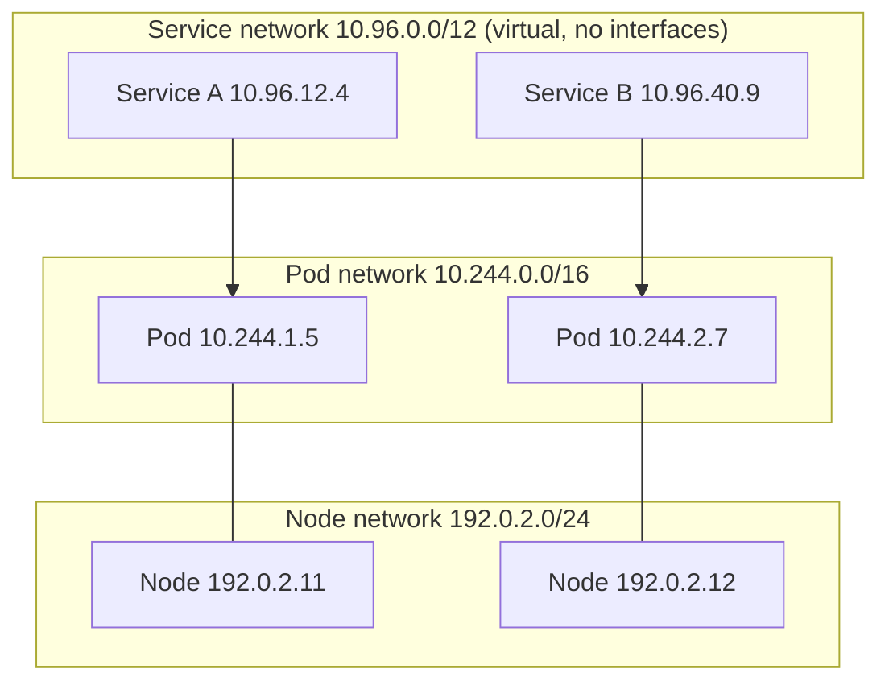
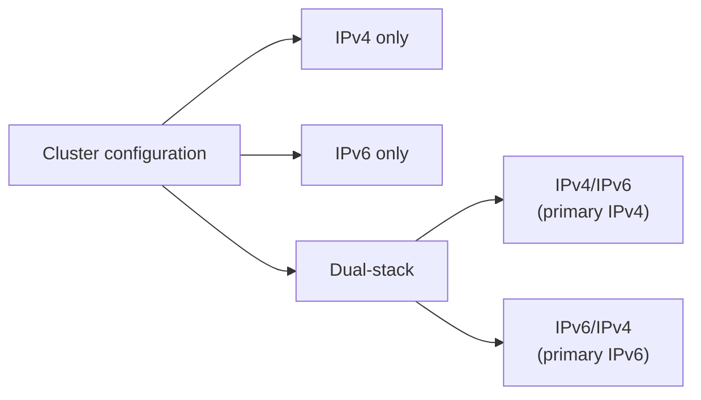

# IP address ranges and dual-stack

## Summary

A cluster needs three non-overlapping IP ranges: one for Pods (assigned by the network plugin), one for Services (assigned by kube-apiserver) and one for nodes (assigned by the kubelet or the cloud controller manager from the infrastructure). Each range can be IPv4, IPv6 or both. A cluster is therefore IPv4-only, IPv6-only, or dual-stack, in which case all components must be configured for both families and must agree on which family is primary.

## Prerequisites

- [Kubernetes network model](kubernetes-network-model.md).

## Core concepts

### The three ranges

Kubernetes clusters must allocate non-overlapping IP addresses for Pods, Services and Nodes, from ranges of available addresses configured in the following components:

| Range | Assigned by | Typical configuration |
| --- | --- | --- |
| Pod network | The network plugin (often per-node Pod CIDRs allocated by kube-controller-manager with `--allocate-node-cidrs`) | `--cluster-cidr`, plugin IPAM configuration, for example `10.244.0.0/16` |
| Service network | kube-apiserver | `--service-cluster-ip-range`, for example `10.96.0.0/12` (or ServiceCIDR objects in newer versions) |
| Node network | The kubelet or the cloud-controller-manager, from the infrastructure | The VPC or LAN subnet, for example `192.0.2.0/24` |

The figure shows the three networks: Pods attached to the Pod network, nodes attached to the node network, and Services as a separate virtual network that points to Pods.




Service IPs are virtual: no interface carries them. They exist only as rules (kube-proxy) or eBPF maps that translate them to Pod IPs.

### Cluster networking types

Depending on the IP families configured, clusters are:

- **IPv4 only**: the network plugin, kube-apiserver and kubelet or cloud-controller-manager assign only IPv4 addresses.
- **IPv6 only**: the network plugin, kube-apiserver and kubelet or cloud-controller-manager assign only IPv6 addresses.
- **IPv4/IPv6 or IPv6/IPv4 dual-stack**:
  - the network plugin is configured to assign IPv4 and IPv6 addresses,
  - kube-apiserver is configured to assign IPv4 and IPv6 addresses,
  - the kubelet or cloud-controller-manager is configured to assign IPv4 and IPv6 addresses,
  - all components must agree on the configured primary IP family (the first family in each list).

IPv4/IPv6 dual-stack networking is stable since v1.23. In a dual-stack cluster, Pods get one address of each family (`status.podIPs`), nodes report addresses of both families, and Services choose with `spec.ipFamilyPolicy` (`SingleStack`, `PreferDualStack`, `RequireDualStack`) and `spec.ipFamilies`.



## Worked example

A dual-stack kind cluster and a dual-stack Service (untested here; kind v0.30, Kubernetes v1.37; the host must have IPv6 enabled):

```yaml
# kind-dual.yaml
kind: Cluster
apiVersion: kind.x-k8s.io/v1alpha4
networking:
  ipFamily: dual
  podSubnet: "10.244.0.0/16,fd00:10:244::/56"
  serviceSubnet: "10.96.0.0/16,fd00:10:96::/112"
```

```bash
kind create cluster --config kind-dual.yaml
kubectl create deployment web --image=nginx:1.27
kubectl expose deployment web --port=80
kubectl patch svc web -p '{"spec":{"ipFamilyPolicy":"PreferDualStack"}}'
kubectl get svc web -o jsonpath='{.spec.clusterIPs}{"\n"}'          # ["10.96.x.y","fd00:10:96::z"]
kubectl get pod -l app=web -o jsonpath='{.items[0].status.podIPs}{"\n"}'
```

Note that `ipFamilyPolicy` can be changed from `SingleStack` to `PreferDualStack` on an existing Service, which allocates a second cluster IP.

## Trade offs and when to use it

- **Range sizing.** A `/16` Pod range with `/24` per node allows 256 nodes with up to 254 Pod IPs each (the kubelet default limit is 110 Pods). Plan for growth: changing ranges later is disruptive.
- **Dual-stack** lets IPv6 clients reach services natively and eases IPv4 exhaustion, at the cost of more configuration and testing.
- **IPv6-only** is simplest for address planning but needs NAT64/DNS64 to reach IPv4-only external services.

## Common mistakes

- **Overlap** between the Pod or Service range and existing corporate networks, VPN ranges or the node subnet.
- **Mismatched primary families** between components in dual-stack clusters.
- **Expecting to ping a Service IP**: it is virtual and usually answers only on its defined ports.

## Practice

1. Which component assigns Service IPs, and which assigns Pod IPs?
2. What must all components agree on in a dual-stack cluster?
3. Why does a Service IP not show up on any network interface?

Answers: 1. kube-apiserver assigns Service IPs; the network plugin assigns Pod IPs. 2. Both families must be configured everywhere, and the primary IP family must be the same. 3. It is virtual: kube-proxy rules or eBPF programs translate it to Pod IPs.

## Further reading

- [Cluster Networking](https://kubernetes.io/docs/concepts/cluster-administration/networking/), Kubernetes documentation. IP address ranges and cluster networking types.
- [IPv4/IPv6 dual-stack](https://kubernetes.io/docs/concepts/services-networking/dual-stack/), Kubernetes documentation.
- [Service ClusterIP allocation](https://kubernetes.io/docs/concepts/services-networking/cluster-ip-allocation/), Kubernetes documentation.
