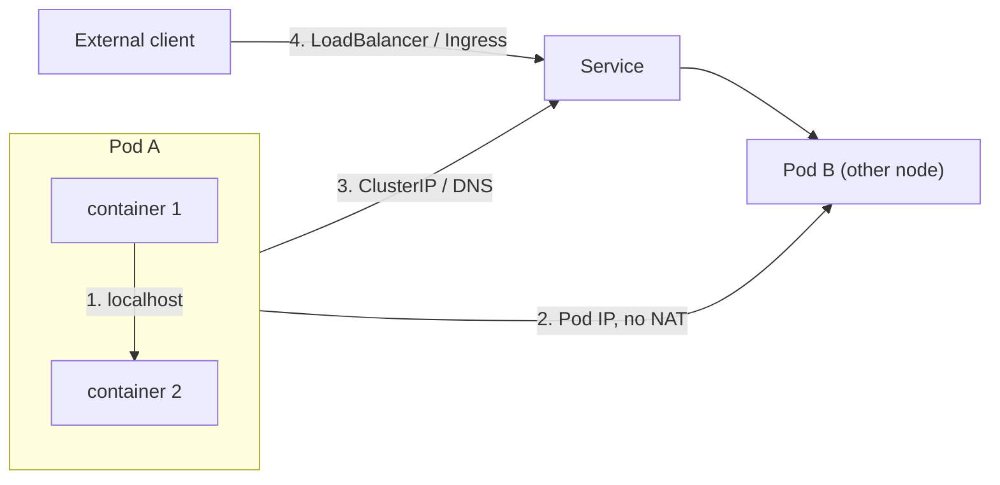
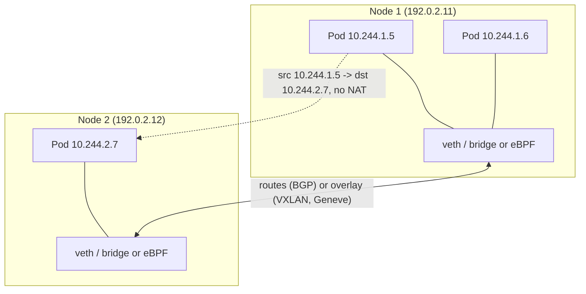

# Kubernetes network model

## Summary

Kubernetes networking solves four problems: container-to-container communication inside a Pod (shared `localhost`), Pod-to-Pod communication, Pod-to-Service communication and external-to-Service communication. The network model fixes the rules: every Pod gets its own cluster-wide IP address, and all Pods can reach all other Pods without NAT, regardless of the node. Kubernetes itself does not implement the Pod network; network plugins (CNI plugins such as Calico, Cilium or Flannel) do. Services, kube-proxy, DNS, Ingress and network policies build on top of this flat network.

## Prerequisites

- [Pod overview](../workloads/pods/pod-overview.md).
- IP networking basics: subnets, routing, NAT, overlay networks.

## Core concepts

### The four networking problems

Networking is a central part of Kubernetes, but it can be hard to understand exactly how it is expected to work. There are four distinct networking problems:

1. **Highly coupled container-to-container communication**: solved by Pods and `localhost` communication.
2. **Pod-to-Pod communication**: the main subject of the network model.
3. **Pod-to-Service communication**: covered by [Services](services.md).
4. **External-to-Service communication**: also covered by Services (and by [Ingress](ingress.md) and the Gateway API).



### Why not ports on the host

Kubernetes is about sharing machines among applications. Sharing machines normally requires making sure that two applications do not try to use the same ports. Coordinating ports across many developers is very hard at scale and exposes users to cluster level issues outside their control.

Dynamic port allocation brings many complications: every application must take ports as flags, the API servers must know how to insert dynamic port numbers into configuration blocks, services must know how to find each other, and so on. Rather than deal with this, Kubernetes takes a different approach: give every Pod its own IP address, so that every Pod can use any port.

*Analogy.* Dynamic ports are like a hotel where every guest shares one street address and is told a different door number each night. IP-per-Pod gives every guest their own house with a fixed address on a flat street map, so visitors find them without asking reception. The analogy breaks because Pod addresses are not permanent: a replaced Pod gets a new address, which is why Services exist.

### Key concepts of the model

1. **Pod-to-Pod communication.** Every Pod in a cluster has a unique IP address, and all Pods can communicate with each other directly without Network Address Translation (NAT).
2. **Pod-to-Service communication.** Services provide a stable IP address and DNS name for a set of Pods. This abstracts the Pods and allows load balancing.
3. **External-to-internal communication.** Ingress resources and other mechanisms (Services of type `LoadBalancer` or `NodePort`, the Gateway API) expose services to external clients.

### How it works

1. **IP-per-Pod model.**
   - Each Pod is assigned a unique IP address within the cluster.
   - This removes the need for port mapping or complex NAT configuration.
   - Containers in a Pod share the Pod's network namespace and IP.
2. **Flat network structure.**
   - All Pods can communicate with each other without NAT, regardless of the node they run on.
   - Agents on a node (system daemons, the kubelet) can communicate with all Pods on that node.
   - The topology is flat and non-hierarchical from the Pods' point of view, even if the plugin uses an overlay or routing underneath.
3. **Service abstraction.**
   - Services provide a stable endpoint for a group of Pods.
   - kube-proxy (or a replacement in the network plugin) implements virtual IPs (cluster IPs) and routes Service traffic.
4. **Network policies.**
   - Kubernetes NetworkPolicies let administrators control communication between Pods.
   - They define rules for Pod ingress and egress traffic. See [Network policies](network-policies.md).



### Network plugins (CNI)

Kubernetes relies on network plugins, which implement the **Container Network Interface (CNI)** specification, to implement its network model. When the runtime creates a Pod sandbox, it calls the CNI plugin, which creates the Pod's interface, assigns an IP (IPAM) and sets up routes. Popular plugins:

| Plugin | Approach | Notable features |
| --- | --- | --- |
| **Calico** | Routing with BGP or an overlay (VXLAN, IP-in-IP); eBPF dataplane available | Networking and network policy, IPAM, BGP peering, its own extended security policies. |
| **Flannel** | Simple overlay (VXLAN or other backends) that encapsulates Pod traffic | Easy to run; no network policy enforcement by itself (often paired with Calico as "Canal"). |
| **Weave Net** | Overlay mesh | Automatic IP allocation and encryption. Its company, Weaveworks, shut down in 2024; the project is no longer actively maintained, so do not choose it for new clusters. |
| **Cilium** | eBPF in the kernel | Fine-grained (including layer 7) security policies, high performance, kube-proxy replacement, observability (Hubble). |

Managed services also have provider plugins that give Pods IPs from the cloud network (AWS VPC CNI, Azure CNI, GKE VPC-native).

### Components built on the model

1. **Service discovery.** Kubernetes uses DNS for service discovery inside the cluster. CoreDNS (formerly kube-dns) is the DNS server that translates Service names into IP addresses.
2. **Load balancing.** Services balance load across the Pods they represent. kube-proxy maintains network rules on nodes and directs traffic to the right Pods.
3. **Ingress and egress.** Ingress resources manage external access to services in the cluster. Egress can be controlled with network policies or custom routing (egress gateways).
4. **Multi-cluster networking.** Service meshes such as Istio or Linkerd, or multi-cluster CNI features (for example Cilium Cluster Mesh), connect several clusters.

### Summary of the model

The Kubernetes network model provides a scalable framework for networking within a cluster:

- unique IP addresses for Pods, which give direct Pod-to-Pod communication without NAT,
- a Service abstraction for stable access to groups of Pods,
- network policies for fine-grained traffic control,
- a pluggable CNI architecture for flexible, customizable network implementations.

The address ranges that Pods, Services and nodes use are described in [IP address ranges and dual-stack](ip-address-ranges-and-dual-stack.md).

## Worked example

Verify the "no NAT" rule (untested here; any cluster with a conformant CNI plugin, two nodes):

```bash
kubectl run server --image=nginx:1.27 --overrides='{"spec":{"nodeName":"<node-1>"}}'
kubectl run client --image=busybox:1.36 --overrides='{"spec":{"nodeName":"<node-2>"}}' -- sleep 3600
SERVER_IP=$(kubectl get pod server -o jsonpath='{.status.podIP}')
CLIENT_IP=$(kubectl get pod client -o jsonpath='{.status.podIP}')
kubectl exec client -- wget -qO- http://$SERVER_IP >/dev/null && echo reachable
kubectl logs server | tail -1     # the access log shows CLIENT_IP as the source address, not a node IP
echo "client is $CLIENT_IP"
```

The nginx access log records the client Pod's own IP, which proves that the traffic crossed nodes without source NAT.

## Trade offs and when to use it

- **Overlay versus routed networks.** Overlays work on any underlay but add encapsulation overhead and MTU issues; routed (BGP or cloud native) networks are faster but need cooperation from the underlying network.
- **IP address consumption.** Cloud native CNIs that give Pods VPC addresses simplify integration but can exhaust subnets.
- **eBPF dataplanes** give performance and observability but require recent kernels.

## Common mistakes

- **Assuming Kubernetes ships a Pod network.** A cluster without a CNI plugin has `NotReady` nodes and Pods stuck in `ContainerCreating`.
- **Overlapping CIDRs** between Pods, Services, nodes and the corporate network.
- **Choosing a plugin without network policy support** and then expecting NetworkPolicies to work.
- **Ignoring MTU** with overlays, which causes hangs on large packets.

## Practice

1. Which of the four networking problems does a Pod solve, and how?
2. State the two core rules of the network model.
3. Which component implements Pod-to-Pod connectivity?
4. Why did Kubernetes choose IP-per-Pod over dynamic host ports?

Answers: 1. Container-to-container communication, through a shared network namespace and `localhost`. 2. Every Pod has a unique cluster-wide IP; all Pods can reach each other without NAT. 3. The CNI network plugin. 4. To avoid port coordination between applications and the complexity of dynamic port allocation in configuration and discovery.

## Further reading

- [Services, Load Balancing, and Networking](https://kubernetes.io/docs/concepts/services-networking/), Kubernetes documentation. The network model.
- [Cluster Networking](https://kubernetes.io/docs/concepts/cluster-administration/networking/), Kubernetes documentation.
- [CNI specification](https://github.com/containernetworking/cni/blob/main/SPEC.md), Container Network Interface project.
- [Cilium documentation](https://docs.cilium.io/), Cilium project.
- [Calico documentation](https://docs.tigera.io/calico/latest/about/), Tigera.
