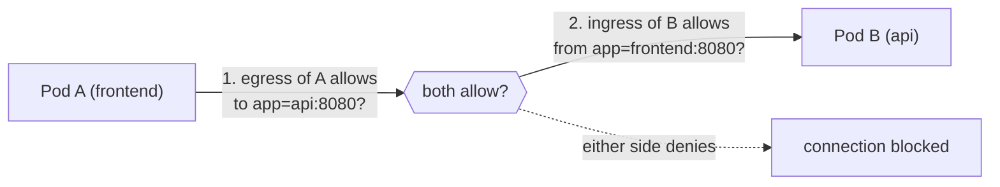

# Network policies

## Summary

A NetworkPolicy controls traffic at the IP and port level (layer 3 and 4) for TCP, UDP and SCTP, for Pods selected by labels. By default every Pod accepts all traffic; once any policy selects a Pod for a direction (ingress or egress), that Pod is *isolated* in that direction and only the traffic allowed by the union of all policies that select it gets through. Policies are additive allow-lists: there are no deny rules and no ordering. A connection needs both the source's egress and the destination's ingress to allow it. Enforcement is done by the network plugin, so a plugin without NetworkPolicy support silently ignores them.

## Prerequisites

- [Kubernetes network model](kubernetes-network-model.md).
- Labels and selectors (planned in [Overview](../overview/README.md)).

## Core concepts

### What a NetworkPolicy controls

Use NetworkPolicies to control traffic flow at the IP address or port level (OSI layer 3 or 4) for TCP, UDP and SCTP. NetworkPolicies let you specify how a Pod may communicate with various network entities. They apply to connections with a Pod on one or both ends and are not relevant to other connections.

The entities a Pod can communicate with are identified by a combination of three identifiers:

1. **Other Pods that are allowed** (exception: a Pod cannot block access to itself).
2. **Namespaces that are allowed.**
3. **IP blocks** (exception: traffic to and from the node where a Pod runs is always allowed, regardless of the IP address of the Pod or the node).

When you define a Pod or namespace based NetworkPolicy, you use a selector to specify what traffic is allowed to and from the Pods that match the selector. When you define an IP based policy, you specify IP blocks (CIDR ranges).

Network policies are implemented by the network plugin. You must use a networking solution that supports NetworkPolicy; creating a NetworkPolicy without a controller that implements it has no effect.

### Pod isolation

There are two sorts of isolation for a Pod: isolation for egress (outgoing) and isolation for ingress (incoming). They concern which connections may be established. "Isolation" here is not absolute; it means "some restrictions apply". The alternative, "non-isolated for direction X", means that no restrictions apply in that direction. The two directions are declared independently.

- **Egress.** By default, a Pod is non-isolated for egress: all outbound connections are allowed. A Pod is isolated for egress if any NetworkPolicy selects it and has `Egress` in its `policyTypes`. Then the only allowed outbound connections are those allowed by the `egress` lists of some NetworkPolicy that applies to the Pod for egress. Reply traffic for allowed connections is also implicitly allowed. The effects of the `egress` lists combine additively.
- **Ingress.** By default, a Pod is non-isolated for ingress: all inbound connections are allowed. A Pod is isolated for ingress if any NetworkPolicy selects it and has `Ingress` in its `policyTypes`. Then the only allowed inbound connections are those from the Pod's node and those allowed by the `ingress` lists of some NetworkPolicy that applies to the Pod for ingress. Reply traffic is implicitly allowed. The effects of the `ingress` lists combine additively.

Network policies do not conflict; they are additive. If any policy selects a Pod for a direction, the allowed connections in that direction are the union of what all applicable policies allow. Evaluation order does not matter.

For a connection from a source Pod to a destination Pod to be allowed, both the egress policy of the source and the ingress policy of the destination must allow it. If either side does not allow it, the connection does not happen.



### Default policies

By default, if no policies exist in a namespace, all ingress and egress traffic is allowed to and from Pods in that namespace. These common policies change the default behavior:

```yaml
# Default deny all ingress in a namespace: selects all Pods, allows nothing in
apiVersion: networking.k8s.io/v1
kind: NetworkPolicy
metadata:
  name: default-deny-ingress
spec:
  podSelector: {}
  policyTypes: [Ingress]
---
# Default deny all ingress and egress
apiVersion: networking.k8s.io/v1
kind: NetworkPolicy
metadata:
  name: default-deny-all
spec:
  podSelector: {}
  policyTypes: [Ingress, Egress]
---
# Allow all ingress (overrides isolation from other policies for ingress)
apiVersion: networking.k8s.io/v1
kind: NetworkPolicy
metadata:
  name: allow-all-ingress
spec:
  podSelector: {}
  ingress:
    - {}
  policyTypes: [Ingress]
```

### Network traffic filtering

NetworkPolicy is defined for layer 4 connections (TCP, UDP and optionally SCTP). For all other protocols, the behavior may vary across network plugins. You must use a CNI plugin that supports SCTP for SCTP network policies.

When a `deny all` network policy is defined, it is only guaranteed to deny TCP, UDP and SCTP connections. For other protocols, such as ARP or ICMP, the behavior is undefined. The same applies to allow rules: when a specific Pod is allowed as an ingress source or egress destination, it is undefined what happens with, for example, ICMP packets. Protocols such as ICMP may be allowed by some plugins and denied by others.

### Selector semantics

Inside one `from` or `to` element, `podSelector` and `namespaceSelector` together mean AND (Pods with these labels in namespaces with these labels). Separate list elements mean OR. This YAML detail is the most common source of overly permissive policies:

```yaml
ingress:
  - from:
      - namespaceSelector: { matchLabels: { team: a } }
        podSelector: { matchLabels: { role: client } }   # AND: client Pods in team-a namespaces
---
ingress:
  - from:
      - namespaceSelector: { matchLabels: { team: a } }
      - podSelector: { matchLabels: { role: client } }   # OR: anything in team-a namespaces, or client Pods in this namespace
```

### Pod lifecycle

The following applies to clusters with a conformant network plugin and a conformant NetworkPolicy implementation.

When a new NetworkPolicy object is created, it may take some time for the plugin to handle it. Pods affected by it may be started before the policy is enforced and start without isolation. Once the plugin has processed the policy:

1. Affected Pods are isolated before they start, and NetworkPolicies are enforced on all their containers from the start.
2. Allow rules are processed after isolation is established, so new Pods may initially have no network connectivity at all, even to destinations that a policy allows, until the allow rules are programmed.

The time at which a plugin applies a policy is not visible in the Kubernetes API. Pods must be resilient to being started with network access different from what they expect: retry connections, or use an init container that checks the required network paths before the app containers start.

Newly created NetworkPolicies eventually apply to all targeted Pods, but because the implementation is distributed across nodes, the view of the network may be inconsistent for a short time. For example, a Pod's ability to connect to other Pods may differ shortly after creation.

### Limitations

As of Kubernetes 1.30 (and still in later releases), the NetworkPolicy API cannot do the following. Workarounds may exist through operating system components (SELinux, Open vSwitch, iptables), layer 7 technologies (Ingress controllers, service meshes) or admission controllers. If you are new to Kubernetes network security, note that these user stories cannot (yet) be implemented with the NetworkPolicy API:

- Forcing internal cluster traffic to go through a common gateway (best served by a service mesh or another proxy).
- Anything TLS related (use a service mesh or Ingress controller).
- Node specific policies (you can use CIDR notation for nodes, but you cannot target nodes by their Kubernetes identities).
- Targeting Services by name (you can target Pods or namespaces by their labels, which is often a viable workaround).
- Creating or managing "policy requests" that are fulfilled by a third party.
- Default policies that apply to all namespaces or Pods (some third party distributions and projects can do this).
- Advanced policy querying and reachability tooling.
- Logging network security events (for example blocked or accepted connections).
- Explicitly denying traffic (the model is deny by default, with only allow rules).
- Preventing loopback or incoming host traffic (Pods cannot block localhost access, nor access from their own node).

Several of these gaps are addressed by the AdminNetworkPolicy and BaselineAdminNetworkPolicy APIs from the SIG Network policy working group (cluster-wide policies with explicit deny and priorities, implemented by some plugins), and by plugin specific policies (Calico GlobalNetworkPolicy, CiliumNetworkPolicy with layer 7 and DNS rules).

## Worked example

Default deny for a namespace, then allow front end to API on port 8080 and DNS egress (untested here; Kubernetes v1.30 or later with a policy-enforcing plugin such as Calico or Cilium):

```yaml
apiVersion: networking.k8s.io/v1
kind: NetworkPolicy
metadata: { name: default-deny-all, namespace: shop }
spec:
  podSelector: {}
  policyTypes: [Ingress, Egress]
---
apiVersion: networking.k8s.io/v1
kind: NetworkPolicy
metadata: { name: allow-dns-egress, namespace: shop }
spec:
  podSelector: {}
  policyTypes: [Egress]
  egress:
    - to:
        - namespaceSelector: { matchLabels: { kubernetes.io/metadata.name: kube-system } }
          podSelector: { matchLabels: { k8s-app: kube-dns } }
      ports:
        - { protocol: UDP, port: 53 }
        - { protocol: TCP, port: 53 }
---
apiVersion: networking.k8s.io/v1
kind: NetworkPolicy
metadata: { name: frontend-to-api, namespace: shop }
spec:
  podSelector: { matchLabels: { app: api } }
  policyTypes: [Ingress]
  ingress:
    - from:
        - podSelector: { matchLabels: { app: frontend } }
      ports:
        - { protocol: TCP, port: 8080 }
---
apiVersion: networking.k8s.io/v1
kind: NetworkPolicy
metadata: { name: frontend-egress-to-api, namespace: shop }
spec:
  podSelector: { matchLabels: { app: frontend } }
  policyTypes: [Egress]
  egress:
    - to:
        - podSelector: { matchLabels: { app: api } }
      ports:
        - { protocol: TCP, port: 8080 }
```

```bash
kubectl -n shop exec deploy/frontend -- wget -qO- -T 3 http://api:8080/health    # OK
kubectl -n shop exec deploy/other -- wget -qO- -T 3 http://api:8080/health       # times out
kubectl -n shop exec deploy/frontend -- wget -qO- -T 3 http://example.com         # times out (no egress)
```

Without the DNS egress policy, even the allowed call would fail, because the front end could not resolve `api`.

## Trade offs and when to use it

- **Default deny per namespace** plus explicit allows is the standard zero-trust baseline; it needs good labels and maintenance.
- **Native NetworkPolicy** is portable but limited (no deny, no layer 7, no logging). Plugin specific policies or AdminNetworkPolicy fill the gaps at the cost of portability.
- **Service mesh authorization** adds identity (mTLS) and layer 7 rules but is a different layer; many teams use both.

## Common mistakes

- **A plugin without policy support** (for example plain Flannel): policies are accepted and ignored.
- **Forgetting DNS egress** after a default deny egress policy.
- **AND/OR confusion** between `namespaceSelector` and `podSelector` in one or separate elements.
- **Relying on namespace labels that tenants can change** (see [RBAC good practices](../security/rbac-good-practices.md#namespace-modification)); prefer the immutable `kubernetes.io/metadata.name` label.
- **Expecting to block traffic from the node** (kubelet probes) or to block ICMP reliably.

## Practice

1. A namespace has no NetworkPolicies. What traffic is allowed?
2. Policy 1 allows ingress from `app=a`; policy 2 allows ingress from `app=b`. Both select `app=db`. What can reach the database?
3. Why might a new Pod have no network at all for a moment after start?
4. Write the selector that allows only `role=client` Pods from namespaces labeled `team=a`.
5. Name three things NetworkPolicy cannot do.

Answers: 1. All ingress and egress. 2. Pods with `app=a` or `app=b` (the union), and the node itself. 3. Isolation is applied before the allow rules are programmed by the plugin. 4. One `from` element containing both `namespaceSelector: {matchLabels: {team: a}}` and `podSelector: {matchLabels: {role: client}}`. 5. Explicit deny rules, TLS or layer 7 rules, logging, targeting Services by name, blocking node or loopback traffic (any three).

## Further reading

- [Network Policies](https://kubernetes.io/docs/concepts/services-networking/network-policies/), Kubernetes documentation.
- [Declare Network Policy](https://kubernetes.io/docs/tasks/administer-cluster/declare-network-policy/), Kubernetes documentation.
- [Network Policy API (AdminNetworkPolicy)](https://network-policy-api.sigs.k8s.io/), Kubernetes SIG Network.
- [NetworkPolicy editor and tutorials](https://editor.networkpolicy.io/), Isovalent. Visual policy builder.
