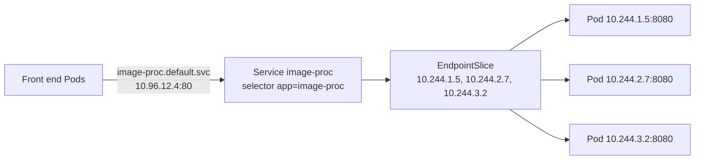
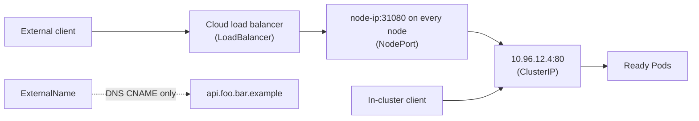
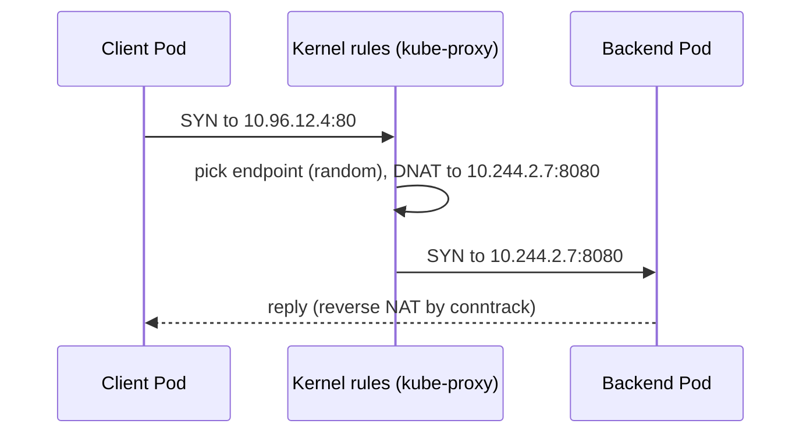

# Services

## Summary

A Service exposes a network application that runs as one or more Pods behind a stable virtual IP and DNS name. It selects its backends with a label selector (or uses manually managed EndpointSlices), and kube-proxy or the network plugin load balances traffic across the ready endpoints. The Service `type` decides the reach: `ClusterIP` (inside the cluster), `NodePort` (a port on every node), `LoadBalancer` (an external load balancer) or `ExternalName` (a DNS alias). Headless Services skip the virtual IP and return Pod IPs directly. Clients find Services through DNS or, legacy, environment variables.

## Prerequisites

- [Kubernetes network model](kubernetes-network-model.md).
- [Deployments](../workloads/workload-management/deployments.md).

## Core concepts

### Definition and motivation

In Kubernetes, a Service is a method for exposing a network application that runs as one or more Pods in the cluster.

A key aim of Services is that you do not need to modify existing applications to use an unfamiliar service discovery mechanism. You can run code in Pods, whether it is cloud native or an older containerized application, and use a Service to make that set of Pods available on the network so that clients can interact with it.

If you use a Deployment to run your app, it can create and destroy Pods dynamically. From one moment to the next, you do not know how many Pods are working and healthy, or even what their names are. Pods are ephemeral and get new IP addresses when they are replaced. With this constant change, front end Pods need a way to find and connect to back end Pods. That is what Services provide.

The Service API is an abstraction that exposes groups of Pods over a network. Each Service object defines a logical set of endpoints (usually Pods) along with a policy for making those Pods accessible. For example, a stateless image processing back end runs with 3 replicas. Those replicas are interchangeable: front ends do not care which back end they use. While the actual Pods that make up the back end may change, the front end clients do not need to be aware of that, nor keep track of the back ends themselves. The Service abstraction enables this decoupling.

*Analogy.* A Service is like a company's main phone number: callers dial one number, and the switchboard forwards the call to whichever employee on the team is available today. The analogy breaks for headless Services, which give the caller the direct numbers of every employee instead.



### Cloud native service discovery

If your application can use the Kubernetes APIs for service discovery, it can query the API server for matching EndpointSlices. Kubernetes updates the EndpointSlices of a Service whenever the set of Pods in the Service changes.

For non-native applications, Kubernetes offers ways to place a network port or load balancer between your application and the back end Pods. Either way, the workload can use these service discovery mechanisms to find the target it wants to connect to.

### Services without selectors

Services most commonly abstract access to Pods thanks to the selector. When used with a corresponding set of EndpointSlice objects and without a selector, a Service can abstract other kinds of back ends, including ones that run outside the cluster. For example:

- You want an external database cluster in production, but in your test environment you use your own databases.
- You want to point your Service to a Service in a different namespace or in another cluster.
- You are migrating a workload to Kubernetes. While evaluating the approach, you run only part of your back ends in Kubernetes.

You then create the EndpointSlice objects yourself (with the label `kubernetes.io/service-name` set to the Service name).

### Application protocol

The `appProtocol` field gives a way to specify an application protocol for each Service port. It is a hint for implementations to offer richer behavior for protocols they understand. Its value is mirrored by the corresponding Endpoints and EndpointSlice objects. It follows standard Kubernetes label syntax. Valid values are one of:

- IANA standard service names,
- implementation-defined prefixed names such as `mycompany.com/my-custom-protocol`,
- Kubernetes-defined prefixed names:

| Protocol | Description |
| --- | --- |
| `kubernetes.io/h2c` | HTTP/2 over cleartext, as described in RFC 7540 |
| `kubernetes.io/ws` | WebSocket over cleartext, as described in RFC 6455 |
| `kubernetes.io/wss` | WebSocket over TLS, as described in RFC 6455 |

### Multi-port Services

For some Services you need to expose more than one port. Kubernetes lets you configure several port definitions on one Service. When you use several ports, you must name all of them so that they are unambiguous (for example `http` and `https`).

### Service types

For some parts of an application (for example front ends) you may want to expose a Service on an external IP address, one that is reachable from outside the cluster. The Service `type` specifies what kind of Service you want:

| Type | Behavior |
| --- | --- |
| `ClusterIP` | Exposes the Service on a cluster-internal IP. The Service is reachable only from within the cluster. This is the default if you do not specify a `type`. You can expose it to the public internet with an [Ingress](ingress.md) or a Gateway. |
| `NodePort` | Exposes the Service on each node's IP at a static port (the `NodePort`, by default from 30000-32767). To make the node port available, Kubernetes also sets up a cluster IP, as for `type: ClusterIP`. |
| `LoadBalancer` | Exposes the Service externally using an external load balancer. Kubernetes does not offer a load balancing component directly; you provide one, or you integrate the cluster with a cloud provider (whose cloud controller manager creates it). A `LoadBalancer` Service also gets a node port and a cluster IP. |
| `ExternalName` | Maps the Service to the contents of the `externalName` field (for example the host name `api.foo.bar.example`). The mapping configures the cluster's DNS server to return a `CNAME` record with that value. No proxying of any kind is set up. |



The diagram shows that the types build on each other: a LoadBalancer Service uses a NodePort, which uses a ClusterIP.

### Headless Services

Sometimes you do not need load balancing and a single Service IP. Then you create a *headless* Service by setting the cluster IP (`.spec.clusterIP`) to `"None"`. Headless Services get no cluster IP, kube-proxy does not handle them, and the platform does no load balancing or proxying. They let clients connect directly to the Pods they prefer, using the cluster DNS to resolve individual Pod IPs. Create one with `.spec.type: ClusterIP` and `.spec.clusterIP: None`. You must use `"None"`; leaving `.spec.clusterIP` unset is different (it allocates an IP).

How DNS is configured depends on whether the Service has selectors:

- **With selectors**, the endpoints controller creates EndpointSlices, and DNS returns A or AAAA records that point directly to the Pods backing the Service.
- **Without selectors**, there are no EndpointSlices created by the control plane. DNS configures either `CNAME` records for `type: ExternalName` Services, or A/AAAA records for all IPs of the Service's ready endpoints for all other types.

For a headless Service without selectors, `port` must match `targetPort`. Headless Services are what give StatefulSet Pods their stable DNS names (see [StatefulSets](../workloads/workload-management/statefulsets.md#pod-identity)).

### Discovering services

For clients inside the cluster, Kubernetes supports two primary modes of finding a Service: environment variables and DNS.

#### Environment variables

When a Pod is run on a node, the kubelet adds a set of environment variables for each active Service. It adds `{SVCNAME}_SERVICE_HOST` and `{SVCNAME}_SERVICE_PORT` variables, where the Service name is uppercased and hyphens are converted to underscores.

For example, the Service `redis-primary`, which exposes TCP port 6379 and has the cluster IP 10.0.0.11, produces the following variables:

```ini
REDIS_PRIMARY_SERVICE_HOST=10.0.0.11
REDIS_PRIMARY_SERVICE_PORT=6379
REDIS_PRIMARY_PORT=tcp://10.0.0.11:6379
REDIS_PRIMARY_PORT_6379_TCP=tcp://10.0.0.11:6379
REDIS_PRIMARY_PORT_6379_TCP_PROTO=tcp
REDIS_PRIMARY_PORT_6379_TCP_PORT=6379
REDIS_PRIMARY_PORT_6379_TCP_ADDR=10.0.0.11
```

When a Pod needs to access a Service and you use the environment variable method to publish the port and cluster IP to client Pods, you must create the Service *before* the client Pods come into existence. Otherwise, those Pods do not get their variables populated. If you only use DNS to discover the cluster IP, you do not need to worry about this ordering. See also [Container environment](../containers/container-environment.md#cluster-information).

#### DNS

You can (and almost always should) set up a DNS service for the cluster using an [add-on](https://kubernetes.io/docs/concepts/cluster-administration/addons/).

A cluster-aware DNS server, such as CoreDNS, watches the Kubernetes API for new Services and creates a set of DNS records for each one. If DNS is enabled throughout the cluster, all Pods can automatically resolve Services by their DNS names.

For example, for a Service `my-service` in the namespace `my-ns`, the control plane and the DNS Service together create a DNS record for `my-service.my-ns`. Pods in the `my-ns` namespace find the Service with a lookup for `my-service` (`my-service.my-ns` also works). Pods in other namespaces must qualify the name as `my-service.my-ns`. These names resolve to the cluster IP of the Service. The fully qualified name is `my-service.my-ns.svc.cluster.local`. DNS also creates SRV records for named ports: `_http._tcp.my-service.my-ns.svc.cluster.local`.

### Virtual IP addressing mechanism

Every node runs kube-proxy (unless a plugin replaces it), which implements the virtual IP of `ClusterIP` Services: it watches Services and EndpointSlices and programs rules (iptables, IPVS or nftables) that rewrite the destination of packets sent to the cluster IP to one of the ready Pod IPs. See [Node components](../cluster-architecture/node-components.md#kube-proxy).



#### Traffic policies

`.spec.internalTrafficPolicy` and `.spec.externalTrafficPolicy` control how Kubernetes routes traffic to healthy ("ready") back ends.

- `internalTrafficPolicy: Local` sends in-cluster traffic only to endpoints on the client's node (useful for node local agents); `Cluster` (default) uses all endpoints.
- `externalTrafficPolicy: Local` sends external traffic (NodePort, LoadBalancer) only to endpoints on the receiving node, which preserves the client source IP and avoids a second hop, but load balancers must health check nodes so that nodes without endpoints receive nothing; `Cluster` (default) spreads traffic across all endpoints but source NATs it.

#### Traffic distribution

The `.spec.trafficDistribution` field gives another way to influence routing within a Service. While traffic policies give strict semantic guarantees, traffic distribution lets you express *preferences* (such as routing to topologically closer endpoints). This can help optimize performance, cost or reliability.

- **`PreferClose`**: prefer routing traffic to endpoints that are close to the client. "Close" depends on the implementation (same node, rack, zone or region). This trades load distribution for proximity; do not set it if those trade offs are unacceptable. Newer releases refine this with explicit `PreferSameZone` and `PreferSameNode` values.

TODO: Verify the names and maturity of the traffic distribution values (`PreferSameZone`, `PreferSameNode`) against the v1.37 documentation.

#### Session stickiness

To make sure that connections from a particular client go to the same Pod each time, configure session affinity based on the client's IP address: `spec.sessionAffinity: ClientIP` (with an optional timeout in `sessionAffinityConfig.clientIP.timeoutSeconds`, default 10800 seconds).

### External IPs

If there are external IPs that route to one or more cluster nodes, Services can be exposed on those `externalIPs`. When traffic arrives in the cluster with the external IP as destination and a port matching the Service, the rules and routes that Kubernetes configured send it to one of the Service's endpoints. Kubernetes does not manage these IPs; the administrator is responsible for routing them to nodes. Because any user who can create Services could claim arbitrary IPs this way, many clusters restrict `externalIPs` with an admission policy (see CVE-2020-8554).

## Worked example

A ClusterIP Service, a headless Service and a lookup of both (untested here; Kubernetes v1.30 or later):

```bash
kubectl create deployment backend --image=nginx:1.27 --replicas=3
kubectl expose deployment backend --name=backend --port=80 --target-port=80
kubectl create service clusterip backend-hl --clusterip=None --tcp=80:80
# 'create service' sets the selector app=backend-hl; point it at the backend Pods instead
kubectl patch svc backend-hl -p '{"spec":{"selector":{"app":"backend"}}}'
kubectl run -it --rm dns --image=busybox:1.36 --restart=Never -- sh -c '
  nslookup backend;      # one A record: the cluster IP
  nslookup backend-hl'   # three A records: the Pod IPs
kubectl get endpointslices -l kubernetes.io/service-name=backend
```

Expected result: `backend` resolves to one address in the Service range (for example 10.96.x.y), `backend-hl` resolves to three addresses in the Pod range.

## Trade offs and when to use it

- **ClusterIP plus Ingress or Gateway** is the usual way to expose HTTP services: one external load balancer for many Services.
- **LoadBalancer per Service** suits non-HTTP protocols but costs one cloud load balancer each.
- **NodePort** is useful for bare metal or behind your own load balancer, but exposes high ports on every node.
- **Headless** suits clients that do their own load balancing or need individual Pods (databases, gRPC with client side balancing).
- **`externalTrafficPolicy: Local`** preserves source IPs at the cost of uneven load when Pods are unevenly spread.

## Common mistakes

- **Selector typos**: the Service exists but has no endpoints (`kubectl get endpointslices` is empty).
- **Pointing `targetPort` at the wrong port** or a port name that the container does not define.
- **Relying on environment variables** for Services created after the client.
- **Long lived connections** (HTTP/2, gRPC) through a ClusterIP: kube-proxy balances connections, not requests, so load stays on the first Pods.
- **Unrestricted `externalIPs`**, a known traffic interception risk.

## Practice

1. What is the difference between `clusterIP: None` and leaving `clusterIP` unset?
2. Which DNS name does a Pod in namespace `web` use for Service `db` in namespace `data`?
3. Which Service type returns a CNAME and does no proxying?
4. Why does `externalTrafficPolicy: Local` preserve the client IP?
5. Give two reasons to create a Service without a selector.

Answers: 1. `None` creates a headless Service with no virtual IP; unset allocates a cluster IP. 2. `db.data` (or `db.data.svc.cluster.local`). 3. `ExternalName`. 4. Traffic is only delivered to Pods on the receiving node, so no second hop and no source NAT are needed. 5. Pointing to an external database, to a Service in another namespace or cluster, or during a migration with some back ends outside Kubernetes.

## Further reading

- [Service](https://kubernetes.io/docs/concepts/services-networking/service/), Kubernetes documentation.
- [Virtual IPs and Service Proxies](https://kubernetes.io/docs/reference/networking/virtual-ips/), Kubernetes documentation.
- [DNS for Services and Pods](https://kubernetes.io/docs/concepts/services-networking/dns-pod-service/), Kubernetes documentation.
- [EndpointSlices](https://kubernetes.io/docs/concepts/services-networking/endpoint-slices/), Kubernetes documentation.
- [CVE-2020-8554: Man in the middle using LoadBalancer or ExternalIPs](https://github.com/kubernetes/kubernetes/issues/97076), Kubernetes issue tracker.
