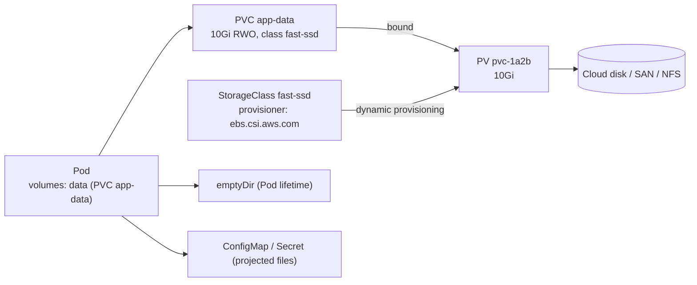
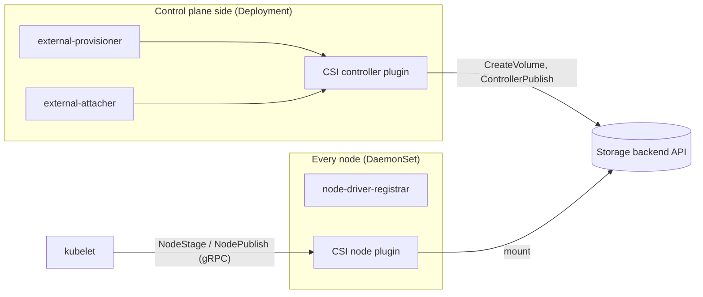

# Volumes

## Summary

Files in a container are ephemeral: they disappear when the container crashes, and they cannot be shared between containers of a Pod. Volumes solve both problems. A volume is a directory, defined in the Pod's `spec.volumes` and mounted into containers with `volumeMounts`, whose lifetime and backing storage depend on its type. *Ephemeral* volumes (such as `emptyDir`, ConfigMap, Secret, downwardAPI) live as long as the Pod; *persistent* volumes (through a PersistentVolumeClaim) outlive it. Storage vendors plug in through the Container Storage Interface (CSI). `subPath`, read-only mounts and mount propagation control how a volume appears inside each container.

## Prerequisites

- [Pod overview](../workloads/pods/pod-overview.md).

## Core concepts

### Storage building blocks

Volumes provide directories accessible to containers running in a Pod, and they can be backed by many kinds of storage. *PersistentVolumes* (PVs) are storage resources independent of Pods that can be reused by several Pods over time, while *PersistentVolumeClaims* (PVCs) are requests for a specific amount and kind of storage that bind to PVs. *StorageClasses* let administrators define different kinds of storage that can be provisioned dynamically.



### Why volumes exist

On-disk files in a container are ephemeral, which causes problems for non-trivial applications. One problem is the loss of files when a container crashes: the kubelet restarts the container with a clean state. Another problem is sharing files between containers running together in a Pod. Kubernetes volumes solve both.

Kubernetes supports many types of volumes, and a Pod can use any number of them at the same time. *Ephemeral volume* types have the lifetime of a Pod, while *persistent volumes* exist beyond the lifetime of a Pod. When a Pod ceases to exist, Kubernetes destroys its ephemeral volumes but does not destroy persistent volumes. For any kind of volume in a given Pod, data is preserved across container restarts.

At its core, a volume is a directory, possibly with some data in it, that is accessible to the containers in a Pod. How that directory comes to be, the medium that backs it and its contents are determined by the volume type.

To use a volume, specify the volumes to provide for the Pod in `.spec.volumes` and declare where to mount them into containers in `.spec.containers[*].volumeMounts`. A process in a container sees a file system view composed of the initial contents of the container image plus volumes (if defined) mounted inside the container. Writes to that file system affect what the process sees when it later accesses the file system. Volumes are mounted at specified paths within the container. Volumes cannot mount within other volumes (but see `subPath` for a related mechanism), and a volume cannot contain a hard link to anything in a different volume.

### Volume types

| Type | Lifetime | What it is | Notes |
| --- | --- | --- | --- |
| `emptyDir` | Pod | A temporary directory created empty when the Pod is assigned to a node; useful for sharing files between containers of the Pod. | `medium: Memory` makes it a tmpfs counted against container memory. |
| `hostPath` | Node | Mounts a file or directory from the host node's file system into the Pod. | Not recommended for production: security risk and ties the Pod to the node. |
| `nfs` | External | Mounts an NFS share into the Pod, providing shared storage across nodes. | Content is preserved; can be mounted by many Pods (ReadWriteMany). |
| `iscsi` | External | Mounts iSCSI (Internet Small Computer Systems Interface) storage, a network protocol based storage networking standard for linking data storage facilities. | Can be mounted read-write by only one consumer at a time. |
| `persistentVolumeClaim` | Independent of the Pod | Mounts a PersistentVolume claimed by the user; the claim can be dynamically provisioned from a StorageClass or pre-bound to an existing PV. | The standard way to use durable storage. |
| `configMap` | Pod | Injects configuration data (non-confidential key-value pairs) as files. | See [ConfigMaps](../configuration/configmaps.md). |
| `secret` | Pod | Like ConfigMap, for sensitive data; backed by tmpfs on the node so it is never written to node disk. | Secrets are often described as "encrypted at rest"; that is true only if encryption at rest is configured in the API server. See [Secrets](../configuration/secrets.md). |
| `downwardAPI` | Pod | Exposes Pod and container fields (labels, annotations, resource limits) to the container as files. Also available as environment variables. | |
| `fc` (Fibre Channel) | External | Mounts a Fibre Channel storage system into Pods, typically for high speed storage networks. | |
| `csi` | Depends on the driver | Container Storage Interface: a standard for exposing arbitrary block and file storage systems to containerized workloads on container orchestration systems (COs) such as Kubernetes. | See [out-of-tree volume plugins](#out-of-tree-volume-plugins). |
| `local` | Node, but persistent | A mounted local storage device such as a disk, partition or directory. | Usable only as a statically created PersistentVolume; dynamic provisioning is not supported. The scheduler respects its node affinity. |
| `projected` | Pod | Maps several existing volume sources (Secret, ConfigMap, downwardAPI, serviceAccountToken, clusterTrustBundle) into the same directory. | Used for service account tokens. |
| `rbd` | External | Mounts a Rados Block Device (Ceph RBD) volume. Unlike `emptyDir`, which is erased when the Pod is removed, the contents are preserved and the volume is only unmounted, so it can be pre-populated with data and shared between Pods. | The in-tree `rbd` plugin was deprecated and removed (v1.31); use the Ceph CSI driver. |
| `flocker` | External | Flocker, a data volume manager and multi-host Docker volume plugin. | Removed in v1.25; the Flocker project is no longer maintained. Listed for completeness only. |
| `ephemeral` (generic ephemeral volume) | Pod | A PVC created and deleted with the Pod, from any StorageClass. | Scratch space with storage class features. |
| `image` | Pod | Mounts an OCI image or artifact read-only as a volume. | Newer feature; see the documentation for its maturity. |

TODO: Verify the removal version of the in-tree `rbd` plugin and the maturity of `image` volumes against the v1.37 documentation.

### Using subPath

Sometimes it is useful to share one volume for several uses in a single Pod. The `volumeMounts[*].subPath` property specifies a sub-path inside the referenced volume instead of its root. For example, a LAMP stack Pod can mount one PVC twice: `subPath: mysql` at `/var/lib/mysql` and `subPath: html` at `/var/www/html`. `subPathExpr` builds the sub-path from environment variables (for example the Pod name). Containers that use a ConfigMap or Secret through `subPath` do not receive updates when the source changes.

### Resources

The storage medium (such as disk or SSD) of an `emptyDir` volume is determined by the medium of the file system holding the kubelet root directory (typically `/var/lib/kubelet`). There is no limit on how much space an `emptyDir` or `hostPath` volume can consume, and no isolation between containers or between Pods, unless you set `emptyDir.sizeLimit` or ephemeral storage limits (see [Resource management](../configuration/resource-management-for-pods-and-containers.md#resource-types)), which the kubelet enforces by evicting the Pod.

### Out-of-tree volume plugins

The out-of-tree volume plugins are the Container Storage Interface (CSI) and FlexVolume (deprecated). These plugins let storage vendors create custom storage plugins without adding their source code to the Kubernetes repository.

Previously, all volume plugins were "in-tree": built, linked, compiled and shipped with the core Kubernetes binaries. Adding a new storage system (a volume plugin) to Kubernetes meant checking code into the core repository. CSI migration now redirects most former in-tree cloud plugins (AWS EBS, GCE PD, Azure Disk, vSphere and others) to their CSI drivers.

**CSI.** The Container Storage Interface defines a standard interface for container orchestration systems (like Kubernetes) to expose arbitrary storage systems to their container workloads. Once a CSI compatible volume driver is deployed on a cluster, users can use the `csi` volume type to attach or mount the volumes exposed by the CSI driver. A `csi` volume can be used in a Pod in three ways:

- through a reference to a PersistentVolumeClaim,
- with a generic ephemeral volume,
- with a CSI ephemeral volume, if the driver supports it.



### Mount propagation

Mount propagation allows sharing volumes mounted by a container with other containers in the same Pod, or even with other Pods on the same node. It is controlled by the `mountPropagation` field in `containers[*].volumeMounts`:

- **`None`**: this volume mount does not receive any subsequent mounts that are mounted to this volume or its subdirectories by the host, and no mounts created by the container are visible on the host. This is the default and equals `rprivate` in Linux terms. The CRI runtime may choose `rslave` instead when `rprivate` is not suitable; for example, cri-dockerd chooses `rslave` if the mount source contains the Docker daemon's root directory (`/var/lib/docker`).
- **`HostToContainer`**: this volume mount receives all subsequent mounts that are mounted to this volume or any of its subdirectories, including those made by the host or by any Pod with `Bidirectional` propagation on the same volume. Equals `rslave`.
- **`Bidirectional`**: behaves like `HostToContainer` and, in addition, propagates all mounts created by the container back to the host and to all containers of all Pods that use the same volume. Typically used by Pods with FlexVolume or CSI drivers, or Pods that need to mount something on the host with a `hostPath` volume. Equals `rshared`.

**Warning.** `Bidirectional` mount propagation can be dangerous. It can damage the host operating system and is therefore allowed only in privileged containers. Familiarity with Linux kernel behavior is strongly recommended. In addition, any volume mounts created by containers in Pods must be destroyed (unmounted) by the containers on termination.

### Read-only mounts

A mount can be made read-only by setting `.spec.containers[].volumeMounts[].readOnly` to `true`. This does not make the volume itself read-only, but that container cannot write to it. Other containers in the Pod may mount the same volume read-write. On Linux, read-only mounts are not recursive by default: submounts may remain writable; `recursiveReadOnly: Enabled` (newer releases) makes the whole tree read-only.

## Worked example

A Pod that shares an `emptyDir` between two containers and uses a PVC with `subPath` (untested here; Kubernetes v1.30 or later, a default StorageClass present):

```yaml
apiVersion: v1
kind: PersistentVolumeClaim
metadata:
  name: app-data
spec:
  accessModes: ["ReadWriteOnce"]
  resources:
    requests:
      storage: 1Gi
---
apiVersion: v1
kind: Pod
metadata:
  name: volumes-demo
spec:
  volumes:
    - name: scratch
      emptyDir:
        sizeLimit: 100Mi
    - name: data
      persistentVolumeClaim:
        claimName: app-data
  containers:
    - name: writer
      image: busybox:1.36
      command: ["sh", "-c", "date >> /scratch/log; date >> /data/history; sleep 3600"]
      volumeMounts:
        - { name: scratch, mountPath: /scratch }
        - { name: data, mountPath: /data, subPath: writer }
    - name: reader
      image: busybox:1.36
      command: ["sh", "-c", "sleep 5; cat /scratch/log; sleep 3600"]
      volumeMounts:
        - { name: scratch, mountPath: /scratch, readOnly: true }
```

```bash
kubectl apply -f volumes-demo.yaml
kubectl logs volumes-demo -c reader              # date written by the other container
kubectl delete pod volumes-demo && kubectl apply -f volumes-demo.yaml
kubectl exec volumes-demo -c writer -- cat /data/history   # two lines: the PVC survived the Pod
kubectl exec volumes-demo -c reader -- ls /scratch          # one line: emptyDir was recreated
```

## Trade offs and when to use it

- **Ephemeral versus persistent.** `emptyDir` is fast and free but disappears with the Pod; PVCs survive but cost money and add attach and mount latency.
- **Block (RWO) versus shared file (RWX).** Block storage is fast but attached to one node; shared file systems (NFS, CephFS, cloud file services) allow many readers and writers with weaker performance and locking semantics.
- **hostPath** is acceptable for node agents (log collectors, CSI node plugins) but not for applications.

## Common mistakes

- **Using `hostPath` for application data**, which binds the Pod to one node and opens host access.
- **Unbounded `emptyDir`** filling the node disk and triggering eviction of other Pods.
- **Expecting ConfigMap updates through `subPath` mounts.**
- **Assuming `readOnly: true` protects the volume** from other containers that mount it read-write.
- **Mounting a ReadWriteOnce PVC from Pods on different nodes**, which leaves the second Pod stuck in `ContainerCreating` with a multi-attach error.

## Practice

1. Which volume types are deleted with the Pod, and which survive?
2. What are the three ways to use a `csi` volume in a Pod?
3. Which mount propagation mode is needed by a CSI node plugin, and why is it restricted?
4. Does `readOnly: true` on a mount make the volume read-only for all containers?
5. Where does an `emptyDir` store its data by default?

Answers: 1. `emptyDir`, ConfigMap, Secret, downwardAPI, projected and generic ephemeral volumes are deleted with the Pod; PVC-backed, NFS, iSCSI, FC and other external volumes survive. 2. A PVC reference, a generic ephemeral volume, or a CSI ephemeral volume. 3. `Bidirectional`, so that mounts it creates propagate to the host; it can damage the host, so only privileged containers may use it. 4. No, only for that container. 5. On the file system that holds the kubelet root directory, usually `/var/lib/kubelet`.

## Further reading

- [Volumes](https://kubernetes.io/docs/concepts/storage/volumes/), Kubernetes documentation.
- [Persistent Volumes](https://kubernetes.io/docs/concepts/storage/persistent-volumes/), Kubernetes documentation.
- [Ephemeral Volumes](https://kubernetes.io/docs/concepts/storage/ephemeral-volumes/), Kubernetes documentation.
- [Kubernetes CSI Developer Documentation](https://kubernetes-csi.github.io/docs/), Kubernetes CSI. Sidecars and driver architecture.
- [Container Storage Interface specification](https://github.com/container-storage-interface/spec), CSI project.
