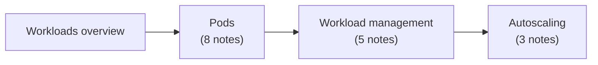

# Workloads

Pods, the smallest deployable compute object in Kubernetes, and the higher level resources that run them: the workload controllers and the autoscalers. Corresponds to the "Workloads" chapter of the Kubernetes documentation Concepts.

## Map of the area

Read the overview, then the Pods section, which everything else builds on. Workload management explains the controllers, and autoscaling builds on them.

## Notes and sections in reading order

1. [Workloads overview](workloads-overview.md): workload resources and how to choose between them.
2. [Pods](pods/README.md): Pod overview, lifecycle, init, sidecar and ephemeral containers, probes, disruptions, QoS classes.
3. [Workload management](workload-management/README.md): ReplicaSet, Deployments, StatefulSets, DaemonSet, Jobs.
4. [Autoscaling](autoscaling/README.md): workload autoscaling overview, Horizontal Pod Autoscaler, Vertical Pod Autoscaler.

## Planned topics

- Managing workloads (organizing resource configurations, labels, canary releases with labels, `kubectl apply` workflows)
- Workload API, PodGroup API and CompositePodGroup API (gang and topology-aware scheduling of groups of Pods)
