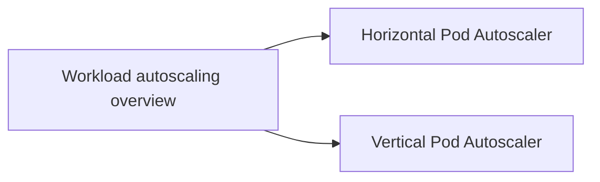

# Autoscaling

Scaling workloads automatically: horizontally by changing the number of replicas, and vertically by changing the resources of each replica. Corresponds to the "Autoscaling Workloads", "Horizontal Pod Autoscaling" and "Vertical Pod Autoscaling" pages of the Workloads chapter of the Kubernetes documentation. Node autoscaling lives in [Cluster administration](../../cluster-administration/node-autoscaling.md).

## Map of the section

## Notes in reading order

1. [Workload autoscaling overview](workload-autoscaling-overview.md): horizontal versus vertical scaling, the layers of autoscaling, combining HPA and VPA.
2. [Horizontal Pod Autoscaler](horizontal-pod-autoscaler.md): control loop, algorithm, metrics APIs, scaling policies and stabilization.
3. [Vertical Pod Autoscaler](vertical-pod-autoscaler.md): Recommender, Updater, Admission Controller, update modes, limitations.

## Planned topics

- Event-driven autoscaling with KEDA
- In-place Pod resource resize
- Scaling on custom and external metrics with the Prometheus Adapter
