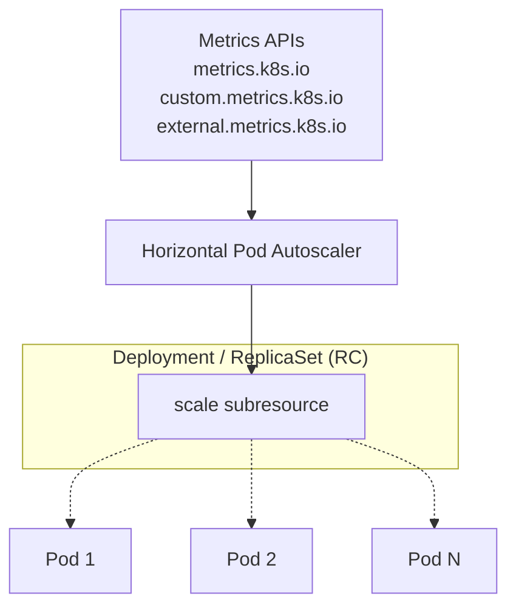
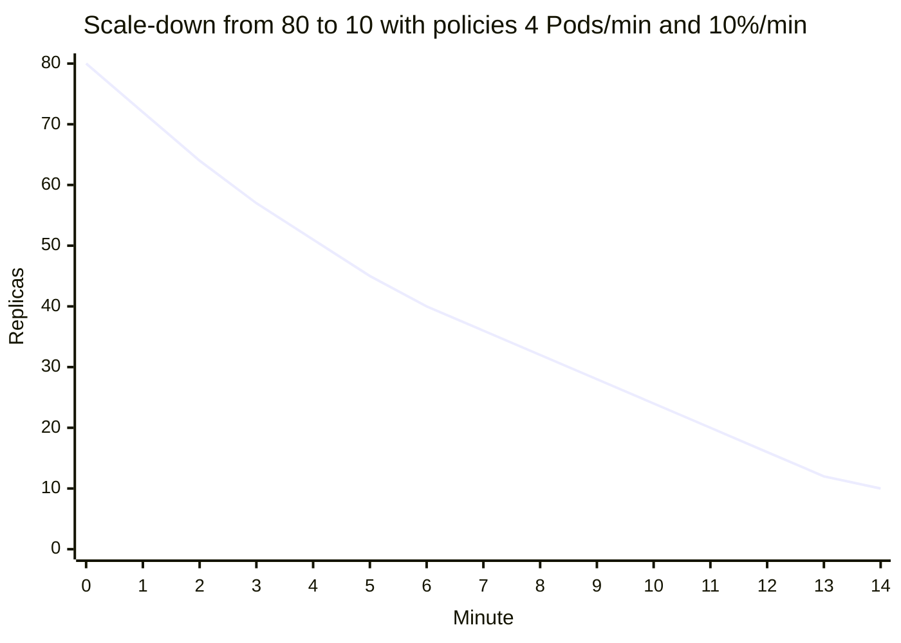

# Horizontal Pod Autoscaler

## Summary

The Horizontal Pod Autoscaler (HPA) automatically changes the number of replicas of a workload (a Deployment, StatefulSet or any resource with a `scale` subresource) to match demand. A control loop in kube-controller-manager runs every 15 seconds by default, reads metrics from the metrics APIs, and computes `desiredReplicas = ceil(currentReplicas * currentMetric / desiredMetric)`, skipping changes within a 10% tolerance. With the `autoscaling/v2` API it can use resource, custom, object and external metrics, several at once, and a `behavior` section that sets separate scale-up and scale-down policies and stabilization windows to prevent flapping.

## Prerequisites

- [Workload autoscaling overview](workload-autoscaling-overview.md).
- [Resource management for Pods and containers](../../configuration/resource-management-for-pods-and-containers.md) (requests).
- [Resource metrics pipeline](../../cluster-administration/observability/resource-metrics-pipeline.md).

## Core concepts

### What it does

The HPA automatically adjusts the number of Pod replicas to demand. It monitors CPU or other metrics against targets so that the workload meets them, which prevents overload during traffic spikes and saves resources when traffic drops. It does not apply to objects that cannot be scaled, such as DaemonSets.



The diagram, a redraw of the figure in the Kubernetes documentation, shows that the HPA never touches Pods: it only writes the replica count of the target, and the target's controller creates or deletes Pods.

### How it works

Horizontal Pod autoscaling is an intermittent control loop, not a continuous process. Its interval is set by the `--horizontal-pod-autoscaler-sync-period` flag of `kube-controller-manager`, 15 seconds by default.

In each period, the controller manager queries resource use against the metrics in each HorizontalPodAutoscaler definition. It finds the target resource from `scaleTargetRef`, then selects the Pods based on the target's `.spec.selector` labels, and gets the metrics from the resource metrics API (for per-Pod resource metrics such as CPU) or the custom metrics API (for all other metrics).

- **Per-Pod resource metrics** (like CPU): the controller fetches the metrics for each Pod targeted by the HPA. If a target *utilization* is set, it computes utilization as a percentage of the equivalent resource *request* of the containers in each Pod. If a target *raw value* is set, it uses the raw metric values directly. It then takes the mean of the utilization or raw value across all targeted Pods and computes a ratio used to scale the desired number of replicas.
- If some of the Pod's containers do not have the relevant resource request set, CPU utilization for the Pod is not defined, and the autoscaler takes no action for that metric.
- **Per-Pod custom metrics**: the controller works as for resource metrics, except that it works with raw values, not utilization.
- **Object and external metrics**: a single metric is fetched that describes the object in question. It is compared to the target value to produce a ratio. In the `autoscaling/v2` API, the value can optionally be divided by the number of Pods before the comparison (`AverageValue`).

### Algorithm details

From the most basic perspective, the HPA controller works on the ratio between the desired metric value and the current metric value:

```text
desiredReplicas = ceil[currentReplicas * ( currentMetricValue / desiredMetricValue )]
```

For example, if the current metric value is `200m` and the desired value is `100m`, the number of replicas is doubled, because `200.0 / 100.0 == 2.0`. If the current value is `50m`, the number of replicas is halved, because `50.0 / 100.0 == 0.5`. The control plane skips scaling if the ratio is close enough to 1.0, within a globally configurable tolerance (`--horizontal-pod-autoscaler-tolerance`), 0.1 by default.

Refinements in the real algorithm: Pods that are being deleted or have no metrics are set aside; not-yet-ready Pods and missing metrics are treated conservatively (assumed 0% when scaling up, 100% when scaling down) so that they dampen the change; and the result is clamped to `minReplicas` and `maxReplicas`.

**Example.** A Deployment has 4 replicas with a target CPU utilization of 60%. The average utilization is 90%. `ceil(4 * 90 / 60) = ceil(6.0) = 6` replicas. If utilization drops to 63%, the ratio 1.05 is within the 0.1 tolerance, and nothing happens.

### Stability of workload scale

When an HPA manages the scale of a group of replicas, the number of replicas may keep fluctuating because the evaluated metrics are dynamic. This is sometimes called *thrashing* or *flapping*. It is similar to the concept of *hysteresis* in cybernetics. The stabilization window and scaling policies below exist to control it.

### Autoscaling during a rolling update

Kubernetes performs rolling updates on Deployments and manages the underlying ReplicaSets. When you autoscale a Deployment, you bind the HPA to the Deployment. The HPA manages the `replicas` field of the Deployment, and the Deployment controller is responsible for setting the `replicas` of the underlying ReplicaSets so that they add up to the right number during and after the rollout (see [proportional scaling](../workload-management/deployments.md#proportional-scaling)).

For a StatefulSet with an autoscaled number of replicas, the StatefulSet directly manages its set of Pods; there is no intermediate resource like a ReplicaSet.

### Support for resource metrics

Any HPA target can be scaled on the resource usage of the Pods in the scaling target. When you define the Pod specification, set resource requests such as `cpu` and `memory`; they are used to compute resource utilization. To use utilization based scaling, specify a metric source like this:

```yaml
type: Resource
resource:
  name: cpu
  target:
    type: Utilization
    averageUtilization: 60
```

With this metric the HPA controller keeps the average utilization of the Pods in the target at 60%. Utilization is the ratio between current usage and requested resources of the Pods. A `ContainerResource` metric type scales on one container's usage instead of the sum over the Pod, which helps when a sidecar distorts the Pod total.

### Scaling on custom metrics

With the `autoscaling/v2` API, an HPA can scale on a custom metric, one that is not built into Kubernetes or any Kubernetes component. The HPA controller then queries the custom metrics from the Kubernetes API (`custom.metrics.k8s.io`).

### Scaling on multiple metrics

With the `autoscaling/v2` API, you can specify several metrics. The controller evaluates each metric and proposes a new scale based on it. It takes the largest of the proposed scales (as long as it does not exceed the configured maximum) as the new scale.

### Support for metrics APIs

By default, the HPA controller retrieves metrics from a series of APIs. For it to access them, cluster administrators must make sure that:

- The [API aggregation layer](../../extending-kubernetes/extending-kubernetes-overview.md#api-extensions) is enabled.
- The corresponding APIs are registered:
  - For resource metrics, the `metrics.k8s.io` API, generally provided by metrics-server, which can run as a cluster add-on.
  - For custom metrics, the `custom.metrics.k8s.io` API, provided by "adapter" API servers from metrics solution vendors (for example the Prometheus Adapter). Check with your metrics pipeline whether a Kubernetes metrics adapter is available.
  - For external metrics, the `external.metrics.k8s.io` API. It may be provided by the custom metrics adapters above.

### Configurable scaling behavior

With the `v2` HPA API, the `behavior` field configures separate scale-up and scale-down behavior, through `scaleUp` and `scaleDown`. You can specify a *stabilization window* that prevents flapping of the replica count, and *scaling policies* that control the rate of change of replicas while scaling.

**Scaling policies.** One or more policies can be given in the `behavior` section. When several policies are specified, the one that allows the highest amount of change is selected by default. `periodSeconds` is the length of time over which the policy applies, at most 1800 seconds (30 minutes).

```yaml
behavior:
  scaleDown:
    policies:
      - type: Pods
        value: 4
        periodSeconds: 60
      - type: Percent
        value: 10
        periodSeconds: 60
```

The first policy allows at most 4 replicas to be scaled down in one minute. The second allows at most 10% of the current replicas to be scaled down in one minute. Since by default the policy with the most change is chosen, the second policy applies only when the number of replicas is above 40 (10% of 40 is 4). With 40 or fewer replicas, the first policy applies. For example, when scaling down from 80 replicas to 10, 8 replicas are removed in the first step. In the next iteration, with 72 replicas, 10% is 7.2, rounded up to 8. In each loop the allowed change is recomputed from the current number of replicas. Once the number drops to 40 or below, the first policy (Pods) applies and 4 replicas are removed at a time.

The chart shows the replica count per minute for this scale-down, computed from the two policies (illustrative, assuming the metric keeps asking for 10 replicas):



The policy selection can be changed with `selectPolicy`: `Min` selects the policy that allows the smallest change, and `Disabled` turns off scaling in that direction entirely.

**Stabilization window.** The stabilization window restricts flapping of the replica count when the metrics keep fluctuating. The algorithm uses the window to infer a previous desired state and avoid unwanted changes to the workload scale. When the metrics indicate that the target should be scaled down, the algorithm looks at the desired states computed during the window and uses the highest value. The default window is 300 seconds for scale-down and 0 for scale-up.

```yaml
behavior:
  scaleDown:
    stabilizationWindowSeconds: 300
```

### Implicit maintenance-mode deactivation

You can implicitly deactivate the HPA for a target without changing the HPA configuration itself. If the target's desired replica count is set to 0 and the HPA's minimum replica count is greater than 0, the HPA stops adjusting the target and sets its `ScalingActive` condition to `false`, until you reactivate it by manually changing the target's desired replica count or the HPA's minimum replica count.

## Worked example

An HPA for a web Deployment with CPU and a requests-per-second metric (untested here; Kubernetes v1.30 or later; the `http_requests_per_second` metric requires a custom metrics adapter):

```yaml
apiVersion: autoscaling/v2
kind: HorizontalPodAutoscaler
metadata:
  name: web
spec:
  scaleTargetRef:
    apiVersion: apps/v1
    kind: Deployment
    name: web
  minReplicas: 3
  maxReplicas: 30
  metrics:
    - type: Resource
      resource:
        name: cpu
        target: { type: Utilization, averageUtilization: 60 }
    - type: Pods
      pods:
        metric: { name: http_requests_per_second }
        target: { type: AverageValue, averageValue: "100" }
  behavior:
    scaleUp:
      stabilizationWindowSeconds: 0
      policies:
        - { type: Percent, value: 100, periodSeconds: 15 }
    scaleDown:
      stabilizationWindowSeconds: 300
      policies:
        - { type: Pods, value: 4, periodSeconds: 60 }
        - { type: Percent, value: 10, periodSeconds: 60 }
```

```bash
kubectl apply -f web-hpa.yaml
kubectl get hpa web --watch
# NAME  REFERENCE       TARGETS                       MINPODS  MAXPODS  REPLICAS
# web   Deployment/web  cpu: 90%/60%, 140/100         3        30       4
kubectl describe hpa web | sed -n '/Conditions/,/Events/p'   # AbleToScale, ScalingActive, ScalingLimited
```

With 4 replicas, CPU proposes `ceil(4 * 90/60) = 6` and the request metric proposes `ceil(4 * 140/100) = 6`; the larger (6) is applied.

## Trade offs and when to use it

- **CPU is a lagging signal** for many services; request rate, latency or queue depth (custom or external metrics) often scale earlier and more accurately.
- **Aggressive scale-up, conservative scale-down** is the usual shape: fast reaction to spikes, slow release to avoid flapping.
- **Max replicas** protects downstream systems and budget but caps capacity.
- **Alternatives.** KEDA for event-driven scaling and scale to zero; scheduled scaling for predictable peaks.

## Common mistakes

- **Setting `replicas` in the Deployment manifest** while an HPA manages it: every `kubectl apply` resets the count. Omit `replicas` from the manifest when using an HPA.
- **Missing requests** on one container, which disables the CPU utilization metric.
- **Too short scale-down windows**, which cause flapping and cold starts.
- **metrics-server not installed**: the HPA shows `<unknown>` targets.

## Practice

1. 5 replicas, target CPU utilization 50%, current average 80%. How many replicas does the HPA request?
2. Current 102m, target 100m. Does the HPA scale? Why?
3. With two metrics proposing 6 and 9 replicas and `maxReplicas: 8`, what is the result?
4. Which `behavior` setting turns off scale-down entirely?
5. Why does a missing CPU request in a sidecar matter for a CPU utilization HPA?

Answers: 1. `ceil(5 * 80/50) = 8`. 2. No; the ratio 1.02 is within the default tolerance of 0.1. 3. 8, the larger proposal clamped to the maximum. 4. `scaleDown.selectPolicy: Disabled`. 5. Pod utilization is undefined when any container lacks the request, so the HPA cannot act on that metric (use a `ContainerResource` metric or add the request).

## Further reading

- [Horizontal Pod Autoscaling](https://kubernetes.io/docs/concepts/workloads/autoscaling/horizontal-pod-autoscale/), Kubernetes documentation. Algorithm, metrics APIs, behavior.
- [HorizontalPodAutoscaler Walkthrough](https://kubernetes.io/docs/tasks/run-application/horizontal-pod-autoscale-walkthrough/), Kubernetes documentation.
- [KEDA](https://keda.sh/), CNCF project. Event-driven autoscaling.
- [Prometheus Adapter](https://github.com/kubernetes-sigs/prometheus-adapter), Kubernetes SIGs. Custom metrics API from Prometheus.
