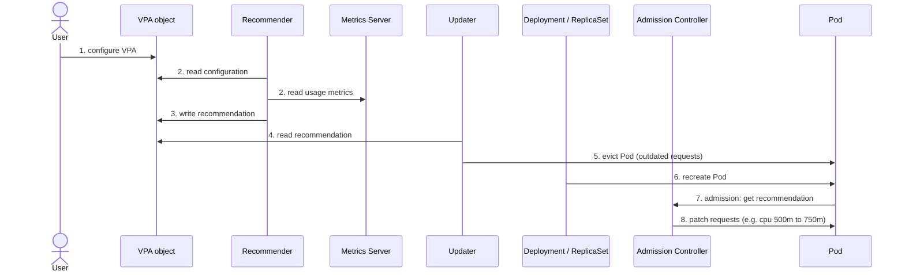

# Vertical Pod Autoscaler

## Summary

The Vertical Pod Autoscaler (VPA) sets container CPU and memory requests (and proportionally limits) from observed usage. It is an add-on from the Kubernetes autoscaler project with three components: the *Recommender* computes targets from metrics history and OOM events, the *Updater* evicts Pods whose requests are far from the recommendation, and the *Admission Controller* (a mutating webhook) writes the recommended values into new Pods. In its classic modes it applies changes by recreating Pods; newer releases can resize Pods in place. It must not act on the same CPU or memory signal as an HPA.

## Prerequisites

- [Workload autoscaling overview](workload-autoscaling-overview.md).
- [Resource management for Pods and containers](../../configuration/resource-management-for-pods-and-containers.md).

## Core concepts

### Definition

The Vertical Pod Autoscaler automates adjusting the resources of the containers in Pods. Unlike the [Horizontal Pod Autoscaler](horizontal-pod-autoscaler.md), which changes the number of replicas, VPA scales the resources allocated to a Pod's containers. It adjusts the requests and limits of each container based on its actual usage.

With VPA, two kinds of resource configuration are managed for each container:

1. **Requests** define the minimum amount of resources that a container needs. For example, an application can use more than 256 MB of memory, but Kubernetes guarantees it a minimum of 256 MB if its request is 256 MB.
2. **Limits** define the maximum amount of resources a container can consume. An application might need at least 256 MB of memory, but you want to make sure it does not use more than 512 MB, so you limit its memory to 512 MB.

By default VPA keeps the limit-to-request ratio that the container originally had (`controlledValues: RequestsAndLimits`), so raising the request also raises the limit proportionally.

### Components

A VPA deployment has three main components.

**VPA Recommender**

- Monitors resource utilization and computes target values.
- Looks at the metrics history, OOM events and the VPA object spec, and suggests fair requests. Limits are raised or lowered according to the defined limit-to-request proportion.
- Writes a recommendation (lower bound, target, upper bound, uncapped target) into the VPA object's `status`.

**VPA Updater**

- Evicts Pods that need the new resource values.
- Applies what the Recommender recommends if `updateMode: "Auto"` (or `"Recreate"`) is set.
- Respects PodDisruptionBudgets because it uses the Eviction API.

**VPA Admission Controller**

- Changes the CPU and memory settings (with a mutating webhook) before a new Pod starts, whenever the Updater has evicted a Pod and its controller recreates it.
- The admission controller is sometimes described as also evicting Pods; precisely, eviction is the Updater's job, and the admission controller only mutates. Historically, the only way to change the resource requests of a running Pod was to recreate it, which is why "Auto" mode evicts.

### How it works

The diagram below shows a practical example of how VPA works, followed by a numbered explanation of each step.




1. The user configures VPA.
2. The VPA Recommender reads the VPA configuration and the resource utilization metrics from the metrics server.
3. The Recommender provides Pod resource recommendations.
4. The VPA Updater reads the recommendations.
5. The Updater initiates the Pod termination.
6. The Deployment notices that the Pod was terminated and recreates it to match its replica count.
7. While the Pod is being recreated, the VPA Admission Controller gets the Pod resource recommendation. Because Kubernetes (classically) does not support changing the resource limits of a running Pod, VPA cannot update existing Pods with new limits. It terminates Pods that use outdated limits, and when the Pod's controller requests the replacement from the API server, the admission controller injects the updated request and limit values into the new Pod's specification.
8. Finally, the admission controller writes the recommendation into the Pod. In this example, it adds 250m CPU to the Pod (from 500m).

**Recommendation mode.** VPA can also run in recommendation mode (`updateMode: "Off"`). The Recommender then updates the status of the workload's VPA resource with its suggested values, but does not terminate Pods or alter Pod API requests. This is the safe way to start: observe recommendations, then apply them in manifests or enable automatic mode.

| `updateMode` | Behavior |
| --- | --- |
| `Off` | Only recommendations in the VPA status. |
| `Initial` | Requests are set only when Pods are created; running Pods are never evicted. |
| `Recreate` | Requests set at creation and running Pods evicted when they differ significantly. |
| `Auto` | Currently equivalent to `Recreate` in classic versions. |
| `InPlaceOrRecreate` | Newer VPA versions: resize running Pods in place when possible, otherwise recreate. |

**Correction for newer versions.** Kubernetes added in-place Pod resource resize (the `resize` subresource; alpha in v1.27, beta in v1.33), which lets requests and limits of a running container change without a restart for many workloads. Recent VPA releases use it through `InPlaceOrRecreate`. TODO: Verify the stable version of in-place Pod resize and the VPA release that made `InPlaceOrRecreate` generally available.

### Limitations

VPA is useful for many applications, but keep these limitations in mind:

- Do not use VPA together with an HPA that scales on the same resource metrics, such as CPU and memory. When the metric reaches its threshold, both scale at the same time, which can have unknown side effects and lead to problems. (Combining VPA with an HPA on custom or external metrics is fine.)
- VPA might recommend more resources than are available in the cluster, so that the Pod cannot be assigned to a node (insufficient resources) and never runs. To avoid this, set a [LimitRange](../../policies/limit-ranges.md) maximum to the maximum available resources (and set `maxAllowed` in the VPA's `resourcePolicy`). This makes sure that Pods do not ask for more resources than the LimitRange defines.
- Evictions in `Recreate`/`Auto` mode restart Pods; single-replica workloads experience downtime.
- Recommendations based on short histories can be wrong for workloads with weekly cycles.

## Worked example

Start in recommendation mode (untested here; VPA 1.x installed from the kubernetes/autoscaler repository, Kubernetes v1.30 or later):

```yaml
apiVersion: autoscaling.k8s.io/v1
kind: VerticalPodAutoscaler
metadata:
  name: api-vpa
spec:
  targetRef:
    apiVersion: apps/v1
    kind: Deployment
    name: api
  updatePolicy:
    updateMode: "Off"
  resourcePolicy:
    containerPolicies:
      - containerName: "*"
        minAllowed: { cpu: 50m, memory: 64Mi }
        maxAllowed: { cpu: "2", memory: 2Gi }
        controlledResources: ["cpu", "memory"]
```

```bash
kubectl apply -f api-vpa.yaml
kubectl describe vpa api-vpa | sed -n '/Recommendation/,$p'
#   Container Recommendations:
#     Container Name:  api
#     Lower Bound:     cpu: 120m  memory: 180Mi
#     Target:          cpu: 250m  memory: 262Mi
#     Upper Bound:     cpu: 900m  memory: 700Mi
```

After a few days of observation, copy the `Target` into the Deployment's requests, or switch `updateMode` to `Initial` or `Auto`.

## Trade offs and when to use it

- **Benefits.** Right-sized requests, fewer OOM kills, better bin packing and lower cost; useful for workloads that cannot scale horizontally.
- **Costs.** Pod restarts in classic modes, a webhook in the admission path (if it fails, Pod creation can be affected), and time to learn usage patterns.
- **Alternatives.** Manual right-sizing from monitoring data; Goldilocks or similar tools that present VPA recommendations per namespace.

## Common mistakes

- **Auto mode on single-replica critical services** without a PDB or maintenance window.
- **Combining with a CPU or memory HPA** on the same workload.
- **No `maxAllowed`**, leading to unschedulable Pods when recommendations exceed node size.
- **Expecting VPA to change limits only.** It sets requests, and limits follow the original ratio.

## Practice

1. Which VPA component evicts Pods, and which one changes their requests?
2. What does `updateMode: "Off"` do?
3. A container has request 200m and limit 400m CPU; VPA recommends 300m. What limit does the Pod get by default?
4. How do you stop VPA from recommending more than a node can provide?

Answers: 1. The Updater evicts; the Admission Controller mutates requests of new Pods. 2. It only writes recommendations into the VPA status. 3. 600m, keeping the 1:2 ratio. 4. Set `maxAllowed` in the resource policy and a LimitRange maximum.

## Further reading

- [Vertical Pod Autoscaling](https://kubernetes.io/docs/concepts/workloads/autoscaling/vertical-pod-autoscale/), Kubernetes documentation.
- [Vertical Pod Autoscaler](https://github.com/kubernetes/autoscaler/tree/master/vertical-pod-autoscaler), Kubernetes SIG Autoscaling. Installation, modes and components.
- [Resize CPU and Memory Resources assigned to Containers](https://kubernetes.io/docs/tasks/configure-pod-container/resize-container-resources/), Kubernetes documentation. In-place resize.
- [Kubernetes VPA: Pros and Cons & Best Practices](https://www.kubecost.com/kubernetes-autoscaling/kubernetes-vpa/), Kubecost. Source of the flow figure.
