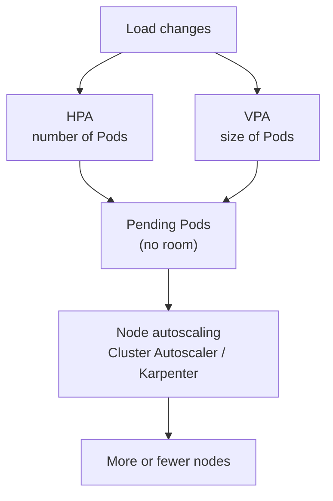
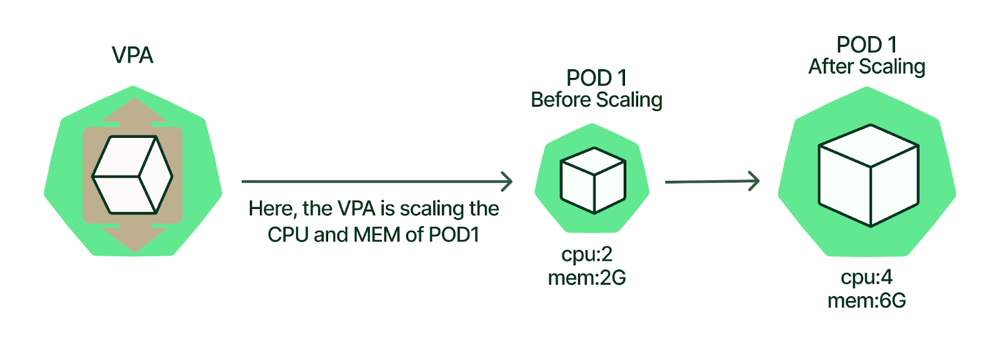
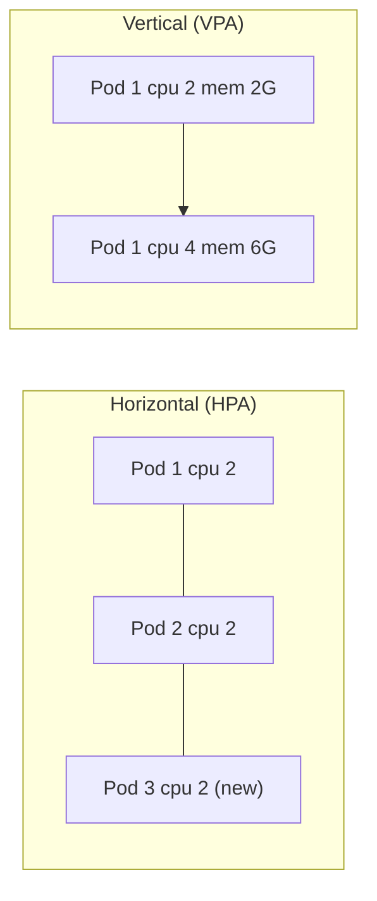

# Workload autoscaling overview

## Summary

Autoscaling adjusts the resources allocated to a workload according to demand. *Horizontal* scaling (the Horizontal Pod Autoscaler, HPA) changes the number of Pod replicas; *vertical* scaling (the Vertical Pod Autoscaler, VPA) changes the CPU and memory requests and limits of the containers. They answer different questions: "how many copies?" and "how big is each copy?". Node autoscaling, which adds and removes machines, is a separate layer described in [Node autoscaling](../../cluster-administration/node-autoscaling.md).

## Prerequisites

- [Resource management for Pods and containers](../../configuration/resource-management-for-pods-and-containers.md).
- [Deployments](../workload-management/deployments.md).

## Core concepts

### Definition

Autoscaling in Kubernetes adjusts the resources allocated to a Deployment or a set of Pods based on demand. It includes Horizontal Pod Autoscaling (HPA) and Vertical Pod Autoscaling (VPA), which respectively increase or decrease the number of replicas, or adjust resource requests and limits.

*Analogy.* A supermarket facing a queue can open more checkouts (horizontal) or give each cashier a faster scanner (vertical). Opening checkouts works as long as there is floor space (nodes) and customers can be spread; faster scanners help even a single checkout, but only up to the fastest scanner available (the node size). The analogy breaks because a vertically scaled Pod is usually restarted to get its new size, while a cashier keeps working.

### The three layers of autoscaling



| Layer | Component | Adjusts | Note |
| --- | --- | --- | --- |
| Pods, horizontal | HorizontalPodAutoscaler (built in) | `replicas` of a Deployment, StatefulSet or other scalable resource | [Horizontal Pod Autoscaler](horizontal-pod-autoscaler.md) |
| Pods, vertical | VerticalPodAutoscaler (add-on from the Kubernetes autoscaler project) | Container requests and limits | [Vertical Pod Autoscaler](vertical-pod-autoscaler.md) |
| Nodes | Cluster Autoscaler, Karpenter | Number and size of nodes | [Node autoscaling](../../cluster-administration/node-autoscaling.md) |
| Event driven | KEDA (CNCF project) | Replicas from external event sources, including scale to zero | Planned |

### VPA versus HPA

Fundamentally, the difference between VPA and HPA is how they scale. HPA scales by adding or removing *Pods*: capacity is scaled horizontally. VPA scales by increasing or decreasing CPU *and memory within the existing Pod containers*: capacity is scaled vertically.

| Capacity adjustment desired | Horizontal scaling (HPA) | Vertical scaling (VPA) |
| --- | --- | --- |
| More resources | Add more Pods | Increase CPU or memory of existing Pod containers |
| Less resources | Remove Pods | Decrease CPU or memory of existing Pod containers |

The figure shows vertical scaling of one Pod: VPA raises POD 1 from 2 CPUs and 2 GB of memory to 4 CPUs and 6 GB.





| Dimension | HPA | VPA |
| --- | --- | --- |
| Best for | Stateless services whose load can be spread | Workloads that cannot be replicated easily, right-sizing requests |
| Signal | CPU, memory, custom and external metrics | Historical CPU and memory usage, OOM events |
| Reaction time | Seconds to a minute | Minutes to hours (recommendations need history) |
| Disruption | None for scale-up; scale-down terminates Pods | Recreates Pods (or resizes in place in newer versions) |
| Limit | Max replicas, cluster capacity | Largest node, LimitRange maximum |

### Using both

Do not let HPA and VPA act on the same resource metric (CPU or memory) for the same workload: both react to the same signal and can amplify each other. Common safe combinations:

- HPA on CPU or a custom metric, VPA in recommendation mode (`updateMode: "Off"`) only to guide request sizing.
- HPA on a custom or external metric (for example requests per second or queue length), VPA in automatic mode on CPU and memory.

## Worked example

Choosing a strategy for three workloads:

| Workload | Choice | Reason |
| --- | --- | --- |
| Stateless REST API with daily traffic peaks | HPA on CPU utilization 60%, min 3, max 30 | Load spreads over replicas; fast reaction. |
| Single-replica legacy service with unknown memory needs | VPA `updateMode: "Auto"` (or `"Off"` first to observe) | Cannot run several copies; requests need right-sizing. |
| Queue workers | HPA on an external metric (queue depth) or KEDA, VPA `"Off"` for sizing | Work is driven by the backlog, not by CPU. |

```bash
kubectl get hpa,vpa -A        # VPA objects exist only if the VPA add-on is installed
```

## Trade offs and when to use it

- **HPA** requires that the application can run several replicas and that requests are set (utilization is relative to requests).
- **VPA** removes guesswork from requests but restarts Pods to apply changes in its classic modes, and its recommendations need time to stabilize.
- **Neither** helps if the cluster has no room; combine with node autoscaling.

## Common mistakes

- **HPA on CPU without CPU requests**: utilization is undefined and the HPA does nothing.
- **HPA and VPA both on CPU** for the same Deployment.
- **Expecting autoscaling to fix a bottleneck elsewhere** (a database) that more replicas only worsen.

## Practice

1. What does HPA change, and what does VPA change?
2. Why is running HPA and VPA on the same CPU metric a problem?
3. Which layer adds capacity when Pods stay Pending after HPA scales up?

Answers: 1. HPA changes the replica count; VPA changes container requests and limits. 2. Both react to the same signal at the same time, with unpredictable combined effects. 3. Node autoscaling (Cluster Autoscaler or Karpenter).

## Further reading

- [Autoscaling Workloads](https://kubernetes.io/docs/concepts/workloads/autoscaling/), Kubernetes documentation.
- [Kubernetes autoscaler project](https://github.com/kubernetes/autoscaler), Kubernetes SIG Autoscaling. Cluster Autoscaler and VPA.
- [Kubernetes VPA: Pros and Cons & Best Practices](https://www.kubecost.com/kubernetes-autoscaling/kubernetes-vpa/), Kubecost. Source of the vertical scaling figure.
