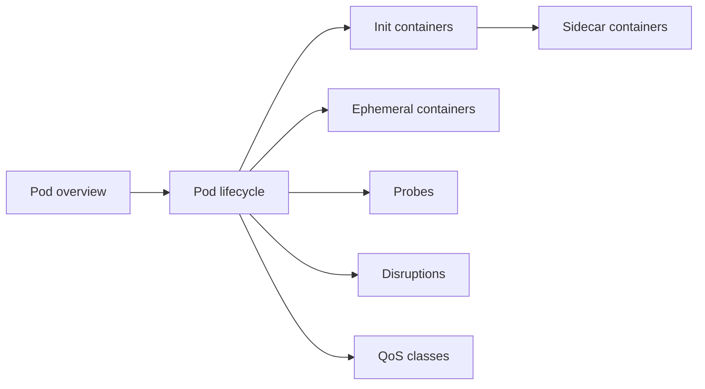

# Pods

The smallest deployable unit in Kubernetes: what a Pod is, how it lives and dies, the special kinds of containers it can hold, how its health is checked, how it is disrupted and how it is classified for resource pressure. Corresponds to the "Pods" section of the Workloads chapter of the Kubernetes documentation.

## Map of the section

## Notes in reading order

1. [Pod overview](pod-overview.md): definition, what containers in a Pod share, kinds of containers.
2. [Pod lifecycle](pod-lifecycle.md): phases, container states, CrashLoopBackOff, restart policy, conditions, readiness gates.
3. [Init containers](init-containers.md): sequential setup containers, use cases, effective resource requests.
4. [Sidecar containers](sidecar-containers.md): restartable init containers, lifecycle, Jobs, comparison with init and app containers.
5. [Ephemeral containers](ephemeral-containers.md): debugging running Pods with `kubectl debug`.
6. [Liveness, readiness and startup probes](probes.md): probe types, parameters, mechanisms, combining probes.
7. [Disruptions](disruptions.md): voluntary and involuntary disruptions, PodDisruptionBudgets, disruption conditions.
8. [Pod quality of service classes](pod-quality-of-service-classes.md): Guaranteed, Burstable, BestEffort and eviction order.

## Planned topics

- Pod hostname
- Static Pods
- User namespaces
- Downward API
- Advanced Pod configuration
- Scheduling group
