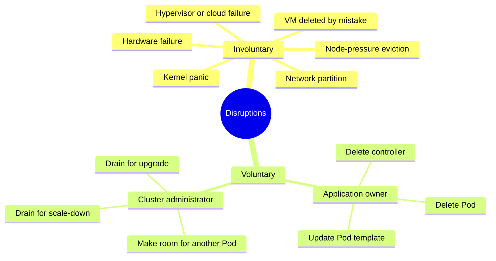
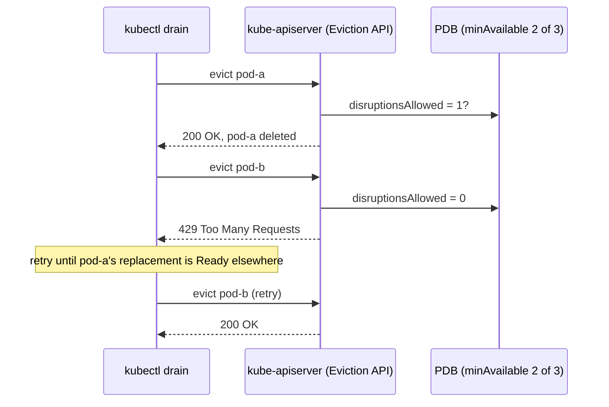

# Disruptions

## Summary

A *disruption* is anything that takes a Pod down. *Involuntary* disruptions are unavoidable failures: hardware faults, kernel panics, network partitions, node-pressure eviction. *Voluntary* disruptions are deliberate actions by application owners or cluster administrators: deleting Pods, updating templates, draining nodes for upgrades or scale-down. A *PodDisruptionBudget* (PDB) limits how many replicas of an application voluntary disruptions may take down at once, as long as the tools use the Eviction API. The `DisruptionTarget` Pod condition tells a Pod why it is about to be removed.

## Prerequisites

- [Pod lifecycle](pod-lifecycle.md).
- [Workloads overview](../workloads-overview.md).

## Core concepts

### Audience

This topic is for application owners who want to build highly available applications and therefore need to understand what kinds of disruptions can happen to Pods. It is also for cluster administrators who want to automate cluster actions such as upgrades and autoscaling.

### Involuntary and voluntary disruptions

Pods do not disappear until someone (a person or a controller) destroys them, or there is an unavoidable hardware or system software error. These unavoidable cases are *involuntary disruptions* to an application. Examples:

- a hardware failure of the physical machine backing the node,
- a cluster administrator deleting a VM (instance) by mistake,
- a cloud provider or hypervisor failure that makes the VM disappear,
- a kernel panic,
- the node disappearing from the cluster because of a network partition,
- eviction of a Pod because the node is out of resources.

All other cases are *voluntary disruptions*. They include actions initiated by the application owner and actions initiated by a cluster administrator. Typical application owner actions:

- deleting the Deployment or other controller that manages the Pod,
- updating a Deployment's Pod template, which causes a restart,
- directly deleting a Pod (for example by accident).

Cluster administrator actions:

- [draining a node](https://kubernetes.io/docs/tasks/administer-cluster/safely-drain-node/) for repair or upgrade,
- draining a node to scale the cluster down,
- removing a Pod from a node to let something else fit on that node.



### Dealing with disruptions

Ways to mitigate involuntary disruptions:

- Make sure the Pod [requests the resources](../../configuration/resource-management-for-pods-and-containers.md) it needs.
- Replicate the application if you need higher availability (run replicated stateless and stateful applications).
- For even higher availability, spread replicas across racks (with anti-affinity) or across zones (in a multi-zone cluster); see [Pod topology spread constraints](../../scheduling-preemption-and-eviction/pod-topology-spread-constraints.md).

### Pod disruption budgets

Kubernetes offers features that help run highly available applications even when you introduce frequent voluntary disruptions.

As an application owner, you can create a *PodDisruptionBudget* (PDB) for each application. A PDB limits the number of Pods of a replicated application that are down at the same time because of voluntary disruptions. For example, a quorum based application wants to make sure the number of running replicas never drops below the number needed for a quorum. A web front end might want to make sure the number of replicas serving load never falls below a certain percentage of the total.

A PDB has a label selector and either `minAvailable` or `maxUnavailable` (an absolute number or a percentage). The disruption controller computes `status.disruptionsAllowed`, and the Eviction API refuses evictions (HTTP 429) that would bring the application below the budget.

Cluster managers and hosting providers should use tools that respect PDBs by calling the [Eviction API](../../scheduling-preemption-and-eviction/api-initiated-eviction.md) instead of directly deleting Pods or Deployments. `kubectl drain` and the cluster autoscaler do this.

**What PDBs do not cover.** Involuntary disruptions cannot be prevented by PDBs; however, they do count against the budget. Pods that are deleted or unavailable because of a rolling update of the application count against the budget, but workload resources (such as Deployment and StatefulSet) are not limited by PDBs when doing rolling updates; their own `maxUnavailable` settings apply.



### Pod disruption conditions

A dedicated Pod condition `DisruptionTarget` is added to show that the Pod is about to be deleted because of a disruption (stable since v1.31; earlier behind the `PodDisruptionConditions` feature gate). The `reason` field of the condition gives one of the following reasons:

| Reason | Meaning |
| --- | --- |
| `PreemptionByScheduler` | The Pod is going to be preempted by the scheduler to make room for a new Pod with higher priority. See [Pod priority and preemption](../../scheduling-preemption-and-eviction/pod-priority-and-preemption.md). |
| `DeletionByTaintManager` | The Pod is going to be deleted by the taint manager (part of the node lifecycle controller in `kube-controller-manager`) because of a `NoExecute` taint that the Pod does not tolerate. See [Taints and tolerations](../../scheduling-preemption-and-eviction/taints-and-tolerations.md#taint-based-evictions). |
| `EvictionByEvictionAPI` | The Pod has been marked for eviction through the Kubernetes API. |
| `DeletionByPodGC` | The Pod is bound to a node that no longer exists and is going to be deleted by Pod garbage collection. |
| `TerminationByKubelet` | The Pod has been terminated by the kubelet because of node-pressure eviction, graceful node shutdown or system critical Pod preemption. |

A Pod disruption might be interrupted. The control plane might retry the disruption of the same Pod, but this is not guaranteed. As a result, the `DisruptionTarget` condition might be added to a Pod that is then not actually deleted. In that case, the condition is cleared after some time.

Along with cleaning up Pods, the Pod garbage collector (PodGC) also marks them as failed if they are in a non-terminal phase.

Jobs can use these conditions in a [Pod failure policy](../workload-management/jobs.md#pod-failure-policy) to ignore failures caused by disruptions.

### How to perform disruptive actions on a cluster

If you are a cluster administrator and need a disruptive action on all nodes, such as a node or system software upgrade, the options are:

| Option | Downtime | Cost | Automation |
| --- | --- | --- | --- |
| Accept downtime during the upgrade | Yes | None | Simple |
| Fail over to another complete replica cluster | No | High: duplicated nodes and human effort to orchestrate the switchover | Manual |
| Write disruption tolerant applications and use PDBs | No | Minimal resource duplication | Allows more automation of cluster administration |

Writing disruption tolerant applications is tricky, but the work to tolerate voluntary disruptions largely overlaps with the work needed for autoscaling and for tolerating involuntary disruptions.

## Worked example

A PDB for a three replica front end and a node drain (untested here; Kubernetes v1.30 or later, multi-node kind cluster):

```yaml
apiVersion: policy/v1
kind: PodDisruptionBudget
metadata:
  name: web-pdb
spec:
  minAvailable: 2
  selector:
    matchLabels:
      app: web
```

```bash
kubectl create deployment web --image=nginx:1.27 --replicas=3
kubectl apply -f web-pdb.yaml
kubectl get pdb web-pdb          # MIN AVAILABLE 2, ALLOWED DISRUPTIONS 1
kubectl drain kind-worker --ignore-daemonsets --delete-emptydir-data
# evicting pod default/web-...
# error when evicting pods/"web-..." (will retry after 5s): Cannot evict pod as it would violate the pod's disruption budget.
# ... succeeds once the evicted replica's replacement is Ready on another node
kubectl uncordon kind-worker
```

## Trade offs and when to use it

- **PDB strictness.** `minAvailable` equal to the replica count (or `maxUnavailable: 0`) blocks every drain and stalls upgrades and autoscaler scale-down. Leave at least one disruption allowed.
- **Percentages versus numbers.** Percentages follow scaling; absolute numbers express quorum requirements precisely.
- **Unhealthy Pods.** `unhealthyPodEvictionPolicy: AlwaysAllow` lets drains evict Pods that are not ready anyway, which avoids deadlocks with crash looping apps.

## Common mistakes

- **PDBs for single replica applications** with `minAvailable: 1`: the node can never be drained.
- **Overlapping PDBs** that select the same Pods: the Eviction API returns 500.
- **Assuming PDBs protect against node failure.** They only govern voluntary evictions.
- **Deleting Pods directly** in maintenance scripts, which bypasses PDBs.

## Practice

1. Is node-pressure eviction voluntary or involuntary? Does it count against a PDB?
2. Why should cluster tools use the Eviction API rather than delete Pods?
3. A Deployment with 4 replicas has a PDB `maxUnavailable: 1`. Does the PDB slow down a rolling update of the Deployment?
4. What does the `DisruptionTarget` reason `DeletionByPodGC` mean?

Answers: 1. Involuntary; it is not blocked by a PDB, but it counts against the budget. 2. The Eviction API checks PDBs and returns 429 when a budget would be violated; deletes bypass them. 3. No; rolling updates are governed by the Deployment's own strategy, not by PDBs (but the unavailable Pods count against the budget for other evictions). 4. The Pod is bound to a node that no longer exists and is being removed by Pod garbage collection.

## Further reading

- [Disruptions](https://kubernetes.io/docs/concepts/workloads/pods/disruptions/), Kubernetes documentation.
- [Specifying a Disruption Budget for your Application](https://kubernetes.io/docs/tasks/run-application/configure-pdb/), Kubernetes documentation.
- [Safely Drain a Node](https://kubernetes.io/docs/tasks/administer-cluster/safely-drain-node/), Kubernetes documentation.
