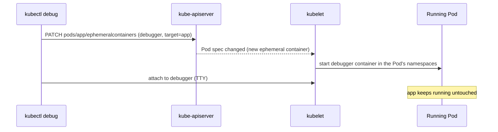

# Ephemeral containers

## Summary

An ephemeral container is a temporary container that you add to an existing, running Pod to inspect it, typically with `kubectl debug`. It exists because you cannot add containers to a Pod after creation, and production images (distroless, minimal) often lack a shell or debugging tools. Ephemeral containers have no resource guarantees, are never restarted and cannot declare ports or probes, so they are for troubleshooting only, never for running applications.

## Prerequisites

- [Pod overview](pod-overview.md).

## Core concepts

### Motivation

Pods are the fundamental building block of Kubernetes applications. Since Pods are intended to be disposable and replaceable, you cannot add a container to a Pod once it has been created. Instead, you usually delete and replace Pods in a controlled way using Deployments.

Sometimes it is necessary to inspect the state of an existing Pod, for example to troubleshoot a hard to reproduce bug. In these cases you can run an *ephemeral container* in an existing Pod to inspect its state and run arbitrary commands.

### What makes them different

Ephemeral containers differ from other containers in that they lack guarantees for resources or execution, and they are never restarted automatically, so they are not appropriate for building applications. They are described with the same `ContainerSpec` as regular containers, but many fields are incompatible and disallowed:

- Ephemeral containers may not have ports, so fields such as `ports`, `livenessProbe` and `readinessProbe` are disallowed.
- Pod resource allocations are immutable, so setting `resources` is disallowed.
- For the full list of allowed fields, see the `EphemeralContainer` reference.

Ephemeral containers are created with a special `ephemeralcontainers` handler (subresource) in the API rather than by adding them directly to `pod.spec`, so it is not possible to add one with `kubectl edit`. Like regular containers, an ephemeral container cannot be changed or removed after it has been added to a Pod; it disappears only with the Pod.



### Use cases

Ephemeral containers are useful for interactive troubleshooting when `kubectl exec` is insufficient because a container has crashed or its image does not include debugging utilities. This is especially relevant for *distroless* images, which contain only the application and its runtime dependencies.

With `--target`, the ephemeral container joins the process namespace of a specific container, so you can see and inspect its processes (for example `/proc/<pid>/root` to read its file system). Alternatively, enable `shareProcessNamespace` on the Pod.

`kubectl debug` offers related modes that do not use ephemeral containers: `--copy-to` creates a copy of the Pod with changes (for example a different image or command), and `kubectl debug node/<name>` starts a Pod in the node's host namespaces.

## Worked example

Debugging a distroless container (untested here; Kubernetes v1.25 or later, where ephemeral containers are stable):

```bash
kubectl run app --image=registry.k8s.io/pause:3.10     # image without a shell
kubectl exec -it app -- sh                             # fails: no such file "sh"
kubectl debug -it app --image=busybox:1.36 --target=app -- sh
# inside the debugger:
ps aux                     # shows /pause as PID 1 of the target container
ls /proc/1/root            # the target container's file system
exit
kubectl get pod app -o jsonpath='{.spec.ephemeralContainers[*].name}{"\n"}'   # debugger-xxxxx
```

## Trade offs and when to use it

- **Benefits.** Debug without changing images or restarting Pods; keeps production images minimal.
- **Costs and risks.** The debugger runs in production with access to the Pod's network and possibly its processes. Restrict the `pods/ephemeralcontainers` subresource with RBAC, and note that Pod Security admission applies to ephemeral containers too.
- **Alternatives.** Logs and metrics first; `kubectl debug --copy-to` when you must change the Pod; node debugging for host level problems.

## Common mistakes

- **Expecting to see the target's processes without `--target`** (or without a shared process namespace).
- **Leaving debuggers in long lived Pods.** They cannot be removed; replace the Pod when done.
- **Trying to set `resources`** on an ephemeral container; it is rejected.

## Practice

1. Why can you not add an ephemeral container with `kubectl edit`?
2. Name two fields that are disallowed for ephemeral containers and why.
3. How do you remove an ephemeral container?

Answers: 1. They are added through the `ephemeralcontainers` subresource, not by updating `pod.spec`. 2. `ports` and probes (no ports), `resources` (Pod resources are immutable). 3. You cannot; it is removed only when the Pod is deleted.

## Further reading

- [Ephemeral Containers](https://kubernetes.io/docs/concepts/workloads/pods/ephemeral-containers/), Kubernetes documentation.
- [Debug Running Pods](https://kubernetes.io/docs/tasks/debug/debug-application/debug-running-pod/), Kubernetes documentation. `kubectl debug` usage.
