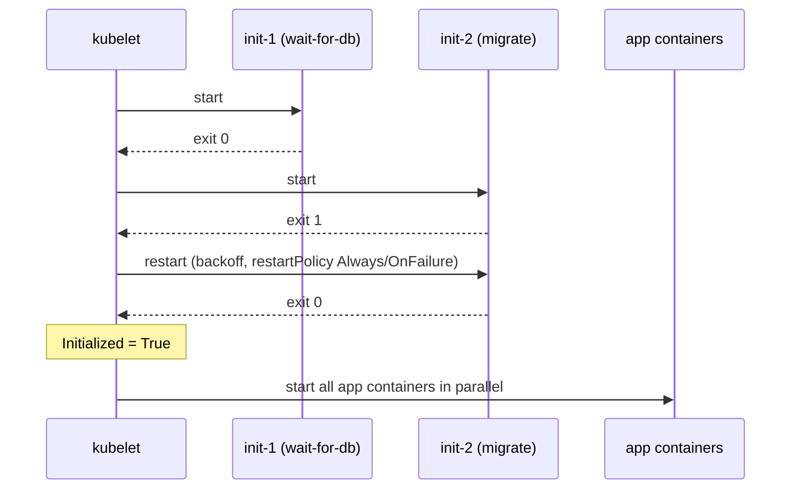
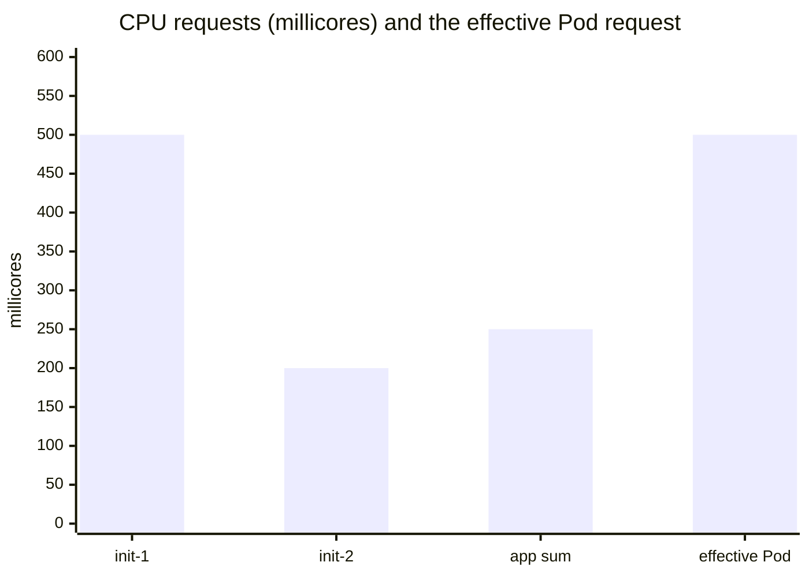

# Init containers

## Summary

Init containers run before the application containers of a Pod start. They run one at a time, each to completion, and each must succeed before the next starts; only then do the app containers start, in parallel. Because they use their own images, they can carry setup tools, secrets or permissions that the app image should not have, and they can block startup until preconditions are met. Their resource requests count differently: the Pod reserves the larger of the biggest init container request and the sum of the app container requests.

## Prerequisites

- [Pod overview](pod-overview.md).
- [Pod lifecycle](pod-lifecycle.md).

## Core concepts

### Definition

A Pod can have several containers running apps, and it can also have one or more *init containers*, which run before the app containers are started. Init containers are exactly like regular containers, except:

- Init containers always run to completion.
- Each init container must complete successfully before the next one starts.

If a Pod's init container fails, the kubelet restarts that init container repeatedly until it succeeds. However, if the Pod has `restartPolicy: Never` and an init container fails during startup, Kubernetes treats the whole Pod as failed.



### Differences from regular containers

Init containers support all the fields and features of app containers, including resource limits, [volumes](../../storage/volumes.md) and security settings. However, their resource requests and limits are handled differently (see below).

Regular init containers (that is, excluding sidecar containers) do not support the `lifecycle`, `livenessProbe`, `readinessProbe` or `startupProbe` fields. Init containers must run to completion before the Pod can be ready; sidecar containers keep running during the Pod's lifetime and do support some probes.

### Differences from sidecar containers

Init containers run and complete their tasks before the main application container starts. Unlike [sidecar containers](sidecar-containers.md), they do not keep running alongside the main containers. Init containers run to completion sequentially, and the main container does not start until all init containers have completed successfully.

### Use cases

Because init containers have separate images from app containers, they have some advantages for startup related code:

- They can contain utilities or custom setup code that are not present in the app image. For example, there is no need to build an image `FROM` another image just to use a tool like `sed`, `awk`, `python` or `dig` during setup.
- The application image builder and deployer roles can work independently, without having to build a single app image together.
- They can run with a different view of the file system than app containers in the same Pod. They can therefore be given access to Secrets that app containers cannot access.
- Because they run to completion before any app container starts, they offer a mechanism to block or delay app container startup until a set of preconditions are met. Once the preconditions are met, all app containers start in parallel.
- They can securely run utilities or custom code that would otherwise make the app image less secure. Keeping unnecessary tools out of the app image limits its attack surface.

Typical examples: waiting for a Service to resolve in DNS, running database migrations, fetching configuration or certificates, setting file permissions on a volume, registering the Pod with an external system.

### Resource sharing within containers

Given the order of execution of init, sidecar and app containers, the following rules apply to resource usage:

- The highest request or limit of a particular resource across all init containers is the *effective init request/limit*. If any resource has no limit specified, this is considered the highest limit.
- The Pod's *effective request/limit* for a resource is the higher of:
  - the sum of the requests/limits of all app containers for that resource,
  - the effective init request/limit for that resource.
- Scheduling is based on effective requests/limits, which means init containers can reserve resources for initialization that are not used during the life of the Pod.
- The Pod's *effective QoS tier* is the QoS tier for init containers and app containers alike.

Quota and limits are applied based on the effective Pod request and limit. With sidecar containers and Pod overhead, the formula is extended; see [Sidecar containers](sidecar-containers.md#resource-sharing-within-containers).

**Example.** Init containers request 500m and 200m CPU; two app containers request 100m and 150m. The effective init request is 500m, the app sum is 250m, so the Pod's effective CPU request is max(500m, 250m) = 500m. The scheduler reserves 500m, although the running Pod later needs only 250m.



## Worked example

An init container that waits for a Service and prepares a config file (untested here; Kubernetes v1.30 or later):

```yaml
apiVersion: v1
kind: Pod
metadata:
  name: app-with-init
spec:
  volumes:
    - name: config
      emptyDir: {}
  initContainers:
    - name: wait-for-db
      image: busybox:1.36
      command: ["sh", "-c", "until nslookup db.default.svc.cluster.local; do echo waiting for db; sleep 2; done"]
    - name: render-config
      image: busybox:1.36
      command: ["sh", "-c", "echo 'db_host=db.default.svc.cluster.local' > /config/app.conf"]
      volumeMounts:
        - name: config
          mountPath: /config
  containers:
    - name: app
      image: busybox:1.36
      command: ["sh", "-c", "cat /config/app.conf; sleep 3600"]
      volumeMounts:
        - name: config
          mountPath: /config
```

```bash
kubectl apply -f app-with-init.yaml
kubectl get pod app-with-init          # Init:0/2 while waiting for the db Service
kubectl logs app-with-init -c wait-for-db
kubectl create service clusterip db --tcp=5432:5432
kubectl get pod app-with-init          # Init:1/2, then PodInitializing, then Running
kubectl logs app-with-init -c app      # db_host=db.default.svc.cluster.local
```

## Trade offs and when to use it

- **Benefits.** Clean separation of setup from runtime, smaller and safer app images, explicit startup ordering.
- **Costs.** Slower Pod start; effective requests can over-reserve resources; logic that waits forever can block a rollout without an obvious error.
- **Alternatives.** Application level retries are more robust for dependencies that can disappear later (an init check only proves the dependency was there at start). Sidecar containers handle long running helpers.

## Common mistakes

- **Non-idempotent init containers.** They can run again when the Pod restarts (see [Pod lifecycle](pod-lifecycle.md#pod-restart-reasons)); migrations must tolerate re-execution.
- **Large init requests** that make the Pod unschedulable or waste capacity.
- **Waiting loops without timeouts**, which hide failures as `Init:0/1` forever.

## Practice

1. In which order do init containers and app containers start?
2. Which probe fields can a regular init container use?
3. Init containers request 1 GiB and 256 MiB of memory; app containers request 300 MiB and 200 MiB. What memory does the scheduler reserve?
4. Give two reasons to put a tool in an init container rather than in the app image.

Answers: 1. Init containers one after another, each to completion; then all app containers in parallel. 2. None. 3. max(1 GiB, 500 MiB) = 1 GiB. 4. Smaller attack surface of the app image; independent build and deploy roles; access to Secrets the app should not see (any two).

## Further reading

- [Init Containers](https://kubernetes.io/docs/concepts/workloads/pods/init-containers/), Kubernetes documentation.
- [Configure Pod Initialization](https://kubernetes.io/docs/tasks/configure-pod-container/configure-pod-initialization/), Kubernetes documentation.
