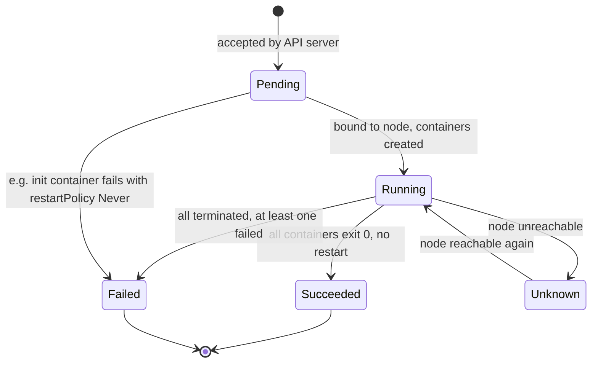
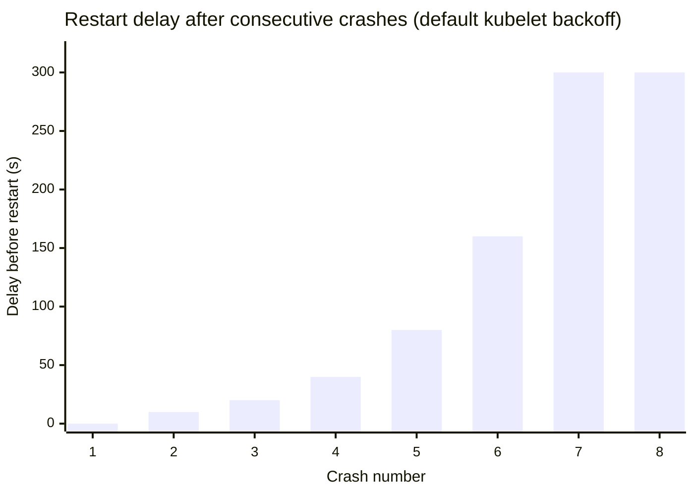
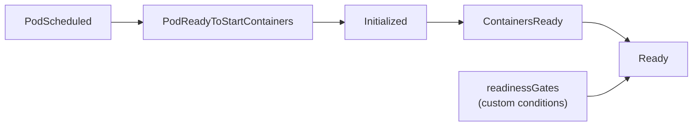

# Pod lifecycle

## Summary

A Pod starts in the `Pending` phase, moves to `Running` once it is bound to a node and its containers are created, and ends in `Succeeded` or `Failed` depending on how its containers terminated. Inside the Pod, each container has its own state (`Waiting`, `Running`, `Terminated`), and the kubelet restarts failed containers according to the `restartPolicy`, with an exponential backoff that shows up as `CrashLoopBackOff`. Pod *conditions* (`PodScheduled`, `Initialized`, `ContainersReady`, `Ready` and others) and optional *readiness gates* decide whether the Pod receives traffic. Pods are never moved or repaired: a failed Pod is replaced by a new one with a new UID.

## Prerequisites

- [Pod overview](pod-overview.md).

## Core concepts

### Lifecycle in one paragraph

Pods follow a defined lifecycle, starting in the `Pending` phase, moving through `Running` if at least one of their primary containers starts OK, and then through either `Succeeded` or `Failed` depending on whether any container terminated in failure.

While a Pod is running, the kubelet can restart containers to handle some kinds of faults. Within a Pod, Kubernetes tracks the different container states and decides what action to take to make the Pod healthy again.

Pods, like individual application containers, are relatively ephemeral entities. They are created, assigned a unique ID (UID) and scheduled to nodes, where they remain until termination (according to the restart policy) or deletion. If a node dies, the Pods scheduled to it are scheduled for deletion after a timeout.

Pods do not self-heal. If a Pod is scheduled to a node that then fails, the Pod is deleted; likewise, a Pod does not survive an eviction due to lack of resources or node maintenance. Kubernetes uses a higher level abstraction, a controller, to manage these disposable Pod instances.

A given Pod (as defined by a UID) is never "rescheduled" to a different node. Instead, it can be replaced by a new, near-identical Pod, possibly with the same name, but with a different UID.

When something is said to have the same lifetime as a Pod, such as a volume, it exists as long as that specific Pod (with that exact UID) exists. If the Pod is deleted for any reason, and even if an identical replacement is created, the related thing (for example an `emptyDir` volume) is also destroyed and created anew.

### Pod phase

A Pod's `status` field is a PodStatus object, which has a `phase` field. The phase is a simple, high level summary of where the Pod is in its lifecycle. It is not intended to be a comprehensive rollup of observations of container or Pod state, nor a comprehensive state machine.

| Value | Description |
| --- | --- |
| `Pending` | The Pod has been accepted by the cluster, but one or more containers has not been set up and made ready to run. This includes time spent waiting to be scheduled and time spent downloading images over the network. |
| `Running` | The Pod has been bound to a node, and all containers have been created. At least one container is still running, or is starting or restarting. |
| `Succeeded` | All containers in the Pod have terminated in success and will not be restarted. |
| `Failed` | All containers in the Pod have terminated, and at least one container terminated in failure: it exited with a non-zero status or was terminated by the system. |
| `Unknown` | The state of the Pod could not be obtained, typically because of an error communicating with the node where the Pod should run. |



**`Terminating` is not a phase.** When a Pod is being deleted, some kubectl commands show it as `Terminating`. The Pod gets a grace period to terminate gracefully, 30 seconds by default (`terminationGracePeriodSeconds`). You can force immediate removal with `kubectl delete pod <name> --grace-period=0 --force`, which removes the API object without waiting for the kubelet to confirm that the containers stopped; use it with care, especially for StatefulSet Pods.

### Container states

As well as the phase of the Pod overall, Kubernetes tracks the state of each container inside a Pod. You can use [container lifecycle hooks](../../containers/container-lifecycle-hooks.md) to trigger events at certain points of a container's lifecycle. Once the scheduler assigns a Pod to a node, the kubelet starts creating containers for that Pod with a container runtime. There are three possible container states:

| Value | Description |
| --- | --- |
| `Waiting` | The container is not `Running` or `Terminated`. It is still running the operations it needs to complete startup, for example pulling the image from a registry or applying Secret data. The `reason` field says why (for example `ContainerCreating`, `ImagePullBackOff`, `CrashLoopBackOff`). |
| `Running` | The container is executing without issues. If a `postStart` hook was configured, it has already executed and finished. |
| `Terminated` | The container began execution and then either ran to completion or failed. `kubectl` shows the reason, exit code and start and finish times. If a `preStop` hook is configured, it runs before the container enters `Terminated`. |

### Failure management and CrashLoopBackOff

Kubernetes manages container failures within Pods using the `restartPolicy` defined in the Pod `spec`. The policy determines how Kubernetes reacts to containers that exit because of errors or other reasons, in this sequence:

1. **Initial crash.** Kubernetes attempts an immediate restart based on the Pod `restartPolicy`.
2. **Repeated crashes.** After the initial crash, Kubernetes applies an exponential backoff delay to subsequent restarts. This prevents rapid, repeated restart attempts from overloading the system. The delay starts at 10 seconds and doubles (10 s, 20 s, 40 s ...) up to a cap of 5 minutes.
3. **CrashLoopBackOff state.** This shows that the backoff mechanism is currently in effect for a container that is in a crash loop, failing and restarting repeatedly.
4. **Backoff reset.** If a container runs successfully for a certain duration (10 minutes), Kubernetes resets the backoff delay and treats any new crash as the first one.



TODO: Verify the backoff values against the v1.37 documentation; recent releases added kubelet options to tune the container restart backoff (`KubeletCrashLoopBackOffMax`).

`CrashLoopBackOff` can be caused by:

- Application errors that make the container exit.
- Configuration errors, such as wrong environment variables or missing configuration files.
- Resource constraints: the container does not have enough memory or CPU to start properly (for example it is OOM killed at startup).
- Health checks failing because the application does not start serving within the expected time.
- Liveness or startup probes returning `Failure` (see [Probes](probes.md)).

To investigate the root cause:

1. **Check logs.** `kubectl logs <name-of-pod>` (add `--previous` to see the output of the crashed instance). This is often the most direct way to find the cause.
2. **Inspect events.** `kubectl describe pod <name-of-pod>` shows events with hints about configuration or resource issues, and the last termination reason and exit code (for example `OOMKilled`, exit code 137).
3. **Review configuration.** Check environment variables, mounted volumes and that all required external resources are available.
4. **Check resource limits.** Make sure the container has enough CPU and memory; increasing them in the Pod definition sometimes resolves the issue.
5. **Debug the application.** Bugs or misconfigurations in the code may be the cause. Running the image locally or in a development environment, or attaching an [ephemeral container](ephemeral-containers.md), helps diagnose application specific issues.

### Container restart policy

The `spec` of a Pod has a `restartPolicy` field with the values `Always`, `OnFailure` and `Never`. The default is `Always`.

- `Always`: automatically restarts the container after any termination.
- `OnFailure`: restarts the container only if it exits with an error (non-zero exit status).
- `Never`: does not automatically restart the terminated container.

The Pod `restartPolicy` applies to app containers and to regular init containers. Sidecar containers ignore the Pod level field: in Kubernetes, a sidecar is an entry in `initContainers` whose container level `restartPolicy` is `Always`. For init containers that exit with an error, the kubelet restarts the init container if the Pod level `restartPolicy` is `OnFailure` or `Always`.

Restarts happen on the same node, in the same Pod, with the same UID. Workload resources restrict the allowed values: Deployments, ReplicaSets, StatefulSets and DaemonSets require `Always`; Jobs require `OnFailure` or `Never`.

### Pod conditions

A Pod has a PodStatus, which has an array of PodConditions through which the Pod has or has not passed. The kubelet manages the following conditions:

| Condition | Meaning |
| --- | --- |
| `PodScheduled` | The Pod has been scheduled to a node. |
| `PodReadyToStartContainers` | The Pod sandbox has been created and networking configured (beta, enabled by default when introduced). |
| `Initialized` | All init containers have completed successfully. |
| `ContainersReady` | All containers in the Pod are ready. |
| `Ready` | The Pod can serve requests and should be added to the load balancing pools of all matching Services. |

Other components add conditions too, for example `DisruptionTarget` (see [Disruptions](disruptions.md#pod-disruption-conditions)).



### Pod readiness and readiness gates

An application can inject extra feedback or signals into PodStatus: *Pod readiness*. To use it, set `readinessGates` in the Pod's `spec` to list additional conditions that the kubelet evaluates for Pod readiness.

Readiness gates are determined by the current state of `status.conditions` of the Pod. If Kubernetes cannot find such a condition, its status defaults to `False`. A Pod that uses custom conditions is ready **only** when both statements apply:

- All containers in the Pod are ready.
- All conditions listed in `readinessGates` are `True`.

When the containers are ready but at least one custom condition is missing or `False`, the kubelet sets the Pod's `ContainersReady` condition to `True` but not `Ready`. Custom conditions are set by external controllers through the `status` subresource (for example a cloud load balancer controller that marks the Pod ready only after it is registered as a healthy target).

### Pod restart reasons

A Pod can restart, which re-executes its init containers, for the following reasons:

- The Pod infrastructure (sandbox) container is restarted. This is uncommon and would have to be done by someone with root access to the nodes.
- All containers in the Pod are terminated while `restartPolicy` is `Always`, forcing a restart, and the init container completion record has been lost because of garbage collection.

Changes to the init container image do not restart the Pod in place; for Pods owned by a controller they lead to a new Pod.

## Worked example

Watching a crash loop and diagnosing it (untested here; Kubernetes v1.30 or later):

```yaml
apiVersion: v1
kind: Pod
metadata:
  name: crashy
spec:
  restartPolicy: Always
  containers:
    - name: app
      image: busybox:1.36
      command: ["sh", "-c", "echo starting; echo missing config >&2; exit 3"]
```

```bash
kubectl apply -f crashy.yaml
kubectl get pod crashy --watch
# crashy  0/1  Error             1   5s
# crashy  0/1  CrashLoopBackOff  1   6s
# crashy  0/1  Error             2   20s   (restarts spaced 10 s, 20 s, 40 s ...)
kubectl logs crashy --previous         # starting / missing config
kubectl get pod crashy -o jsonpath='{.status.containerStatuses[0].lastState.terminated.exitCode}{"\n"}'   # 3
kubectl get pod crashy -o jsonpath='{range .status.conditions[*]}{.type}={.status}{" "}{end}{"\n"}'
# PodReadyToStartContainers=True Initialized=True Ready=False ContainersReady=False PodScheduled=True
```

The phase stays `Running` during the crash loop, because the container keeps being restarted; `Ready` is `False`, so the Pod receives no Service traffic.

## Trade offs and when to use it

- **Restart in place or replace.** The kubelet's restarts are fast and keep the Pod's IP and volumes, but cannot fix node level problems; controllers replace Pods for that.
- **Readiness gates** integrate external systems into readiness but add a dependency: if the external controller fails, Pods never become `Ready`.

## Common mistakes

- **Reading the phase as health.** A crash looping Pod is `Running`. Check container states, restart counts and conditions.
- **Forgetting `--previous`** when reading logs of a restarted container.
- **Force deleting StatefulSet Pods.** The API object disappears while the container may still run, and a second Pod with the same identity can start.
- **Expecting `emptyDir` data to survive Pod replacement.** It lives exactly as long as the Pod UID.

## Practice

1. A Pod has `restartPolicy: OnFailure`, and its container exits with code 0. What happens?
2. Which phase does a Pod show while one of its containers is in `CrashLoopBackOff`?
3. A Pod's containers are all ready, but a readiness gate condition is missing. What are `ContainersReady` and `Ready`?
4. What is the difference between a container restart and a Pod replacement?
5. Which exit code and reason indicate that a container exceeded its memory limit?

Answers: 1. Nothing; the container is not restarted, and if it was the only container the Pod becomes `Succeeded`. 2. `Running`. 3. `ContainersReady=True`, `Ready=False`. 4. A restart happens in the same Pod on the same node with the same UID and IP; a replacement is a new Pod with a new UID, possibly on another node. 5. Exit code 137 with reason `OOMKilled`.

## Further reading

- [Pod Lifecycle](https://kubernetes.io/docs/concepts/workloads/pods/pod-lifecycle/), Kubernetes documentation. Phases, container states, restart policy, conditions, termination.
- [Pod Conditions](https://kubernetes.io/docs/concepts/workloads/pods/pod-condition/), Kubernetes documentation.
- [Debug Running Pods](https://kubernetes.io/docs/tasks/debug/debug-application/debug-running-pod/), Kubernetes documentation.
- [KEP-580: Pod readiness gates](https://github.com/kubernetes/enhancements/tree/master/keps/sig-network/580-pod-readiness-gates), Kubernetes enhancements.
