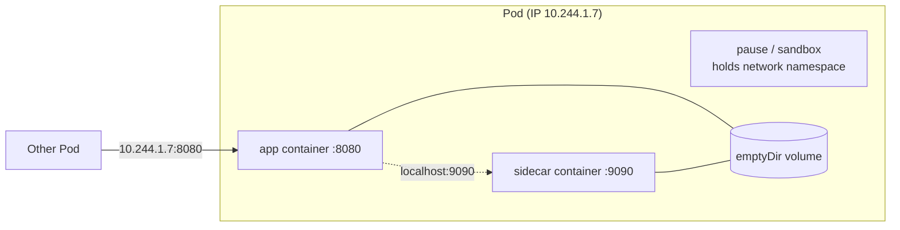

# Pod overview

## Summary

A Pod is the smallest deployable unit of computing in Kubernetes: a group of one or more containers that share network and storage and run together on one node, plus a specification of how to run them. A Pod models an application-specific *logical host*. Besides application containers, a Pod can contain init containers that run during startup, sidecar containers that run alongside the application, and ephemeral containers injected for debugging. Pods are disposable; controllers create and replace them.

## Prerequisites

- [Container fundamentals](../../containers/container-fundamentals.md).
- [Workloads overview](../workloads-overview.md).

## Core concepts

### Definition

*Pods* are the smallest deployable units of computing that you can create and manage in Kubernetes.

A Pod (as in a pod of whales or a pea pod) is a group of one or more containers, with shared storage and network resources, and a specification for how to run the containers. A Pod's contents are always co-located and co-scheduled, and run in a shared context. A Pod models an application-specific "logical host": it contains one or more application containers that are relatively tightly coupled. In non-cloud contexts, applications executed on the same physical or virtual machine are analogous to cloud applications executed on the same logical host.

*Analogy.* A Pod is like a shared apartment: the flatmates (containers) share one address (IP), one mailbox (ports on `localhost`) and the common rooms (volumes), but each has their own room (file system and process space). The analogy breaks at eviction: when the landlord ends the lease, all flatmates leave together, and a new apartment with a new address is rented elsewhere instead of moving the old one.

### What containers in a Pod share



- **Network.** All containers share one network namespace: one IP address, one port space, and they reach each other on `localhost`. The namespace is held by the Pod sandbox (the "pause" container in most runtimes).
- **Storage.** Volumes defined in the Pod can be mounted into several containers.
- **Optionally, process namespace** (`shareProcessNamespace: true`), so containers can see and signal each other's processes.
- **Not shared by default:** the root file system and the cgroup limits of each container.

### Kinds of containers in a Pod

| Kind | When it runs | Purpose | Home note |
| --- | --- | --- | --- |
| Application (regular) containers | For the life of the Pod | The main workload | This note |
| Init containers | Sequentially, to completion, before the app containers | Setup, waiting for dependencies | [Init containers](init-containers.md) |
| Sidecar containers | Start with the init sequence and keep running | Logging, proxies, helpers | [Sidecar containers](sidecar-containers.md) |
| Ephemeral containers | Added to a running Pod on demand | Interactive debugging | [Ephemeral containers](ephemeral-containers.md) |

### Pods are disposable

Pods are not designed to be durable. They get a unique ID (UID), are bound to one node and stay there until they terminate or are deleted. Controllers create replacement Pods; see [Pod lifecycle](pod-lifecycle.md). You rarely create Pods directly; you create workload resources with a *Pod template*, and the controller creates Pods from it.

## Worked example

A Pod with two containers sharing a volume and the network (untested here; Kubernetes v1.30 or later):

```yaml
apiVersion: v1
kind: Pod
metadata:
  name: shared
spec:
  volumes:
    - name: html
      emptyDir: {}
  containers:
    - name: web
      image: nginx:1.27
      volumeMounts:
        - name: html
          mountPath: /usr/share/nginx/html
    - name: writer
      image: busybox:1.36
      command: ["sh", "-c", "while true; do date > /out/index.html; sleep 5; done"]
      volumeMounts:
        - name: html
          mountPath: /out
```

```bash
kubectl apply -f shared.yaml
kubectl exec shared -c writer -- wget -qO- localhost:80   # writer reaches nginx on localhost
# prints the current date written by the writer container into the shared volume
```

## Trade offs and when to use it

- **One container or several.** Put containers in one Pod only if they must share a lifecycle, network or files and scale together. Otherwise use separate Pods and Services, which scale independently.
- **Bare Pods versus controllers.** Create Pods directly only for experiments.

## Common mistakes

- **Putting a web server and its database in one Pod.** They cannot be scaled independently, and both restart together.
- **Expecting a Pod to survive node failure.** It does not; a new Pod replaces it if a controller owns it.

## Practice

1. What do containers in the same Pod share by default?
2. Why is a Pod called a "logical host"?
3. When should two containers be placed in the same Pod?

Answers: 1. The network namespace (IP and ports) and the Pod's volumes they mount. 2. Its containers are co-located and co-scheduled and share network and storage, like processes on one machine. 3. When they are tightly coupled: they must run on the same node, share files or `localhost`, and live and scale together.

## Further reading

- [Pods](https://kubernetes.io/docs/concepts/workloads/pods/), Kubernetes documentation.
- [The Distributed System ToolKit: Patterns for Composite Containers](https://kubernetes.io/blog/2015/06/the-distributed-system-toolkit-patterns/), Kubernetes blog, 2015. Sidecar, ambassador and adapter patterns.
