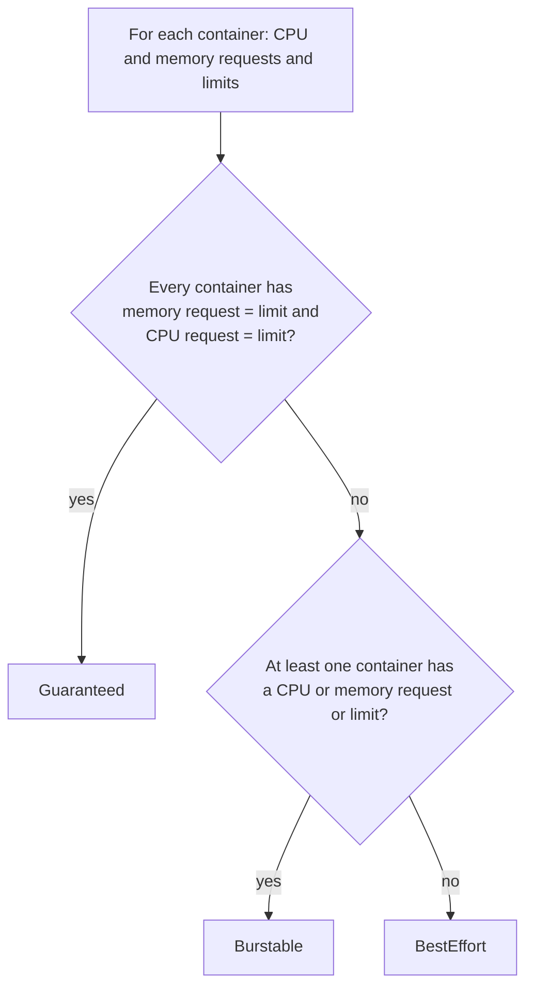
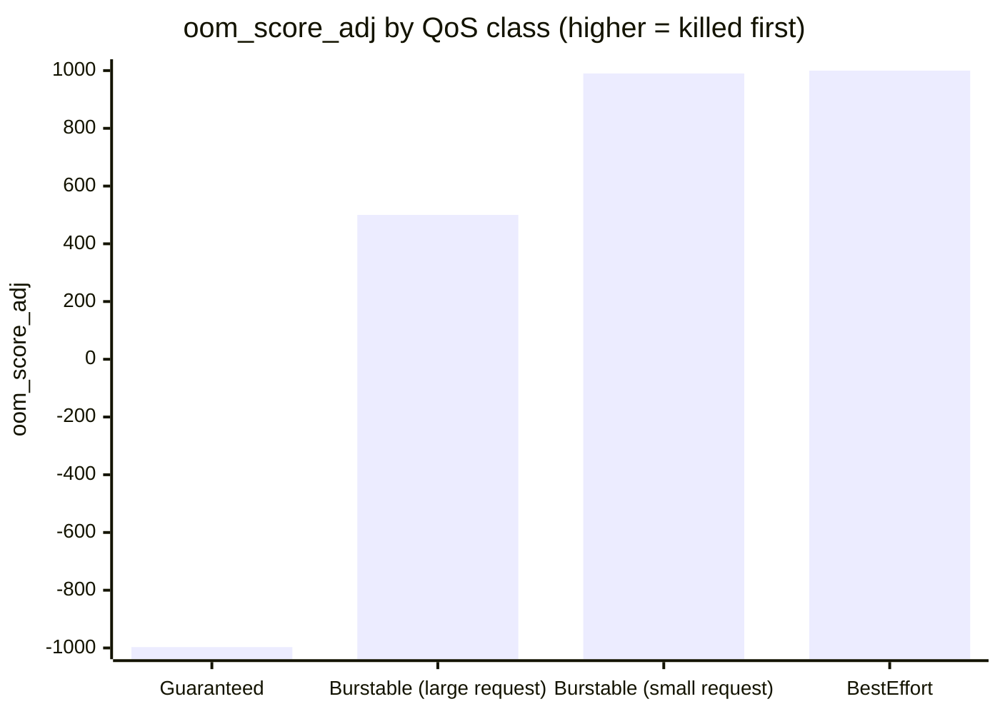

# Pod quality of service classes

## Summary

Kubernetes assigns every Pod a *quality of service (QoS) class* derived from the CPU and memory requests and limits of its containers: `Guaranteed` (every container has requests equal to limits for both CPU and memory), `Burstable` (some requests or limits, but not Guaranteed) and `BestEffort` (no requests or limits at all). The class decides how the kubelet treats the Pod under node pressure: `BestEffort` Pods are evicted first, `Guaranteed` last, and the kernel OOM killer is biased the same way. The scheduler does not use QoS for preemption; that is the job of Pod priority.

## Prerequisites

- [Resource management for Pods and containers](../../configuration/resource-management-for-pods-and-containers.md).

## Core concepts

### Definition

Kubernetes classifies the Pods that you run and assigns each Pod a specific QoS class. It uses that classification to influence how different Pods are handled. The classification is based on the resource requests of the containers in the Pod, and on how those requests relate to the resource limits. QoS classes are used by Kubernetes to decide which Pods to evict from a node experiencing [node pressure](../../scheduling-preemption-and-eviction/node-pressure-eviction.md). The possible classes are `Guaranteed`, `Burstable` and `BestEffort`.

When a node runs out of resources, Kubernetes first evicts `BestEffort` Pods running on that node, followed by `Burstable` and finally `Guaranteed` Pods. When the eviction is due to resource pressure, only Pods that exceed their resource requests are candidates for eviction. (Precisely, the kubelet ranks by whether usage exceeds requests, then by Pod priority, then by usage relative to requests; the QoS class is a good predictor of that order.)



### Guaranteed

Pods that are `Guaranteed` have the strictest resource limits and are the least likely to face eviction. They are guaranteed not to be killed until they exceed their limits or there are no lower priority Pods that can be preempted from the node. They may not acquire resources beyond their specified limits. These Pods can also use exclusive CPUs with the `static` CPU management policy (when the CPU request is an integer).

For a Pod to be given the `Guaranteed` class:

- Every container in the Pod must have a memory limit and a memory request.
- For every container, the memory limit must equal the memory request.
- Every container in the Pod must have a CPU limit and a CPU request.
- For every container, the CPU limit must equal the CPU request.

(If you set only limits, the requests default to the limits, which also yields `Guaranteed`.)

### Burstable

Pods that are `Burstable` have some lower bound resource guarantees based on the request, but do not require a specific limit. If a limit is not specified, it defaults to a limit equivalent to the capacity of the node, which lets the Pods flexibly increase their resources if resources are available. In the event of eviction because of node resource pressure, these Pods are evicted only after all `BestEffort` Pods have been evicted. Because a `Burstable` Pod can include a container that has no resource limits or requests, a `Burstable` Pod can try to use any amount of node resources.

A Pod is `Burstable` if:

- It does not meet the criteria for `Guaranteed`.
- At least one container in the Pod has a memory or CPU request or limit.

### BestEffort

Pods in the `BestEffort` class can use node resources that are not specifically assigned to Pods in other QoS classes. For example, on a node with 16 CPU cores available to the kubelet, with 4 cores assigned to a `Guaranteed` Pod, a `BestEffort` Pod can try to use any amount of the remaining 12 cores.

The kubelet prefers to evict `BestEffort` Pods if the node comes under resource pressure.

A Pod is `BestEffort` if it meets the criteria for neither `Guaranteed` nor `Burstable`. In other words, a Pod is `BestEffort` only if none of its containers has a memory limit or a memory request, and none has a CPU limit or a CPU request. Containers can request other resources (not CPU or memory) and still be classified as `BestEffort`.

### Behavior that does not depend on the QoS class

- Any container that exceeds a resource limit is handled by the kubelet and kernel without affecting other containers in the Pod: exceeding the **memory** limit gets the process OOM killed (and the container restarted according to its restart policy); exceeding the **CPU** limit gets the container throttled, not killed. (The documentation phrases this as "killed and restarted", which is accurate for memory only.)
- If a container exceeds its resource request and the node faces resource pressure, its Pod becomes a candidate for eviction. If this happens, all containers in the Pod are terminated. Kubernetes may create a replacement Pod, usually on a different node.
- The resource request of a Pod is equal to the sum of the requests of its containers, and its limit is the sum of their limits (plus init container and overhead rules, see [Init containers](init-containers.md#resource-sharing-within-containers)).
- The kube-scheduler does not consider QoS class when selecting Pods to [preempt](../../scheduling-preemption-and-eviction/pod-priority-and-preemption.md). Preemption can occur when a cluster does not have enough resources to run all the Pods you defined.

### QoS and the OOM killer

The kubelet sets `oom_score_adj` per container by QoS class: `Guaranteed` -997, `BestEffort` 1000, and for `Burstable` a value between 2 and 999 that is lower when the memory request is a larger share of node memory. See [Node-pressure eviction](../../scheduling-preemption-and-eviction/node-pressure-eviction.md#node-out-of-memory-behavior).



The two Burstable bars are illustrative values for a large and a small memory request; the real value depends on the request relative to node memory.

## Worked example

Three Pods, three classes (untested here; Kubernetes v1.30 or later):

```yaml
apiVersion: v1
kind: Pod
metadata: { name: qos-guaranteed }
spec:
  containers:
    - name: app
      image: nginx:1.27
      resources:
        requests: { cpu: "500m", memory: "256Mi" }
        limits:   { cpu: "500m", memory: "256Mi" }
---
apiVersion: v1
kind: Pod
metadata: { name: qos-burstable }
spec:
  containers:
    - name: app
      image: nginx:1.27
      resources:
        requests: { memory: "128Mi" }
---
apiVersion: v1
kind: Pod
metadata: { name: qos-besteffort }
spec:
  containers:
    - name: app
      image: nginx:1.27
```

```bash
kubectl apply -f qos.yaml
kubectl get pods -o custom-columns=NAME:.metadata.name,QOS:.status.qosClass
# qos-besteffort   BestEffort
# qos-burstable    Burstable
# qos-guaranteed   Guaranteed
```

## Trade offs and when to use it

- **Guaranteed** gives the most predictable performance and eviction protection, but reserves resources that sit idle when the app is quiet, and CPU limits can cause throttling of latency sensitive code.
- **Burstable** is the common choice: requests sized to typical use, memory limits to contain leaks, and often no CPU limit to avoid throttling.
- **BestEffort** suits only truly expendable work (some batch or test Pods); under pressure it is killed first.

## Common mistakes

- **Forgetting one container** (for example a sidecar without resources) and getting `Burstable` instead of `Guaranteed`.
- **Thinking QoS protects against preemption.** Use PriorityClasses for that.
- **Setting CPU requests equal to limits everywhere** to get `Guaranteed`, then suffering CFS throttling.

## Practice

1. A Pod has two containers; one has CPU and memory requests equal to limits, the other has nothing. What is its QoS class?
2. Which class does a Pod get if each container sets only limits for CPU and memory?
3. Does the scheduler use QoS classes when choosing preemption victims?
4. What happens when a `Guaranteed` container exceeds its CPU limit?

Answers: 1. `Burstable`. 2. `Guaranteed`, because requests default to the limits. 3. No, it uses priority. 4. It is throttled by the CFS quota, not killed.

## Further reading

- [Pod Quality of Service Classes](https://kubernetes.io/docs/concepts/workloads/pods/pod-qos/), Kubernetes documentation.
- [Configure Quality of Service for Pods](https://kubernetes.io/docs/tasks/configure-pod-container/quality-service-pod/), Kubernetes documentation.
- [Control CPU Management Policies on the Node](https://kubernetes.io/docs/tasks/administer-cluster/cpu-management-policies/), Kubernetes documentation. The `static` policy and exclusive CPUs.
