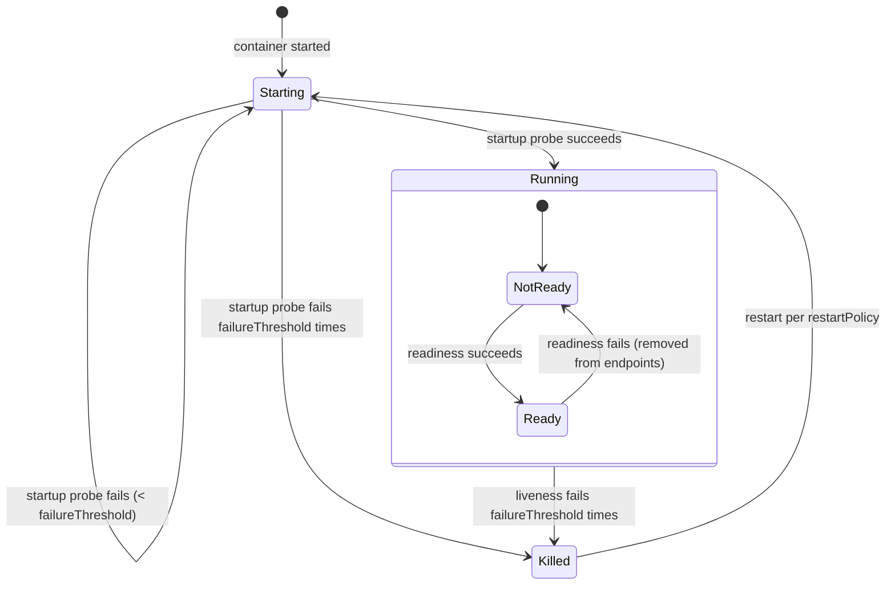
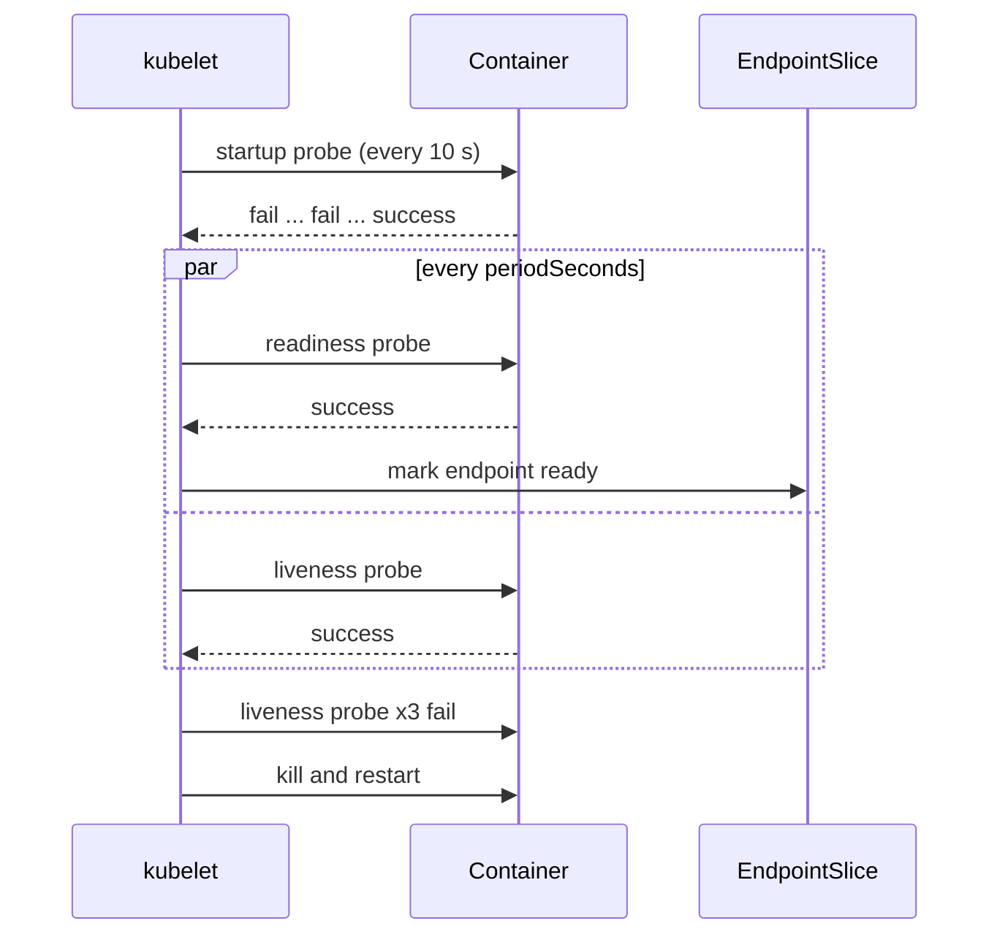

# Liveness, readiness and startup probes

## Summary

Probes are periodic health checks that the kubelet runs against containers. A *liveness* probe restarts a container that is stuck, a *readiness* probe removes a Pod from Service endpoints while it cannot serve, and a *startup* probe gives slow starting applications time before the other two begin. Each probe uses one mechanism (`httpGet`, `tcpSocket`, `grpc` or `exec`) and the same timing parameters. Badly tuned probes are a common cause of outages, so the defaults and the interaction between the three types matter.

## Prerequisites

- [Pod lifecycle](pod-lifecycle.md).

## Core concepts

### Definition

Probes are continuous checks that Kubernetes performs on applications to make sure they are healthy and ready to do their work. They are essential for the reliability and availability of applications. There are three types:

| Probe | Question it answers | Action on failure | Field |
| --- | --- | --- | --- |
| Liveness | Is the container alive and responsive? | The kubelet kills the container; it is restarted according to `restartPolicy`. | `spec.containers[*].livenessProbe` |
| Readiness | Is the container ready to serve traffic? | The Pod is marked not ready and removed from Service endpoints; no restart. | `spec.containers[*].readinessProbe` |
| Startup | Has the application finished starting? | Liveness and readiness are not run until it succeeds; after `failureThreshold` failures the container is killed. | `spec.containers[*].startupProbe` |

*Analogy.* Think of a restaurant. The startup probe is the kitchen opening check in the morning: no one judges the cooks before the kitchen is set up. The readiness probe is the "open" sign: when the kitchen is overwhelmed, the sign is turned off and new guests go elsewhere, but nobody is fired. The liveness probe is the manager checking whether a cook has collapsed; if so, the cook is replaced. The analogy breaks in that a replaced container starts from scratch, losing all in-memory state.

### Configuration parameters

Several parameters define how a probe operates:

| Parameter | Meaning | Default |
| --- | --- | --- |
| `initialDelaySeconds` | Seconds to wait after the container has started before the probe begins checking. | 0 |
| `periodSeconds` | How often (in seconds) the probe runs. | 10 |
| `timeoutSeconds` | Seconds after which the probe times out if no response is received. | 1 |
| `successThreshold` | Consecutive successes required to mark the container healthy after it failed. Must be 1 for liveness and startup probes. | 1 |
| `failureThreshold` | Consecutive failures required to mark the container unhealthy (or to restart it). | 3 |
| `terminationGracePeriodSeconds` | Probe level override of the grace period used when a liveness or startup failure kills the container. | Pod value |

Probes can use different mechanisms, chosen by the application's needs:

| Mechanism | Success condition |
| --- | --- |
| `httpGet` | HTTP status code from 200 to 399. |
| `tcpSocket` | The TCP connection is established. |
| `grpc` | The gRPC health checking protocol returns `SERVING`. |
| `exec` | The command exits with code 0. |

### Liveness probe

A liveness probe determines whether a container is alive and responsive. If the probe fails, Kubernetes restarts the container.

Many applications that run for a long time eventually become unresponsive and stuck in an error state (deadlocks, exhausted thread pools) without crashing. A liveness probe detects that and restarts the container.

A liveness probe should check only the process itself, not its dependencies. If it checks the database, a database outage restarts every replica at once, which makes the outage worse.

### Readiness probe

A readiness probe indicates whether an application is ready to accept traffic. If it fails, Kubernetes stops sending traffic to the Pod (removes it from EndpointSlices) until it passes again.

Readiness probes prevent traffic from reaching Pods that cannot serve requests. This is useful during startup, after configuration changes, or when the application needs to do initialization work. Readiness probes run during the whole lifecycle of the container, not only at startup.

Readiness and liveness probes can be used in parallel on the same container. Using both makes sure that traffic does not reach a container that is not ready and that containers are restarted when they fail.

### Startup probe

Startup probes check whether an application has started. They are useful for slow starting applications: the application gets enough time to initialize without being killed by the liveness probe or marked unready too early.

When a startup probe is configured, liveness and readiness checks are disabled until it succeeds, so they cannot interfere with startup. To cover the worst case startup time, set the startup probe's `failureThreshold * periodSeconds` to that time, while keeping the liveness probe's own values short for fast detection after startup.

**Example.** An application needs up to 5 minutes to start. A startup probe with `periodSeconds: 10` and `failureThreshold: 30` allows 300 seconds. After it succeeds, the liveness probe with `periodSeconds: 10` and `failureThreshold: 3` detects a hang within about 30 seconds.

### Combining probes

All three probes can be combined for availability and resilience. The order of execution is:

1. **Startup probe**: makes sure the application (for example a JVM) has started before any other probe runs.
2. **Readiness probe**: checks whether the application is ready to serve traffic.
3. **Liveness probe**: checks the ongoing health of the application.

After the startup probe succeeds, readiness and liveness run concurrently, each on its own schedule.





## Worked example

A slow starting JVM service with all three probes (untested here; Kubernetes v1.30 or later; the image is a placeholder):

```yaml
apiVersion: v1
kind: Pod
metadata:
  name: orders
spec:
  containers:
    - name: app
      image: registry.example.com/orders:2.3.0
      ports:
        - containerPort: 8080
      startupProbe:
        httpGet: { path: /actuator/health/liveness, port: 8080 }
        periodSeconds: 10
        failureThreshold: 30        # up to 300 s to start
      readinessProbe:
        httpGet: { path: /actuator/health/readiness, port: 8080 }
        periodSeconds: 5
        failureThreshold: 2         # out of rotation after about 10 s of failures
      livenessProbe:
        httpGet: { path: /actuator/health/liveness, port: 8080 }
        periodSeconds: 10
        timeoutSeconds: 2
        failureThreshold: 3         # restart after about 30 s of hanging
```

```bash
kubectl describe pod orders | grep -E 'Liveness|Readiness|Startup'
kubectl get events --field-selector involvedObject.name=orders | grep -i unhealthy
# Warning  Unhealthy  ...  Startup probe failed: Get "http://10.244.1.9:8080/...": connection refused
```

During startup the events show startup probe failures but no restarts until 30 failures; the Pod has `Ready=False` and is not in the Service endpoints.

## Trade offs and when to use it

- **No liveness probe** is better than a bad one: the kubelet already restarts crashed processes. Add liveness only for hangs the process cannot detect itself.
- **Readiness probes** are almost always worth it for anything behind a Service.
- **Startup probes** replace long `initialDelaySeconds` values, which delay failure detection for the whole life of the container.
- **HTTP versus exec.** HTTP and gRPC probes are cheap and run from the kubelet; `exec` probes start a process in the container every period and cost CPU at scale.

## Common mistakes

- **Liveness probes that check dependencies** (database, downstream APIs): cascading restarts.
- **Identical liveness and readiness probes** with the same thresholds: a slow Pod is restarted instead of being taken out of rotation.
- **`timeoutSeconds: 1` on endpoints** that do work under load: false failures and restarts at peak traffic.
- **Large `initialDelaySeconds` instead of a startup probe.**
- **Readiness that depends on shared dependencies**, which can take every replica out of rotation at once and turn a partial outage into a total one.

## Practice

1. What happens when a readiness probe fails? When a liveness probe fails?
2. An application needs up to 120 s to start, and you want hangs detected within 15 s after that. Configure the startup and liveness probes.
3. Which probe disables the others until it succeeds?
4. Why can `successThreshold` not be greater than 1 for a liveness probe?

Answers: 1. Readiness: the Pod is removed from Service endpoints, no restart. Liveness: the container is killed and restarted. 2. Startup: `periodSeconds: 5`, `failureThreshold: 24`; liveness: `periodSeconds: 5`, `failureThreshold: 3`. 3. The startup probe. 4. A liveness failure results in a restart, so there is no "recovering" state in which consecutive successes would be counted; the API requires 1.

## Further reading

- [Liveness, Readiness, and Startup Probes](https://kubernetes.io/docs/concepts/workloads/pods/probes/), Kubernetes documentation.
- [Configure Liveness, Readiness and Startup Probes](https://kubernetes.io/docs/tasks/configure-pod-container/configure-liveness-readiness-startup-probes/), Kubernetes documentation. Parameters and examples.
- [GRPC Health Checking Protocol](https://github.com/grpc/grpc/blob/master/doc/health-checking.md), gRPC project.
