# Sidecar containers

## Summary

Sidecar containers are secondary containers that run alongside the main application container in the same Pod to provide supporting functions such as log shipping, proxies or configuration reloading. Kubernetes implements native sidecars as a special case of init containers: an entry in `initContainers` with the container level `restartPolicy: Always`. Such a container starts in the init sequence, keeps running for the life of the Pod, can be restarted independently, supports probes, and does not block a Job from completing. Native sidecars are stable since v1.33.

## Prerequisites

- [Init containers](init-containers.md).
- [Pod lifecycle](pod-lifecycle.md#container-restart-policy).

## Core concepts

### Definition

Kubernetes implements sidecar containers as a special case of init containers; sidecar containers remain running after Pod startup. The term *regular init containers* is used for containers that only run during Pod startup.

These restartable sidecar containers are independent from other init containers and from the main application containers in the same Pod. They can be started, stopped or restarted without affecting the main application container and other init containers.

You can also run a Pod with several containers that are not marked as init or sidecar containers. That is appropriate when the containers are all required for the Pod to work, but you do not need to control which one starts or stops first. You might also do it to support older versions of Kubernetes that do not support the container level `restartPolicy` field.

*Analogy.* A motorcycle sidecar travels with the motorcycle and adds capacity without changing the engine. A sidecar container adds logging or networking without changing the application. The analogy breaks at the start and stop order: a native sidecar container starts before the app and stops after it, which a real sidecar cannot do.

### Sidecars in the Pod lifecycle

If an init container is created with its `restartPolicy` set to `Always`, it starts and stays running for the entire life of the Pod. This is useful for supporting services separated from the main containers.

If a `readinessProbe` is specified for this init container, its result is used to determine the `ready` state of the Pod.

Because these containers are defined as init containers, they get the same ordering and sequential guarantees as regular init containers, so you can mix sidecars and regular init containers for complex initialization flows.

Compared to regular init containers, sidecars in `initContainers` keep running after they have started. This matters when there is more than one entry in `.spec.initContainers`. After a sidecar-style init container is running (the kubelet has set its `started` status to true), the kubelet starts the next init container from the ordered list. That status becomes true either because a process runs in the container and no startup probe is defined, or because its `startupProbe` succeeds.

At Pod termination, sidecars are stopped after the main containers, in the reverse order of their definition, so that a logging or proxy sidecar is available until the app has exited.

```mermaid
gantt
  title Container timeline in a Pod with a native sidecar
  dateFormat X
  axisFormat %s
  section init
  init-1 (regular init)        :done, 0, 2
  log-shipper (sidecar)        :active, 2, 20
  init-2 (regular init)        :done, 3, 5
  section app
  app container                :5, 18
```



The chart shows the order: the sidecar starts after `init-1`, `init-2` waits only until the sidecar has *started*, the app starts after all init containers, and the sidecar outlives the app at shutdown.

### Jobs

If you define a Job that uses a sidecar implemented as a Kubernetes-style init container, the sidecar in each Pod does not prevent the Job from completing after the main container has finished. (With the older pattern of a sidecar as a regular container, the Pod never completes, because the sidecar never exits.)

### Differences from application containers

Sidecar containers run alongside *app containers* in the same Pod. However, they do not execute the primary application logic; they provide supporting functionality to the main application.

Sidecar containers have their own independent lifecycles. They can be started, stopped and restarted independently of app containers, which means you can update, scale or maintain them without affecting the primary application. (Changing a sidecar's image in a Pod template still creates new Pods through the controller.)

Sidecar containers share the same network and storage namespaces with the primary container. This co-location lets them interact closely and share resources.

### Differences from init containers

Sidecar containers work alongside the main container, extending its functionality and providing additional services.

They run concurrently with the main application container. They are active throughout the lifecycle of the Pod and can be started and stopped independently of the main container. Unlike regular init containers, sidecars support probes to control their lifecycle.

Sidecars can interact directly with the main application containers, because, like init containers, they always share the same network, and they can optionally share volumes (file systems).

Init containers stop before the main containers start, so they cannot exchange messages with the app containers. Any data passing is one-way: for example, an init container can put information in an `emptyDir` volume.

| Aspect | Regular init container | Sidecar (restartable init) | App container |
| --- | --- | --- | --- |
| Runs | Before app, to completion | From its position in init order until the Pod ends | After all init containers |
| `restartPolicy` | Pod level | `Always` (container level) | Pod level |
| Probes | No | Yes (startup, readiness, liveness) | Yes |
| Blocks Job completion | No | No | Yes, until it exits |
| Talks to the app at runtime | No | Yes | Yes |

### Resource sharing within containers

Given the order of execution of init, sidecar and app containers, the following rules apply:

- The highest request or limit of a particular resource across all init containers is the *effective init request/limit*. If any resource has no limit specified, this is considered the highest limit.
- The Pod's *effective request/limit* for a resource is the sum of the [Pod overhead](../../containers/runtime-class.md) and the higher of:
  - the sum of the requests/limits of all non-init containers (app and sidecar containers) for that resource,
  - the effective init request/limit for that resource.
- Scheduling is based on effective requests/limits, so init containers can reserve resources for initialization that are not used during the life of the Pod.
- The Pod's *effective QoS tier* is the QoS tier for all init, sidecar and app containers alike.

Quota and limits are applied based on the effective Pod request and limit. (Precisely, the effective init value accounts for sidecars that are already running when each regular init container runs; see the documentation for the exact formula.)

### Linux cgroups

On Linux, resource allocations for Pod level control groups (cgroups) are based on the effective Pod request and limit, the same as for the scheduler.

## Worked example

A Job with a native log shipping sidecar (untested here; Kubernetes v1.33 or later):

```yaml
apiVersion: batch/v1
kind: Job
metadata:
  name: report
spec:
  template:
    spec:
      restartPolicy: Never
      volumes:
        - name: logs
          emptyDir: {}
      initContainers:
        - name: log-shipper
          image: busybox:1.36
          restartPolicy: Always          # this makes it a sidecar
          command: ["sh", "-c", "tail -F /var/log/app/out.log"]
          volumeMounts:
            - name: logs
              mountPath: /var/log/app
      containers:
        - name: main
          image: busybox:1.36
          command: ["sh", "-c", "for i in 1 2 3; do echo line $i >> /var/log/app/out.log; sleep 1; done"]
          volumeMounts:
            - name: logs
              mountPath: /var/log/app
```

```bash
kubectl apply -f report.yaml
kubectl wait --for=condition=complete job/report --timeout=60s   # completes although the sidecar never exits
kubectl logs job/report -c log-shipper                            # line 1, line 2, line 3
```

## Trade offs and when to use it

- **Native sidecar or regular second container.** Native sidecars give ordered startup and shutdown and work with Jobs; plain multi-container Pods work on older clusters but have no ordering.
- **Sidecar or DaemonSet.** A node level agent (DaemonSet) uses fewer resources than one sidecar per Pod; a sidecar gives per-Pod isolation and configuration (see [Logging architecture](../../cluster-administration/observability/logging-architecture.md)).
- **Service mesh sidecars** add mutual TLS and traffic control but cost memory and latency per Pod; some meshes now offer sidecarless modes.

## Common mistakes

- **Declaring a sidecar in `containers`** for a Job: the Job never completes.
- **Forgetting a startup probe** on a sidecar that the app depends on (for example a proxy): the next containers start before it is actually ready.
- **Undersizing sidecars.** Their requests add up across all replicas.

## Practice

1. How do you declare a native sidecar container?
2. Why does a native sidecar not block Job completion?
3. When does the kubelet start the next init container after a sidecar?
4. In which order are sidecars stopped relative to app containers?

Answers: 1. As an entry in `initContainers` with `restartPolicy: Always`. 2. Kubernetes treats it as a supporting container and terminates it once the main containers have finished. 3. When the sidecar's `started` status is true: its process runs (no startup probe) or its startup probe succeeded. 4. After the app containers, in reverse order of definition.

## Further reading

- [Sidecar Containers](https://kubernetes.io/docs/concepts/workloads/pods/sidecar-containers/), Kubernetes documentation.
- [KEP-753: Sidecar containers](https://github.com/kubernetes/enhancements/tree/master/keps/sig-node/753-sidecar-containers), Kubernetes enhancements.
