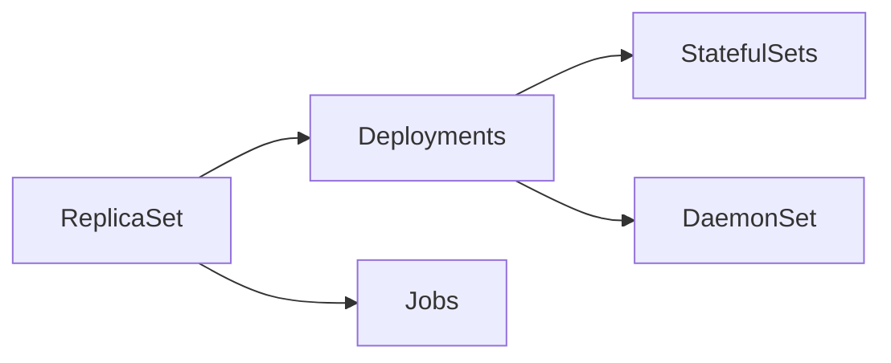

# Workload management

The built-in controllers that run Pods for you: Deployments and ReplicaSets for interchangeable replicas, StatefulSets for stable identities, DaemonSets for node agents and Jobs for work that runs to completion. Corresponds to the "Workload Management" section of the Workloads chapter of the Kubernetes documentation.

## Map of the section

Read ReplicaSet first, because Deployments build on it. The others can be read in any order.

## Notes in reading order

1. [ReplicaSet](replicaset.md): selector, ownership, scale-down order, Pod deletion cost, alternatives.
2. [Deployments](deployments.md): rolling updates, rollover, pause and resume, rollback, proportional scaling, status conditions.
3. [StatefulSets](statefulsets.md): stable identity, headless Service DNS, per-Pod storage, ordering guarantees, update strategies, PVC retention.
4. [DaemonSet](daemonset.md): one Pod per node, scheduling, automatic tolerations, communication patterns, alternatives.
5. [Jobs](jobs.md): parallelism, completion modes, failure and success policies, cleanup, Job patterns, advanced usage.

## Planned topics

- CronJob
- Automatic cleanup for finished Jobs (TTL controller, in depth)
- ReplicationController (legacy)
- Managing workloads (organizing resources, labels, `kubectl apply` workflows)
