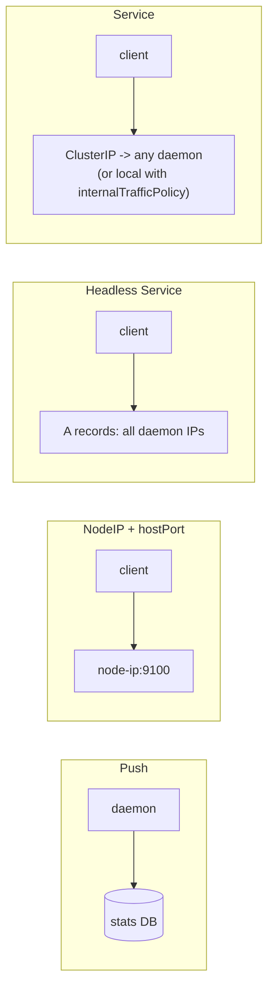

# DaemonSet

## Summary

A DaemonSet makes sure that all (or some) nodes run a copy of a Pod. When a node joins, the Pod is added; when a node leaves, the Pod is garbage collected. DaemonSets run node level agents: log collectors, monitoring agents, network and storage plugins. The controller pins each Pod to its node with node affinity, adds tolerations so that the Pods also run on not-ready, pressured or unschedulable nodes, and then lets the default scheduler bind them.

## Prerequisites

- [Workloads overview](../workloads-overview.md).
- [Taints and tolerations](../../scheduling-preemption-and-eviction/taints-and-tolerations.md).

## Core concepts

### Definition

A *DaemonSet* ensures that all (or some) nodes run a copy of a Pod. As nodes are added to the cluster, Pods are added to them. As nodes are removed from the cluster, those Pods are garbage collected. Deleting a DaemonSet cleans up the Pods it created.

Typical uses:

- running a cluster storage daemon on every node,
- running a log collection daemon on every node,
- running a node monitoring daemon on every node.

In a simple case, one DaemonSet covering all nodes is used for each type of daemon. A more complex setup might use several DaemonSets for one type of daemon, with different flags or different memory and CPU requests for different hardware types.

### Running Pods on selected nodes

If you specify `.spec.template.spec.nodeSelector`, the DaemonSet controller creates Pods only on nodes that match that [node selector](https://kubernetes.io/docs/concepts/scheduling-eviction/assign-pod-node/). Likewise, with `.spec.template.spec.affinity`, it creates Pods on nodes that match that [node affinity](https://kubernetes.io/docs/concepts/scheduling-eviction/assign-pod-node/). If you specify neither, it creates Pods on all nodes.

### Scheduling

A DaemonSet can make sure that all eligible nodes run a copy of a Pod. The DaemonSet controller creates a Pod for each eligible node and adds a `spec.affinity.nodeAffinity` term to the Pod that matches the target host (by `metadata.name`). After the Pod is created, the default scheduler takes over and binds it to the target host by setting `.spec.nodeName`. If the new Pod does not fit on the node, the default scheduler may preempt (evict) some existing Pods based on the priority of the new Pod.

If it is important that the DaemonSet Pod runs on each node, set `.spec.template.spec.priorityClassName` to a PriorityClass with a higher priority to make sure this eviction happens (for example `system-node-critical` for essential node agents).

```mermaid
sequenceDiagram
  participant N as New node
  participant DC as DaemonSet controller
  participant A as kube-apiserver
  participant S as kube-scheduler
  N->>A: register Node
  A-->>DC: watch: node added
  DC->>A: create Pod with nodeAffinity (metadata.name = node) and tolerations
  A-->>S: Pod without nodeName
  S->>S: only one feasible node; preempt if needed
  S->>A: bind Pod to the node
```

### Taints and tolerations

The DaemonSet controller automatically adds a set of tolerations to DaemonSet Pods:

| Toleration key | Effect | Details |
| --- | --- | --- |
| `node.kubernetes.io/not-ready` | `NoExecute` | DaemonSet Pods can be scheduled onto nodes that are not healthy or not ready to accept Pods. DaemonSet Pods running on such nodes are not evicted. |
| `node.kubernetes.io/unreachable` | `NoExecute` | DaemonSet Pods can be scheduled onto nodes that are unreachable from the node controller. DaemonSet Pods running on such nodes are not evicted. |
| `node.kubernetes.io/disk-pressure` | `NoSchedule` | DaemonSet Pods can be scheduled onto nodes with disk pressure. |
| `node.kubernetes.io/memory-pressure` | `NoSchedule` | DaemonSet Pods can be scheduled onto nodes with memory pressure. |
| `node.kubernetes.io/pid-pressure` | `NoSchedule` | DaemonSet Pods can be scheduled onto nodes with process pressure. |
| `node.kubernetes.io/unschedulable` | `NoSchedule` | DaemonSet Pods can be scheduled onto unschedulable nodes. |
| `node.kubernetes.io/network-unavailable` | `NoSchedule` | **Only added for DaemonSet Pods that request host networking**, that is Pods with `spec.hostNetwork: true`. Such Pods can be scheduled onto nodes with unavailable network. |

You can add your own tolerations to DaemonSet Pods by defining them in the Pod template. Because the controller sets the `node.kubernetes.io/unschedulable:NoSchedule` toleration automatically, Kubernetes can run DaemonSet Pods on nodes marked as unschedulable (cordoned). This is also why `kubectl drain` needs `--ignore-daemonsets`: evicting them would be pointless, as they would come back.

Custom taints such as `node-role.kubernetes.io/control-plane:NoSchedule` are not tolerated automatically; add a toleration if the agent must run on control plane nodes.

### Communicating with daemon Pods

Possible patterns for communicating with Pods in a DaemonSet:

- **Push.** Pods in the DaemonSet send updates to another service, such as a stats database. They have no clients.
- **NodeIP and known port.** Pods use a `hostPort`, so they are reachable through the node IPs. Clients know the list of node IPs somehow and know the port by convention.
- **DNS.** Create a headless Service with the same Pod selector, then discover the daemons through EndpointSlices or by retrieving multiple A records from DNS.
- **Service.** Create a Service with the same Pod selector and use it to reach a daemon on a random node. There is no way to reach a specific node this way, unless the Service uses `internalTrafficPolicy: Local`, which sends traffic only to the daemon on the client's own node.



### Updating a DaemonSet

`.spec.updateStrategy.type` is `RollingUpdate` (default; `maxUnavailable` default 1, `maxSurge` optional) or `OnDelete` (Pods are replaced only when deleted manually). Changing node labels adds or removes Pods immediately on the affected nodes.

### Alternatives to DaemonSet

| Alternative | Comparison |
| --- | --- |
| **Init scripts** | You can run daemon processes directly on a node (with `init`, `upstartd` or `systemd`). That is fine. Running them through a DaemonSet has advantages: logs and monitoring work the same way as for applications; the same configuration language and tools (Pod templates, `kubectl`) are used for daemons and applications; and running daemons in containers with resource limits isolates them from application containers (although this can also be done by running them in containers outside Pods). |
| **Bare Pods** | You can create Pods that name a node to run on. But a DaemonSet replaces Pods that are deleted or terminated for any reason, for example after node failure or disruptive node maintenance such as a kernel upgrade. Use a DaemonSet rather than individual Pods. |
| **Static Pods** | Pods can be created by writing a file to a directory watched by the kubelet: *static Pods*. Unlike DaemonSet Pods, they cannot be managed with kubectl or other API clients (the API server shows only read-only mirror Pods). Static Pods do not depend on the API server, which makes them useful for bootstrapping the cluster (control plane components). The documentation has noted that static Pods may be deprecated in the future. |
| **Deployments** | DaemonSets are similar to Deployments in that both create Pods with processes that are not expected to terminate (web servers, storage servers). Use a Deployment for stateless services, like front ends, where scaling the number of replicas and rolling out updates matter more than controlling exactly which host runs the Pod. Use a DaemonSet when a copy of a Pod must always run on all or certain hosts, if the DaemonSet provides node level functionality that lets other Pods run correctly on that node. |

## Worked example

A node exporter style agent on Linux worker nodes only (untested here; Kubernetes v1.30 or later):

```yaml
apiVersion: apps/v1
kind: DaemonSet
metadata:
  name: node-agent
  namespace: kube-system
spec:
  selector:
    matchLabels: { app: node-agent }
  updateStrategy:
    type: RollingUpdate
    rollingUpdate: { maxUnavailable: 1 }
  template:
    metadata:
      labels: { app: node-agent }
    spec:
      priorityClassName: system-node-critical
      nodeSelector:
        kubernetes.io/os: linux
      hostNetwork: true
      containers:
        - name: agent
          image: quay.io/prometheus/node-exporter:v1.8.2
          ports:
            - containerPort: 9100
              hostPort: 9100
          resources:
            requests: { cpu: 50m, memory: 50Mi }
            limits: { memory: 100Mi }
```

```bash
kubectl apply -f node-agent.yaml
kubectl get ds -n kube-system node-agent        # DESIRED = number of Linux nodes
kubectl get pod -n kube-system -l app=node-agent -o jsonpath='{.items[0].spec.tolerations}' | tr ',' '\n' | grep key
# includes not-ready, unreachable, disk-pressure, memory-pressure, pid-pressure, unschedulable, network-unavailable
kubectl cordon <node>; kubectl get pod -n kube-system -l app=node-agent -o wide   # still running on the cordoned node
```

## Trade offs and when to use it

- **DaemonSet versus sidecars.** One agent per node is cheaper than one sidecar per Pod but shares configuration and failure domain across all Pods of the node.
- **`hostNetwork` and `hostPort`** make daemons reachable on node IPs but reduce isolation and must be allowed by Pod Security settings.
- **Resource requests on every node.** A DaemonSet's requests are reserved on every node; keep agents small.

## Common mistakes

- **No priority class for critical agents**, so they cannot be scheduled on full nodes.
- **Forgetting tolerations for tainted node pools** (GPU nodes, control plane nodes), which leaves those nodes without the agent.
- **Overlapping node selectors** between two DaemonSets of the same agent, which runs two copies on some nodes.

## Practice

1. How does the DaemonSet controller make sure a Pod lands on a specific node?
2. Why do DaemonSet Pods keep running on a node that becomes `NotReady`?
3. Which toleration is added only for `hostNetwork` Pods, and why?
4. How do you reach the daemon on the client's own node through a Service?

Answers: 1. It sets a node affinity term matching the node name; the default scheduler then binds it. 2. They automatically tolerate `not-ready` and `unreachable` with `NoExecute`. 3. `node.kubernetes.io/network-unavailable`; host network Pods do not depend on the Pod network, so they can run (and may be the network plugin itself). 4. A Service with `internalTrafficPolicy: Local`.

## Further reading

- [DaemonSet](https://kubernetes.io/docs/concepts/workloads/controllers/daemonset/), Kubernetes documentation.
- [Perform a Rolling Update on a DaemonSet](https://kubernetes.io/docs/tasks/manage-daemon/update-daemon-set/), Kubernetes documentation.
- [Static Pods](https://kubernetes.io/docs/tasks/configure-pod-container/static-pod/), Kubernetes documentation.
