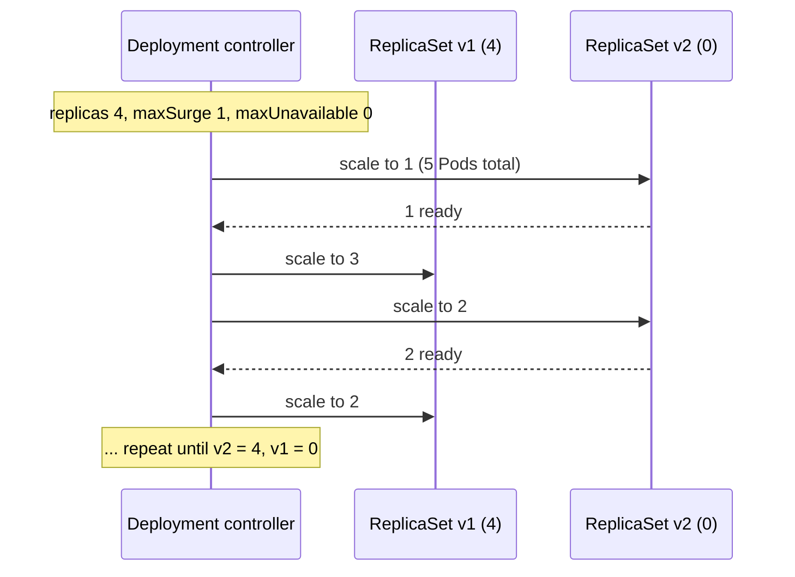
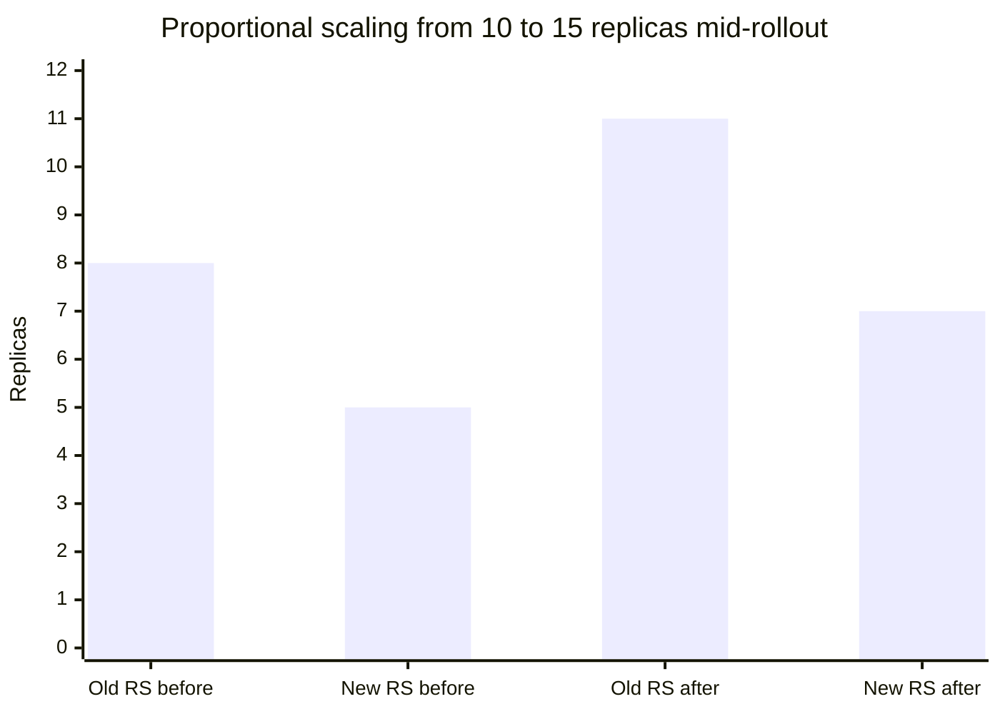
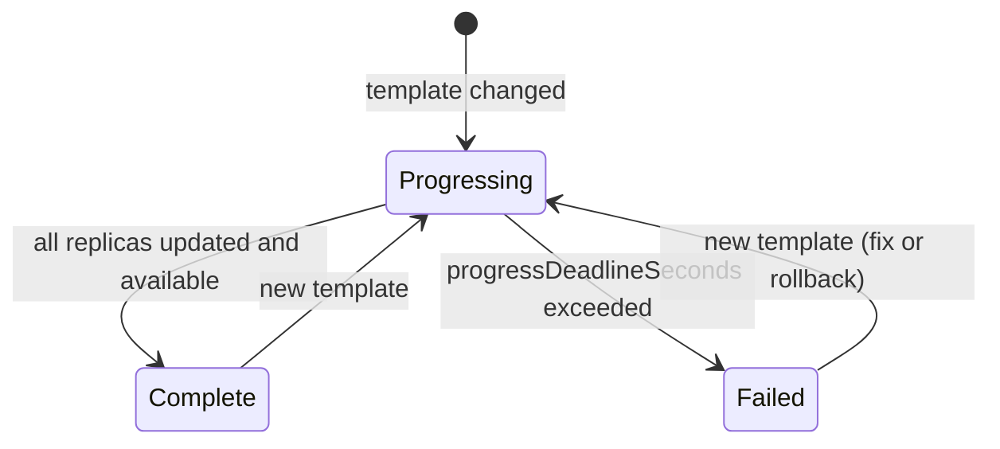

# Deployments

## Summary

A Deployment provides declarative updates for Pods and ReplicaSets. You describe a desired state (image, replicas, update strategy), and the Deployment controller changes the actual state to it at a controlled rate by creating a new ReplicaSet for every change of the Pod template and shifting replicas from the old ReplicaSets to the new one. It keeps a revision history for rollbacks, can be paused to batch changes, scales proportionally during a rollout, and reports progress through status conditions, including a deadline that marks a stuck rollout as failed.

## Prerequisites

- [ReplicaSet](replicaset.md).
- [Probes](../pods/probes.md), because readiness drives rollout progress.

## Core concepts

### Definition

A *Deployment* provides declarative updates for Pods and ReplicaSets.

You describe a *desired state* in a Deployment, and the Deployment controller changes the actual state to the desired state at a controlled rate. You can define Deployments to create new ReplicaSets, or to remove existing Deployments and adopt all their resources with new Deployments.

*Analogy.* A Deployment is like a shift manager replacing a team of workers with a newly trained team: new workers start one or two at a time, an old worker leaves only when a new one is ready, and the manager keeps the roster of previous teams in case the new one has to be sent home. The analogy breaks because the "old team" (the old ReplicaSet) stays on file with zero members, ready to be scaled up again on rollback.

### Use cases

- Create a Deployment to roll out a ReplicaSet. The ReplicaSet creates Pods in the background. Check the status of the rollout to see whether it succeeds.
- Declare the new state of the Pods by updating the PodTemplateSpec of the Deployment. A new ReplicaSet is created, and the Deployment moves the Pods from the old ReplicaSet to the new one at a controlled rate. Each new ReplicaSet updates the revision of the Deployment.
- Roll back to an earlier revision if the current state is not stable. Each rollback updates the revision of the Deployment.
- Scale up the Deployment to handle more load.
- Pause the rollout to apply several fixes to the PodTemplateSpec, then resume it to start a single new rollout.
- Use the status of the Deployment as an indicator that a rollout is stuck.
- Clean up older ReplicaSets that you no longer need.

### Update strategy

`.spec.strategy.type` is `RollingUpdate` (default) or `Recreate`.

- **`RollingUpdate`** replaces Pods gradually. `maxUnavailable` (default 25%) limits how many Pods may be unavailable during the update, and `maxSurge` (default 25%) limits how many Pods may exist above `replicas`. Percentages are rounded: `maxSurge` up, `maxUnavailable` down.
- **`Recreate`** kills all existing Pods before new ones are created, which causes downtime but guarantees that two versions never run at once.

The strategies and their trade offs as delivery practices are discussed in [Rolling updates](../../application-delivery/deployment-strategies/rolling-updates.md).



### Rollover (multiple updates in flight)

Each time the Deployment controller observes a new Deployment, it creates a ReplicaSet to bring up the desired Pods. If the Deployment is updated, the existing ReplicaSet that controls Pods whose labels match `.spec.selector` but whose template does not match `.spec.template` is scaled down. Eventually the new ReplicaSet is scaled to `.spec.replicas` and all old ReplicaSets are scaled to 0.

If you update a Deployment while a rollout is in progress, the Deployment creates a new ReplicaSet for the update and starts scaling it up, and it *rolls over* the ReplicaSet it was scaling up before: it adds that one to its list of old ReplicaSets and starts scaling it down.

For example, suppose you create a Deployment with 5 replicas of `nginx:1.14.2`, then update it to 5 replicas of `nginx:1.16.1` when only 3 replicas of `nginx:1.14.2` have been created. The Deployment immediately starts killing the 3 `nginx:1.14.2` Pods it created and starts creating `nginx:1.16.1` Pods. It does not wait for the 5 replicas of `nginx:1.14.2` to be created before changing course.

### Pausing and resuming a rollout

When you update a Deployment, or plan to, you can pause rollouts for it before you trigger one or more updates. When you are ready, you resume rollouts. This lets you apply several fixes between pausing and resuming without triggering unnecessary rollouts. A paused Deployment can still be scaled.

### Rolling back

Sometimes you want to roll back a Deployment, for example when it is not stable, such as crash looping. By default, the Deployment's rollout history is kept in the system so that you can roll back at any time (bounded by the revision history limit, see below).

A Deployment's revision is created when its rollout is triggered. A new revision is created if and only if the Pod template (`.spec.template`) changes, for example when you update labels or container images in the template. Other updates, such as scaling, do not create a revision, so that manual scaling and autoscaling can happen at the same time as rollouts. This means that a rollback restores only the Pod template part of the Deployment.

The Deployment controller stops a bad rollout automatically and stops scaling up the new ReplicaSet. How many old Pods are taken down before that depends on the rolling update parameters, `maxUnavailable` in particular, which Kubernetes sets to 25% by default. With unready new Pods, the rollout stalls at that point; it does not roll back by itself (see [Deployment status](#deployment-status)).

### Scaling

```bash
kubectl scale deployment/nginx-deployment --replicas=10
```

Assuming horizontal Pod autoscaling is enabled in the cluster, you can also set up an autoscaler for the Deployment and choose the minimum and maximum number of Pods based on the CPU utilization of the existing Pods (see [Horizontal Pod Autoscaler](../autoscaling/horizontal-pod-autoscaler.md)).

### Proportional scaling

RollingUpdate Deployments support running several versions of an application at the same time. When you or an autoscaler scale a RollingUpdate Deployment that is in the middle of a rollout (in progress or paused), the Deployment controller balances the additional replicas across the existing active ReplicaSets (ReplicaSets with Pods) to reduce risk. This is called *proportional scaling*.

**Example.** A Deployment with 10 replicas, `maxSurge: 3`, `maxUnavailable: 2` is mid-rollout to a broken image: the old ReplicaSet has 8 replicas and the new one 5 (13 = 10 + 3 surge). You scale the Deployment to 15. The 5 extra replicas are split in proportion: about 3 to the old ReplicaSet (8 of 13) and 2 to the new one (5 of 13), giving 11 and 7.



### Deployment status

A Deployment goes through several states during its lifecycle: it can be *progressing* while rolling out a new ReplicaSet, *complete*, or it can *fail to progress*.

**Progressing.** Kubernetes marks a Deployment as progressing when one of the following happens:

- The Deployment creates a new ReplicaSet.
- The Deployment scales up its newest ReplicaSet.
- The Deployment scales down its older ReplicaSets.
- New Pods become ready or available (ready for at least `minReadySeconds`).

When the rollout becomes progressing, the controller adds a condition to `.status.conditions` with `type: Progressing`, `status: "True"` and `reason: NewReplicaSetCreated`, `FoundNewReplicaSet` or `ReplicaSetUpdated`. Monitor progress with `kubectl rollout status`.

**Complete.** Kubernetes marks a Deployment as complete when:

- All replicas of the Deployment have been updated to the latest version, so any requested updates are complete.
- All replicas are available.
- No old replicas are running.

When the rollout becomes complete, the controller sets a condition with `type: Progressing`, `status: "True"` and `reason: NewReplicaSetAvailable`. This `Progressing` condition keeps the status `"True"` until a new rollout starts. It holds even when the availability of replicas changes (which affects the `Available` condition instead).

**Failed.** A Deployment can get stuck trying to deploy its newest ReplicaSet without ever completing, because of:

- insufficient quota,
- readiness probe failures,
- image pull errors,
- insufficient permissions,
- limit ranges,
- application runtime misconfiguration.

You detect this by specifying a deadline in the Deployment spec: `.spec.progressDeadlineSeconds` (default 600). It is the number of seconds the controller waits before indicating in the status that progress has stalled. Once the deadline is exceeded, the controller adds a condition with `type: Progressing`, `status: "False"` and `reason: ProgressDeadlineExceeded`. The condition can also fail early with status `"False"` for reasons such as `ReplicaSetCreateError`. The deadline is no longer considered after the rollout completes.

Kubernetes takes no action on a stalled Deployment other than reporting the condition with `reason: ProgressDeadlineExceeded`. Higher level orchestrators can use it and act, for example roll back to the previous version. `kubectl rollout status` exits with a non-zero code when the deadline is exceeded, which CI pipelines use.



**Operating on a failed Deployment.** All actions that apply to a complete Deployment also apply to a failed one: scale it up or down, roll back to a previous revision, or pause it to apply several changes to the Pod template.

### Clean up policy

`.spec.revisionHistoryLimit` sets how many old ReplicaSets of the Deployment to keep. The rest are garbage collected in the background. The default is 10. Setting it explicitly to 0 cleans up all history, and the Deployment can then not be rolled back.

### Canary deployment

To roll out a release to a subset of users or servers with Deployments, create several Deployments, one per release, behind one Service that selects both by a shared label. The canary pattern is described in [Canary deployment](../../application-delivery/deployment-strategies/canary-deployment.md).

## Worked example

The rollover example from above, then a rollback (untested here; Kubernetes v1.30 or later):

```yaml
apiVersion: apps/v1
kind: Deployment
metadata:
  name: nginx-deployment
spec:
  replicas: 5
  progressDeadlineSeconds: 120
  revisionHistoryLimit: 5
  strategy:
    type: RollingUpdate
    rollingUpdate: { maxSurge: 1, maxUnavailable: 0 }
  selector:
    matchLabels: { app: nginx }
  template:
    metadata:
      labels: { app: nginx }
    spec:
      containers:
        - name: nginx
          image: nginx:1.14.2
          readinessProbe:
            httpGet: { path: /, port: 80 }
```

```bash
kubectl apply -f nginx-deployment.yaml
kubectl set image deployment/nginx-deployment nginx=nginx:1.16.1     # revision 2
kubectl rollout status deployment/nginx-deployment
kubectl set image deployment/nginx-deployment nginx=nginx:1.161      # typo: image does not exist
kubectl rollout status deployment/nginx-deployment --timeout=150s
# error: deployment "nginx-deployment" exceeded its progress deadline
kubectl get rs                    # new RS has 1 Pod in ImagePullBackOff; old RS still has 5 (maxUnavailable 0)
kubectl rollout history deployment/nginx-deployment
kubectl rollout undo deployment/nginx-deployment --to-revision=2
kubectl get deployment nginx-deployment -o jsonpath='{.status.conditions[?(@.type=="Progressing")].reason}{"\n"}'
# NewReplicaSetAvailable
```

With `maxUnavailable: 0`, the broken rollout never reduced capacity: the old ReplicaSet kept all 5 replicas.

## Trade offs and when to use it

- **`maxSurge` and `maxUnavailable`.** Surge needs spare capacity but keeps full capacity during the rollout; unavailability needs no extra capacity but reduces it.
- **Recreate** is appropriate when two versions must never run together (for example an exclusive file lock or an incompatible schema migration) and short downtime is acceptable.
- **Deployments do not do traffic based canaries.** Pod count ratios are coarse; use a progressive delivery controller or a mesh for percentage based traffic shifting.

## Common mistakes

- **No readiness probe.** Pods count as available immediately, so a broken version replaces the old one completely.
- **Changing `.spec.selector`.** It is immutable in `apps/v1`; create a new Deployment instead.
- **Expecting automatic rollback** on `ProgressDeadlineExceeded`.
- **`revisionHistoryLimit: 0`**, which disables rollbacks.
- **Mutating ConfigMaps in place** and expecting a rollout: only template changes create revisions. Use versioned ConfigMap names or a checksum annotation.

## Practice

1. Which change creates a new revision: scaling to 10 replicas or adding a label to the Pod template?
2. With 4 replicas, `maxSurge: 25%` and `maxUnavailable: 25%`, how many Pods can exist and how many must be available during a rollout?
3. What does Kubernetes do when `progressDeadlineSeconds` is exceeded?
4. Explain rollover with the `nginx:1.14.2` to `nginx:1.16.1` example.
5. Why does a rollback not restore the replica count?

Answers: 1. Adding a label to the template. 2. At most 5 Pods (surge rounds up to 1), at least 3 available (unavailable rounds down to 1). 3. It sets `Progressing=False` with `reason: ProgressDeadlineExceeded` and does nothing else. 4. The controller does not finish the first rollout; it moves the half-created ReplicaSet to the old list and scales it down while scaling up the newest one. 5. Revisions capture only the Pod template; replicas are not part of the revision.

## Further reading

- [Deployments](https://kubernetes.io/docs/concepts/workloads/controllers/deployment/), Kubernetes documentation.
- [Performing a Rolling Update](https://kubernetes.io/docs/tutorials/kubernetes-basics/update/update-intro/), Kubernetes documentation tutorial.
- [kubectl rollout](https://kubernetes.io/docs/reference/kubectl/generated/kubectl_rollout/), Kubernetes documentation.
