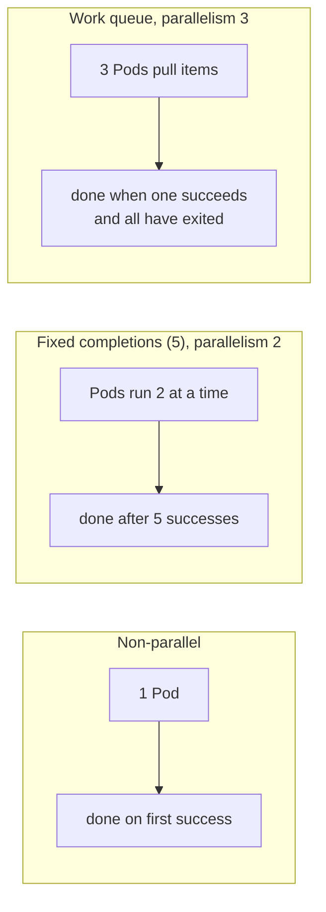
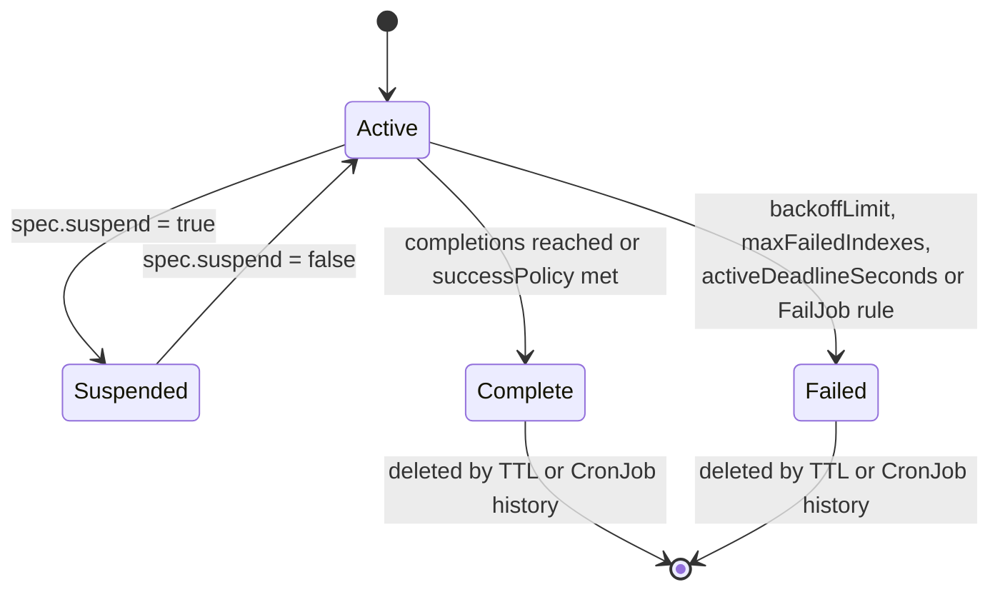

# Jobs

## Summary

A Job creates one or more Pods and retries them until a specified number of them terminate successfully; then the Job is complete. Jobs come in three shapes: non-parallel, parallel with a fixed completion count (optionally *Indexed*, where each Pod gets an index), and parallel with a work queue. Failures are counted against `backoffLimit` (or per index), and a *Pod failure policy* can fail fast on known bugs or ignore disruptions; a *success policy* can declare success early. Finished Jobs are cleaned up by CronJob history limits or the TTL controller. Advanced features let queue controllers suspend Jobs, change their scheduling directives, or take over their reconciliation entirely.

## Prerequisites

- [Pod lifecycle](../pods/pod-lifecycle.md#container-restart-policy).
- [Workloads overview](../workloads-overview.md).

## Core concepts

### Definition

A Job creates one or more Pods and keeps retrying execution of the Pods until a specified number of them terminate successfully. As Pods complete successfully, the Job tracks the successful completions. When the specified number of successful completions is reached, the task (the Job) is complete. Deleting a Job cleans up the Pods it created. Suspending a Job deletes its active Pods until the Job is resumed.

A simple case is to create one Job object to reliably run one Pod to completion. The Job starts a new Pod if the first Pod fails or is deleted (for example because of a node hardware failure or a node reboot). You can also use a Job to run several Pods in parallel. To run Jobs on a schedule, use a CronJob (planned note).

### Parallel execution for Jobs

There are three main types of task suitable to run as a Job:

1. **Non-parallel Jobs**
   - Normally only one Pod is started, unless the Pod fails.
   - The Job is complete as soon as its Pod terminates successfully.
2. **Parallel Jobs with a fixed completion count**
   - Specify a non-zero positive value for `.spec.completions`.
   - The Job represents the overall task and is complete when there are `.spec.completions` successful Pods.
   - With `.spec.completionMode="Indexed"`, each Pod gets a different index in the range 0 to `.spec.completions-1`.
3. **Parallel Jobs with a work queue**
   - Do not specify `.spec.completions`; it defaults to `.spec.parallelism`.
   - The Pods must coordinate among themselves or with an external service to decide what each one works on. For example, a Pod might fetch a batch of up to N items from the work queue.
   - Each Pod can independently determine whether all its peers are done, and thus whether the entire Job is done.
   - When *any* Pod of the Job terminates with success, no new Pods are created.
   - Once at least one Pod has terminated with success and all Pods are terminated, the Job is completed with success.
   - Once any Pod has exited with success, no other Pod should still be doing any work or writing output. They should all be exiting.

For a *non-parallel* Job, leave both `.spec.completions` and `.spec.parallelism` unset; both default to 1. For a *fixed completion count* Job, set `.spec.completions` to the number of completions needed; you can set `.spec.parallelism` or leave it at its default of 1. For a *work queue* Job, leave `.spec.completions` unset and set `.spec.parallelism` to a non-negative integer.



### Controlling parallelism

The requested parallelism (`.spec.parallelism`) can be set to any non-negative value. If unspecified, it defaults to 1. If set to 0, the Job is effectively paused until it is increased.

Actual parallelism (the number of Pods running at any instant) may be more or less than requested, for several reasons:

- For fixed completion count Jobs, the number of Pods running in parallel does not exceed the number of remaining completions. Higher values of `.spec.parallelism` are effectively ignored.
- For work queue Jobs, no new Pods are started after any Pod has succeeded; the remaining Pods are allowed to complete.
- The Job controller has not had time to react.
- The Job controller failed to create Pods for some reason (lack of `ResourceQuota`, lack of permission, and so on), so there may be fewer Pods than requested.
- The Job controller may throttle new Pod creation because of excessive previous Pod failures in the same Job.
- A Pod that is shut down gracefully takes time to stop.

### Completion mode

Jobs with a fixed completion count (non-null `.spec.completions`) can have a completion mode in `.spec.completionMode`:

- **`NonIndexed`** (default): the Job is complete when there have been `.spec.completions` successfully completed Pods. Every Pod completion is equivalent to any other. Jobs with null `.spec.completions` are implicitly `NonIndexed`.
- **`Indexed`**: the Pods of a Job get a completion index from 0 to `.spec.completions-1`. The index is available through four mechanisms:
  - the Pod annotation `batch.kubernetes.io/job-completion-index`,
  - the Pod label `batch.kubernetes.io/job-completion-index` (v1.28 and later; needs the `PodIndexLabel` feature gate, enabled by default),
  - the Pod host name, with the pattern `$(job-name)-$(index)`; combined with a headless Service, Pods of an Indexed Job can address each other through DNS by these deterministic host names,
  - the environment variable `JOB_COMPLETION_INDEX` in the container.

The Job is complete when there is one successfully completed Pod for each index.

### Handling Pod and container failures

A container in a Pod may fail for several reasons, for example because its process exited with a non-zero code, or because it was killed for exceeding a memory limit. If this happens and `.spec.template.spec.restartPolicy = "OnFailure"`, the Pod stays on the node but the container is re-run. Your program must therefore handle being restarted locally, or you specify `.spec.template.spec.restartPolicy = "Never"`.

An entire Pod can also fail, for example when it is kicked off its node (the node is upgraded, rebooted or deleted), or when a container fails and `.spec.template.spec.restartPolicy = "Never"`. When a Pod fails, the Job controller starts a new Pod. Your application must therefore handle being restarted in a new Pod: temporary files, locks, incomplete output and the like from previous runs.

By default, each Pod failure counts towards the `.spec.backoffLimit` limit (see below). You can customize the handling of Pod failures with a Pod failure policy. You can also count failures independently for each index of an Indexed Job with `.spec.backoffLimitPerIndex`.

Even if you set `.spec.parallelism = 1`, `.spec.completions = 1` and `.spec.template.spec.restartPolicy = "Never"`, the same program may sometimes be started twice. Make the work idempotent.

### Pod backoff failure policy

Sometimes you want a Job to fail after some retries because of a logical error in its configuration. Set `.spec.backoffLimit` to the number of retries before the Job is considered failed. The default is 6. Failed Pods of the Job are recreated by the Job controller with an exponential backoff delay (10 s, 20 s, 40 s ...) capped at six minutes.

The number of retries is calculated in two ways:

- the number of Pods with `.status.phase = "Failed"`,
- with `restartPolicy = "OnFailure"`, the number of retries in all containers of Pods with `.status.phase` equal to `Pending` or `Running`.

If either calculation reaches `.spec.backoffLimit`, the Job is considered failed.

### Backoff limit per index

For an Indexed Job, `.spec.backoffLimitPerIndex` sets the retry limit per index. When an index exceeds its limit, it is marked as failed and listed in `.status.failedIndexes`. Succeeded indexes are recorded in `.status.completedIndexes`. The Job keeps running the other indexes; at the end it is marked as failed if any index failed, even if others succeeded. Use `.spec.maxFailedIndexes` to cap the number of failed indexes: when it is exceeded, the controller terminates all running Pods and marks the Job as failed.

### Pod failure policy

A Pod failure policy, defined in `.spec.podFailurePolicy`, lets the cluster handle Pod failures based on container exit codes and Pod conditions.

In some situations you want better control over Pod failures than the backoff policy based on `.spec.backoffLimit` gives. Examples:

- To optimize the cost of running workloads by avoiding unnecessary Pod restarts, terminate a Job as soon as one of its Pods fails with an exit code that indicates a software bug.
- To guarantee that a Job finishes despite disruptions, ignore Pod failures caused by disruptions (such as preemption, API-initiated eviction or taint-based eviction), so that they do not count towards `.spec.backoffLimit`.

The policy is a list of rules, evaluated in order; the first matching rule decides. Each rule has an `action` (`FailJob`, `Ignore`, `Count`, or `FailIndex` for Indexed Jobs with a per-index backoff limit) and a requirement: `onExitCodes` or `onPodConditions`. Using a Pod failure policy requires `restartPolicy: Never`.

```yaml
podFailurePolicy:
  rules:
    - action: FailJob
      onExitCodes:
        containerName: main      # optional
        operator: In             # one of: In, NotIn
        values: [42]
    - action: Ignore             # one of: Ignore, FailJob, Count
      onPodConditions:
        - type: DisruptionTarget # indicates Pod disruption
```

The first rule fails the whole Job when the `main` container exits with code 42 (a known bug, retrying is pointless). The second rule ignores failures of Pods that carry the `DisruptionTarget` condition (see [Disruptions](../pods/disruptions.md#pod-disruption-conditions)), so they do not consume the backoff limit.

### Success policy

When you create an Indexed Job, you can define when it can be declared as succeeded with `.spec.successPolicy`, based on the Pods that succeeded.

By default, a Job succeeds when the number of succeeded Pods equals `.spec.completions`. Situations where you want more control:

- When running simulations with different parameters, you might not need all simulations to succeed for the overall Job to be successful.
- With a leader-worker pattern, only the success of the leader determines the success or failure of the Job. Examples are frameworks such as MPI and PyTorch.

After the Job meets the success policy, the Job controller terminates the lingering Pods. A success policy is defined by rules. Each rule takes one of these forms:

- **Only `succeededIndexes`**: once all indexes in `succeededIndexes` succeed, the Job is marked as succeeded. `succeededIndexes` is a list of intervals between 0 and `.spec.completions-1`.
- **Only `succeededCount`**: once the number of succeeded indexes reaches `succeededCount`, the Job is marked as succeeded.
- **Both**: once the number of succeeded indexes from the subset in `succeededIndexes` reaches `succeededCount`, the Job is marked as succeeded.

```yaml
spec:
  parallelism: 10
  completions: 10
  completionMode: Indexed     # required for the success policy
  successPolicy:
    rules:
      - succeededIndexes: 0,2-3
        succeededCount: 1
  template:
    # ...
```

Here the Job succeeds as soon as any one of indexes 0, 2 or 3 succeeds; the remaining Pods are then terminated.

### Job termination and cleanup

When a Job completes, no more Pods are created, but the Pods are [usually](https://kubernetes.io/docs/concepts/workloads/controllers/job/#pod-backoff-failure-policy) not deleted either. Keeping them lets you view the logs of completed Pods to check for errors, warnings or other diagnostic output. The Job object also remains after completion so that you can view its status. It is up to the user to delete old Jobs after noting their status.

By default, a Job runs uninterrupted unless a Pod fails (`restartPolicy=Never`) or a container exits in error (`restartPolicy=OnFailure`), in which case the Job defers to `.spec.backoffLimit`. Once `.spec.backoffLimit` is reached, the Job is marked as failed and any running Pods are terminated.

Another way to terminate a Job is an active deadline: set `.spec.activeDeadlineSeconds` to a number of seconds. It applies to the duration of the Job, no matter how many Pods are created. Once a Job reaches `activeDeadlineSeconds`, all its running Pods are terminated and the Job status becomes `type: Failed` with `reason: DeadlineExceeded`. `activeDeadlineSeconds` takes precedence over `backoffLimit`.

The `restartPolicy` applies to the Pod, not to the Job itself: there is no automatic Job restart once the Job status is `type: Failed`. The termination mechanisms `.spec.activeDeadlineSeconds` and `.spec.backoffLimit` result in a permanent failure that requires manual intervention.



### Clean up finished Jobs automatically

Finished Jobs are usually no longer needed. Keeping them puts pressure on the API server. If the Jobs are managed by a higher level controller such as a CronJob, the CronJob can clean them up based on its capacity based cleanup policy (`successfulJobsHistoryLimit`, `failedJobsHistoryLimit`).

**TTL mechanism.** Another way to clean up finished Jobs (`Complete` or `Failed`) automatically is the TTL controller for finished resources: set `.spec.ttlSecondsAfterFinished`. When the TTL controller cleans up the Job, it deletes it cascadingly, that is together with its dependent objects such as Pods. Lifecycle guarantees of the deletion, such as finalizers, are honored. If the field is `0`, the Job can be deleted immediately after it finishes. If it is unset, the TTL controller does not clean the Job up.

### Job patterns

The Job object can process a set of independent but related *work items*: emails to send, frames to render, files to transcode, ranges of keys in a NoSQL database to scan, and so on. In a complex system there may be several sets of work items; here we consider one set that the user wants to manage together, a *batch job*.

There are several patterns for parallel computation, each with strengths and weaknesses. The trade offs are:

- One Job object per work item, or one Job object for all work items. One Job per item creates overhead for the user and for the system, which has to manage many Job objects. One Job for all items is better for large numbers of items.
- Number of Pods equal to the number of work items, or each Pod processing several items. When Pods equal items, the Pods typically need fewer changes to existing code and containers. Each Pod processing several items is better for large numbers of items.
- Several approaches use a work queue. This requires running a queue service and modifying the program or container to use the queue. Other approaches are easier to adapt to an existing containerized application.
- When the Job is associated with a headless Service, the Pods of the Job can communicate with each other to collaborate in a computation.

| Pattern | Single Job object | Fewer Pods than work items? | Use app unmodified? |
| --- | --- | --- | --- |
| Queue with Pod per work item | Yes | No | Sometimes |
| Queue with variable Pod count | Yes | Yes | No |
| Indexed Job with static work assignment | Yes | No | Yes |
| Job with Pod-to-Pod communication | Yes | Sometimes | Sometimes |
| Job template expansion | No | No | Yes |

The required settings of `.spec.parallelism` and `.spec.completions` for each pattern, where `W` is the number of work items:

| Pattern | `.spec.completions` | `.spec.parallelism` |
| --- | --- | --- |
| Queue with Pod per work item | W | any |
| Queue with variable Pod count | null | any |
| Indexed Job with static work assignment | W | any |
| Job with Pod-to-Pod communication | W | W |
| Job template expansion | 1 | should be 1 |

### Advanced usage

**Suspending a Job.** When a Job is created, the Job controller immediately starts creating Pods and continues until the Job is complete. You may want to suspend a Job and resume it later, or create Jobs in a suspended state and let a custom controller decide when to start them. Set `.spec.suspend` to true to suspend; set it to false to resume. Creating a Job with `.spec.suspend: true` creates it suspended. When a Job is resumed, its `.status.startTime` is reset to the current time, so the `.spec.activeDeadlineSeconds` timer stops and resets across suspension. When you suspend a Job, running Pods that are not `Completed` are terminated with SIGTERM; their graceful termination period is honored, and the Pod should handle the signal in that time (save progress, undo changes). Pods terminated this way do not count towards the Job's `completions`.

**Mutable scheduling directives.** Parallel Jobs often need constraints such as all Pods in the same zone or all on the same GPU model. The `suspend` field lets custom queue controllers decide *when* a Job starts, but not *where* its Pods run after it is unsuspended. This feature allows changing a Job's scheduling directives (node affinity, node selector, tolerations, labels, annotations, scheduling gates of the Pod template) before it starts, which lets custom queue controllers influence Pod placement while leaving the actual Pod-to-node assignment to kube-scheduler. It applies only to suspended Jobs that have never been resumed. Kueue is an example of a queue controller that uses it.

**Specifying your own Pod selector.** Normally the Job controller sets the Pod selector (based on a generated `controller-uid` label). You might need to override it by specifying `.spec.selector` (with `manualSelector: true`). Be very careful: if the selector is not unique to the Job's Pods and matches unrelated Pods, Pods of the unrelated Job may be deleted, this Job may count other Pods as completing it, or one or both Jobs may refuse to create Pods or run to completion. With a non-unique selector, other controllers (for example a ReplicationController) and their Pods may behave unpredictably too. Kubernetes does not stop you from making this mistake.

**Job tracking with finalizers.** The control plane keeps track of the Pods of every Job and notices if any Pod is removed from the API server. To do that, the Job controller creates Pods with the finalizer `batch.kubernetes.io/job-tracking`. The controller removes the finalizer only after the Pod has been accounted for in the Job status, which then lets other controllers or users remove the Pod.

**Elastic Indexed Jobs.** You can scale Indexed Jobs up or down by changing both `.spec.parallelism` and `.spec.completions` together so that `.spec.parallelism == .spec.completions`. When the `ElasticIndexedJob` feature gate on the API server is disabled, `.spec.completions` is immutable. Use cases include batch workloads that need to scale an Indexed Job, such as MPI, Horovod, Ray and PyTorch training jobs.

**Delayed creation of replacement Pods.** You can choose to create replacement Pods only when the terminating Pod is fully terminal (has `status.phase: Failed`): set `.spec.podReplacementPolicy: Failed`. The default depends on whether the Job has a `podFailurePolicy`. Without one, omitting `podReplacementPolicy` selects `TerminatingOrFailed`: the control plane creates replacement Pods immediately when Pods are deleted (as soon as it sees a `deletionTimestamp`). With a Pod failure policy, the default is `Failed`, and no other value is permitted. Delaying replacement avoids two Pods of the same index running at once (important for frameworks that cannot tolerate duplicates) at the cost of slower recovery.

**Delegating management of a Job to an external controller.** You can disable the built-in Job controller for a specific Job and delegate its reconciliation to an external controller by setting `spec.managedBy` to any value other than `kubernetes.io/job-controller`. The value is immutable. Multi-cluster dispatchers such as MultiKueue use this to run the Job in another cluster while mirroring its status.

TODO: Verify the current maturity (beta or stable) of `backoffLimitPerIndex`, `successPolicy`, `podReplacementPolicy`, `managedBy` and elastic Indexed Jobs against the v1.37 documentation.

## Worked example

An Indexed Job that processes ten shards with a failure policy and automatic cleanup (untested here; Kubernetes v1.31 or later):

```yaml
apiVersion: batch/v1
kind: Job
metadata:
  name: shards
spec:
  completions: 10
  parallelism: 3
  completionMode: Indexed
  backoffLimitPerIndex: 2
  maxFailedIndexes: 3
  ttlSecondsAfterFinished: 3600
  activeDeadlineSeconds: 1800
  podFailurePolicy:
    rules:
      - action: FailIndex
        onExitCodes: { containerName: worker, operator: In, values: [42] }
      - action: Ignore
        onPodConditions: [{ type: DisruptionTarget }]
  template:
    spec:
      restartPolicy: Never
      containers:
        - name: worker
          image: busybox:1.36
          command: ["sh", "-c", "echo processing shard $JOB_COMPLETION_INDEX; [ $JOB_COMPLETION_INDEX -ne 7 ] || exit 42"]
```

```bash
kubectl apply -f shards.yaml
kubectl get pods -l job-name=shards -L batch.kubernetes.io/job-completion-index
kubectl get job shards -o jsonpath='{.status.completedIndexes} / failed: {.status.failedIndexes}{"\n"}'
# 0-6,8-9 / failed: 7
kubectl get job shards -o jsonpath='{.status.conditions[*].type}{"\n"}'   # ... Failed (one index failed)
```

Index 7 exits with code 42, which the `FailIndex` rule marks as failed immediately without retries; all other indexes succeed; the Job ends `Failed` because an index failed, and it is deleted an hour later by the TTL controller.

## Trade offs and when to use it

- **`OnFailure` or `Never`.** `OnFailure` restarts containers in place (faster, but logs of failed attempts are lost and counting is per container); `Never` creates new Pods (keeps failed Pods for debugging; required for Pod failure policies).
- **Indexed Jobs** give static work assignment without a queue service, but need the work to be partitionable up front.
- **Queues** handle uneven work and dynamic item counts, at the cost of running a queue and changing the program.
- **Native Jobs or batch frameworks.** For gang scheduling, quotas and fair sharing between teams, add a queueing layer (Kueue, Volcano) on top of Jobs.

## Common mistakes

- **Non-idempotent work.** Pods may run twice even with parallelism 1.
- **Forgetting cleanup.** Thousands of finished Jobs and Pods slow down the API server; set `ttlSecondsAfterFinished` or CronJob history limits.
- **Expecting a failed Job to restart.** It does not; create a new Job.
- **Custom selectors** that match other Pods.
- **Long running sidecars as regular containers**, which keep Pods from completing (use [native sidecars](../pods/sidecar-containers.md#jobs)).

## Practice

1. Which settings define a work queue Job, and when is it complete?
2. Name the four ways an Indexed Job's Pod learns its index.
3. A Job has `backoffLimit: 6` and `activeDeadlineSeconds: 60`; Pods keep failing quickly. What ends the Job, and with which reason?
4. Write a Pod failure policy rule that stops wasting retries on exit code 2 of container `main`.
5. What happens to running Pods when a Job is suspended, and do they count as completions?

Answers: 1. `completions` unset, `parallelism` set; complete when at least one Pod succeeded and all Pods have terminated. 2. Annotation, label, host name, `JOB_COMPLETION_INDEX` environment variable. 3. Whichever comes first: with fast failures and exponential backoff, the deadline of 60 s usually ends it with `reason: DeadlineExceeded` (otherwise `BackoffLimitExceeded`). 4. `{action: FailJob, onExitCodes: {containerName: main, operator: In, values: [2]}}`. 5. They receive SIGTERM and are terminated within their grace period; they do not count towards completions.

## Further reading

- [Jobs](https://kubernetes.io/docs/concepts/workloads/controllers/job/), Kubernetes documentation.
- [Automatic Cleanup for Finished Jobs](https://kubernetes.io/docs/concepts/workloads/controllers/ttlafterfinished/), Kubernetes documentation.
- [Handling retriable and non-retriable pod failures with Pod failure policy](https://kubernetes.io/docs/tasks/job/pod-failure-policy/), Kubernetes documentation.
- [Kueue](https://kueue.sigs.k8s.io/), Kubernetes SIG Scheduling. Job queueing built on suspend and mutable scheduling directives.
