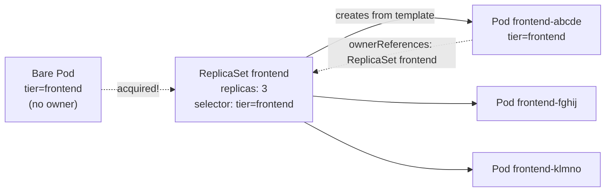
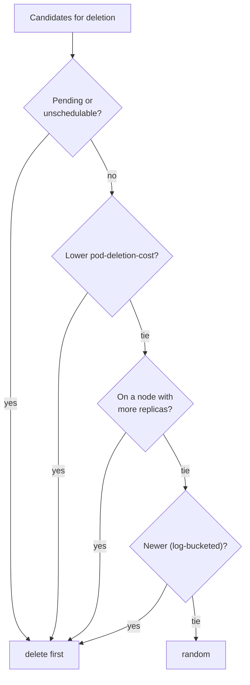

# ReplicaSet

## Summary

A ReplicaSet keeps a stable set of identical replica Pods running at any given time. It uses a label selector to find the Pods it owns, a Pod template to create new ones, and `ownerReferences` to record ownership. It creates or deletes Pods until the number of matching Pods equals `.spec.replicas`, and it follows a defined order when it scales down. You rarely create ReplicaSets directly: Deployments create and manage them and add rolling updates on top.

## Prerequisites

- [Pod overview](../pods/pod-overview.md).
- Labels and selectors (planned in [Overview](../../overview/README.md)).

## Core concepts

### Definition

A ReplicaSet's purpose is to maintain a stable set of replica Pods running at any given time. It is therefore often used to guarantee the availability of a specified number of identical Pods.

### How it works

A ReplicaSet is defined by three fields: a *selector* that specifies how to identify Pods it can acquire, a number of *replicas* that says how many Pods it should maintain, and a *Pod template* with the data of new Pods it creates to meet the replica count. It fulfills its purpose by creating and deleting Pods as needed to reach the desired number, using the template for new Pods.

A ReplicaSet is linked to its Pods through the Pods' `metadata.ownerReferences` field, which says which resource owns the object. All Pods acquired by a ReplicaSet have the ReplicaSet's identifying information in their `ownerReferences`. This is how the ReplicaSet knows the state of the Pods it maintains and plans accordingly.

A ReplicaSet identifies new Pods to acquire with its selector. If a Pod has no OwnerReference, or the OwnerReference is not a controller, and it matches a ReplicaSet's selector, the ReplicaSet immediately acquires it.



The reconcile loop compares the number of owned, active Pods that match the selector with `.spec.replicas` and creates or deletes the difference.

### When to use a ReplicaSet

A ReplicaSet makes sure that a given number of Pod replicas run at any time. A Deployment is a higher level concept that manages ReplicaSets and provides declarative updates to Pods along with many other useful features. Use Deployments instead of ReplicaSets directly, unless you need custom update orchestration or do not need updates at all.

This means that you may never need to manipulate ReplicaSet objects: use a Deployment and define your application in its `spec`.

### Non-template Pod acquisitions

You can create bare Pods without problems, but make sure they do not have labels that match the selector of one of your ReplicaSets. A ReplicaSet is not limited to owning Pods specified by its template; it can acquire other Pods as described above. If you create a bare Pod with matching labels after the ReplicaSet has reached its count, the ReplicaSet acquires it and then deletes it (or another Pod) because it now has too many. If you create matching bare Pods first, the ReplicaSet acquires them and creates fewer Pods from its template, so your replicas may run a different image than the template says.

### The manifest

As with all other Kubernetes API objects, a ReplicaSet needs the `apiVersion`, `kind` and `metadata` fields. For ReplicaSets, `kind` is always `ReplicaSet`.

When the control plane creates new Pods for a ReplicaSet, the `.metadata.name` of the ReplicaSet is part of the basis for naming those Pods. The name must be a valid DNS subdomain, but this can produce unexpected results for Pod host names. For best compatibility, follow the more restrictive rules for a DNS label. A ReplicaSet also needs a `.spec` section.

**Pod template.** `.spec.template` is a Pod template that must have labels. In the `frontend.yaml` example below there is one label, `tier: frontend`. Be careful not to overlap with the selectors of other controllers, or they may try to adopt the Pod. For the template's restart policy, `.spec.template.spec.restartPolicy`, the only allowed value is `Always`, which is the default.

**Pod selector.** `.spec.selector` is a label selector: the labels used to identify potential Pods to acquire. In a ReplicaSet, `.spec.template.metadata.labels` must match `.spec.selector`, or the API rejects it. For two ReplicaSets with the same `.spec.selector` but different `.spec.template.metadata.labels` and `.spec.template.spec`, each ReplicaSet ignores the Pods created by the other. (Overlapping selectors are still a bad idea; ownership becomes hard to reason about.)

**Replicas.** `.spec.replicas` sets how many Pods should run concurrently. The ReplicaSet creates or deletes Pods to match it. If unset, it defaults to 1.

### Management

**Deleting a ReplicaSet and its Pods.** Use `kubectl delete`. The [garbage collector](https://kubernetes.io/docs/concepts/architecture/garbage-collection/) automatically deletes all dependent Pods by default. With the REST API or `client-go`, set `propagationPolicy` to `Background` or `Foreground` in the `DeleteOptions`:

```bash
kubectl proxy --port=8080 &
curl -X DELETE 'localhost:8080/apis/apps/v1/namespaces/default/replicasets/frontend' \
  -d '{"kind":"DeleteOptions","apiVersion":"v1","propagationPolicy":"Foreground"}' \
  -H "Content-Type: application/json"
```

**Deleting only a ReplicaSet.** Delete it without affecting its Pods with `kubectl delete --cascade=orphan`. With the REST API or `client-go`, set `propagationPolicy` to `Orphan`:

```bash
curl -X DELETE 'localhost:8080/apis/apps/v1/namespaces/default/replicasets/frontend' \
  -d '{"kind":"DeleteOptions","apiVersion":"v1","propagationPolicy":"Orphan"}' \
  -H "Content-Type: application/json"
```

Once the original is deleted, you can create a new ReplicaSet to replace it. As long as the old and new `.spec.selector` are the same, the new one adopts the old Pods. It does not make the existing Pods match a new, different template; use a Deployment for controlled updates.

**Isolating Pods from a ReplicaSet.** Remove Pods from a ReplicaSet by changing their labels. This takes Pods out of service for debugging or data recovery. Pods removed this way are replaced automatically (if the replica count does not also change).

**Scaling a ReplicaSet.** Update `.spec.replicas`. The ReplicaSet controller makes sure that the desired number of Pods with a matching selector is available and operational. When scaling down, it chooses which Pods to delete by sorting the available Pods with this general algorithm:

1. Pending (and unschedulable) Pods are scaled down first.
2. If the `controller.kubernetes.io/pod-deletion-cost` annotation is set, the Pod with the lower value comes first.
3. Pods on nodes with more replicas come before Pods on nodes with fewer replicas.
4. If the Pods' creation times differ, the more recently created Pod comes before the older one (creation times are bucketed on an integer log scale when the `LogarithmicScaleDown` feature gate is enabled, which is the default).

If all of the above match, the selection is random.



**Pod deletion cost.** With the `controller.kubernetes.io/pod-deletion-cost` annotation, you can express which Pods to remove first when downscaling. The annotation is set on the Pod, and its range is [-2147483648, 2147483647]. It is the cost of deleting a Pod compared to other Pods of the same ReplicaSet. Pods with a lower deletion cost are deleted before Pods with a higher cost. It is best effort, and updating it frequently (for example from metrics) puts load on the API server.

**ReplicaSet as a Horizontal Pod Autoscaler target.** A ReplicaSet can be the target of a [Horizontal Pod Autoscaler](../autoscaling/horizontal-pod-autoscaler.md); an HPA can autoscale it.

### Alternatives to ReplicaSet

| Alternative | When to use it |
| --- | --- |
| **Deployment (recommended)** | A Deployment owns and manages its ReplicaSets and updates Pods with server-side rolling updates. Use it for managing ReplicaSets and Pods. |
| **Bare Pods** | Unlike bare Pods, a ReplicaSet replaces Pods that are deleted or terminated, for example after a node failure or during disruptive node maintenance such as a kernel upgrade. Use a ReplicaSet (through a Deployment) even for a single Pod: it acts like a process supervisor across nodes, while the kubelet supervises containers on one node. |
| **Job** | Use a Job for Pods that are expected to terminate on their own (batch jobs). |
| **DaemonSet** | Use a DaemonSet for Pods that provide a machine level function, such as monitoring or logging of the machine. Their lifetime is tied to the machine: they must run before other Pods start, and are safe to terminate when the machine is ready to be rebooted or shut down. |
| **ReplicationController** | The predecessor of ReplicaSet. Both serve the same purpose and behave similarly, except that a ReplicationController does not support set-based selector requirements. Prefer ReplicaSets. |

## Worked example

The `frontend.yaml` ReplicaSet referred to above (untested here; Kubernetes v1.30 or later):

```yaml
apiVersion: apps/v1
kind: ReplicaSet
metadata:
  name: frontend
  labels:
    app: guestbook
    tier: frontend
spec:
  replicas: 3
  selector:
    matchLabels:
      tier: frontend
  template:
    metadata:
      labels:
        tier: frontend
    spec:
      containers:
        - name: php-redis
          image: us-docker.pkg.dev/google-samples/containers/gke/gb-frontend:v5
```

```bash
kubectl apply -f frontend.yaml
kubectl get rs frontend                  # DESIRED 3 CURRENT 3 READY 3
# make one Pod the preferred victim, then scale down
POD=$(kubectl get pod -l tier=frontend -o name | head -1)
kubectl annotate $POD controller.kubernetes.io/pod-deletion-cost=-100
kubectl scale rs frontend --replicas=2
kubectl get pods -l tier=frontend        # the annotated Pod is gone
# isolate a Pod for debugging: change its label, a replacement is created
kubectl label $(kubectl get pod -l tier=frontend -o name | head -1) tier=debug --overwrite
kubectl get pods -L tier                 # 2 Pods with tier=frontend, 1 with tier=debug
```

## Trade offs and when to use it

- **ReplicaSet directly** is useful only for custom update tooling or educational purposes; it has no rollout or rollback.
- **Label based ownership** is flexible (adoption, isolation) but dangerous with overlapping selectors.

## Common mistakes

- **Bare Pods with labels that match a ReplicaSet**, which get adopted or deleted unexpectedly.
- **Editing a ReplicaSet's template and expecting running Pods to change.** Only new Pods use the new template.
- **Deleting a ReplicaSet owned by a Deployment.** The Deployment recreates it.

## Practice

1. How does a ReplicaSet know which Pods it owns?
2. You scale a ReplicaSet from 5 to 3. Two Pods are Pending; one Running Pod has `pod-deletion-cost: -10`. Which Pods are deleted?
3. What is the difference between `--cascade=orphan` and the default delete?
4. Why should you not create a bare Pod with the label `tier: frontend` in the example namespace?

Answers: 1. Through its selector and the `ownerReferences` field on the Pods. 2. The two Pending Pods (pending first); the annotated Pod survives because only two deletions are needed. 3. Orphan deletes only the ReplicaSet and keeps its Pods; the default also deletes the dependent Pods through the garbage collector. 4. The ReplicaSet would acquire it and then delete a Pod to restore the count of 3.

## Further reading

- [ReplicaSet](https://kubernetes.io/docs/concepts/workloads/controllers/replicaset/), Kubernetes documentation.
- [Garbage Collection](https://kubernetes.io/docs/concepts/architecture/garbage-collection/), Kubernetes documentation. Owner references and cascading deletion.
- [Labels and Selectors](https://kubernetes.io/docs/concepts/overview/working-with-objects/labels/), Kubernetes documentation.
