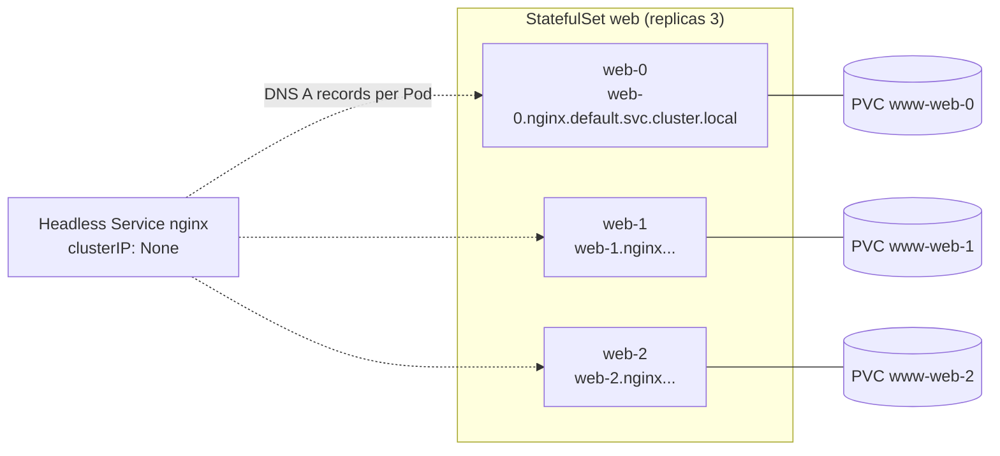
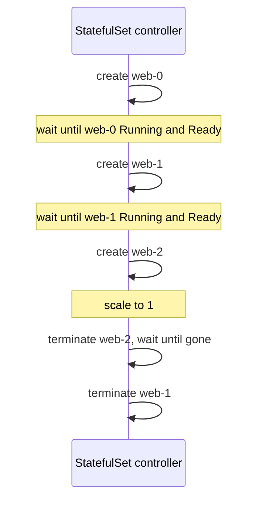

# StatefulSets

## Summary

A StatefulSet manages stateful applications. Like a Deployment, it runs Pods from one template, but each Pod gets a sticky identity: an ordinal index (`web-0`, `web-1` ...), a stable DNS name through a headless Service, and its own PersistentVolumeClaim from a `volumeClaimTemplate` that follows it across rescheduling. By default Pods are created, scaled and updated one at a time in order, which suits databases, brokers and quorum systems. The price is slower operations, manual volume cleanup and a rollout that can get stuck and needs manual repair.

## Prerequisites

- [Deployments](deployments.md).
- [Services](../../services-and-networking/services.md#headless-services) (headless Services).
- [Volumes](../../storage/volumes.md) (PersistentVolumeClaims).

## Core concepts

### Definition

StatefulSet is the workload API object used to manage stateful applications. It manages the deployment and scaling of a set of Pods, *and provides guarantees about the ordering and uniqueness* of these Pods.

Like a Deployment, a StatefulSet manages Pods that are based on an identical container spec. Unlike a Deployment, a StatefulSet maintains a sticky identity for each Pod. The Pods are created from the same spec but are not interchangeable: each has a persistent identifier that it keeps across any rescheduling.

If you want storage volumes to give persistence to your workload, a StatefulSet can be part of the solution. Although individual Pods in a StatefulSet are susceptible to failure, the persistent Pod identifiers make it easier to match existing volumes to the new Pods that replace failed ones.

*Analogy.* A Deployment is a taxi rank: any car will do. A StatefulSet is a set of numbered lockers: locker 0 always gets the same key and the same contents, even if the lock is replaced. The analogy breaks at scale-down: removing locker 2 keeps its contents (the PVC) in storage until someone clears them.

### When to use it

StatefulSets are valuable for applications that require one or more of:

- stable, unique network identifiers,
- stable, persistent storage,
- ordered, graceful deployment and scaling,
- ordered, automated rolling updates.

Here, *stable* means persistent across Pod (re)scheduling. If an application does not need stable identifiers or ordered deployment, deletion or scaling, deploy it with a workload object that provides stateless replicas: a Deployment or ReplicaSet fits better.

### Limitations

- The storage for a Pod must be provisioned either by a PersistentVolume provisioner based on the requested storage class, or pre-provisioned by an administrator.
- Deleting or scaling down a StatefulSet does *not* delete the volumes associated with it. This ensures data safety, which is generally more valuable than automatically purging all related resources (see [PersistentVolumeClaim retention](#persistentvolumeclaim-retention)).
- StatefulSets require a headless Service to be responsible for the network identity of the Pods. You must create this Service.
- StatefulSets do not guarantee anything about the termination of Pods when a StatefulSet is deleted. To get ordered and graceful termination, scale the StatefulSet down to 0 before deleting it.
- With rolling updates and the default Pod management policy (`OrderedReady`), it is possible to get into a broken state that needs manual intervention (see [Forced rollback](#forced-rollback)).

### Pod identity

StatefulSet Pods have a unique identity made of an ordinal, a stable network identity and stable storage. The identity sticks to the Pod regardless of the node it is (re)scheduled on.



**Ordinal index.** For a StatefulSet with N replicas, each Pod gets an integer ordinal that is unique in the set. By default ordinals run from 0 to N-1. The controller also adds a Pod label with this index, `apps.kubernetes.io/pod-index`.

**Start ordinal.** `.spec.ordinals` is an optional field that configures the integer ordinals. It defaults to nil. If `.spec.ordinals.start` is set, Pods get ordinals from `.spec.ordinals.start` up to `.spec.ordinals.start + .spec.replicas - 1`. This was introduced behind the `StatefulSetStartOrdinal` feature gate and is stable since v1.31, so the gate is no longer needed. It helps migrate a StatefulSet between clusters or namespaces Pod by Pod.

**Stable network ID.** Each Pod derives its host name from the StatefulSet name and its ordinal: `$(statefulset name)-$(ordinal)`, for example `web-0`, `web-1`, `web-2`. A headless Service controls the domain of the Pods: `$(service name).$(namespace).svc.cluster.local`, where `cluster.local` is the cluster domain. As each Pod is created, it gets a matching DNS subdomain: `$(podname).$(governing service domain)`, where the governing Service is set by `serviceName`.

Depending on how DNS is configured, you may not be able to look up a new Pod's DNS name immediately after it starts. This happens when other clients already queried the name before the Pod existed: negative caching means that previous failed lookups are remembered and reused for a while. To discover Pods promptly after creation, you can:

- query the Kubernetes API directly (for example with a watch) instead of relying on DNS,
- decrease the caching time in the DNS provider (typically by editing the CoreDNS ConfigMap, which caches for 30 seconds).

You are responsible for creating the headless Service. Examples of how the cluster domain, Service name and StatefulSet name affect the DNS names:

| Cluster domain | Service (ns/name) | StatefulSet (ns/name) | StatefulSet domain | Pod DNS | Pod host name |
| --- | --- | --- | --- | --- | --- |
| cluster.local | default/nginx | default/web | nginx.default.svc.cluster.local | web-{0..N-1}.nginx.default.svc.cluster.local | web-{0..N-1} |
| cluster.local | foo/nginx | foo/web | nginx.foo.svc.cluster.local | web-{0..N-1}.nginx.foo.svc.cluster.local | web-{0..N-1} |
| kube.local | foo/nginx | foo/web | nginx.foo.svc.kube.local | web-{0..N-1}.nginx.foo.svc.kube.local | web-{0..N-1} |

**Stable storage.** For each entry in `volumeClaimTemplates`, each Pod gets one PersistentVolumeClaim. In the nginx example below, each Pod gets one PersistentVolume with the StorageClass `my-storage-class` and 1 GiB of provisioned storage. If no StorageClass is given, the default StorageClass is used. When a Pod is (re)scheduled onto a node, its `volumeMounts` mount the PersistentVolumes of its claims. The PersistentVolumes of the claims are not deleted when the Pods or the StatefulSet are deleted; that must be done manually (unless a retention policy says otherwise).

**Pod name label.** When the controller creates a Pod, it adds the label `statefulset.kubernetes.io/pod-name` with the Pod's name. This lets you attach a Service to one specific Pod of the StatefulSet.

**Pod index label.** The controller also labels each Pod with `apps.kubernetes.io/pod-index`, whose value is the ordinal. This lets you route traffic to a particular Pod index, filter logs and metrics by index, and more. The `PodIndexLabel` feature gate controls it; it is enabled by default (stable since v1.32).

### Deployment and scaling guarantees

- For a StatefulSet with N replicas, Pods are created sequentially, in order from 0 to N-1.
- When Pods are deleted, they are terminated in reverse order, from N-1 to 0.
- Before a scaling operation is applied to a Pod, all its predecessors must be Running and Ready.
- Before a Pod is terminated, all its successors must be completely shut down.

Set a `terminationGracePeriodSeconds` greater than 0 for StatefulSet Pods; force deleting them can break the at-most-one-Pod-per-identity guarantee.



### Pod management policies

StatefulSet lets you relax its ordering guarantees while keeping its uniqueness and identity guarantees with `.spec.podManagementPolicy`:

- **`OrderedReady`** (default) implements the behavior described above.
- **`Parallel`** tells the controller to launch or terminate all Pods in parallel and not to wait for Pods to become Running and Ready or to terminate completely before launching or terminating another Pod. This affects only scaling operations; updates are not affected.

### Update strategies

`.spec.updateStrategy` configures or disables automated rolling updates of containers, labels, resource requests and limits, and annotations of the Pods. There are two values:

- **`OnDelete`**: the controller does not update Pods automatically. Users must delete Pods manually to make the controller create new Pods that reflect changes to `.spec.template`.
- **`RollingUpdate`** (default): automated rolling updates.

**Rolling updates.** With `RollingUpdate`, the controller deletes and recreates each Pod. It proceeds in the same order as Pod termination (from the largest ordinal to the smallest), updating one Pod at a time. The control plane waits until an updated Pod is Running and Ready before updating its predecessor. If `.spec.minReadySeconds` is set, it also waits that long after the Pod becomes ready. Two optional parameters refine it: `partition` (only Pods with an ordinal greater than or equal to the partition are updated, which enables staged or canary rollouts) and `maxUnavailable` (update several Pods at once, beta).

### Forced rollback

With rolling updates and the default `OrderedReady` policy, the StatefulSet can get into a broken state that requires manual intervention.

If you update the Pod template to a configuration that never becomes Running and Ready (for example a bad binary or an application configuration error), the StatefulSet stops the rollout and waits.

In this state it is not enough to revert the Pod template to a good configuration. Because of a known issue, the StatefulSet keeps waiting for the broken Pod to become Ready (which never happens) before it tries to revert it to the working configuration.

After reverting the template, you must also delete any Pods that the StatefulSet already tried to run with the bad configuration. The StatefulSet then recreates them with the reverted template.

### PersistentVolumeClaim retention

The optional `.spec.persistentVolumeClaimRetentionPolicy` controls whether and how PVCs are deleted during the lifecycle of a StatefulSet. It was introduced behind the `StatefulSetAutoDeletePVC` feature gate (on the API server and the controller manager) and is stable since v1.32. There are two policies:

- **`whenDeleted`**: the volume retention behavior when the StatefulSet is deleted.
- **`whenScaled`**: the behavior when the replica count is reduced, for example when scaling down.

Each can be set to:

- **`Delete`**: the PVCs created from the `volumeClaimTemplate` are deleted for each Pod affected by the policy. With `whenDeleted`, all PVCs from the template are deleted after their Pods have been deleted. With `whenScaled`, only the PVCs of the replicas being scaled down are deleted, after their Pods have been deleted.
- **`Retain`** (default): PVCs from the `volumeClaimTemplate` are not affected when their Pod is deleted. This is the behavior from before the feature existed.

These policies apply **only** when Pods are removed because the StatefulSet is deleted or scaled down. A Pod that fails and is replaced keeps its PVC.

TODO: Verify the stable versions given for start ordinals (v1.31), Pod index label (v1.32) and PVC retention (v1.32) against the v1.37 documentation.

## Worked example

The nginx example referred to above (untested here; Kubernetes v1.32 or later, a StorageClass `my-storage-class` must exist):

```yaml
apiVersion: v1
kind: Service
metadata:
  name: nginx
spec:
  clusterIP: None          # headless: DNS records per Pod, no virtual IP
  selector: { app: nginx }
  ports:
    - port: 80
      name: web
---
apiVersion: apps/v1
kind: StatefulSet
metadata:
  name: web
spec:
  serviceName: nginx
  replicas: 3
  minReadySeconds: 10
  persistentVolumeClaimRetentionPolicy:
    whenDeleted: Retain
    whenScaled: Delete
  selector:
    matchLabels: { app: nginx }
  template:
    metadata:
      labels: { app: nginx }
    spec:
      terminationGracePeriodSeconds: 10
      containers:
        - name: nginx
          image: registry.k8s.io/nginx-slim:0.24
          ports:
            - containerPort: 80
              name: web
          volumeMounts:
            - name: www
              mountPath: /usr/share/nginx/html
  volumeClaimTemplates:
    - metadata:
        name: www
      spec:
        accessModes: ["ReadWriteOnce"]
        storageClassName: my-storage-class
        resources:
          requests:
            storage: 1Gi
```

```bash
kubectl apply -f web.yaml
kubectl get pods -l app=nginx -w                  # web-0, then web-1, then web-2
kubectl get pvc                                   # www-web-0, www-web-1, www-web-2
kubectl run -it --rm dns --image=busybox:1.36 -- nslookup web-0.nginx
kubectl exec web-1 -- sh -c 'echo web-1 > /usr/share/nginx/html/index.html'
kubectl delete pod web-1                          # recreated as web-1 with the same PVC
kubectl exec web-1 -- cat /usr/share/nginx/html/index.html   # web-1
kubectl scale statefulset web --replicas=2        # web-2 removed; whenScaled: Delete removes www-web-2
```

## Trade offs and when to use it

- **StatefulSet or operator.** A StatefulSet gives identity and storage, but not replication setup, failover, backups or version upgrades. For production databases, an operator built on StatefulSets usually handles those.
- **`OrderedReady` or `Parallel`.** Ordered startup is needed for leader based systems; parallel speeds up systems whose members can join in any order (for example Cassandra-like peers).
- **`partition`** enables canary updates of stateful systems.

## Common mistakes

- **Forgetting the headless Service** or giving a different `serviceName`: DNS names do not resolve.
- **Assuming scale-down deletes data.** By default PVCs stay and are reused on scale-up, possibly with stale data.
- **Expecting a template revert to fix a stuck rollout** without deleting the broken Pods.
- **Force deleting StatefulSet Pods** on an unreachable node: two Pods with the same identity can run against the same volume.

## Practice

1. In which order are Pods of a StatefulSet updated with `RollingUpdate`?
2. What is the DNS name of Pod 2 of StatefulSet `db` with headless Service `db-hl` in namespace `prod`?
3. Which policy deletes the PVC of a replica removed by scale-down?
4. What extra step does a forced rollback require?
5. What does `podManagementPolicy: Parallel` change and what not?

Answers: 1. From the highest ordinal to the lowest, one at a time, waiting for each to be Running and Ready. 2. `db-2.db-hl.prod.svc.cluster.local`. 3. `persistentVolumeClaimRetentionPolicy.whenScaled: Delete`. 4. Deleting the Pods that were created with the bad template after reverting it. 5. Scaling launches and terminates Pods in parallel; rolling updates are unchanged.

## Further reading

- [StatefulSets](https://kubernetes.io/docs/concepts/workloads/controllers/statefulset/), Kubernetes documentation.
- [StatefulSet Basics](https://kubernetes.io/docs/tutorials/stateful-application/basic-stateful-set/), Kubernetes documentation tutorial.
- [Run a Replicated Stateful Application](https://kubernetes.io/docs/tasks/run-application/run-replicated-stateful-application/), Kubernetes documentation.
