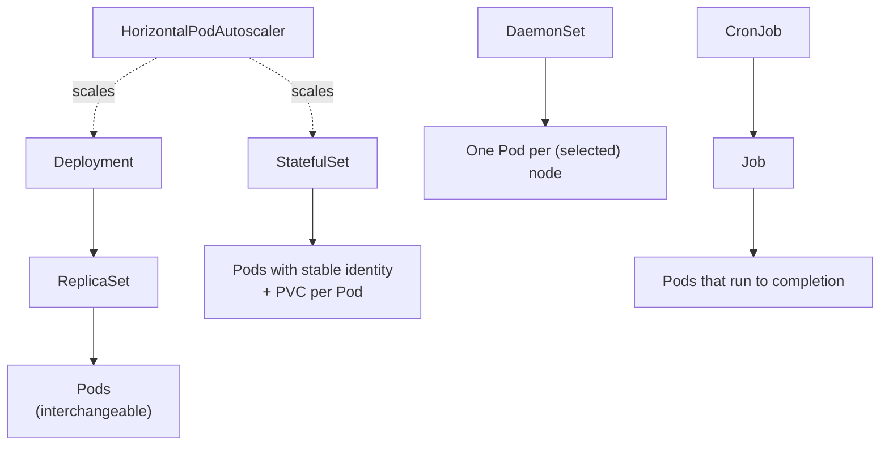
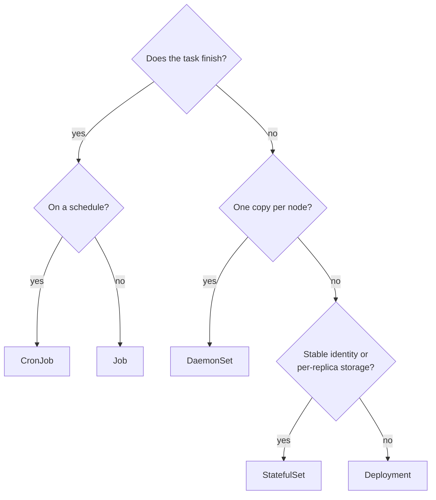

# Workloads overview

## Summary

A *workload* is an application running on Kubernetes. Whether it is one component or several that work together, it runs inside a set of Pods. Pods are mortal: a node failure kills them for good, and Kubernetes does not repair them. Instead you use *workload resources* (Deployment, ReplicaSet, StatefulSet, DaemonSet, Job, CronJob) whose controllers keep the right number of the right kind of Pods running. Choosing the workload resource is choosing the semantics: interchangeable replicas, stable identities, one Pod per node, or run to completion.

## Prerequisites

- [What is Kubernetes](../overview/what-is-kubernetes.md).
- [Container fundamentals](../containers/container-fundamentals.md).

## Core concepts

### Pods and their lifecycle

In Kubernetes, a Pod represents a set of running containers in the cluster (see [Pod overview](pods/pod-overview.md)). Pods have a defined lifecycle. For example, once a Pod is running, a critical fault on its node means that all Pods on that node fail. Kubernetes treats that level of failure as final: you would need to create a new Pod to recover, even if the node later becomes healthy.

### Workload resources

To make life easier, you do not manage each Pod directly. You use *workload resources* that manage a set of Pods on your behalf. These resources configure controllers that make sure the right number of the right kind of Pod is running, to match the state you specified.



Kubernetes provides several built-in workload resources:

| Resource | Semantics | Typical workload | Home note |
| --- | --- | --- | --- |
| Deployment and ReplicaSet (replacing the legacy ReplicationController) | Interchangeable replicas; any Pod can be replaced. A Deployment manages ReplicaSets to roll out changes. | Stateless web services and APIs | [Deployments](workload-management/deployments.md), [ReplicaSet](workload-management/replicaset.md) |
| StatefulSet | One or more related Pods that track state. Each Pod has a stable identity and can be matched with its own PersistentVolume. The code in the Pods can replicate data to other Pods of the StatefulSet to improve resilience. | Databases, message brokers, quorum systems | [StatefulSets](workload-management/statefulsets.md) |
| DaemonSet | Pods that provide node-local facilities. Every time a node that matches the DaemonSet is added, the control plane schedules a Pod for it onto the new node. Each Pod works like a system daemon on a classic Unix or POSIX server. A DaemonSet can be fundamental to the cluster (for example a network plugin), help manage the node, or add optional behavior to the container platform. | Log collectors, node monitoring, CNI and CSI node plugins | [DaemonSet](workload-management/daemonset.md) |
| Job and CronJob | Tasks that run to completion and then stop. A Job runs a task to completion once; a CronJob runs the same Job repeatedly on a schedule. | Batch processing, migrations, backups, periodic reports | [Jobs](workload-management/jobs.md) |

### Choosing a workload resource



Beyond the built-in resources, custom resources and operators add workload types (for example a `PostgresCluster` managed by an operator); see [Custom resources](../extending-kubernetes/custom-resources.md).

## Worked example

One cluster, four kinds of workload (untested here; Kubernetes v1.30 or later):

```bash
kubectl create deployment api --image=nginx:1.27 --replicas=3
kubectl create job migrate --image=busybox:1.36 -- sh -c 'echo migrating; sleep 5'
kubectl create cronjob report --image=busybox:1.36 --schedule='*/5 * * * *' -- date
kubectl get deploy,rs,job,cronjob,pods
kubectl get pod -l app=api -o jsonpath='{.items[0].metadata.ownerReferences[0].kind}{"\n"}'   # ReplicaSet
```

The `ownerReferences` show the chain Deployment, ReplicaSet, Pod. Deleting a Pod of `api` produces a replacement; deleting the Job's Pod after completion produces nothing, because the Job's desired state (one successful completion) is already met.

## Trade offs and when to use it

- **Bare Pods** are acceptable only for one-off debugging; nothing recreates them (see [Configuration best practices](../configuration/configuration-best-practices.md#naked-pods)).
- **Deployment versus StatefulSet.** StatefulSets give ordering and identity at the cost of slower, sequential rollouts and manual volume cleanup. Use them only when the application needs those guarantees.
- **Operators** add domain logic (backups, failover) but are another component to trust and upgrade.

## Common mistakes

- **Running a database as a Deployment with one shared volume.** Two replicas then fight over the same data during rollouts; use a StatefulSet or an operator.
- **Using a Deployment for node agents.** Replicas do not follow nodes; use a DaemonSet.
- **Long running "Jobs" that never exit**, which block completion and backoff logic.

## Practice

1. Why does Kubernetes not move a failed Pod to a healthy node?
2. Which workload resource would you use for a log collector on every node, and for a nightly backup?
3. Which resource actually owns the Pods of a Deployment?

Answers: 1. Pods are not rescheduled; a controller creates a new Pod instead, with a new UID. 2. DaemonSet; CronJob. 3. The ReplicaSet created by the Deployment.

## Further reading

- [Workloads](https://kubernetes.io/docs/concepts/workloads/), Kubernetes documentation.
- [Workload Management](https://kubernetes.io/docs/concepts/workloads/controllers/), Kubernetes documentation. The built-in controllers.
